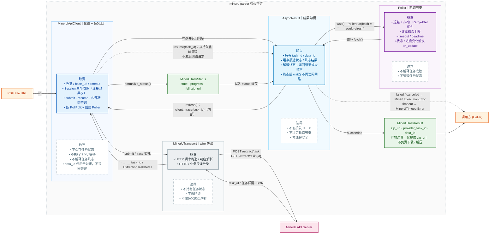
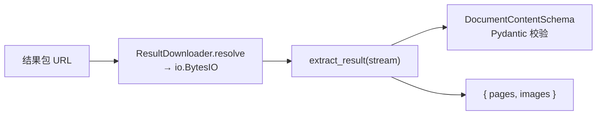
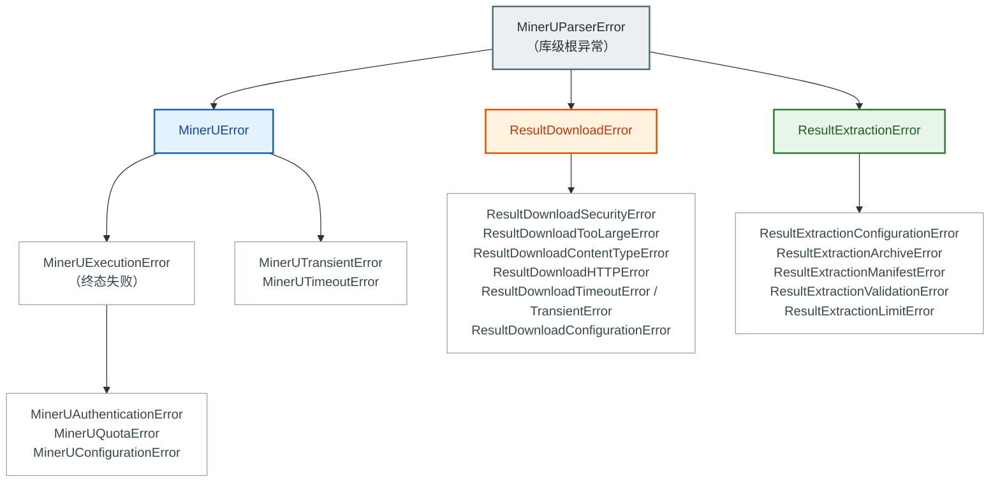

# mineru-parser

`mineru-parser` 把 MinerU 的异步文档解析流程封装成一次同步 Python 调用：**输入一个 PDF URI，输出一个 `ExtractedResult`**——包含逐页版面结构与图片字节的解析产物。

一次调用跨越三个互相独立的阶段，每个阶段都可单独替换：

| 阶段 | 模块 | 输入 | 输出 |
| --- | --- | --- | --- |
| ① 提交并等待 | [`client`](#1-client--mineruapiclient--asyncresult) | PDF URI | `MinerUTaskResult`（含 `zip_url`） |
| ② 拉取结果包 | [`downloader`](#2-downloader--resultdownloader) | `zip_url` | `io.BytesIO`（ZIP 内存流） |
| ③ 解析结果包 | [`extractor`](#3-extractor--extract_result) | ZIP 内存流 | `ExtractedResult`（`{pages, images}`） |

适合后端服务、批处理脚本和离线文档处理等需要"提交 → 等待 → 取结果"的场景。

## 快速开始

```python
from mineru_parser import MinerUApiClient, ResultDownloader, extract_result

with MinerUApiClient() as client, ResultDownloader() as downloader:  # API Key 默认读取 MINERU_API_KEY
    # ① 提交任务，立即拿到可等待的结果句柄
    task = client.submit("https://example.com/paper.pdf", data_id="doc-42")
    result = task.wait(timeout=600, on_update=lambda s: print(s.state))

    # ② 把结果包流式读进内存
    stream = downloader.resolve(result.zip_url)  # io.BytesIO，游标位于 0

    # ③ 解析结果包
    extracted = extract_result(stream)

for page in extracted["pages"]:      # list[Page]：逐页版面元素
    for block in page:
        print(block.type, block.bbox)
for image in extracted["images"]:     # list[{"path", "bytes"}]
    print(image["path"], len(image["bytes"]))
```

`ExtractedResult` 的形状：

```python
{
    "pages":  [[LayoutElement, ...], ...],        # list[Page]，元素是 Pydantic 模型
    "images": [{"path": "images/a.jpg", "bytes": b"..."}],
}
```

- **`pages`** — 按页分组的版面元素列表。元素按 `type` 判别：`title` / `paragraph` / `table` / `image` / `equation_interline` / `chart` / `list` / `algorithm` 以及页眉页脚等页级元素。
- **`images`** — 结果包内顶层 `images/` 下的图片原始字节，按 canonical path 字典序排列。

## 数据管道

```mermaid
flowchart LR
    classDef io fill:#fff3e0,stroke:#e65100,stroke-width:2px,color:#bf360c;
    classDef mod fill:#e3f2fd,stroke:#1565c0,stroke-width:2px,color:#0d47a1;
    classDef out fill:#e8f5e9,stroke:#2e7d32,stroke-width:2px,color:#1b5e20;
    classDef srv fill:#fce4ec,stroke:#ad1457,stroke-width:2px,color:#880e4f;

    URI["PDF URI"]:::io
    CLIENT["client<br/>MinerUApiClient · AsyncResult"]:::mod
    API["MinerU API Server"]:::srv
    ZIPURL["zip_url"]:::io
    DL["downloader<br/>ResultDownloader"]:::mod
    MEM["io.BytesIO<br/>ZIP 内存流"]:::io
    EX["extractor<br/>extract_result"]:::mod
    RESULT["ExtractedResult<br/>{pages, images}"]:::out

    URI -->|"① 提交"| CLIENT
    CLIENT -->|"POST /extract/task"| API
    API -->|"task_id"| CLIENT
    CLIENT -->|"GET /extract/task/{id}"| API
    API -->|"full_zip_url"| ZIPURL
    ZIPURL -->|"② 下载"| DL
    DL --> MEM
    MEM -->|"③ 解析"| EX
    EX --> RESULT
```



### 流程说明

**① client：提交 → 等待。** `submit(uri)` 把 PDF URI 交给 MinerU，返回一个 `AsyncResult` 句柄；`wait()` 阻塞轮询直到任务进入终态，成功时返回 `MinerUTaskResult`，其中的 `zip_url` 指向结果包。客户端自身不保存任务状态，因此进程重启后可用 `resume(task_id)` 接着等待，不会重复提交任务。

**② downloader：拉取结果包。** `resolve(zip_url)` 把结果包流式读进内存，返回游标位于 0 的 `io.BytesIO`。只有完整读取并关闭响应后才返回，任何失败都不会交出半截数据；默认限制单次响应体 50 MiB、总耗时 300 秒，并拒绝非公网目标与 HTTPS 降级重定向。

**③ extractor：解析结果包。** `extract_result(stream)` 从 ZIP 内存流中定位唯一的顶层 `*_content_list_v2.json`，用 `DocumentContentSchema` 做 Schema 校验，收集顶层 `images/` 下的图片，输出 `{"pages", "images"}`。全程不落盘、不解码图片、不关闭调用方流。

三个阶段各自抛出互不继承的异常（见[错误模型](#错误模型)），任何一段失败都不会留下半成品状态。

## 核心模块

### 1. client — `MinerUApiClient` / `AsyncResult`

同步客户端，负责配置、凭证与结果句柄工厂。

```python
from mineru_parser import MinerUApiClient

with MinerUApiClient() as client:  # API Key 默认读取 MINERU_API_KEY
    # 提交解析任务，立即拿到可等待的结果句柄
    submission = client.submit("https://example.com/paper.pdf", data_id="doc-42")
    result = submission.wait(timeout=600, on_update=lambda s: print(s.state))
    print(result.zip_url)

    # 进程重启后：从持久化的 task_id 恢复等待，不会重复提交
    resumed = client.resume(submission.task_id)
    result = resumed.wait(timeout=600)
```

主要能力：

- **提交并等待**：`submit()` 返回 `AsyncResult`，由句柄的 `wait()` 完成等待；也可以先提交、稍后再等待；
- **任务恢复**：持久化 `task_id` 后，可在之后的进程里通过 `resume()` 恢复等待，不会重复提交任务；
- **稳健轮询**：自动处理指数退避、随机抖动、服务端 `Retry-After` 与连续错误上限，偶发故障不会立即中断；
- **等待边界**：支持相对超时 `timeout` 和绝对截止时间 `deadline_epoch`（两者互斥），超时异常携带最后已知的任务状态；
- **进度回调**：`on_update` 在状态或解析页数变化时触发，便于上报进度；
- **错误分类**：认证、额度、瞬时、执行与超时错误分别抛出，便于调用方决定重试策略；
- **共享连接池**：客户端可跨任务复用，自建并管理 `requests.Session`；也可注入外部 Session，此时生命周期归调用方负责，`close()` 不会关闭它。

`AsyncResult` 负责解释终态：成功后返回 `MinerUTaskResult`（`zip_url` / `provider_task_id` / `data_id`），失败或取消抛 `MinerUExecutionError`，超时抛 `MinerUTimeoutError`。终态一旦观察到就不再访问网络，重复调用 `wait()` 直接返回缓存结果或抛出同一类异常。句柄不是线程安全的——多线程等待同一任务时，每个线程应各自通过 `client.resume(task_id)` 创建独立句柄。

轮询节奏由 `PollPolicy` 决定（指数退避 + 抖动，`Retry-After` 优先，连续错误上限）：

```python
from mineru_parser import MinerUApiClient, PollPolicy

policy = PollPolicy(initial_interval=3.0, max_interval=30.0, backoff=1.5, jitter=0.5)
client = MinerUApiClient(poll_policy=policy)
```

客户端内部管道：



### 2. downloader — `ResultDownloader`

同步下载器，把结果包 URL 流式读进内存。

```python
import zipfile

from mineru_parser import ResultDownloader

with ResultDownloader() as downloader:
    stream = downloader.resolve(result.zip_url)  # io.BytesIO，游标位于 0
    with zipfile.ZipFile(stream) as archive:
        ...
```

主要能力：

- **不交出半截数据**：只有完整读取并关闭响应后才返回 `BytesIO`；任何失败都直接抛异常；
- **有界读取**：默认限制单次响应体 **50 MiB**、总耗时 **300 秒**（覆盖整个 `resolve()` 调用，含重试、重定向与退避）；
- **SSRF 防护**：拒绝回环、私网、链路本地、多播、保留地址等非公网 IP，拒绝 HTTPS 降级重定向，逐跳校验重定向目标；
- **统一重试**：`DownloadRetryPolicy`（默认 3 次尝试、指数退避 + 抖动、`Retry-After` 优先）是唯一重试层；
- **URL 脱敏**：日志中的 URL 一律剔除 query 与 fragment，并移除控制字符，避免签名参数泄漏与日志注入。

```python
from mineru_parser import DownloadRetryPolicy, ResultDownloader

downloader = ResultDownloader(
    max_bytes=50 * 1024 * 1024,
    total_timeout=300.0,
    retry_policy=DownloadRetryPolicy(max_attempts=3, initial_interval=0.5, backoff=2.0),
)
```

> **注入自定义 Session 时**：请将其内部重试次数设为 0（`DownloadRetryPolicy` 是唯一重试层），且不要携带全局 `Authorization` / `Cookie` 头或 `session.auth`。

### 3. extractor — `extract_result`

结果包提取器，把 ZIP 内存流解析为结构化的页面与图片。**不下载、不重试、不落盘、不解码图片**。

```python
import io

from mineru_parser import canonicalize_member_path, extract_result

stream = io.BytesIO(zip_bytes)  # 来源不限：下载器、缓存、本地文件或测试夹具
extracted = extract_result(stream)

pages = extracted["pages"]    # list[list[LayoutElement]]，Pydantic 模型
images = extracted["images"]  # [{"path": "images/a.jpg", "bytes": b"..."}]

# manifest 中的 image_source.path 是上游原始字符串，必须用同一套规则归一后再匹配
by_path = {image["path"]: image for image in images}
for page in pages:
    for block in page:
        source = getattr(block.content, "image_source", None)
        if source is not None:
            key = canonicalize_member_path(source.path)  # 可能返回 None
            if key is not None and key in by_path:
                ...
```



契约要点：

- 只在 ZIP **顶层**定位唯一的 `*_content_list_v2.json`；缺失或多份都失败关闭；
- 只收集顶层 `images/` 下的常规文件；路径 canonical 化、按字典序排序、拒绝重复与不安全路径；
- 解压后资源受 `ExtractionLimits` 限制：manifest 16 MiB、单图 32 MiB、图片总量 160 MiB、图片 10,000 张、ZIP 成员 100,000 个；
- 不关闭调用方流，成功与失败后都会恢复游标；不落盘、不解码图片；
- 失败按 `ResultExtractionError` 的五个子类分类（配置 / 归档 / manifest / Schema / 限额），可用 `reason` / `resource` / `category` 分支。

```python
from mineru_parser import ExtractionLimits, extract_result

extracted = extract_result(stream, limits=ExtractionLimits(max_images=5_000))
```

**内存预算**：默认限额下单次调用峰值内存约 **240 MiB**；$W = 4$ 并发时约 **960 MiB**。若部署形态不同，请用 `ExtractionLimits` 覆盖 `max_total_image_bytes`（推导见 SPEC-003 §3.2）。

## 错误模型

三条失败路径互不继承，各自可单独捕获；需要"一网打尽"时用库级根异常 `MinerUParserError`。



- **client**：`MinerUTransientError` 表示请求确定未发出或只读查询失败，可以安全重试；`MinerUExecutionError` 表示结果未知、请求被拒绝或服务端明确失败。认证、额度、配置错误均继承 `MinerUExecutionError`，需要细分时先捕获更具体的类型。
- **downloader**：安全、超限、内容类型、HTTP 状态、超时与重试耗尽各有独立异常类型，公共消息不泄漏原始签名 URL。
- **extractor**：按 `reason` / `resource` / `category` 字段分支，公共消息只使用英文固定文案，不携带 manifest 正文或图片字节。

## 可观测性

三个模块都接受 `on_metric` 指标回调与 `correlation_id` 关联标识，统一走 `mineru_parser` logger。指标回调失败只记一条告警日志，不影响主流程。

```python
def on_metric(name: str, value: float, tags: dict[str, str]) -> None:
    print(name, value, tags)

client = MinerUApiClient(on_metric=on_metric, correlation_id="doc-42")
```

指标名：`mineru.submit.*`、`mineru.task.duration_ms`、`mineru.download.*`、`mineru.extract.*`。
