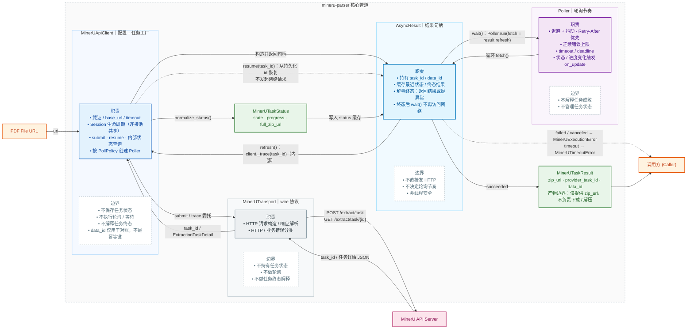

# mineru-parser

`mineru-parser` 把 MinerU 的异步文档解析流程封装成同步 Python 调用：传入 PDF 链接提交解析任务，调用方通过结果句柄等待进度，成功后返回结果包的下载地址。适合后端服务、批处理脚本和离线文档处理等需要“提交 → 等待 → 取结果”的场景。

主要功能：

- **提交并等待**：`submit()` 返回 `AsyncResult`，由句柄的 `wait()` 完成等待；也可以先提交、稍后再等待；
- **任务恢复**：持久化 `task_id` 后，可在之后的进程里通过 `resume()` 恢复等待，不会重复提交任务；
- **稳健轮询**：自动处理指数退避、随机抖动、服务端 `Retry-After` 与连续错误上限，偶发故障不会立即中断；
- **等待边界**：支持相对超时和绝对截止时间，超时异常携带最后已知的任务状态；
- **进度回调**：状态或解析页数变化时触发回调，便于上报进度；
- **错误分类**：认证、额度、瞬时、执行与超时错误分别抛出，便于调用方决定重试策略；
- **结果交付**：成功时返回 MinerU 结果包的 `zip_url`，下载与解压由调用方处理；
- **可选下载器**：`ResultDownloader` 把结果包 URL 流式读入 `io.BytesIO`，统一处理超时、重试、SSRF 防护与内存上限；不使用时 API 客户端行为不变。

```python
from mineru_parser import MinerUApiClient

with MinerUApiClient() as client:  # API Key 默认读取 MINERU_API_KEY
    # 提交解析任务，立即拿到可等待的结果句柄
    submission = client.submit("https://example.com/paper.pdf", data_id="doc-42")
    result = submission.wait(timeout=600, on_update=lambda s: print(s.state))
    print(result.zip_url)

    # 进程重启后：从持久化的 task_id 恢复等待，不会重复提交
    resumed = client.resume(submission.task_id)
    result = resumed.wait(timeout=600)
```

`MinerUApiClient` 仍然只交付 `zip_url`，不负责下载与解压；需要直接拿到内存流时，可选用独立的 `ResultDownloader`：

```python
import zipfile

from mineru_parser import MinerUApiClient, ResultDownloader

with MinerUApiClient() as client, ResultDownloader() as downloader:
    result = client.submit("https://example.com/paper.pdf").wait(timeout=600)
    stream = downloader.resolve(result.zip_url)  # io.BytesIO，游标位于 0
    with zipfile.ZipFile(stream) as archive:
        ...
```

下载器默认限制单次响应体为 50 MiB、总耗时为 300 秒，并拒绝非公网目标与 HTTPS 降级重定向。若注入自定义 `requests.Session`，请将其内部重试次数设为 0（下载器的 `DownloadRetryPolicy` 是唯一重试层），且不要携带全局 `Authorization` / `Cookie` 头或 `session.auth`。

## 数据管道



