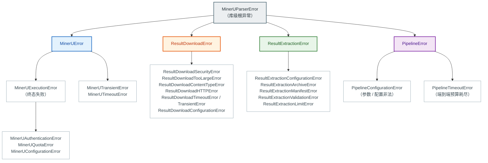

# mineru-parser

`mineru-parser` 把 MinerU 的异步文档解析流程封装成一次同步 Python 调用：**输入一个 PDF URI，输出一个 `ParseResult`**——包含解析产物、任务元数据与失败原因的状态信封。

一次调用跨越四个阶段，阶段顺序、参数透传、资源生命周期与端到端预算全部由库负责：

| 阶段 | 内部实现 | 输入 | 输出 |
| --- | --- | --- | --- |
| ① 提交 | client | PDF URI | `task_id` |
| ② 等待 | client | `task_id` | `zip_url` |
| ③ 下载 | downloader | `zip_url` | `io.BytesIO`（ZIP 内存流） |
| ④ 解析 | extractor | ZIP 内存流 | `ExtractedResult`（`{pages, images}`） |

## 快速开始

```python
from mineru_parser import parse

# API Key 默认读取环境变量 MINERU_API_KEY
# 下面使用 MinerU 官方的公开示例 PDF（13 页 Elsevier 论文），可直接运行
result = parse("https://cdn-mineru.openxlab.org.cn/demo/example.pdf")   # 同步阻塞，直到任务终态

if result["status"] == "success":
    for page in result["data"]["pages"]:        # list[Page]：逐页版面元素
        for block in page:
            print(block.type, block.bbox)
    for image in result["data"]["images"]:       # list[{"path", "bytes"}]
        print(image["path"], len(image["bytes"]))
    print(result["task_id"], result["data_id"])
else:
    err = result["error"]
    print(err["stage"], err["error_type"], err["message"])
```

`parse()` 是**同步阻塞**调用，一次调用完成"提交 → 等待 → 下载 → 解析"。任一阶段失败都不会交出半成品：失败时 `data` 必定是 `None`。

### 已验证示例

对上面这个示例 PDF 的真实运行结果（2026-10-21）：

| 项目 | 实测值 |
| --- | --- |
| 端到端耗时 | 37.5 s |
| 提交 / 等待 / 下载 / 解析 | 0.22 s / 36.56 s / 0.67 s / 0.03 s |
| 结果包 ZIP | 985,735 B |
| 页面数 | 13 |
| 版面元素 | 156 |
| 图片 | 20 张，共 631,443 B |

```text
status = success
task_id = 85d5b85c-c040-4223-8620-fc040f9b285b
data_id = None            # 未传 data_id
error   = None
pages=13 blocks=156 images=20
```

解析出的元素类型覆盖 `title` / `paragraph` / `table` / `chart` / `equation_interline` / `list` / `page_header` / `page_number`；标题、作者、机构、摘要、公式与参考文献均正确归一化。

> 耗时随服务端队列与文档复杂度变化，上表只用于说明量级；页面数、元素数与图片数由文档本身决定。

### `parse()` 参数

```python
def parse(
    uri: str,                                       # 必填：PDF 的绝对 http(s) URI
    *,
    model_version: str = "vlm",                     # 透传给 MinerU
    data_id: str | None = None,                     # 对账标识（不是幂等键）
    timeout: float | None = None,                   # 端到端相对预算（秒）
    deadline_epoch: float | None = None,            # 端到端绝对截止（Unix 时间戳）
    limits: ExtractionLimits | None = None,         # 解压侧限额
    raise_on_error: bool = False,                   # True：失败时抛异常（见「失败语义」）
    on_update: Callable[[MinerUTaskStatus], None] | None = None,
    on_error: Callable[[PipelineStage, BaseException], None] | None = None,
    on_metric: MetricHook | None = None,
    correlation_id: str | None = None,              # 透传到全部日志与指标
) -> ParseResult: ...
```

`timeout` 与 `deadline_epoch` **互斥**，同时给出会在任何网络请求之前失败。两者都不给表示**不设端到端上限**（等待阶段沿用客户端的无限等待语义）。

| 参数 | 作用 | 详见 |
| --- | --- | --- |
| `model_version` | 透传给 MinerU 的模型版本 | — |
| `data_id` | 对账标识；**不是幂等键** | [风险与已知限制](#风险与已知限制) |
| `timeout` / `deadline_epoch` | 覆盖四个阶段的端到端预算 | [端到端预算与超时](#端到端预算与超时) |
| `limits` | 解压侧限额（`ExtractionLimits`） | [内存预算与并发度](#内存预算与并发度) |
| `raise_on_error` | `True` 时失败抛异常 | [失败语义](#失败语义默认信封异常可选) |
| `on_update` | 任务状态 / 进度变化时触发 | — |
| `on_error` | 阶段失败时收到 `(stage, 原始异常)` | [阶段归因](#阶段归因pipelinestage) |
| `on_metric` | 指标回调 | [可观测性](#可观测性) |
| `correlation_id` | 透传到全部日志与指标 | [可观测性](#可观测性) |

## 返回值：`ParseResult`

`ParseResult` 是普通 `dict`，**恰好**六个键：

| 键 | 类型 | 说明 |
| --- | --- | --- |
| `status` | `Literal["success", "failed"]` | 本次调用的结果状态 |
| `data` | `ExtractedResult \| None` | 成功时为解析产物；**失败时必须为 `None`**（不返回部分产物） |
| `task_id` | `str \| None` | 本次任务的服务端 id |
| `data_id` | `str \| None` | 对账标识；服务端与提交参数都缺失时为 `None` |
| `zip_url` | `str \| None` | 结果包地址（**敏感值**，见下） |
| `error` | `ErrorMessage \| None` | 失败原因；**成功时必须为 `None`** |

`data` 的形状就是 `ExtractedResult`——与结果包提取器的返回值逐字相同：

```python
{
    "pages":  [[LayoutElement, ...], ...],        # list[Page]，元素是 Pydantic 模型
    "images": [{"path": "images/a.jpg", "bytes": b"..."}],
}
```

- **`pages`** — 按页分组的版面元素列表。元素按 `type` 判别：`title` / `paragraph` / `table` / `image` / `equation_interline` / `chart` / `list` / `algorithm` 以及页眉页脚等页级元素。
- **`images`** — 结果包内顶层 `images/` 下的图片原始字节，按 canonical path 字典序排列。

**元数据来源**：`task_id` / `data_id` / `zip_url` 取自本次调用的终态结果（`MinerUTaskResult`），失败时按"**当时已知**"填充——提交成功即知 `task_id`，等待完成后才知 `zip_url`，未知的取 `None`。

> **⚠️ `zip_url` 是敏感值**：它可能携带签名凭据。库不会把它写入任何日志或指标标签，但也**不会**对其脱敏——落盘或打日志前请自行评估。

## 失败语义：默认信封，异常可选

**默认不抛异常。** 已知失败（`MinerUParserError` 家族）被封装成 `ErrorMessage` 随 `status="failed"` 返回，调用方默认无需 `try` / `except` 就能拿到成败与失败原因。

```python
result = parse("https://cdn-mineru.openxlab.org.cn/demo/example.pdf")

if result["status"] == "failed":
    error = result["error"]
    error["stage"]        # PipelineStage：失败发生在哪个阶段
    error["error_type"]   # 异常类名，如 "MinerUQuotaError"
    error["message"]      # 脱敏后的可读摘要
    error["cause_type"]   # 异常链首因的类名，无异常链时为 None
```

需要"按异常类型分支"时，显式开启异常模式：

```python
from mineru_parser import MinerUParserError, parse

try:
    result = parse("https://cdn-mineru.openxlab.org.cn/demo/example.pdf", timeout=600, raise_on_error=True)
except MinerUParserError as exc:
    # 已知失败：组件异常**原样抛出**（同一对象，类型与异常链不变）
    print(type(exc).__name__, exc)
```

### 已知 vs 兜不住

| 类别 | 判定 | 两种模式下的表现 |
| --- | --- | --- |
| **已知** | `MinerUParserError` 家族的任意子类（`MinerUError` / `ResultDownloadError` / `ResultExtractionError` / `PipelineError`） | 信封模式：封装成 `ErrorMessage`；异常模式：**原样抛出**（仅超时被翻译为 `PipelineTimeoutError`） |
| **兜不住** | 未知异常类型、`MemoryError`、`KeyboardInterrupt`、`SystemExit` | **两种模式都原样抛出**，不封装、不吞掉 |

判定只看**类型**，不看消息、不看内容。信封由库自行构造，可序列化、可落盘、可上报：它只带类名与脱敏摘要，**不携带原始异常对象**，也不携带文档正文、凭据或签名 URL。

> **组件异常类不对外公开**，调用方无法按具体类型导入它们（`MinerUQuotaError` 等）。异常模式下用库级根异常 `MinerUParserError` 捕获，再按 `type(exc).__name__` 分支；信封模式下直接读 `error["error_type"]`。两种模式的信息量一致。

### 两种模式的对照

| 情形 | 信封（默认） | 异常（`raise_on_error=True`） |
| --- | --- | --- |
| 提交失败（认证 / 额度 / 服务端错误） | `status="failed"`，`error.stage="submit"`，`error.error_type="MinerUQuotaError"` 等 | 原样抛出 `MinerUQuotaError` |
| 等待阶段超时 | `error.stage="wait"`，`error.error_type="PipelineTimeoutError"`，`error.cause_type="MinerUTimeoutError"` | `PipelineTimeoutError(stage="wait")`，`__cause__` 指向原始超时异常 |
| 下载被 SSRF 防护拒绝 | `error.stage="download"`，`error.error_type="ResultDownloadSecurityError"` | 原样抛出 `ResultDownloadSecurityError` |
| 结果包解压后超限 | `error.stage="extract"`，`error.error_type="ResultExtractionLimitError"` | 原样抛出 `ResultExtractionLimitError` |
| 参数非法（`timeout` 与 `deadline_epoch` 同时给出） | `error.stage="config"` | `PipelineConfigurationError(field="timeout")` |
| 未知异常 / `MemoryError` | **原样抛出** | **原样抛出** |

## 阶段归因：`PipelineStage`

失败发生在哪一段，以封闭枚举暴露——它是指标标签与 `on_error` 参数的唯一取值来源，低基数，可直接用于监控维度。

| 取值 | 含义 |
| --- | --- |
| `config` | 任何阶段开始前的参数校验（尚未进入任何执行阶段） |
| `submit` | 提交解析任务（`POST /extract/task`） |
| `wait` | 轮询等待任务终态 |
| `download` | 下载结果包 |
| `extract` | 解析结果包 |

```python
import logging

from mineru_parser import PipelineStage, parse

logger = logging.getLogger(__name__)

def on_failure(stage: PipelineStage, exc: BaseException) -> None:
    logger.error("parse failed at %s: %s", stage, type(exc).__name__)

result = parse(
    "https://cdn-mineru.openxlab.org.cn/demo/example.pdf",
    data_id="doc-42",
    timeout=600,                              # 覆盖提交 / 等待 / 下载 / 解析四段
    on_update=lambda status: print(status.state),
    on_error=on_failure,
)
```

阶段信息同时进入日志（`mineru.pipeline.error`，含 `stage` 与 `error_type`）与指标（`mineru.pipeline.total{stage}`），不提供回调时也能读到。回调抛出的异常会被吞掉并记一条告警，不影响主流程。

## 端到端预算与超时

`timeout`（相对秒数）与 `deadline_epoch`（绝对 Unix 时间戳）提供**单一**端到端预算，覆盖全部四个阶段，而不是三段超时之和。

```python
result = parse(uri, timeout=600)          # 相对预算
result = parse(uri, deadline_epoch=1789000000.0)   # 绝对截止
```

预算在每个阶段**开始前**与**结束后**检查：

| 检查点 | 耗尽时的 `stage` |
| --- | --- |
| 提交前 | `submit` |
| 等待前 | `wait` |
| 下载前 | `download` |
| 解析前 | `extract` |
| 解析后 | `extract` |

等待阶段把**剩余预算**下传给客户端（`wait(timeout=remaining)`），客户端会在每次查询前与每次 sleep 后自行检查。

**超时的统一语义**：`parse()` 抛出的超时只有一种类型——`PipelineTimeoutError`，携带 `stage`（耗尽时所处阶段）、`task_id`，以及等待阶段超时才有的 `last_status`（最后一次已知任务状态）；被翻译的原始超时异常保留在 `__cause__` 上。

```python
from mineru_parser import MinerUParserError, PipelineTimeoutError, parse

try:
    result = parse(uri, timeout=600, raise_on_error=True)
except PipelineTimeoutError as exc:
    print(exc.stage, exc.task_id)       # 例如 "wait"、任务 id
except MinerUParserError as exc:
    print(type(exc).__name__)           # 其余已知失败
```

> **⚠️ 已知限制**：除等待阶段外，管道**无法中断**正在进行的下载——若下载阶段越过端到端预算，只能在阶段结束后检出并失败（`stage="download"`）。提取阶段同理：它是纯 CPU / 内存操作，预算只能在提取**结束后**检出，此时结果会被丢弃。

## 内存预算与并发度

一次 `parse()` 的峰值内存由**压缩侧**（下载的 ZIP 缓冲，默认 50 MiB）与**解压侧**（提取限额，默认 160 + 32 + 40 + 8 MiB）共同决定：

$$M_{\text{peak}} \approx 50 + 160 + 32 \times 2 + 40 + 8 = 290\,\text{MiB}$$

部署侧应满足 $W \times M_{\text{peak}} \le M_{\text{container}}$（$W$ 为并发数）：

| 形态 | 校验 |
| --- | --- |
| $W = 3$、容器 1 GiB | $3 \times 290 = 870\,\text{MiB} \le 1024\,\text{MiB}$ ✓ 默认档位可用 |
| $W = 4$、容器 1 GiB | $4 \times 290 = 1160\,\text{MiB} > 1024\,\text{MiB}$ ✗ 默认档位**超限** |

并发 4 时需要把解压侧上限压到 $X \le 126\,\text{MiB}$：

```python
from mineru_parser import ExtractionLimits, parse

result = parse(
    uri,
    limits=ExtractionLimits(max_total_image_bytes=126 * 1024 * 1024),
)
```

> 压缩侧与解压侧**不是同一量纲**：下载上限约束**压缩后**字节，提取限额约束**解压后**字节。因此"下载成功但提取被限额拒绝"是正常可达状态，不是错误。
>
> 峰值数字是**推导值**，不是实测值；真实并发峰值请在目标环境标定（推导口径见 SPEC-004 §3.5）。

## 错误模型

四条失败路径互不继承；需要"一网打尽"时用库级根异常 `MinerUParserError`。

其中**管道家族**（`PipelineError` 及其两个子类）可以从顶层导入并单独捕获；**组件三族**是内部实现，调用方无法按具体类型导入，只通过 `MinerUParserError` 捕获后按类名分支（信封模式下读 `error["error_type"]`）。



- **client**：`MinerUTransientError` 表示请求确定未发出或只读查询失败，可以安全重试；`MinerUExecutionError` 表示结果未知、请求被拒绝或服务端明确失败。认证、额度、配置错误均继承 `MinerUExecutionError`。
- **downloader**：安全、超限、内容类型、HTTP 状态、超时与重试耗尽各有独立异常类型，公共消息不泄漏原始签名 URL。
- **extractor**：按 `reason` / `resource` / `category` 字段分支，公共消息只使用英文固定文案，不携带 manifest 正文或图片字节。
- **pipeline**：只有两类自身失败——`PipelineConfigurationError`（参数非法，带 `field`）与 `PipelineTimeoutError`（预算耗尽，带 `stage`）。

## 可观测性

`parse()` 接受 `on_metric` 指标回调与 `correlation_id` 关联标识，统一走 `mineru_parser` logger。指标回调失败只记一条告警日志，不影响主流程。

```python
def on_metric(name: str, value: float, tags: dict[str, str]) -> None:
    print(name, value, tags)

result = parse(uri, on_metric=on_metric, correlation_id="doc-42")
```

管道自身的指标：

| 指标 | 标签 |
| --- | --- |
| `mineru.pipeline.total` | `outcome`、`stage` |
| `mineru.pipeline.duration_ms` | `outcome` |
| `mineru.pipeline.stage.duration_ms` | `stage`、`outcome` |
| `mineru.pipeline.pages` / `.images` / `.image_bytes` | `outcome` |

`outcome` 是封闭枚举：`success` / `config_error` / `timeout` / `stage_error` / `unexpected`。指标标签只允许封闭枚举——**不得**包含 URI、`task_id`、`data_id`、`zip_url`、路径或 `correlation_id`（这些只出现在日志字段里）。

日志名：`mineru.pipeline`（成功）、`mineru.pipeline.stage`（阶段切换）、`mineru.pipeline.error`（失败，含 `stage` 与 `error_type`）、`mineru.pipeline.on_error.failed`（回调异常）。三个组件的既有日志名保持不变。

## 风险与已知限制

- **`data_id` 不是幂等键**：它是**对账标识**，服务端不提供"按 `data_id` 复用任务"的能力。同一 URI 调用两次 `parse()` 会创建**两个任务、计费两次**。需要去重请在业务层自行处理。
- **默认没有端到端超时**：不传 `timeout` / `deadline_epoch` 时等待阶段无上界，长文档解析可能耗时数分钟。生产环境建议显式给出预算。
- **管道无状态，崩溃后任务不可恢复**：等待途中进程崩溃会留下一个无人认领的服务端任务（可能计费）。库不提供凭 `task_id` 恢复等待的入口，请按 `data_id` 自行对账。
- **每次调用自建 Session**：`parse()` 每次调用都新建 client / downloader 及其连接池，跨调用无连接池复用。高频小任务场景下 TLS 握手开销显著。
- **`zip_url` 是敏感值**：库不记录它，但也不脱敏；落盘或打日志前请自行评估。
- **峰值内存是推导值**：290 MiB 来自组件默认值的推导，真实并发峰值需在目标环境标定。

## 内部实现（不对外）

以下三个组件是 `parse()` 的内部实现，**不提供公开导入路径**，也不遵循 SemVer——它们的行为契约由各自 SPEC 约束（SPEC-001 / 002 / 003），但对调用方而言，`parse()` 就是全部。

```mermaid
flowchart LR
    classDef io fill:#fff3e0,stroke:#e65100,stroke-width:2px,color:#bf360c;
    classDef mod fill:#e3f2fd,stroke:#1565c0,stroke-width:2px,color:#0d47a1;
    classDef out fill:#e8f5e9,stroke:#2e7d32,stroke-width:2px,color:#1b5e20;
    classDef srv fill:#fce4ec,stroke:#ad1457,stroke-width:2px,color:#880e4f;

    URI["PDF URI"]:::io
    CLIENT["client<br/>MinerUApiClient · AsyncResult"]:::mod
    API["MinerU API Server"]:::srv
    ZIPURL["zip_url"]:::io
    DL["downloader<br/>ResultDownloader"]:::mod
    MEM["io.BytesIO<br/>ZIP 内存流"]:::io
    EX["extractor<br/>extract_result"]:::mod
    RESULT["ParseResult<br/>{status, data, task_id, data_id, zip_url, error}"]:::out

    URI -->|"① 提交"| CLIENT
    CLIENT -->|"POST /extract/task"| API
    API -->|"task_id"| CLIENT
    CLIENT -->|"GET /extract/task/{id}"| API
    API -->|"full_zip_url"| ZIPURL
    ZIPURL -->|"② 下载"| DL
    DL --> MEM
    MEM -->|"③ 解析"| EX
    EX --> RESULT
```



- **client** — 提交、轮询、终态解释。自动处理指数退避、随机抖动、服务端 `Retry-After` 与连续错误上限；错误按认证 / 额度 / 瞬时 / 执行 / 超时分类。
- **downloader** — 流式下载。默认限制单次响应体 50 MiB、总耗时 300 秒，拒绝非公网目标与 HTTPS 降级重定向，日志中的 URL 剔除 query 与 fragment。
- **extractor** — 解析结果包。只在 ZIP 顶层定位唯一的 `*_content_list_v2.json`，用 `DocumentContentSchema` 做 Schema 校验，收集顶层 `images/` 下的图片；解压后资源受 `ExtractionLimits` 限制（manifest 16 MiB、单图 32 MiB、图片总量 160 MiB、图片 10,000 张、ZIP 成员 100,000 个），不落盘、不解码图片。

三者的组合效应由管道保证：阶段顺序由库固定，任一阶段失败即中止后续阶段（失败于 submit / wait 时不发起下载，失败于 download 时不调用提取器）；中间 ZIP 流与自建组件由管道在返回前按"流 → downloader → client"的顺序关闭，失败路径同样关闭。
