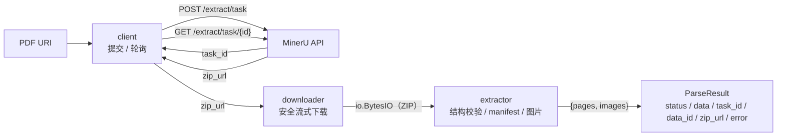

# mineru-parser 架构

> 本文是 `mineru-parser` 的全局架构基线，派生自仓库中已落地的实现与既有技术规格，2026-11-09 整理为可被 Spec `depends_on` 引用的受管文档。
>
> 本文只记录已确定的全局结构、组件边界与关键决策；单个变更范围内的拓扑、接口与验收标准由对应 Spec 描述。

## 1. 问题与目标

MinerU 只提供异步解析接口：调用方提交 PDF URL，拿到 `task_id` 后必须自行轮询到终态，再下载结果包、解压并解析 `content_list_v2.json` 与图片。把这条链路留在每个调用方手里，会重复产生轮询、退避、超时、错误分类、SSRF 防护、ZIP 安全与资源预算等问题，且行为难以一致。

`mineru-parser` 的目标是把这条链路收敛为**一次同步 Python 调用**：输入一个 PDF URI，输出一个包含解析产物、任务元数据与失败原因的状态信封。调用方不需要知道四个阶段的存在，也不需要自己持有中间流、关闭会话或拼接异常。

## 2. 范围

### 包含

- 提交任务与稳健轮询（client）。
- 结果包的安全流式下载（downloader）。
- ZIP 结果包的结构校验、manifest 解析与图片提取（extractor）。
- 四阶段编排、端到端预算、阶段归因与统一失败语义（pipeline）。

### 不包含

- 异步 / 并发调度、批处理、任务恢复、任务对账与幂等提交。
- 结果缓存、断点续传、磁盘落盘与对象存储。
- 图片解码、OCR、版面重排与阅读顺序重建。
- 组件 API 的公开可扩展性；组件是私有实现。

## 3. 组件与职责

| 组件 | 对外可见性 | 职责 | 明确不负责 |
| :--- | :--- | :--- | :--- |
| `pipeline` | 公开面：唯一函数 `parse` | 四阶段编排、端到端预算、阶段归因、失败信封 / 异常双模式、生命周期与所有权 | 不新增解析能力，不缓存，不持有跨调用状态 |
| `_client` | 私有实现 | 提交、轮询、终态解释、退避 / 抖动 / `Retry-After`、超时与错误分类 | 不下载、不解压、不解释文档内容 |
| `_downloader` | 私有实现 | 安全流式下载、重定向逐跳复验、内存上限、重试与总预算 | 不解压、不校验哈希、不落盘 |
| `_extractor` | 私有实现 | ZIP 结构校验、唯一 manifest 定位、Schema 校验、图片提取与资源限额 | 不下载、不重试、不解码图片 |
| `schema` | 公开类型 | `content_v2` Schema 与 Pydantic 模型 | 不做业务校验或内容转换 |
| `errors` | 公开根异常 | `MinerUParserError` 全库根异常 | 不承载具体阶段的失败语义 |

### 3.1 公开 API 面

顶层 `mineru_parser.__all__` 只有 14 个条目：唯一函数 `parse`，以及它的签名 / 返回值所需的类型、异常类与 `__version__`。三个组件包（`_client` / `_downloader` / `_extractor`）不提供公开导入路径。

### 3.2 异常家族

```text
MinerUParserError
├── MinerUError                 # 客户端失败
├── ResultDownloadError         # 下载失败
├── ResultExtractionError       # 解析失败
└── PipelineError               # 管道自身失败
```

四个家族**互不继承**：客户端失败、下载失败、解析失败与管道失败的处置动作不同（重试 / 重新下载 / 拒收 / 调整预算），不能被同一个 `except` 混为一谈。`MinerUParserError` 只提供“一网打尽”的捕获入口。

## 4. 数据流



一次 `parse()` 调用中，中间 ZIP 流由管道关闭；返回的 `ParseResult.data` 是独立对象，不依赖流。任一阶段失败都不会交出半成品：失败时 `data` 必定为 `None`。

## 5. 关键决策

1. **单函数门面**：对外只有一个函数 `parse`。顶层 API 面收缩是 0.1.0 的一次性决定，组件行为契约不变但不再是公共 API。
2. **同步阻塞**：`parse()` 同步阻塞到终态；异步 / 并发由调用方用线程或进程实现，库不引入事件循环。
3. **内存流**：下载器交付 `io.BytesIO`，提取器只读内存 ZIP；不落盘、不调用 `extract()` / `extractall()`。
4. **无状态管道**：不持有跨调用的任务状态，不接受外部 `task_id` 续跑；崩溃后的任务由调用方按 `data_id` 对账。
5. **默认信封、异常可选**：已知异常封装为 `ErrorMessage`；`raise_on_error=True` 时才原样抛出（超时翻译为 `PipelineTimeoutError`）。
6. **共享根、互不继承**：`MinerUParserError` 统一捕获入口，四个异常家族互不继承。

## 6. 质量属性基线

| 维度 | 基线 | 状态 |
| :--- | :--- | :--- |
| 端到端耗时 | 真实样本 13 页 PDF：37.5 s，其中等待阶段 36.56 s | 已实测（2026-10-21，README） |
| 下载上限 | 单次结果包默认 ≤ 50 MiB | 已实现 |
| 提取内存 | 单次调用峰值约 240 MiB（$W=4$ 时约 960 MiB） | 推导值 + `tracemalloc` 测试；[estimated] |
| 管道内存 | 压缩侧与解压侧合计约 290 MiB | [estimated]，待部署环境标定 |
| 测试 | 无网络单元测试覆盖四个组件；client 29 / downloader 111 / extractor 80 / pipeline 66 个测试函数 | 已实现 |
| 可观测性 | 结构化日志 + `on_metric` 指标出口 + `correlation_id` 透传 | 已实现 |

## 7. 演进与边界

- 多任务 / 批处理、任务恢复、幂等提交、缓存与落盘均不在当前架构内，需单独立项。
- 组件保持私有；任何“组件可注入 / 可替换”的诉求都要先解决公共面与测试缝的边界问题。
- 全局拓扑与模块职责以本文为准；各 Spec 只描述本次变更范围内的拓扑、数据流与契约。
