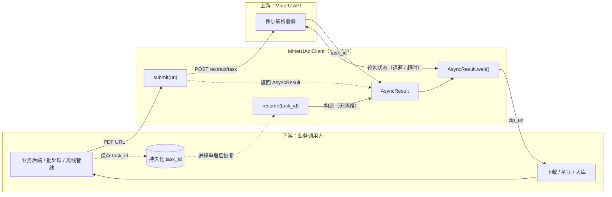
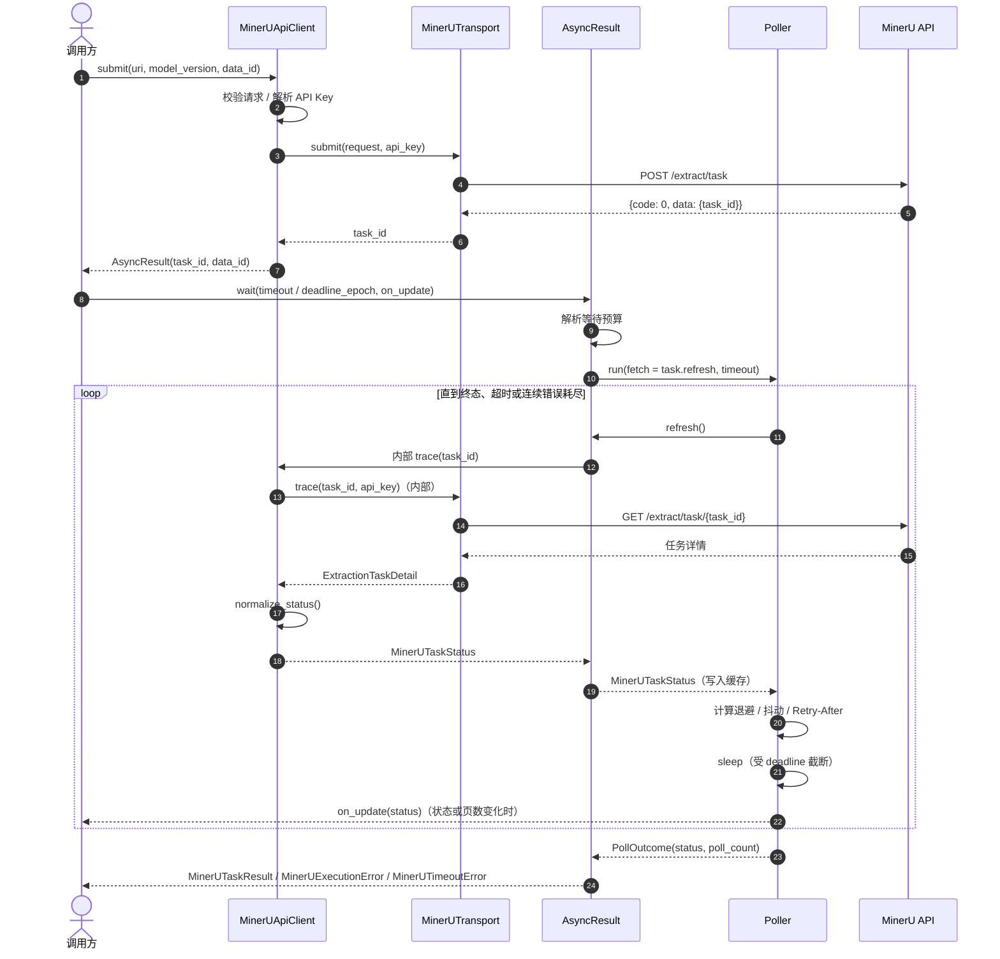
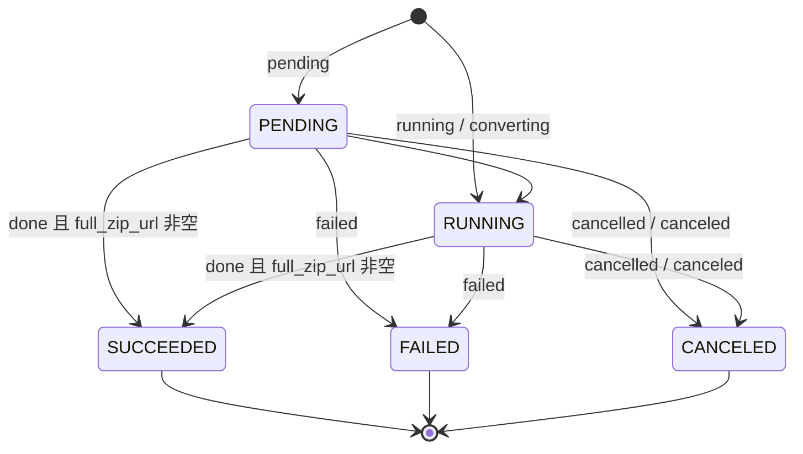

# [SPEC-001] MinerUApiClient

| 属性 | 内容 |
| :--- | :--- |
| **状态** | Implemented |
| **负责人** | @jackafx |
| **创建时间** | 2026-10-20 |
| **更新时间** | 2026-10-21 |
| **关联 Issue/PR** | —（补写，尚未关联） |

---

## 1. 背景与目标 (Context & Objectives)

### 1.1 背景 (Context)

业务侧需要把外部 PDF 转为结构化文档。调用方提供 PDF 的 URL，MinerU 异步完成抓取与解析，最终返回结果包的 `zip_url`，由调用方自行下载、解压并进入后续入库流程。

核心痛点在于 MinerU 只提供异步任务接口：调用方必须自己实现「提交 → 保存 `task_id` → 轮询 → 判断终态 → 取结果」的完整链路，并处理进程重启后的任务恢复、限流与偶发 5xx、退避抖动、等待超时、错误分类以及日志指标缺失等问题。每个业务重复实现一遍，行为不一致，故障也难以定位。

`MinerUApiClient` 因此将这些职责收敛为一个同步客户端：`submit()` 返回 `AsyncResult`，`resume(task_id)` 在进程重启后重新取得句柄，`AsyncResult.wait()` 负责可靠等待并交付 `zip_url`。其上游是 MinerU 官方 API，下游是业务后端、批处理脚本与离线处理管线；客户端是两者之间唯一的公共边界。

链路概览：



### 1.2 现状与差距分析 (Gap Analysis)

在统一客户端落地前，业务侧通常直接用 `requests` 手写提交与轮询，或写一次性脚本用固定 `sleep` 轮询。两者都能“跑通”，但配置、凭证、连接复用、退避、限流、超时与错误分类各自实现，行为难以保持一致。`MinerUApiClient` 把这些职责收敛到一个可注入、可测试的公共对象中。

| 能力维度 | 裸 `requests` 手写 | 固定 `sleep` 脚本 | `MinerUApiClient` |
| :--- | :---: | :---: | :---: |
| 统一入口与配置 | ❌ | ❌ | ✅ |
| 凭证解析（显式 / 环境变量） | ⚠️ 每次重写 | ⚠️ 每次重写 | ✅ |
| 任务恢复（持久化 `task_id`） | ❌ | ❌ | ✅ `resume()` |
| 指数退避 + 随机抖动 | ❌ | ❌ | ✅ `PollPolicy` |
| 服务端 `Retry-After` | ❌ | ❌ | ✅ 优先且截断 |
| 相对超时 / 绝对截止时间 | ⚠️ 手工实现 | ❌ | ✅ `timeout` / `deadline_epoch` |
| 进度回调 | ❌ | ❌ | ✅ `on_update` |
| 错误分类（认证 / 额度 / 瞬时 / 执行 / 超时） | ❌ | ❌ | ✅ 异常体系 |
| 连接池复用与生命周期 | ⚠️ 易遗漏 | ⚠️ 易遗漏 | ✅ 共享 / 可注入 `Session` |
| 结果交付 | ⚠️ 形态不一 | ⚠️ 形态不一 | ✅ `MinerUTaskResult.zip_url` |
| 可测试性（无网络、假时钟） | ❌ | ❌ | ✅ 依赖注入 |

### 1.3 目标 (Goals)

- [x] **Goal 1**：统一客户端构造：配置校验、凭证解析、默认值收敛。
- [x] **Goal 2**：提供 `submit` / `resume` 两个核心方法，覆盖提交与恢复。
- [x] **Goal 3**：异步结果句柄 `AsyncResult`：持有身份、缓存状态、解释终态；`submit()` / `resume()` 均返回该类型。
- [x] **Goal 4**：稳健轮询：指数退避、随机抖动、`Retry-After` 优先、连续错误上限。
- [x] **Goal 5**：等待边界：支持相对超时与绝对截止时间，超时异常携带最后已知状态。
- [x] **Goal 6**：进度回调：状态或解析页数变化时通知调用方。
- [x] **Goal 7**：错误分类：认证、额度、瞬时、执行、配置、超时分别建模。
- [x] **Goal 8**：Session 生命周期：自建时负责关闭，注入时绝不接管。
- [x] **Goal 9**：结果交付：成功时返回 `zip_url`，不下载、不解压。
- [x] **Goal 10**：可观测与可测试：日志 / 指标统一出口；时钟、随机源、Session 均可注入。

### 1.4 非目标 (Non-Goals / Out of Scope)

> 明确本次迭代**不包含**的内容，防止需求范围膨胀（Scope Creep）。

- [ ] 下载、校验、解压结果包，或解析 Markdown / JSON 等文档内容。
- [ ] 批量任务、任务列表、删除任务等 MinerU 其他 API。
- [ ] 提交幂等；`data_id` 仅用于对账，不是幂等键。
- [ ] 异步 / 并发轮询、任务调度器集成。
- [ ] 业务编排（如一步式解析）：由调用方组合 `submit()` 与 `AsyncResult.wait()` 完成，客户端不提供 `parse()`。
- [ ] 单次状态查询作为公共 API：`trace` 仅为内部机制，由 `AsyncResult.refresh()` 调用，不对外暴露。
- [ ] 多线程共享同一个 `AsyncResult` 句柄。
- [ ] 自动重试提交阶段「结果未知」的失败（避免重复创建任务）。
- [ ] 对 `requests.Session` 之外的 HTTP 后端进行抽象。

---

## 2. 用户故事与验收标准 (User Stories & Acceptance Criteria)

### US-1: 客户端构造与配置

**As a** 服务集成方  
**I want to** 用一组显式参数构造 `MinerUApiClient`，并从环境变量读取 API Key  
**So that** 凭证不进入代码，配置错误在发起网络请求前暴露

#### 验收标准 (Acceptance Criteria)
* **AC-1.1**: 当显式传入 `api_key` 时，客户端必须去除首尾空白后保存；空白字符串必须在构造时抛出 `MinerUConfigurationError`。
* **AC-1.2**: 当未传入 `api_key` 时，构造不得失败；首次 `submit()` 或 `wait()`（内部状态查询）时必须读取 `MINERU_API_KEY`，缺失或空白必须抛出 `MinerUAuthenticationError`。
* **AC-1.3**: `base_url` 必须为绝对 http(s) URL，去除尾部 `/`，且不得包含 query 或 fragment；非法时必须在构造时抛出 `MinerUConfigurationError`。
* **AC-1.4**: `request_timeout` 必须为正有限数，或 `(connect, read)` 正有限数二元组；`poll_policy` 必须是 `PollPolicy` 实例；非法时必须在构造时抛出 `MinerUConfigurationError`。
* **AC-1.5**: `session`、`sleep`、`monotonic`、`wall_clock`、`random_fn`、`on_metric`、`correlation_id` 必须可注入；注入后客户端必须直接使用这些对象，不得回退到系统默认实现。
* **AC-1.6**: 客户端必须暴露只读属性 `base_url` 与 `poll_policy`；未传入 `poll_policy` 时必须返回 `DEFAULT_POLL_POLICY`。

---

### US-2: 提交解析任务

**As a** 服务集成方  
**I want to** 调用 `submit()` 把 PDF URL 提交为 MinerU 解析任务并拿到 `AsyncResult`  
**So that** 我可以在不阻塞提交流程的情况下跟踪任务

#### 验收标准 (Acceptance Criteria)
* **AC-2.1**: 当提交合法 URL 时，客户端必须向 `POST {base_url}/extract/task` 发送 JSON，字段为 `url`（来自 `uri`）、`model_version`、可选 `data_id`，并返回 `AsyncResult`，其 `task_id` 等于响应中的 `data.task_id`。
* **AC-2.2**: 提交请求必须携带 `Authorization: Bearer <api_key>`、`Accept: application/json`，并使用配置的 `request_timeout`。
* **AC-2.3**: 当 `data_id` 为 `None` 时，请求体必须省略该字段，而不是发送 `null`。
* **AC-2.4**: 当 `uri` 不是绝对 http(s) URL 时，必须在发出任何 HTTP 请求前抛出 `MinerUConfigurationError`。
* **AC-2.5**: 当响应 `data.task_id` 缺失或为空时，必须抛出 `MinerUExecutionError`。
* **AC-2.6**: 返回的 `AsyncResult` 必须满足：`task_id` 来自服务端响应，`data_id` 来自提交参数，`status` / `state` / `result` 均为 `None`。

---

### US-3: 恢复 AsyncResult

**As a** 服务集成方  
**I want to** 调用 `resume(task_id)` 从持久化的任务 ID 恢复 `AsyncResult`  
**So that** 进程重启后可以继续等待，而不会重复提交任务

#### 验收标准 (Acceptance Criteria)
* **AC-3.1**: `resume(task_id, data_id=None)` 不得发起任何网络请求。
* **AC-3.2**: `task_id` 必须去除首尾空白并校验非空；`data_id` 必须非空白且长度 $\le 128$；非法时抛出 `MinerUConfigurationError`。
* **AC-3.3**: 返回的 `AsyncResult` 的 `task_id` / `data_id` 必须与参数一致，`status` / `state` / `result` 初始均为 `None`。
* **AC-3.4**: 对恢复的 `AsyncResult` 调用 `wait()` 时，必须只产生状态查询请求（GET），不得产生提交请求（POST）。
* **AC-3.5**: 内部状态查询必须对 `task_id` 做 URL 编码（`/` → `%2F`）。

---

### US-4: 等待边界

**As a** 服务集成方  
**I want to** 通过 `AsyncResult.wait()` 指定相对超时或绝对截止时间  
**So that** 我能在 SLA 内放弃等待，并保留最后已知状态

#### 验收标准 (Acceptance Criteria)
* **AC-4.1**: `timeout` 与 `deadline_epoch` 互斥；同时提供时必须抛出 `MinerUConfigurationError`，且不发起轮询。
* **AC-4.2**: `deadline_epoch` 必须换算为 $\max(0,\ \text{deadline\_epoch} - t_{\text{wall}})$ 的单调时钟预算。
* **AC-4.3**: 超时必须抛出 `MinerUTimeoutError`，携带 `task_id` 与最后成功查询到的 `last_status`（从未成功则为 `None`）。
* **AC-4.4**: 超时检查必须在每次查询前与每次 `sleep` 后执行；`sleep` 必须截断到剩余预算。

---

### US-5: 稳健轮询

**As a** 服务集成方  
**I want to** 让 `AsyncResult.wait()` 自动退避、抖动并遵守 `Retry-After`  
**So that** 偶发故障与限流不会中断任务

#### 验收标准 (Acceptance Criteria)
* **AC-5.1**: 默认策略必须为 `initial_interval=3.0`、`max_interval=30.0`、`backoff=1.5`、`jitter=0.5`、`max_consecutive_errors=3`、`max_retry_after=60.0`。
* **AC-5.2**: 普通轮询延迟必须为 $d = I \cdot ((1-j) + j \cdot U)$，其中 $I \leftarrow \min(I \cdot b,\ I_{\max})$，$U$ 来自注入的 `random_fn` 并夹取到 $[0,1]$。
* **AC-5.3**: 状态发生变化时必须把间隔重置为 `initial_interval`；仅进度变化不得重置间隔。
* **AC-5.4**: 当瞬态错误携带 `Retry-After` 时，必须优先使用 $d = \min(\text{Retry-After},\ \text{max\_retry\_after})$，且不叠加随机抖动。
* **AC-5.5**: 连续瞬态错误达到 `max_consecutive_errors` 时，必须抛出 `MinerUExecutionError`；任何一次成功查询必须把连续错误计数清零。
* **AC-5.6**: `Retry-After` 必须同时支持秒数与 HTTP-date；非法值必须忽略，负值按 $0$ 处理，超过 `max_retry_after` 必须截断。

---

### US-6: 错误分类

**As a** 服务集成方  
**I want to** 从客户端收到明确的异常类型  
**So that** 我能决定重试、降级还是放弃

#### 验收标准 (Acceptance Criteria)
* **AC-6.1**: 提交阶段 HTTP 429、`ConnectTimeout`、连接未建立（`NewConnectionError`，含 DNS 失败）必须抛 `MinerUTransientError`；401/403 必须抛 `MinerUAuthenticationError`；其余（含 5xx、读超时、连接中断）必须抛 `MinerUExecutionError`，且不自动重试。
* **AC-6.2**: 查询阶段 HTTP 429、404、5xx 必须抛 `MinerUTransientError`；401/403 必须抛 `MinerUAuthenticationError`；其余 4xx 必须抛 `MinerUExecutionError`；其他传输异常必须抛 `MinerUTransientError`。
* **AC-6.3**: 业务错误码必须按 `ERROR_CODE_KIND` 分类：`auth` → `MinerUAuthenticationError`，`quota` → `MinerUQuotaError`，`transient` → `MinerUTransientError`，`terminal` → `MinerUExecutionError`；提交阶段的未知码按 `MinerUExecutionError` 处理，查询阶段的未知码按 `MinerUTransientError` 处理。
* **AC-6.4**: `failed` 终态必须抛 `MinerUExecutionError`（优先使用 `err_msg`）；`cancelled` / `canceled` 终态必须抛 `MinerUExecutionError` 并说明任务已取消。
* **AC-6.5**: `done` 但缺少 `full_zip_url` 必须抛 `MinerUExecutionError`；未知 `state` 必须抛 `MinerUTransientError`，允许后续重试。
* **AC-6.6**: 失败后重复调用 `wait()` 必须立即抛出同一类异常，且不再访问网络。

---

### US-7: 进度回调

**As a** 服务集成方  
**I want to** 在状态或解析页数变化时收到 `on_update` 回调  
**So that** 我能向用户或监控系统上报进度

#### 验收标准 (Acceptance Criteria)
* **AC-7.1**: `on_update` 必须在首次查询、状态变化，或前后两次查询的 `extracted_pages` 均存在且不相等时被调用，参数为归一化后的 `MinerUTaskStatus`。
* **AC-7.2**: `on_update` 抛出的任何异常必须被吞掉并记录 `mineru.on_update.failed` 警告日志，不得中断轮询。

---

### US-8: 会话与生命周期

**As a** 服务集成方  
**I want to** 复用连接池并控制 Session 生命周期  
**So that** 多任务共享连接，且不会泄漏或误关外部资源

#### 验收标准 (Acceptance Criteria)
* **AC-8.1**: 未注入 `session` 时客户端必须自建 Session；`close()` 或退出上下文时必须关闭自建 Session。
* **AC-8.2**: 注入 `session` 时客户端不得关闭它；其生命周期完全由调用方负责。
* **AC-8.3**: 同一客户端的所有 `submit` 请求与内部状态查询必须复用同一个 Session。
* **AC-8.4**: 客户端必须可被多个任务共享，且不得在客户端实例上保存任何任务状态。

---

### US-9: 结果交付

**As a** 服务集成方  
**I want to** 拿到结果包的 `zip_url`  
**So that** 下载、校验与解压策略由我完全控制

#### 验收标准 (Acceptance Criteria)
* **AC-9.1**: 成功结果必须只提供 `zip_url`，不得自动下载、校验或解压。
* **AC-9.2**: `provider_task_id` 必须优先取服务端返回的 `task_id`，缺失时回退到 `AsyncResult` 的 `task_id`；`data_id` 必须优先取服务端返回值，缺失时回退到 `AsyncResult` 创建时传入的值。

---

### US-10: 可观测性

**As a** 运维 / 服务集成方  
**I want to** 通过日志与 `MetricHook` 观察客户端行为  
**So that** 我能定位慢请求、限流与任务失败

#### 验收标准 (Acceptance Criteria)
* **AC-10.1**: 当提供 `on_metric` 时，客户端必须为提交、HTTP 请求、轮询与任务终态上报指标，指标名与标签符合 3.6 节定义。
* **AC-10.2**: `on_metric` 抛出的任何异常必须被吞掉并记录 `mineru.metric.failed` 警告日志，不得影响主流程。
* **AC-10.3**: 当提供 `correlation_id` 时，客户端发出的所有日志必须携带该字段。

---

## 3. 技术方案设计 (Technical Design)

### 3.1 架构与数据流 (Architecture & Data Flow)

#### 组件职责与边界

`MinerUApiClient` 是唯一公共入口；其余组件均为其内部协作者。

| 组件 | 职责 | 明确不做 |
| :--- | :--- | :--- |
| `MinerUApiClient` | 配置校验、凭证解析、Session 生命周期、`submit` / `resume`、内部状态查询、按策略创建 Poller | 不保存任务状态、不执行轮询、不解释终态、不提供业务编排、不对外暴露 `trace` |
| `MinerUTransport` | HTTP 请求构造、响应解析、信封与错误码分类、`Retry-After` 解析 | 不持有任务状态、不轮询、不解释终态 |
| `AsyncResult` | 持有 `task_id` / `data_id`、缓存最近状态与结果、终态解释 | 不直接发 HTTP、不决定轮询节奏、非线程安全 |
| `Poller` | 退避、抖动、`Retry-After`、超时 / deadline、连续错误上限、`on_update` 触发 | 不解释任务成败、不管理任务状态 |
| `Telemetry` | 统一日志与指标出口、`correlation_id` 注入、回调异常隔离 | 不影响主流程 |

#### 客户端调用时序



#### 任务状态机



> 未识别的原始状态不会进入领域状态机，而是按瞬时错误处理，交由轮询继续尝试。

### 3.2 数据模型 (Data Model)

#### 客户端配置

| 构造参数 | 默认值 | 校验 / 语义 |
| :--- | :--- | :--- |
| `api_key` | `None` | 显式提供时去空白且不得为空；`None` 时延迟到首次请求读取 `MINERU_API_KEY` |
| `base_url` | `https://mineru.net/api/v4` | 绝对 http(s) URL；去除尾部 `/`；禁止 query / fragment |
| `request_timeout` | `10.0` | 正有限数，或 `(connect, read)` 正有限数二元组 |
| `poll_policy` | `None` → `DEFAULT_POLL_POLICY` | 必须是 `PollPolicy` 实例 |
| `session` | `None` → 新建 `requests.Session()` | 注入时客户端不接管生命周期 |
| `sleep` | `time.sleep` | 轮询等待函数，可注入假时钟 |
| `monotonic` | `time.monotonic` | 单调时钟，用于 deadline |
| `wall_clock` | `time.time` | 墙钟，用于 `deadline_epoch` 与 HTTP-date |
| `random_fn` | `random.random` | 抖动随机源，返回值夹取到 `[0,1]` |
| `on_metric` | `None` | `Callable[[str, float, Mapping[str, str]], None]` |
| `correlation_id` | `None` | 附加到所有日志 |

#### 客户端内部状态

| 字段 | 类型 | 说明 |
| :--- | :--- | :--- |
| `_api_key` | `str \| None` | 显式凭证；`None` 表示运行时从环境变量解析 |
| `_base_url` | `str` | 归一化后的 API 根地址 |
| `_request_timeout` | `float \| tuple[float, float]` | HTTP 超时 |
| `_poll_policy` | `PollPolicy` | 默认轮询策略 |
| `_owns_session` | `bool` | 是否由客户端创建并负责关闭 Session |
| `_session` | `requests.Session` | 所有 HTTP 请求的共享会话 |
| `_runtime` | `PollRuntime` | 注入的时间 / 随机源容器 |
| `_telemetry` | `Telemetry` | 日志与指标出口 |
| `_transport` | `MinerUTransport` | wire 协议实现 |

> 客户端不持有 `AsyncResult`、状态缓存或任务结果；任务状态只存在于 `AsyncResult` 中。

#### wire 模型

**`ExtractionRequest`（提交请求体）**

| Python 字段 | wire 字段 | 类型 | 必填 | 约束 |
| :--- | :--- | :--- | :---: | :--- |
| `uri` | `url` | `str` | 是 | 绝对 http(s) URL；提交前去除首尾空白 |
| `model_version` | `model_version` | `str` | 否 | 默认 `"vlm"`；不得为空白 |
| `data_id` | `data_id` | `str \| None` | 否 | 非空白，长度 $\le 128$；`None` 时从载荷中省略 |

**`ExtractionTaskDetail`（查询响应载荷）**

| 字段 | 类型 | 说明 |
| :--- | :--- | :--- |
| `task_id` | `str \| None` | 服务端任务 ID；归一化时缺失则回退到请求所用 ID |
| `state` | `str \| None` | 原始状态字符串 |
| `err_msg` | `str \| None` | 失败原因 |
| `full_zip_url` | `str \| None` | 成功结果包地址 |
| `data_id` | `str \| None` | 对账 ID |
| `extract_progress.extracted_pages` | `int \| None` | 已解析页数 |
| `extract_progress.total_pages` | `int \| None` | 总页数 |

**`ApiEnvelope[T]`（响应信封）**

| 字段 | 类型 | 说明 |
| :--- | :--- | :--- |
| `code` | `int \| str \| None` | 标准业务码，字符串 `"0"` 表示成功 |
| `msgCode` | `str \| None` | 网关错误码（Python 字段 `msg_code`） |
| `msg` | `str \| None` | 错误消息 |
| `trace_id` | `str \| None` | 服务端链路 ID |
| `data` | `T \| None` | 业务载荷 |
| `success` | `bool \| None` | 网关成功标志；无 `code` / `msgCode` 时使用 |

信封判定顺序：优先取 `code`，缺失时取 `msgCode`；存在任一错误码时，仅 `"0"` 视为成功。两者都不存在时，以 `success is not False` 判定成功。

#### 领域模型

| 模型 | 字段 | 说明 |
| :--- | :--- | :--- |
| `MinerUTaskState` | `pending` / `running` / `succeeded` / `failed` / `canceled` | `StrEnum`；`succeeded` / `failed` / `canceled` 为终态 |
| `MinerUProgress` | `extracted_pages`、`total_pages` | 不可变 dataclass，字段均可为 `None` |
| `MinerUTaskStatus` | `state`、`raw_state`、`task_id`、`data_id`、`err_msg`、`full_zip_url`、`progress` | 归一化后的状态快照，不可变 |
| `MinerUTaskResult` | `zip_url`、`provider_task_id`、`data_id` | 成功结果，不依赖 Pydantic，供调用方长期持有 |

#### 状态归一化

| 原始 `state` | 领域状态 | 说明 |
| :--- | :--- | :--- |
| `pending` | `PENDING` | 排队中 |
| `running`、`converting` | `RUNNING` | 解析中 |
| `done` | `SUCCEEDED` | 必须同时存在非空 `full_zip_url`，否则视为协议违约 |
| `failed` | `FAILED` | 终态失败 |
| `cancelled`、`canceled` | `CANCELED` | 终态取消 |
| 其他 | — | 抛 `MinerUTransientError`，允许继续轮询 |

#### 轮询策略模型

| 参数 | 默认值 | 约束 | 语义 |
| :--- | :---: | :--- | :--- |
| `initial_interval` | `3.0` | $> 0$ | 初始间隔；状态变化后重置到的基数 |
| `max_interval` | `30.0` | $\ge$ `initial_interval` | 间隔上限 |
| `backoff` | `1.5` | $\ge 1.0$ | 指数增长因子 $b$ |
| `jitter` | `0.5` | $[0, 1)$ | 抖动比例 $j$，实际延迟因子下界为 $1-j$ |
| `max_consecutive_errors` | `3` | 整数 $\ge 1$ | 连续瞬态错误上限 |
| `max_retry_after` | `60.0` | $\ge 0$ | `Retry-After` 截断上限 |

### 3.3 接口契约 (API Contracts)

#### 客户端公共 API

```python
class MinerUApiClient:
    def __init__(
        self,
        *,
        api_key: str | None = None,
        base_url: str = "https://mineru.net/api/v4",
        request_timeout: float | tuple[float, float] = 10.0,
        poll_policy: PollPolicy | None = None,
        session: requests.Session | None = None,
        sleep: Callable[[float], None] = time.sleep,
        monotonic: Callable[[], float] = time.monotonic,
        wall_clock: Callable[[], float] = time.time,
        random_fn: Callable[[], float] = random.random,
        on_metric: MetricHook | None = None,
        correlation_id: str | None = None,
    ) -> None: ...

    base_url: str          # 只读属性
    poll_policy: PollPolicy  # 只读属性

    def submit(
        self,
        uri: str,
        *,
        model_version: str = "vlm",
        data_id: str | None = None,
    ) -> AsyncResult: ...

    def resume(
        self,
        task_id: str,
        *,
        data_id: str | None = None,
    ) -> AsyncResult: ...

    def close(self) -> None: ...
    def __enter__(self) -> MinerUApiClient: ...
    def __exit__(self, *exc_info: object) -> None: ...
```

`MinerUClient` 为 `MinerUApiClient` 的别名，二者必须完全等价。

#### 方法语义

| 方法 | 网络行为 | 关键语义 |
| :--- | :--- | :--- |
| `submit` | `POST /extract/task` | 请求模型校验在 HTTP 异常处理之外；成功返回未查询过的 `AsyncResult` |
| `resume` | 无 | 仅校验参数并构造 `AsyncResult`；用于持久化恢复 |
| `close` | 无 | 仅关闭自建 Session；可重复调用 |
| `with` | — | 退出时等价于 `close()` |

> `trace` 是客户端内部的状态查询机制，仅供 `AsyncResult.refresh()` 调用，不属于公共 API。

#### `AsyncResult` 契约

`submit()` 与 `resume()` 均返回 `AsyncResult`。它是同步阻塞式的结果句柄，不实现 `asyncio.Future`；获取最终结果通过 `wait()` 完成，句柄本身非线程安全。

```python
class AsyncResult:
    task_id: str
    data_id: str | None
    status: MinerUTaskStatus | None
    state: MinerUTaskState | None
    result: MinerUTaskResult | None

    def refresh(self) -> MinerUTaskStatus: ...

    def wait(
        self,
        *,
        timeout: float | None = None,
        deadline_epoch: float | None = None,
        on_update: Callable[[MinerUTaskStatus], None] | None = None,
        policy: PollPolicy | None = None,
    ) -> MinerUTaskResult: ...
```

| 成员 | 类型 | 语义 |
| :--- | :--- | :--- |
| `task_id` | `str` | 提交或恢复时确定的身份 |
| `data_id` | `str \| None` | 优先取显式值，否则取最近状态的 `data_id` |
| `status` | `MinerUTaskStatus \| None` | 最近一次查询到的状态；未查询为 `None` |
| `state` | `MinerUTaskState \| None` | `status.state` 的快捷访问 |
| `result` | `MinerUTaskResult \| None` | 成功后的结果；未成功为 `None` |
| `refresh()` | `MinerUTaskStatus` | 查询一次并写缓存；终态后不再访问网络 |
| `wait(...)` | `MinerUTaskResult` | 轮询到终态、超时或错误耗尽 |

#### `POST /extract/task`

* **请求头**：`Authorization: Bearer <api_key>`、`Accept: application/json`
* **请求体**：
```json
{
  "url": "https://example.com/paper.pdf",
  "model_version": "vlm",
  "data_id": "doc-42"
}
```
* **成功响应（HTTP 200）**：
```json
{
  "code": 0,
  "msg": "ok",
  "data": {
    "task_id": "task-123456"
  }
}
```
* **网关错误信封**：
```json
{
  "success": false,
  "msgCode": "A0202",
  "msg": "user authenticate failed"
}
```

#### `GET /extract/task/{task_id}`

* **路径参数**：`task_id` 必须 URL 编码（`urllib.parse.quote(task_id, safe="")`）。
* **成功响应（HTTP 200）**：
```json
{
  "code": 0,
  "msg": "ok",
  "data": {
    "task_id": "task-123456",
    "state": "done",
    "full_zip_url": "https://cdn.example/result.zip",
    "data_id": "doc-42",
    "extract_progress": {
      "extracted_pages": 10,
      "total_pages": 10
    }
  }
}
```

### 3.4 轮询算法 (Polling Algorithm)

记 $I_0$ 为 `initial_interval`，$b$ 为 `backoff`，$I_{\max}$ 为 `max_interval`，$j$ 为 `jitter`，$U \sim \text{Uniform}(0,1)$。

**间隔推进与延迟**（先推进间隔，再计算本次延迟）：

$$I \leftarrow \min(I \cdot b,\ I_{\max})$$

$$d = I \cdot \big((1-j) + j \cdot U\big)$$

**`Retry-After` 优先**（不叠加抖动）：

$$d = \min(\text{Retry-After},\ \text{max\_retry\_after})$$

**等待预算**：

$$T_{\text{budget}} = \begin{cases}
\text{timeout}, & \text{提供 timeout} \\
\max(0,\ \text{deadline\_epoch} - t_{\text{wall}}), & \text{提供 deadline\_epoch}
\end{cases}$$

Poller 内部统一使用单调时钟：$\text{deadline}_{\text{mono}} = t_{\text{mono}} + T_{\text{budget}}$。每次 sleep 截断为：

$$d' = \min(d,\ \text{deadline}_{\text{mono}} - t_{\text{mono}})$$

```python
def run(fetch, *, timeout, on_update, task_id):
    interval = policy.initial_interval
    consecutive_errors = 0
    poll_count = 0
    last_status = None
    deadline = None if timeout is None else monotonic() + timeout

    while True:
        check_deadline(deadline, last_status)

        try:
            status = fetch()
        except MinerUTransientError as exc:
            consecutive_errors += 1
            if consecutive_errors >= policy.max_consecutive_errors:
                raise MinerUExecutionError(...) from exc
            interval = policy.next_interval(interval)
            delay = policy.delay(interval, retry_after=exc.retry_after)
            sleep_capped(delay, deadline)
            continue

        consecutive_errors = 0
        poll_count += 1
        state_changed = last_status is None or status.state is not last_status.state
        progress_changed = progress_pages_changed(last_status, status)

        if state_changed:
            interval = policy.initial_interval
        if state_changed or progress_changed:
            notify(on_update, status)
        last_status = status

        if status.state.is_terminal:
            return PollOutcome(status=status, poll_count=poll_count)

        interval = policy.next_interval(interval)
        delay = policy.delay(interval, retry_after=None)
        sleep_capped(delay, deadline)
```

行为要点：

1. 首次查询后 `state_changed=True`，因此第一次 sleep 的间隔基数为 $I_0$，实际延迟为 $I_0 \cdot b \cdot ((1-j)+jU)$。
2. 状态变化会把间隔重置回 $I_0$；进度变化只触发回调，不重置间隔，避免轮询被拖回高频。
3. 瞬态错误同样推进退避；连续错误计数在任意一次成功查询后清零。
4. 超时检查发生在每次请求前和每次 sleep 后；sleep 永不越过 deadline。

### 3.5 错误分类 (Error Classification)

#### 异常层级

```text
MinerUError
├── MinerUTransientError        # 可安全重试
├── MinerUTimeoutError          # 超过调用方 deadline，携带 task_id / last_status
└── MinerUExecutionError        # 终态失败或结果未知
    ├── MinerUAuthenticationError
    ├── MinerUQuotaError
    └── MinerUConfigurationError
```

#### HTTP / 传输层分类

**提交阶段（`submit` → `POST /extract/task`）**

| 触发条件 | 异常类型 | 是否可重试 |
| :--- | :--- | :---: |
| HTTP 429 | `MinerUTransientError`（携带 `Retry-After`） | 是 |
| `ConnectTimeout`；`ConnectionError` 的原因为 `NewConnectionError`（含 DNS 失败） | `MinerUTransientError` | 是（请求确定未发出） |
| HTTP 401 / 403 | `MinerUAuthenticationError` | 否 |
| 其他 HTTP 状态（含 4xx / 5xx） | `MinerUExecutionError` | 否（结果未知，避免重复建任务） |
| 读超时、连接中断、响应解析失败 | `MinerUExecutionError` | 否（服务端可能已受理） |

**查询阶段（`AsyncResult.refresh()` 内部状态查询 → `GET /extract/task/{task_id}`）**

| 触发条件 | 异常类型 | 是否可重试 |
| :--- | :--- | :---: |
| HTTP 429 | `MinerUTransientError`（携带 `Retry-After`） | 是 |
| HTTP 404 | `MinerUTransientError` | 是（新任务可能尚未可见） |
| HTTP 5xx | `MinerUTransientError` | 是 |
| HTTP 401 / 403 | `MinerUAuthenticationError` | 否 |
| 其他 HTTP 4xx | `MinerUExecutionError` | 否 |
| 其他传输异常 / 响应解析失败 | `MinerUTransientError` | 是 |

#### 业务错误码分类

| 类别 | 错误码 | 映射异常（查询阶段） |
| :--- | :--- | :--- |
| `auth` | `A0202`、`A0211`、`-60013` | `MinerUAuthenticationError` |
| `quota` | `-60018`、`-60019` | `MinerUQuotaError` |
| `transient` | `-10001`、`-60001`、`-60003`、`-60007`、`-60008`、`-60009`、`-60011`、`-60012`、`-60021`、`-60022` | `MinerUTransientError` |
| `terminal` | `-500`、`-10002`、`-60002`、`-60004`、`-60005`、`-60006`、`-60010`、`-60015`、`-60016`、`-60017`、`-60020` | `MinerUExecutionError` |
| `unknown` | 其他 | 提交阶段 `MinerUExecutionError`；查询阶段 `MinerUTransientError` |

业务错误消息格式：`MinerU API error (code=<code>): <msg>`；若信封含 `trace_id`，追加 `[trace_id=<id>]`。

### 3.6 遥测 (Telemetry)

`MetricHook = Callable[[str, float, Mapping[str, str]], None]`。指标回调抛出的任何异常必须被吞掉并记录 `mineru.metric.failed`；`correlation_id` 必须附加到所有日志。

| 类型 | 名称 | 标签 / 字段 |
| :--- | :--- | :--- |
| 日志 | `mineru.submit` | `provider_task_id`、`data_id`、`duration_ms`、`outcome` |
| 日志 | `mineru.poll` | `provider_task_id`、`provider_state`、`state`、`extracted_pages`、`total_pages`、`consecutive_errors` |
| 日志 | `mineru.poll.error` | `provider_task_id`、`error_type`、`consecutive_errors`、`retry_after` |
| 日志 | `mineru.succeeded` | `provider_task_id`、`provider_state`、`duration_ms`、`poll_count` |
| 日志 | `mineru.failed` | `provider_task_id`、`provider_state`、`error_type`（业务错误另含 `data_id`、`error_code`） |
| 日志 | `mineru.timeout` | `provider_task_id`、`last_state`、`elapsed_ms` |
| 日志 | `mineru.on_update.failed` / `mineru.metric.failed` | `error_type`、`metric_name` |
| 指标 | `mineru.submit.total` | `outcome` |
| 指标 | `mineru.submit.duration_ms` | `outcome` |
| 指标 | `mineru.http.request.duration_ms` | `operation`（`submit` / 内部 `trace`）、`status_class`（`2xx` / `4xx` / `5xx` / `error`） |
| 指标 | `mineru.poll.total` | `state` |
| 指标 | `mineru.poll.duration_ms` | `state`（含 `error`） |
| 指标 | `mineru.poll.errors` | `type` |
| 指标 | `mineru.task.duration_ms` | `outcome`（`success` / `failed` / `timeout`） |

---

## 4. 边界条件与异常处理 (Edge Cases & Error Handling)

| 场景描述 | 触发条件 | 涉及接口 | 预期处理逻辑 | 返回异常 |
| :--- | :--- | :--- | :--- | :--- |
| URI 非法 | `uri` 非绝对 http(s) URL | `submit` | 在发出请求前拒绝 | `MinerUConfigurationError` |
| API Key 缺失 | 未传 `api_key` 且 `MINERU_API_KEY` 为空 | `submit` / `wait`（内部查询） | 在发出请求前拒绝 | `MinerUAuthenticationError` |
| `base_url` 非法 | 非 http(s)、含 query / fragment、Host 非法 | 构造 | 构造客户端时拒绝 | `MinerUConfigurationError` |
| `request_timeout` 非法 | 非正数、NaN / Infinity、二元组元素非法 | 构造 | 构造客户端时拒绝 | `MinerUConfigurationError` |
| 轮询参数非法 | `backoff < 1`、`jitter ∉ [0,1)`、`max < initial` 等 | 构造 / `wait` | 构造 `PollPolicy` 或传入时拒绝 | `MinerUConfigurationError` |
| `task_id` 空白 | 空白字符串或非字符串 | `resume` | 去空白后拒绝，不发请求 | `MinerUConfigurationError` |
| `data_id` 非法 | 空白或长度 $> 128$ | `submit` / `resume` | 在发出请求前拒绝 | `MinerUConfigurationError` |
| 提交被限流 | HTTP 429 | `submit` | 抛出瞬态错误，由调用方决定重试 | `MinerUTransientError`（带 `retry_after`） |
| 提交连接未建立 | `ConnectTimeout` / DNS 失败 / 连接拒绝 | `submit` | 请求确定未发出，可安全重试 | `MinerUTransientError` |
| 提交结果未知 | 5xx、读超时、连接中断 | `submit` | 不自动重试，避免重复创建任务 | `MinerUExecutionError` |
| 提交鉴权失败 | HTTP 401 / 403 | `submit` | 立即失败 | `MinerUAuthenticationError` |
| 提交返回空 ID | `data.task_id` 缺失或空白 | `submit` | 视为协议违约 | `MinerUExecutionError` |
| 查询 404 | 任务刚提交尚未可见 | `wait`（内部查询） | 按瞬态错误继续轮询 | `MinerUTransientError` |
| 查询限流 / 5xx | HTTP 429 / 5xx | `wait`（内部查询） | 按瞬态错误继续轮询 | `MinerUTransientError` |
| 查询鉴权失败 | HTTP 401 / 403 | `wait`（内部查询） | 立即失败，不重试 | `MinerUAuthenticationError` |
| 未知状态 | `state` 不在映射表 | `wait`（内部查询） | 视为协议可能新增状态，继续轮询 | `MinerUTransientError` |
| 成功但无下载地址 | `state=done` 且 `full_zip_url` 为空 | `wait`（内部查询） | 视为协议违约 | `MinerUExecutionError` |
| 任务失败 / 取消 | `state=failed` / `cancelled` | `wait` | 抛出执行错误；`failed` 优先使用 `err_msg` | `MinerUExecutionError` |
| 超时为零 | `timeout=0` 或 deadline 已过 | `wait` | 首次请求前立即超时 | `MinerUTimeoutError`（`last_status=None`） |
| 超时与 deadline 并存 | 同时传入 `timeout` 与 `deadline_epoch` | `wait` | 在轮询前拒绝 | `MinerUConfigurationError` |
| 连续错误耗尽 | 瞬态错误达到 `max_consecutive_errors` | `wait` | 放弃轮询并保留原因链 | `MinerUExecutionError` |
| 回调抛异常 | `on_update` 内部异常 | `wait` | 吞掉并记录 `mineru.on_update.failed`，继续轮询 | 不抛出 |
| 指标钩子抛异常 | `on_metric` 内部异常 | 所有方法 | 吞掉并记录 `mineru.metric.failed` | 不抛出 |
| `Retry-After` 非法 | 非数字且非 HTTP-date，或为负值 | `submit` / `wait`（内部查询） | 忽略 / 归零；合法值按 `max_retry_after` 截断 | — |
| 终态后重复等待 | 成功后再次 `wait()`；失败后再次 `wait()` | `wait` | 成功返回缓存结果；失败立即重抛且不访问网络 | `MinerUTaskResult` / 原执行异常 |
| 终态后 `refresh()` | 句柄已观察到终态 | `refresh` | 直接返回缓存状态，不访问网络 | `MinerUTaskStatus` |
| Session 生命周期 | 注入 / 未注入 `session` | 构造 / `close` | 自建 Session 由 `close()` 关闭；注入的永不关闭 | — |
| 多线程共享句柄 | 多线程对同一 `AsyncResult` 调用 `wait()` | `wait` | 句柄非线程安全；每线程应通过 `client.resume()` 创建独立句柄 | — |

---

## 5. 任务拆解与实施步骤 (Task Breakdown)

* [x] **Phase 1: 客户端契约与配置**
* [x] 定义 `MinerUApiClient` 构造参数、默认值与公共属性
* [x] 实现配置校验（`base_url`、`request_timeout`、`poll_policy`、凭证）
* [x] 实现 Session 所有权与上下文管理
* [x] 实现时间 / 随机源 / 指标钩子注入

* [x] **Phase 2: 传输层与提交 / 查询**
* [x] 定义 wire 模型：`ExtractionRequest`、`ExtractionTaskDetail`、`SubmitData`、`ApiEnvelope`
* [x] 实现 `MinerUTransport.submit` / `trace` 与信封解析
* [x] 实现 HTTP / 传输 / 业务错误分类与 `Retry-After` 解析
* [x] 实现 `submit` / `resume` 两个公共方法，以及内部状态查询机制
* [x] 实现状态归一化与协议违约校验

* [x] **Phase 3: AsyncResult 与轮询**
* [x] 定义领域模型：`MinerUTaskState`、`MinerUTaskStatus`、`MinerUProgress`、`MinerUTaskResult`
* [x] 实现 `AsyncResult.refresh` / `wait` 与终态缓存
* [x] 实现 `Poller` 的退避、抖动、`Retry-After`、deadline 截断与错误预算
* [x] 实现 `on_update` 状态 / 进度变化通知与异常隔离

* [x] **Phase 4: 可观测性与测试**
* [x] 接入日志 / 指标出口与 `correlation_id`
* [x] 针对 AC-1.1 ~ AC-10.3 编写行为测试（假 Session + 假时钟，不访问网络）
* [x] 覆盖重试、限流、超时、终态、回调异常与配置非法等边界
* [x] 全量测试通过：`2026-10-20` 执行 `.venv/bin/python -m pytest -q`，`28 passed`

#### AC 与测试映射

| 验收标准 | 对应测试 |
| :--- | :--- |
| AC-1.1 | `test_api_key_comes_from_environment`、`test_missing_api_key_raises` |
| AC-1.2 | `test_api_key_comes_from_environment`、`test_missing_api_key_raises` |
| AC-1.3 ~ AC-1.5 | `test_invalid_configuration_is_rejected` |
| AC-1.6 | `test_invalid_configuration_is_rejected`（默认策略分支由实现保证） |
| AC-2.1 ~ AC-2.3 | `test_submit_returns_task_handle_and_sends_expected_request`、`test_submit_omits_none_data_id` |
| AC-2.4 | `test_invalid_uri_fails_before_http` |
| AC-2.5 | `test_submit_with_empty_task_id_is_an_execution_error` |
| AC-2.6 | `test_submit_returns_task_handle_and_sends_expected_request` |
| AC-3.1 ~ AC-3.3 | `test_task_resumes_from_persisted_id_without_submit` |
| AC-3.4 | `test_task_resumes_from_persisted_id_without_submit` |
| AC-3.5 | `test_task_id_is_url_encoded` |
| AC-4.1 | `test_timeout_and_deadline_are_mutually_exclusive` |
| AC-4.2 | `test_deadline_epoch_is_converted_to_budget` |
| AC-4.3 ~ AC-4.4 | `test_timeout_carries_last_status` |
| AC-5.1 ~ AC-5.3 | `test_wait_polls_until_done_and_notifies_on_state_and_progress` |
| AC-5.4、AC-5.6 | `test_retry_after_is_honored_and_capped`、`test_parse_retry_after_supports_seconds_and_http_date` |
| AC-5.5 | `test_transient_errors_exhaust_retry_budget`、`test_transient_error_is_retried` |
| AC-6.1 | `test_submit_5xx_is_terminal_and_not_retried`、`test_submit_quota_business_error` |
| AC-6.2 | `test_authentication_error_on_trace_is_not_retried`、`test_gateway_auth_envelope_is_recognized` |
| AC-6.3 | `test_gateway_auth_envelope_is_recognized`、`test_submit_quota_business_error` |
| AC-6.4 ~ AC-6.5 | `test_wait_failed_raises_and_is_idempotent`、`test_wait_cancelled_raises`、`test_done_without_zip_url_is_an_execution_error`、`test_unknown_state_is_retried_as_transient` |
| AC-6.6 | `test_wait_failed_raises_and_is_idempotent` |
| AC-7.1 ~ AC-7.2 | `test_wait_polls_until_done_and_notifies_on_state_and_progress`、`test_callback_exception_does_not_interrupt_polling` |
| AC-8.1 ~ AC-8.3 | `test_client_manages_its_own_session`、`test_injected_session_is_not_closed_by_client` |
| AC-8.4 | `test_client_manages_its_own_session`（间接覆盖：提交与轮询共享客户端） |
| AC-9.1 ~ AC-9.2 | `test_task_resumes_from_persisted_id_without_submit`、`test_wait_polls_until_done_and_notifies_on_state_and_progress` |
| AC-10.1 ~ AC-10.3 | 暂无独立测试；建议后续补充遥测契约测试 |

---

## 6. 风险与待决事项 (Risks & Open Questions)

### 6.1 风险评估表 (Risk Register)

| 编号 | 风险 / 问题描述 | 潜在影响 | 缓解 / 规避方案 | 状态 / 负责人 |
| :--- | :--- | :--- | :--- | :--- |
| `[R-1]` | 服务端新增未知状态或状态改名 | 未知状态按瞬态处理，可能一直重试到超时 | 记录未知状态的 `raw_state` 日志；及时更新 `_STATE_MAP` 与契约测试 | 已缓解（瞬态兜底）/ 待持续跟进 |
| `[R-2]` | 提交阶段 5xx / 读超时导致结果未知 | 调用方若自行重试可能重复创建任务，产生孤儿任务或重复计费 | 客户端不自动重试；调用方使用 `data_id` 对账，并保留提交日志 | 已缓解 / @jackafx |
| `[R-3]` | `data_id` 被误当作幂等键 | 同一 `data_id` 可能对应多个任务 | 文档与 API 注释明确：`data_id` 仅用于对账 | 已缓解 / @jackafx |
| `[R-4]` | `Retry-After` 过大或 HTTP-date 受本地时钟偏差影响 | 轮询长时间挂起或提前恢复 | `max_retry_after` 截断；负值归零；非法值忽略 | 已缓解 / @jackafx |
| `[R-5]` | `zip_url` 过期或需要额外鉴权 | 调用方下载失败，但任务本身已成功 | 调用方应及时下载；下载与重试策略由 SPEC-002 `ResultDownloader` 承接，客户端仍只交付 `zip_url` | 待调用方处理 |
| `[R-6]` | 同一 `AsyncResult` 句柄被多线程共享 | 状态缓存竞争，行为不确定 | 文档明确句柄非线程安全；每线程使用 `client.resume()` 独立句柄 | 已缓解 / @jackafx |
| `[R-7]` | 多任务共享同一客户端触发服务端限流 | HTTP 429 增多，任务整体延迟 | 退避与 `Retry-After` 自动生效；可调大 `initial_interval` 或拆分客户端 | 待评估 |
| `[R-8]` | 指标回调异常被吞掉 | 可观测性数据静默丢失 | 记录 `mineru.metric.failed`；调用方对该日志配置告警 | 已缓解 / @jackafx |
| `[R-9]` | `wait()` 默认无限等待 | 调用方可能永久阻塞 | 建议显式传入 `timeout` 或 `deadline_epoch`；是否改默认值见 Q-1 | 待决 |
| `[R-10]` | `api_key` 延迟解析：构造成功但首次请求才报错 | 配置错误暴露较晚，可能在业务流量中才发现 | 文档明确解析时机；部署时做启动自检或首次调用探活；是否改为构造期校验见 Q-3 | 待决 |
| `[R-11]` | 客户端可跨任务共享，但未显式声明线程安全边界 | 并发调用时行为依赖 `requests.Session` 与调用方同步策略 | 文档声明“跨任务共享”不等于“线程安全”；线程池场景每线程独立客户端 | 待决 / 见 Q-6 |

### 6.2 待决事项 (Open Questions)

> **已闭环（划线/归档）：**
> * [x] ~~`[Q-0]`：本 Spec 的主题是数据管道还是 `MinerUApiClient`？~~
>   * **决策结论**：以 `MinerUApiClient` 为主题。数据管道（Client / Transport / Task / Poller）作为客户端的内部实现机制描述。
> * [x] ~~`[Q-00]`：客户端是否只交付 `zip_url`，还是由本库负责下载解压？~~
>   * **决策结论**：只交付 `zip_url`。下载、校验与解压由调用方负责，已写入 Non-Goals 与 AC-9.1。

#### 1. 核心架构与契约 (Architecture & Contract)

* [ ] **`[Q-1]`**：`wait()` 默认无限等待是否应改为必填，或提供基于 `request_timeout` 的默认总预算？（关联 R-9）
  * **现状 / 影响**：`timeout` 与 `deadline_epoch` 均为 `None` 时调用方会一直等待，误用可能导致线程永久阻塞。
  * **备选方案**：
    * **方案 A**：保持现状，由调用方显式指定边界；库不猜测业务 SLA。
    * **方案 B**：引入默认总超时（例如 30 分钟），并允许显式关闭。
  * **跟进人 / 期限**：@jackafx | 待定

* [ ] **`[Q-2]`**：是否提供按 `data_id` 查询 / 对账任务的封装，以缓解提交阶段结果未知造成的孤儿任务？（关联 R-2）
  * **现状 / 影响**：当前仅能通过调用方自己保存的 `task_id` 恢复，无法按业务 ID 反查。
  * **结论**：暂不纳入当前目标；需先确认 MinerU 是否提供对应查询接口。

* [ ] **`[Q-3]`**：`api_key` 是否应从“延迟解析”改为“构造期解析”？（关联 R-10）
  * **现状 / 影响**：当前允许先构造客户端、首次请求时再读取 `MINERU_API_KEY`；优点是便于测试与延迟配置，缺点是错误暴露较晚。
  * **备选方案**：
    * **方案 A**：保持延迟解析，部署时通过首次调用探活。
    * **方案 B**：构造期强制解析，`MINERU_API_KEY` 缺失立即失败。
  * **跟进人 / 期限**：@jackafx | 待定

#### 2. 业务边界与扩展性 (Scope & Extensibility)

* [x] **`[Q-4]`**：是否支持下载、校验与解压结果包？
  * **结论**：客户端保持不下载、不解压；下载由独立模块 SPEC-002 `ResultDownloader` 承接，避免客户端承担网络传输与存储职责。校验与解压仍属于调用方。

* [ ] **`[Q-5]`**：是否支持批量任务、任务列表、删除任务等 MinerU 其他接口？
  * **结论**：暂不纳入当前目标；当前客户端聚焦单个任务的提交与等待。

#### 3. 性能与解耦 (Performance & Modularization)

* [ ] **`[Q-6]`**：`MinerUApiClient` 是否需要显式声明线程安全边界，或提供线程局部 Session？
  * **现状 / 影响**：客户端可跨任务共享，但并发调用依赖 `requests.Session`；`AsyncResult` 句柄明确非线程安全。
  * **结论**：待评估；当前文档只承诺“跨任务共享”，不承诺线程安全。

* [ ] **`[Q-7]`**：是否将 `MetricHook` 抽象为独立可插拔接口（如 logging / OpenTelemetry adapter）？
  * **现状 / 影响**：当前 `Callable[[str, float, Mapping[str, str]], None]` 足够轻量，但复杂后端需要调用方自行适配。
  * **结论**：保持现状，待实际接入场景明确后再抽象。

* [ ] **`[Q-8]`**：是否支持异步 / 并发轮询以提升多任务吞吐？
  * **现状 / 影响**：当前同步阻塞模型简单可靠，但大量并发任务需要调用方使用线程池或进程池。
  * **结论**：暂不纳入当前目标；优先保证单任务语义正确。
