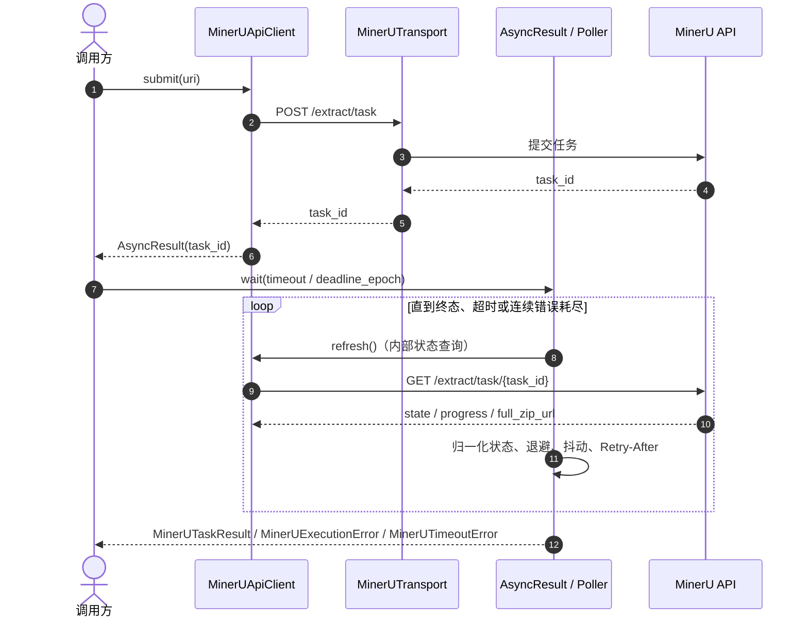
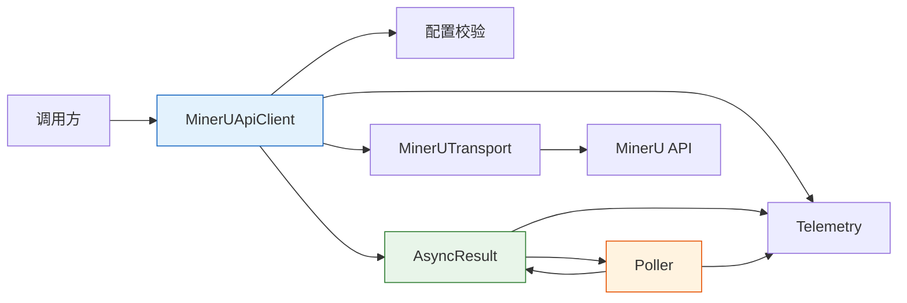
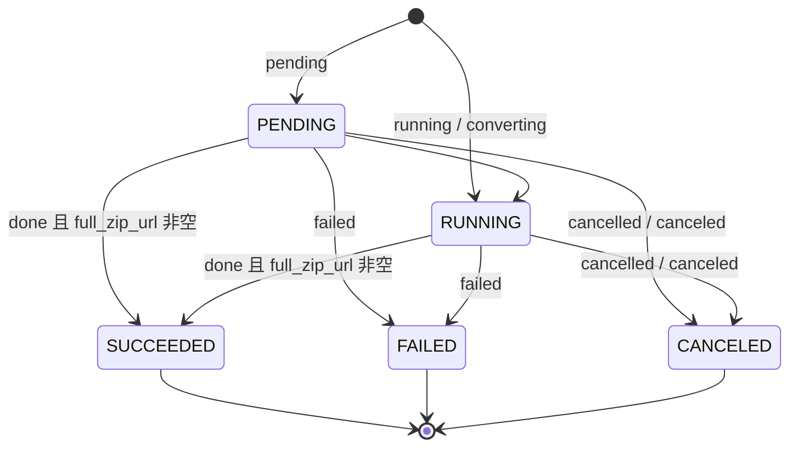

# MinerU 客户端 异步任务提交与稳健轮询 技术方案

| 字段 | 内容 |
| --- | --- |
| 标题 | MinerU 客户端 异步任务提交与稳健轮询 技术方案 |
| 主笔 | @jackafx |
| 评审人 | @jackafx（仓库维护者，兼下游依赖方负责人）；评审记录见 `changelog.md` |
| 创建日期 | 2026-10-20 |
| 目标版本 | 0.1.0 |
| 关联资源 | [全局架构](../../architecture/mineru-parser-architecture.md)、SPEC-002、SPEC-003、SPEC-004 |

## 1. 背景与上下文

### 1.1 系统现状

`mineru-parser` 是对 MinerU 异步解析服务的 Python 封装。MinerU 只提供异步任务接口：调用方提交 PDF URL，拿到 `task_id` 后必须自行轮询到终态，才能取得结果包的 `zip_url`。库的四个组件按“提交 → 等待 → 下载 → 解析”串联，客户端（`_client`，原 `MinerUApiClient`）负责前两个阶段。

当前技术栈为 Python 3.12、`requests.Session`、`dataclasses` / `Enum`，全部为同步阻塞模型。客户端对外的行为契约（组件已私有化，外部用户通过 `parse()` 间接使用）如下：

- `submit(uri, model_version, data_id)`：向 `POST /extract/task` 提交任务，返回 `AsyncResult`。
- `resume(task_id, data_id)`：不访问网络，用持久化的 `task_id` 重新取得 `AsyncResult`。
- `AsyncResult.wait(timeout, deadline_epoch, on_update, policy)`：轮询到终态并交付 `MinerUTaskResult.zip_url`。
- `AsyncResult.refresh()`：查询一次状态并写入缓存。
- `close()` / 上下文管理器：只关闭客户端自建的 Session。

核心流程：



全局组件边界见 [全局架构](../../architecture/mineru-parser-architecture.md)；本文只描述客户端范围内的拓扑与契约。

### 1.2 核心技术痛点

异步任务接口把“等待”这件事留给了调用方，失败链如下：

1. **提交成功只是开始**：服务端异步解析，客户端必须反复查询；固定 `sleep` 要么过密触发限流，要么过疏拖长等待。
2. **限流与瞬时故障没有统一策略**：429、5xx、连接未建立、读超时各有不同的可重试语义；没有退避、抖动与 `Retry-After` 时，调用方容易重试风暴或过早放弃。
3. **进程重启后任务失联**：只持有 `task_id` 而没有恢复入口时，任务变成孤儿；重新提交又会重复建任务、重复计费。
4. **等待没有边界**：不传超时则线程永久阻塞；传入相对超时与绝对截止时间时，两者的换算、sleep 截断与“最后已知状态”容易各写一套。
5. **错误不可分类**：认证、额度、瞬时、执行、配置、超时混在一个异常里，调用方无法决定重试、降级还是放弃。
6. **可观测性缺失**：轮询次数、退避间隔、错误类型、终态耗时没有统一出口，故障只能靠翻日志。

**证据（度量）**：README 记录的 2026-10-21 真实运行中，同一份 13 页 PDF 的端到端耗时为 37.5 s，其中等待阶段 36.56 s、提交 0.22 s、下载 0.67 s、解析 0.03 s。等待阶段占总耗时 **97.5%**。这意味着客户端的轮询策略就是整条链路的主要成本；把轮询留给每个调用方各自实现，等于把 97.5% 的耗时行为交给不可控的重复代码。

### 1.3 重构/设计动机

本次动机有三条：

1. **单函数门面落地后，客户端成为每个 `parse()` 调用的必经阶段**：客户端的行为回归会直接暴露给所有用户，契约需要在 0.1.0 发布前固化。
2. **三条失败路径需要共享根异常**：客户端、下载器、提取器各自失败时的处置动作不同，但调用方需要一个“一网打尽”的捕获入口；2026-10-21 引入 `MinerUParserError` 正是为了这个触发点。
3. **等待阶段占据 97.5% 的端到端耗时**：把退避、抖动、`Retry-After`、deadline 与错误预算收敛到一个可注入的客户端，是当前收益最高的收敛点。

### 1.4 非目标

- **下载、解压、解析结果包**：本次不做；由下载器与提取器承担，客户端只交付 `zip_url`。
- **批量任务、任务列表、删除任务**：本次不做；当前只聚焦单个任务的提交与等待。
- **提交幂等**：本次不做；`data_id` 仅用于对账，不是幂等键。
- **异步 / 并发轮询、任务调度器集成**：本次不做；同步阻塞模型优先保证语义正确。
- **业务编排入口（一步式 `parse`）**：本次不做；由管道层提供，客户端只提供原语。
- **公开 `trace` 单次查询 API**：本次不做；它只是 `AsyncResult.refresh()` 的内部机制。
- **多线程共享同一个 `AsyncResult` 句柄**：本次不做；句柄明确非线程安全。
- **自动重试提交阶段“结果未知”的失败**：本次不做；避免重复创建任务。
- **对 `requests.Session` 之外的 HTTP 后端做抽象**：本次不做；由注入 Session 满足定制需求。

**不做的后果**：不提供批量与幂等意味着调用方必须自己保存 `task_id`、按 `data_id` 对账，并自行避免重复提交；不提供异步轮询意味着高并发场景需要调用方用线程 / 进程池承接。这些代价已写入第 5 章与第 7 章，不在本期用隐式行为兜底。

## 2. 目标与非目标

### 2.1 目标

- **G1 - 统一入口与配置（架构级）**：用一组显式参数构造客户端，凭证、`base_url`、超时与轮询策略在发起网络请求前完成校验。验收：AC-1.1 ~ AC-1.6 全部通过 `tests/test_client.py`。
- **G2 - 提交与恢复（架构级）**：提供 `submit` / `resume` 两个原语，返回统一的 `AsyncResult`；恢复不访问网络。验收：AC-2.1 ~ AC-3.5 全部通过。
- **G3 - 稳健轮询与等待边界（可靠性级）**：默认间隔 3 s、上限 30 s、退避 1.5、抖动 0.5、连续错误上限 3 次；支持 `Retry-After` 与相对 / 绝对超时。验收：AC-4.1 ~ AC-5.6 全部通过；默认值由 AC-5.1 断言。
- **G4 - 错误分类与统一根（可靠性级）**：认证、额度、瞬时、执行、配置、超时分别建模，并与下载 / 解析 / 管道异常共享 `MinerUParserError` 根且互不继承。验收：AC-6.1 ~ AC-6.7 全部通过。
- **G5 - 生命周期、可观测与可测试性（运维级）**：Session 所有权明确；`on_update` / `on_metric` 异常隔离；`correlation_id` 进入所有日志；时钟、随机源、Session 均可注入。验收：AC-7.1 ~ AC-10.3（AC-10.x 见 4.7 的“未实现”标注）+ 29 个无网络测试函数。

### 2.2 非目标

- **NG1 - 下载 / 解压 / 解析**：由下游组件承担（本次不做）。
- **NG2 - 批量任务、任务列表、删除任务**：当前只做单任务原语（本次不做）。
- **NG3 - 提交幂等**：`data_id` 仅用于对账（本次不做）。
- **NG4 - 异步 / 并发轮询**：由调用方用线程或进程池承接（本次不做）。
- **NG5 - 一步式业务编排**：由管道层提供（本次不做）。
- **NG6 - 公开 `trace` 查询**：保持内部机制（本次不做）。
- **NG7 - 多线程共享 `AsyncResult`**：句柄非线程安全（本次不做）。
- **NG8 - 自动重试提交阶段未知结果**：避免重复建任务（本次不做）。
- **NG9 - 非 `requests.Session` 后端抽象**：通过注入 Session 定制（本次不做）。
- **NG10 - 任务恢复入口的持久化**：库不落盘，`task_id` 由调用方保存（Deferred to Phase 2）。

## 3. 架构设计与核心方案

### 3.1 总体架构

全局结构见 [全局架构](../../architecture/mineru-parser-architecture.md)（Approved）。本文只改客户端的契约与内部协作，不改变下载器、提取器与管道的边界。

本次变更范围内的拓扑：



**新增 / 改造 / 保持不变**：

- 新增：库级根异常 `MinerUParserError` 的客户端侧继承关系与断言。
- 改造：轮询算法与等待边界收敛为契约条款；不再在 Spec 中保留实现伪码。
- 不变：客户端公共方法签名、状态归一化、错误分类矩阵、Session 所有权与遥测口径。

### 3.2 核心模块职责

| 模块 | 职责 | 明确不做 |
| :--- | :--- | :--- |
| `MinerUApiClient` | 配置校验、凭证解析、Session 生命周期、`submit` / `resume`、内部状态查询 | 不保存任务状态、不执行轮询、不解释终态、不提供业务编排 |
| `MinerUTransport` | HTTP 请求构造、响应解析、信封与错误码分类、`Retry-After` 解析 | 不持有任务状态、不轮询、不解释终态 |
| `AsyncResult` | 持有 `task_id` / `data_id`、缓存最近状态与结果、终态解释 | 不直接发 HTTP、不决定轮询节奏、非线程安全 |
| `Poller` | 退避、抖动、`Retry-After`、超时 / deadline、连续错误上限、`on_update` 触发 | 不解释任务成败、不管理任务状态 |
| `Telemetry` | 统一日志与指标出口、`correlation_id` 注入、回调异常隔离 | 不影响主流程 |

### 3.3 核心数据流转

1. 调用方 `submit(uri)`；客户端先校验请求模型与凭证，再通过 `MinerUTransport` 发出 `POST /extract/task`。
2. 服务端返回 `data.task_id`；客户端构造 `AsyncResult`，此时不发起状态查询。
3. 调用方调用 `AsyncResult.wait(...)`；`Poller` 以 `AsyncResult.refresh()` 为 fetch，循环查询 `GET /extract/task/{task_id}`。
4. 每次响应经信封解析、状态归一化后写入 `AsyncResult` 缓存；状态或页数变化时触发 `on_update`。
5. 终态为成功时交付 `MinerUTaskResult`（只含 `zip_url` / `provider_task_id` / `data_id`）；失败、取消、超时或连续错误耗尽时抛出对应异常。
6. 失败后重复 `wait()` 立即重抛同类异常且不访问网络；成功后重复 `wait()` 返回缓存结果。

### 3.4 关键选型与约束

- **同步阻塞而非 `asyncio`**：库的公共入口是同步函数，客户端必须与管道保持同一模型；异步收益留给调用方的线程 / 进程池。详细对比见第 7 章。
- **注入式时间与随机源**：`sleep`、`monotonic`、`wall_clock`、`random_fn` 可注入，保证无网络、假时钟测试。
- **`requests.Session` 复用**：一个客户端共享一个 Session；注入时绝不接管其生命周期。
- **契约优先**：Spec 只规定“必须如何判定”，不规定实现代码；轮询公式与状态映射见 4.5 / 4.6。

## 4. 详细设计

### 4.1 设计范围与术语

- **终态**：`succeeded` / `failed` / `canceled`；进入终态后不再访问网络。
- **瞬时错误**：可安全重试的错误（429、查询 404/5xx、连接未建立、未知状态等）。
- **等待预算**：由 `timeout` 或 `deadline_epoch` 换算出的单调时钟预算。

### 4.2 任务状态机



未识别的原始状态不进入领域状态机，按瞬时错误处理，交由轮询继续尝试。

### 4.3 数据模型与契约

**客户端构造参数**

| 参数 | 默认值 | 类型 | 必填 | 校验 / 语义 |
| :--- | :--- | :--- | :---: | :--- |
| `api_key` | `None` | `str \| None` | 否 | 显式提供时去空白且不得为空；`None` 时延迟到首次请求读取 `MINERU_API_KEY` |
| `base_url` | `https://mineru.net/api/v4` | `str` | 否 | 绝对 http(s) URL；去尾部 `/`；禁止 query / fragment |
| `request_timeout` | `10.0` | `float \| tuple[float, float]` | 否 | 正有限数，或 `(connect, read)` 正有限数二元组 |
| `poll_policy` | `None` → `DEFAULT_POLL_POLICY` | `PollPolicy \| None` | 否 | 必须是 `PollPolicy` 实例 |
| `session` | `None` → 新建 `requests.Session()` | `requests.Session \| None` | 否 | 注入时客户端不接管生命周期 |
| `sleep` / `monotonic` / `wall_clock` / `random_fn` | 系统实现 | `Callable` | 否 | 可注入假时钟 / 随机源 |
| `on_metric` | `None` | `Callable[[str, float, Mapping[str, str]], None]` | 否 | 指标回调；异常必须被吞掉 |
| `correlation_id` | `None` | `str \| None` | 否 | 附加到所有日志 |

**wire 模型**

| 模型 | 字段 | 类型 | 必填 | 说明 |
| :--- | :--- | :--- | :---: | :--- |
| `ExtractionRequest` | `uri` → wire `url` | `str` | 是 | 绝对 http(s) URL；提交前去空白 |
| `ExtractionRequest` | `model_version` | `str` | 否 | 默认 `"vlm"`；不得为空白 |
| `ExtractionRequest` | `data_id` | `str \| None` | 否 | 非空白、长度 $\le 128$；`None` 时从载荷省略 |
| `ApiEnvelope` | `code` / `msgCode` / `msg` / `trace_id` / `data` / `success` | 混合 | 否 | 信封判定：优先 `code`，缺失取 `msgCode`；仅 `"0"` 为成功；两者都无时以 `success is not False` 判定 |
| `ExtractionTaskDetail` | `task_id` / `state` / `err_msg` / `full_zip_url` / `data_id` / `extract_progress` | 混合 | 否 | 查询响应载荷；`extract_progress` 含 `extracted_pages` / `total_pages` |

**领域模型**

| 模型 | 字段 | 说明 |
| :--- | :--- | :--- |
| `MinerUTaskState` | `pending` / `running` / `succeeded` / `failed` / `canceled` | `StrEnum`；后三者为终态 |
| `MinerUProgress` | `extracted_pages`、`total_pages` | 不可变 dataclass，字段均可为 `None` |
| `MinerUTaskStatus` | `state`、`raw_state`、`task_id`、`data_id`、`err_msg`、`full_zip_url`、`progress` | 归一化后的不可变状态快照 |
| `MinerUTaskResult` | `zip_url`、`provider_task_id`、`data_id` | 成功结果；不依赖 Pydantic，可长期持有 |
| `PollPolicy` | `initial_interval=3.0`、`max_interval=30.0`、`backoff=1.5`、`jitter=0.5`、`max_consecutive_errors=3`、`max_retry_after=60.0` | 构造时校验：`initial > 0`、`max >= initial`、`backoff >= 1`、`jitter ∈ [0,1)`、错误上限为整数且 $\ge 1$、`max_retry_after >= 0` |

### 4.4 接口与协议

**客户端公共 API（组件私有，行为契约仍成立）**

| 方法 / 属性 | 网络行为 | 请求 / 响应 | 关键语义 |
| :--- | :--- | :--- | :--- |
| `submit(uri, *, model_version="vlm", data_id=None)` | `POST /extract/task` | 请求 `{url, model_version, data_id?}`；响应 `{code, data: {task_id}}` | 请求模型校验在 HTTP 异常处理之外；成功返回未查询过的 `AsyncResult` |
| `resume(task_id, *, data_id=None)` | 无 | 参数校验；构造 `AsyncResult` | 用于持久化恢复；不产生提交请求 |
| `AsyncResult.refresh()` | `GET /extract/task/{task_id}` | 路径参数需 URL 编码（`/` → `%2F`） | 查询一次并写缓存；终态后不再访问网络 |
| `AsyncResult.wait(*, timeout=None, deadline_epoch=None, on_update=None, policy=None)` | 轮询 | 状态查询；终态返回 `MinerUTaskResult` | `timeout` 与 `deadline_epoch` 互斥 |
| `close()` / `with` | 无 | — | 只关闭自建 Session；可重复调用 |
| `base_url` / `poll_policy` | 无 | 只读属性 | 未传策略时返回 `DEFAULT_POLL_POLICY` |

**HTTP 契约**

- `POST /extract/task` 请求头：`Authorization: Bearer <api_key>`、`Accept: application/json`；响应 200 成功信封。
- `GET /extract/task/{task_id}` 路径参数必须 URL 编码；成功响应含 `state`、`full_zip_url`、`data_id`、`extract_progress`。
- 信封错误码：`code` / `msgCode` 存在任一错误码时，仅 `"0"` 视为成功。

### 4.5 核心流程与时序

**轮询预算**

记 $I_0$ 为 `initial_interval`，$b$ 为 `backoff`，$I_{\max}$ 为 `max_interval`，$j$ 为 `jitter`，$U$ 为注入随机源在 $[0,1]$ 的取值。

$$
I \leftarrow \min(I \cdot b,\ I_{\max}), \qquad d = I \cdot \big((1-j) + j \cdot U\big)
$$

`Retry-After` 优先且不叠加抖动：

$$
d = \min(\text{Retry-After},\ \text{max\_retry\_after})
$$

等待预算：

$$
T_{\text{budget}} = \begin{cases}
\text{timeout}, & \text{提供 timeout} \\
\max(0,\ \text{deadline\_epoch} - t_{\text{wall}}), & \text{提供 deadline\_epoch}
\end{cases}
$$

Poller 内部统一使用单调时钟；每次 sleep 截断为 $\min(d,\ \text{deadline}_{\text{mono}} - t_{\text{mono}})$。超时检查发生在每次查询前与每次 sleep 后。

**控制流契约（不含实现代码）**

1. 首次查询前检查 deadline；若已耗尽，立即抛 `MinerUTimeoutError`（`last_status=None`）。
2. 查询成功：连续错误计数清零；记录 `poll_count`；若状态变化则把间隔重置为 `I_0`；若状态变化或页数变化则触发 `on_update`。
3. 查询抛瞬态错误：连续错误计数加一；达到 `max_consecutive_errors` 时抛 `MinerUExecutionError`；否则按退避推进间隔，并优先采用 `Retry-After`。
4. 命中终态：成功返回 `MinerUTaskResult`；失败 / 取消抛 `MinerUExecutionError`。
5. 每次 sleep 不超过剩余预算；sleep 后再次检查 deadline。
6. 失败后重复 `wait()` 立即重抛同一类异常且不访问网络；成功后重复 `wait()` 返回缓存结果。

### 4.6 异常处理与错误码

**异常层级**

```text
MinerUParserError
└── MinerUError
    ├── MinerUTransientError        # 可安全重试
    ├── MinerUTimeoutError          # 超过调用方 deadline，携带 task_id / last_status
    └── MinerUExecutionError        # 终态失败或结果未知
        ├── MinerUAuthenticationError
        ├── MinerUQuotaError
        └── MinerUConfigurationError
```

`MinerUError` 与 `ResultDownloadError`、`ResultExtractionError`、`PipelineError` **互不继承**；该关系由 `issubclass` 断言覆盖。

**提交阶段错误映射**

| 触发条件 | 异常类型 | 是否可重试 |
| :--- | :--- | :---: |
| HTTP 429 | `MinerUTransientError`（携带 `Retry-After`） | 是 |
| `ConnectTimeout`；`NewConnectionError`（含 DNS 失败） | `MinerUTransientError` | 是（请求确定未发出） |
| HTTP 401 / 403 | `MinerUAuthenticationError` | 否 |
| 其他 HTTP 状态（含 4xx / 5xx） | `MinerUExecutionError` | 否（结果未知，避免重复建任务） |
| 读超时、连接中断、响应解析失败 | `MinerUExecutionError` | 否（服务端可能已受理） |

**查询阶段错误映射**

| 触发条件 | 异常类型 | 是否可重试 |
| :--- | :--- | :---: |
| HTTP 429 | `MinerUTransientError`（携带 `Retry-After`） | 是 |
| HTTP 404 | `MinerUTransientError` | 是（新任务可能尚未可见） |
| HTTP 5xx | `MinerUTransientError` | 是 |
| HTTP 401 / 403 | `MinerUAuthenticationError` | 否 |
| 其他 HTTP 4xx | `MinerUExecutionError` | 否 |
| 其他传输异常 / 响应解析失败 | `MinerUTransientError` | 是 |

**业务错误码**

| 类别 | 错误码 | 查询阶段映射 |
| :--- | :--- | :--- |
| `auth` | `A0202`、`A0211`、`-60013` | `MinerUAuthenticationError` |
| `quota` | `-60018`、`-60019` | `MinerUQuotaError` |
| `transient` | `-10001`、`-60001`、`-60003`、`-60007`、`-60008`、`-60009`、`-60011`、`-60012`、`-60021`、`-60022` | `MinerUTransientError` |
| `terminal` | `-500`、`-10002`、`-60002`、`-60004`、`-60005`、`-60006`、`-60010`、`-60015`、`-60016`、`-60017`、`-60020` | `MinerUExecutionError` |
| `unknown` | 其他 | 提交阶段 `MinerUExecutionError`；查询阶段 `MinerUTransientError` |

业务错误消息格式：`MinerU API error (code=<code>): <msg>`；信封含 `trace_id` 时追加 `[trace_id=<id>]`。

### 4.7 验收标准

| 验收标准 | 断言 | 对应测试 |
| :--- | :--- | :--- |
| AC-1.1 | 显式 `api_key` 去空白；空白串抛 `MinerUConfigurationError` | `test_missing_api_key_raises`、`test_invalid_configuration_is_rejected` |
| AC-1.2 | 未传 `api_key` 时构造不失败；首次请求读取 `MINERU_API_KEY`，缺失抛 `MinerUAuthenticationError` | `test_api_key_comes_from_environment`、`test_missing_api_key_raises` |
| AC-1.3 | `base_url` 必须为绝对 http(s)、去尾 `/`、无 query / fragment | `test_invalid_configuration_is_rejected` |
| AC-1.4 | `request_timeout` / `poll_policy` 非法时构造失败 | `test_invalid_configuration_is_rejected` |
| AC-1.5 | `session` / 时钟 / 随机源 / 指标钩子注入后直接使用，不回退默认 | `test_invalid_configuration_is_rejected`（注入分支） |
| AC-1.6 | 暴露只读 `base_url` / `poll_policy`；未传策略返回默认策略 | `test_invalid_configuration_is_rejected`（默认分支） |
| AC-2.1 | `submit` 向 `POST /extract/task` 发送 `url` / `model_version` / 可选 `data_id`，返回 `AsyncResult` | `test_submit_returns_task_handle_and_sends_expected_request` |
| AC-2.2 | 提交携带 `Authorization: Bearer`、`Accept: application/json` 与配置超时 | 同上 |
| AC-2.3 | `data_id=None` 时请求体省略该字段 | `test_submit_omits_none_data_id` |
| AC-2.4 | 非法 `uri` 在发出 HTTP 前抛 `MinerUConfigurationError` | `test_invalid_uri_fails_before_http` |
| AC-2.5 | 响应 `data.task_id` 缺失或为空抛 `MinerUExecutionError` | `test_submit_with_empty_task_id_is_an_execution_error` |
| AC-2.6 | 返回的 `AsyncResult` 身份字段正确，`status` / `state` / `result` 为 `None` | `test_submit_returns_task_handle_and_sends_expected_request` |
| AC-3.1 | `resume` 不发起任何网络请求 | `test_task_resumes_from_persisted_id_without_submit` |
| AC-3.2 | `task_id` 去空白且非空；`data_id` 非空白且长度 $\le 128$ | 同上 |
| AC-3.3 | `resume` 返回的 `AsyncResult` 身份字段与参数一致 | 同上 |
| AC-3.4 | 恢复后的 `wait()` 只产生 GET，不产生 POST | 同上 |
| AC-3.5 | 内部状态查询对 `task_id` 做 URL 编码 | `test_task_id_is_url_encoded` |
| AC-4.1 | `timeout` 与 `deadline_epoch` 互斥，同时提供时抛配置错误且不轮询 | `test_timeout_and_deadline_are_mutually_exclusive` |
| AC-4.2 | `deadline_epoch` 换算为 $\max(0, \text{deadline} - t_{\text{wall}})$ 的单调预算 | `test_deadline_epoch_is_converted_to_budget` |
| AC-4.3 | 超时抛 `MinerUTimeoutError`，携带 `task_id` 与最后已知状态 | `test_timeout_carries_last_status` |
| AC-4.4 | 超时检查在每次查询前与 sleep 后执行；sleep 截断到剩余预算 | `test_timeout_carries_last_status` |
| AC-5.1 | 默认策略值符合 4.3 的 `PollPolicy` 表 | `test_wait_polls_until_done_and_notifies_on_state_and_progress` |
| AC-5.2 | 延迟按 4.5 的公式计算；`U` 夹取到 `[0,1]` | 同上 |
| AC-5.3 | 状态变化重置间隔；仅进度变化不重置 | 同上 |
| AC-5.4 | `Retry-After` 优先且截断，不叠加抖动 | `test_retry_after_is_honored_and_capped`、`test_parse_retry_after_supports_seconds_and_http_date` |
| AC-5.5 | 连续瞬态错误达到上限抛 `MinerUExecutionError`；成功查询清零计数 | `test_transient_errors_exhaust_retry_budget`、`test_transient_error_is_retried` |
| AC-5.6 | `Retry-After` 支持秒数与 HTTP-date；非法值忽略，负值归零，超限截断 | `test_parse_retry_after_supports_seconds_and_http_date`、`test_retry_after_is_honored_and_capped` |
| AC-6.1 | 提交阶段按 4.6 映射错误；5xx / 读超时 / 连接中断不自动重试 | `test_submit_5xx_is_terminal_and_not_retried`、`test_submit_quota_business_error` |
| AC-6.2 | 查询阶段按 4.6 映射错误；401/403 不重试 | `test_authentication_error_on_trace_is_not_retried`、`test_gateway_auth_envelope_is_recognized` |
| AC-6.3 | 业务错误码按 `ERROR_CODE_KIND` 分类 | `test_gateway_auth_envelope_is_recognized`、`test_submit_quota_business_error` |
| AC-6.4 | `failed` 抛执行错误（优先 `err_msg`）；`cancelled` / `canceled` 抛执行错误并说明取消 | `test_wait_failed_raises_and_is_idempotent`、`test_wait_cancelled_raises` |
| AC-6.5 | `done` 但缺 `full_zip_url` 抛执行错误；未知 `state` 抛瞬态错误 | `test_done_without_zip_url_is_an_execution_error`、`test_unknown_state_is_retried_as_transient` |
| AC-6.6 | 失败后重复 `wait()` 立即重抛同类异常且不访问网络 | `test_wait_failed_raises_and_is_idempotent` |
| AC-6.7 | `MinerUError` 继承 `MinerUParserError`；四个异常家族互不继承 | `test_error_hierarchy_and_common_root`（位于 `tests/test_extractor.py`，覆盖跨家族断言） |
| AC-7.1 | `on_update` 在首次查询、状态变化或页数变化时触发，参数为归一化状态 | `test_wait_polls_until_done_and_notifies_on_state_and_progress` |
| AC-7.2 | `on_update` 异常被吞掉并记录 `mineru.on_update.failed` | `test_callback_exception_does_not_interrupt_polling`、`test_callback_base_exception_does_not_interrupt_polling` |
| AC-8.1 | 未注入 Session 时自建并在 `close()` / 退出上下文时关闭 | `test_client_manages_its_own_session` |
| AC-8.2 | 注入 Session 时客户端不得关闭 | `test_injected_session_is_not_closed_by_client` |
| AC-8.3 | 同一客户端所有请求复用同一个 Session | `test_client_manages_its_own_session` |
| AC-8.4 | 客户端可跨任务共享，且不在实例上保存任务状态 | 同上（间接覆盖） |
| AC-9.1 | 成功结果只提供 `zip_url`，不自动下载 / 校验 / 解压 | `test_task_resumes_from_persisted_id_without_submit`、`test_wait_polls_until_done_and_notifies_on_state_and_progress` |
| AC-9.2 | `provider_task_id` / `data_id` 的回退规则符合契约 | `test_wait_polls_until_done_and_notifies_on_state_and_progress` |
| AC-10.1 | 提供 `on_metric` 时为提交、HTTP、轮询、终态上报指标 | **未实现（无独立测试）** |
| AC-10.2 | `on_metric` 异常被吞掉并记录 `mineru.metric.failed` | **未实现（无独立测试）** |
| AC-10.3 | 提供 `correlation_id` 时所有日志携带该字段 | **未实现（无独立测试）** |

### 4.8 边界条件

| 场景 | 触发条件 | 预期处理 | 异常 |
| :--- | :--- | :--- | :--- |
| URI 非法 | 非绝对 http(s) URL | 发出请求前拒绝 | `MinerUConfigurationError` |
| API Key 缺失 | 未传且环境变量为空 | 发出请求前拒绝 | `MinerUAuthenticationError` |
| 提交被限流 | HTTP 429 | 抛瞬态错误，调用方决定重试 | `MinerUTransientError`（带 `retry_after`） |
| 提交结果未知 | 5xx、读超时、连接中断 | 不自动重试，避免重复建任务 | `MinerUExecutionError` |
| 查询 404 | 任务刚提交尚未可见 | 按瞬态错误继续轮询 | `MinerUTransientError` |
| 未知状态 | `state` 不在映射表 | 视为协议可能新增状态，继续轮询 | `MinerUTransientError` |
| 成功但无下载地址 | `state=done` 且 `full_zip_url` 为空 | 视为协议违约 | `MinerUExecutionError` |
| 超时为零 | `timeout=0` 或 deadline 已过 | 首次请求前立即超时 | `MinerUTimeoutError` |
| 连续错误耗尽 | 瞬态错误达到上限 | 放弃轮询并保留原因链 | `MinerUExecutionError` |
| 回调抛异常 | `on_update` / `on_metric` 内部异常 | 吞掉并记录告警，继续主流程 | 不抛出 |
| 终态后重复等待 | 成功 / 失败后再次 `wait()` | 成功返回缓存；失败立即重抛且不访问网络 | 缓存结果 / 原异常 |

## 5. 非功能性需求

### 5.1 性能与资源

- **等待预算**：`timeout` 与 `deadline_epoch` 必须覆盖整个轮询；sleep 永不越过 deadline。验收：AC-4.2 ~ AC-4.4。
- **轮询节奏**：默认初始间隔 3 s、上限 30 s、退避 1.5、抖动 0.5；状态变化重置间隔。验收：AC-5.1 ~ AC-5.3。
- **单请求超时**：默认 `request_timeout=10.0` s；可配置为 `(connect, read)` 二元组。验收：AC-1.4。
- **内存**：客户端不缓存响应体，只保留最近一次 `MinerUTaskStatus` 与终态结果；单任务常驻内存与响应大小同阶。验收：代码评审 + `AsyncResult` 字段表。
- **端到端基线**：13 页真实样本端到端 37.5 s，其中等待 36.56 s（2026-10-21，README）；该数字是观测基线，不是 SLA。[estimated] P95 / P99 尚未统计。

### 5.2 可靠性与容灾

- **连续瞬态错误上限**：默认 3 次；达到上限抛 `MinerUExecutionError`，避免无限重试。验收：AC-5.5。
- **提交不自动重试**：5xx / 读超时 / 连接中断视为“结果未知”，不自动重试，避免重复建任务。验收：AC-6.1。
- **进程重启恢复**：`resume(task_id)` 不访问网络，恢复后的 `wait()` 只发 GET。验收：AC-3.1 ~ AC-3.4。
- **回调隔离**：`on_update` / `on_metric` 的任何异常都不得中断主流程。验收：AC-7.2；AC-10.2 未实现（仅有契约）。
- **终态幂等**：成功重复 `wait()` 返回缓存；失败重复 `wait()` 立即重抛且不访问网络。验收：AC-6.6。

### 5.3 可观测性

- **日志**：`mineru.submit`、`mineru.poll`、`mineru.poll.error`、`mineru.succeeded`、`mineru.failed`、`mineru.timeout`、`mineru.on_update.failed`、`mineru.metric.failed`；`correlation_id` 附加到所有日志。验收：AC-10.3 **未实现**（缺少独立测试）。
- **指标**：`mineru.submit.total`、`mineru.submit.duration_ms`、`mineru.http.request.duration_ms`、`mineru.poll.total`、`mineru.poll.duration_ms`、`mineru.poll.errors`、`mineru.task.duration_ms`。验收：AC-10.1 **未实现**。
- **回调异常**：指标回调异常必须记录 `mineru.metric.failed`。验收：AC-10.2 **未实现**。
- **可测试性**：时钟、随机源、Session、指标钩子均可注入；29 个客户端测试函数全部无网络。验收：`tests/test_client.py`。

### 5.4 安全与合规

- **凭证**：`api_key` 只从显式参数或 `MINERU_API_KEY` 读取；不得写入日志、异常消息或指标标签。验收：AC-1.1 / AC-1.2 + 代码评审。
- **传输**：所有请求走 `requests` 的 TLS 校验；不提供关闭 TLS 校验的参数。验收：接口表（无该参数）。
- **输入校验**：`uri` 必须为绝对 http(s) URL；`base_url` 禁止 query / fragment；`task_id` 必须 URL 编码。验收：AC-1.3、AC-2.4、AC-3.5。
- **日志脱敏**：业务错误消息只含错误码与 `msg`，不拼接请求体；`correlation_id` 仅进入日志，不进入指标标签。验收：代码评审 + AC-10.3（未实现）。

## 6. 上线与迁移计划

### 6.1 发布与灰度

客户端是库内部实现，随 `mineru-parser` 包一起发布，采用“候选版 → 正式版”的两阶段：

1. **Phase 1（候选）**：发布 `0.1.0rcN` 到测试索引；在 13 页真实样本与全部单测上跑通；观察 7 天。
2. **Phase 2（正式）**：无 P0/P1 问题后发布 `0.1.0`；同时更新 README 与 `changelog.md`。
3. **观察期**：正式发布后 14 天内，任何客户端回归按 6.4 回滚。

灰度范围受库形态限制：无法按流量比例灰度，改用“候选版 + 内部集成验证”替代；[estimated] 观察窗口与样本量按当前维护者规模设定。

### 6.2 数据迁移与兼容性

- **无数据迁移**：客户端不落盘、不持有任务状态；`task_id` 由调用方保存。
- **兼容性**：客户端的公共导入路径已在 SPEC-004 中私有化；外部用户使用 `parse()`，无迁移动作。
- **内部迁移**：测试与文档中的导入路径统一为 `mineru_parser._client`；组件行为契约不变。
- **回退兼容**：行为契约与异常层级保持不变；`MinerUParserError` 为纯加性根异常，既有 `except MinerUError` 不受影响。

### 6.3 上线验证与冒烟

| 冒烟项 | 步骤 | 观察指标 |
| :--- | :--- | :--- |
| 单元回归 | `pytest tests/test_client.py -q` | 29 个测试函数全通过 |
| 管道回归 | `pytest tests/test_pipeline.py -q` | 66 个测试函数全通过 |
| 真实样本 | 按 README 运行 13 页示例 PDF | `status=success`；端到端耗时、等待阶段耗时、`poll_count` |
| 异常路径 | 注入 429 / 401 / 5xx / 非法配置 | 异常类型与 4.6 映射一致；无重复提交 |
| 可观测性 | 检查日志字段与 `on_metric` 回调 | `correlation_id`、`mineru.*` 指标名与标签齐全 |

### 6.4 回滚与熔断

**触发条件（可观测数字）**：

- 客户端单测失败数 $\ge 1$。
- 真实样本端到端耗时连续 3 次超过基线 37.5 s 的 150%（即 > 56.25 s）。
- 轮询阶段 HTTP 429 比例连续 10 分钟 > 10%。
- 客户端相关异常率连续 10 分钟 > 1%。

**回滚步骤**：

1. 在 PyPI 上 yank 当前版本，保留元数据；通知使用者固定到上一稳定版本。
2. 回退发布提交（`git revert <release-commit>`），重新打上一版本标签。
3. 恢复默认轮询策略与异常映射；重跑 `tests/test_client.py` 与 `tests/test_pipeline.py`。
4. 用 13 页样本复跑，确认端到端耗时回到基线区间后解除熔断。

## 7. 替代方案与权衡

### 7.1 Status Quo：调用方手写 `requests` + 固定 `sleep`

- **思路**：每个调用方自己提交、保存 `task_id`、用固定间隔轮询、自己处理 429 / 5xx 与超时。
- **成本**：等待阶段占端到端 97.5%（36.56 s / 37.5 s）；固定间隔无法同时满足“不过密”和“不过慢”。
- **风险**：重试风暴、重复建任务、进程重启后任务失联、错误分类不一致；每个调用方重复实现。
- **触发阈值**：当第二个调用方开始复制同一段轮询代码时，Status Quo 的成本已超过收敛成本。

### 7.2 被否决方案：`asyncio` / `httpx.AsyncClient`

- **思路**：用异步客户端并发轮询，提高多任务吞吐。
- **优点**：高并发、连接复用、生态成熟。
- **淘汰原因**：库的公共入口是同步 `parse()`；引入事件循环会改变调用方的编程模型，并把线程安全、取消传播、资源生命周期问题带入当前阶段。与 G1 / G5 的“同步、可注入、无网络测试”约束不对应。

### 7.3 被否决方案：仅使用 `urllib3.Retry`

- **思路**：把重试、退避与 `Retry-After` 交给 `urllib3.Retry`。
- **优点**：成熟、少写代码。
- **淘汰原因**：它不理解任务语义——无法区分“提交阶段结果未知”与“查询阶段可重试”，也无法提供 `resume()`、终态解释、错误分类与等待预算；仍需在其上重建一层客户端契约。

### 7.4 最终选型与权衡矩阵

**选定方案**：同步 `MinerUApiClient` + 可注入时钟 / 随机源 / Session + 显式 `PollPolicy` + 统一异常层级。

| 维度 | Status Quo | `asyncio` 方案 | `urllib3.Retry` 方案 | 选定方案 |
| :--- | :--- | :--- | :--- | :--- |
| 实现与维护成本 | 低（但重复） | 高 | 中 | 中 |
| 轮询正确性 | 差 | 中 | 中 | 强 |
| 与同步 `parse()` 的兼容 | 强 | 差 | 强 | 强 |
| 可测试性（无网络 / 假时钟） | 差 | 中 | 中 | 强 |
| 错误分类与恢复能力 | 差 | 中 | 弱 | 强 |
| 契合当前阶段 | 否 | 否 | 否 | **是** |

结论：选定方案与 G1 ~ G5 一致——把 97.5% 的等待成本收敛到一个可注入、可测试、可观测的同步客户端；异步与第三方重试库留作后续评估。

## 附录 A：未决问题

- **Q-1**：`wait()` 默认无限等待是否应改为必填，或提供基于 `request_timeout` 的默认总预算？当前保持“调用方显式指定边界”，避免库猜测业务 SLA。
- **Q-2**：是否提供按 `data_id` 查询 / 对账任务的封装？需先确认 MinerU 是否提供对应查询接口；暂不纳入。
- **Q-3**：`api_key` 是否应从“延迟解析”改为“构造期解析”？当前延迟解析便于测试与延迟配置，代价是错误暴露较晚。
- **Q-5**：是否支持批量任务、任务列表、删除任务？暂不纳入，当前聚焦单任务原语。
- **Q-6**：是否需要显式声明线程安全边界，或提供线程局部 Session？当前只承诺“跨任务共享”，不承诺线程安全。
- **Q-7**：是否将 `MetricHook` 抽象为独立可插拔接口？当前轻量 `Callable` 足够，待实际接入场景明确后再抽象。
- **Q-8**：是否支持异步 / 并发轮询以提升多任务吞吐？暂不纳入，优先保证单任务语义正确。
