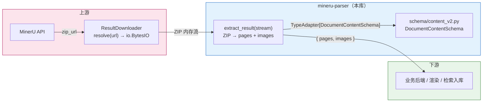
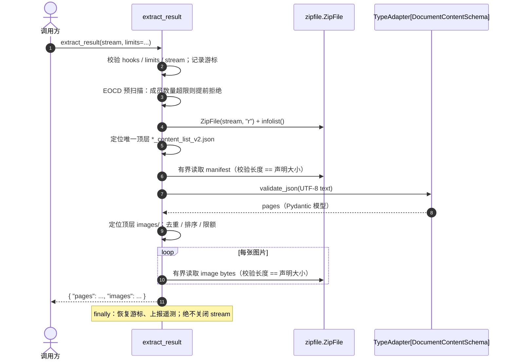

# [SPEC-003] Result Extractor

| 属性 | 内容 |
| :--- | :--- |
| **状态** | Draft |
| **负责人** | @jackafx |
| **创建时间** | 2026-10-21 |
| **更新时间** | 2026-10-21 |
| **关联 Issue/PR** | —（待关联） |

> **评审指引**：本 Spec 的**唯一契约源是 §2 的验收标准（AC）**。评审以 AC 清单为准，逐条确认"可断言 / 可测试"；§3 给出的是**契约**（公共 API、数据模型、判定规则、错误映射），**不包含具体代码实现**——实现方式由实现者决定，§3 只约束"必须做什么"与"必须如何判定"；§4 是边界场景速查表，§6 是已知风险清单。实现与 §3 契约不一致时以 AC 为准，并回写本 Spec。

---

## 1. 背景与目标 (Context & Objectives)

### 1.1 背景 (Context)

`ResultDownloader` 的职责边界止于把结果包 URL 读入 `io.BytesIO`（见 `SPEC-002`）。下游业务真正需要的是“页面 + 图片”：`content_list_v2.json` 中的版面块结构，以及 ZIP 内 `images/` 目录下的图片二进制。当前这一步通常由调用方直接拼 `zipfile.ZipFile`、`json.loads`、`model_validate` 与目录遍历完成，痛点集中在五个方面：

1. **Manifest 定位不一致**：结果包内文件名依赖源文档名，约定位于 ZIP 顶层目录；子目录残留、同名/多份 manifest、macOS 资源分叉、错误页 ZIP 都会让“取第一个匹配文件”的脚本悄悄读到错误内容。
2. **Schema 校验缺失**：直接用 `dict["content"]` 取值时，字段缺失、块类型漂移与 `bbox` 非法要等到业务深处才暴露；错误信息也缺少字段路径。
3. **图片处理分散**：图片路径大小写、重复成员、`..` 路径、符号链接、缺失 `images/` 目录各自处理；排序不确定，调用方难以做稳定快照。
4. **资源边界缺失**：下载器的 `max_bytes` 只约束 ZIP 的压缩字节数，不约束解压后的 manifest 与图片；压缩炸弹或超大图片仍可在解压阶段把进程内存打满。
5. **错误不可分类**：`BadZipFile`、`UnicodeDecodeError`、Pydantic `ValidationError`、`KeyError` 混杂在一起，调用方无法区分“包坏了”“格式变了”“图片超限”，也无法决定是否值得重新下载。

Result Extractor 因此被设计为一个**无状态、纯内存**的解析组件：上游是 `ResultDownloader` 交付的 ZIP 内存流，下游统一交付 `{"pages": [...], "images": [...]}`。它不下载、不重试、不落盘、不解码图片，只负责把“一个结果包”确定性地解析为结构化对象与图片资源。

链路概览：



> **信任边界**：ZIP 内容视为不可信输入。即使 URL 来自 MinerU，响应体仍可能损坏、被替换或包含恶意成员；Extractor 只做结构与资源边界校验，不验证来源、签名或哈希。图片字节不会被解码，因此恶意图片载荷的防护属于下游渲染器职责。

### 1.2 现状与差距分析 (Gap Analysis)

| 能力维度 | 裸 `zipfile` + `json.loads` | 一次性解析脚本 | Result Extractor |
| :--- | :---: | :---: | :---: |
| 统一入口 `extract_result(stream)` | ❌ | ⚠️ 形态不一 | ✅ |
| Manifest 唯一性检查 | ❌ | ⚠️ 常取第一个 | ✅ `not_found` / `ambiguous` |
| `content_v2` Schema 校验 | ⚠️ 手写取值 | ⚠️ 各自实现 | ✅ `TypeAdapter[DocumentContentSchema]` |
| 图片路径规范化 | ❌ | ⚠️ 依赖 ZIP 原样 | ✅ 规范化 + 安全校验 |
| 确定性排序 | ❌ | ❌ | ✅ 按 canonical path |
| 重复 / 不安全成员检测 | ❌ | ❌ | ✅ |
| 解压后大小 / 数量上限 | ❌ | ❌ | ✅ `ExtractionLimits` |
| 损坏 / 加密 / 不支持压缩分类 | ❌ | ⚠️ 各自捕获 | ✅ 统一异常体系 |
| 不关闭调用方流 / 恢复游标 | ⚠️ 易遗漏 | ⚠️ 易遗漏 | ✅ 显式契约 |
| 无磁盘解压 | ⚠️ 易使用 `extractall` | ❌ 常落盘 | ✅ 仅内存读取 |
| 错误上下文脱敏 | ❌ | ❌ | ✅ 不泄漏文档内容（含 Pydantic `msg` 二次脱敏） |
| 成员数量前置预检 | ❌ | ❌ | ✅ EOCD 预扫描，构造 `ZipFile` 前拒绝 |
| 失败可分诊 | ❌ | ❌ | ✅ `category` / `reason` / 顶层成员清单 |
| 可观测性 | ❌ | ❌ | ✅ 日志 / 指标统一出口（标签为封闭枚举） |
| 无网络、内存 ZIP 测试 | ⚠️ | ⚠️ | ✅ 纯函数 |

> **样本基线（2026-10-21）**：用一个最小真实结果包核对，ZIP 共 7 个成员：`<uuid>_content_list.json`、`<uuid>_content_list_v2.json`、`<uuid>_model.json`、`<uuid>_origin.pdf`、`full.md`、`layout.json`、`images/<sha256>.jpg`。manifest 4,803 B，已用 `TypeAdapter(DocumentContentSchema)` 校验通过（1 页、6 个块：TitleBlock ×1、ParagraphBlock ×4、ImageBlock ×1）；ImageBlock 的 `image_source.path` 为 `images/<sha256>.jpg`，与图片成员路径一致；图片 1 张、13,936 B。该样本确认「根目录 manifest + 根 `images/`」布局与默认限额的宽松度，也确认了本期把 manifest 定位范围收敛到 ZIP 顶层目录（Goal 2）的依据；样本量不足以校准 P95/P99，真实样本统计仍见 R-1。
>
> **为什么不直接内联十几行代码？** 单个正常包确实只需要 `ZipFile` 加两次读取；本组件的价值在于把“定位唯一 manifest、Schema 校验、路径安全、解压后限额、错误分类、流生命周期”收敛成可测试的公共契约。实现预计约 300–500 行，主要成本在边界与测试，而不是解析本身。

### 1.3 目标 (Goals)

- [ ] **Goal 1**：提供统一入口 `extract_result(stream) -> ExtractedResult`，接收可 seek 的二进制流，交付 `{"pages", "images"}`。
- [ ] **Goal 2**：只在 ZIP **顶层目录**定位**唯一**的 `*_content_list_v2.json`；缺失或多份均失败关闭。
- [ ] **Goal 3**：使用 `schema/content_v2.py` 的 `DocumentContentSchema` 完成 JSON 与 Schema 校验，错误携带字段路径且不泄漏正文。
- [ ] **Goal 4**：提取 ZIP 顶层 `images/` 目录下的全部常规文件，交付 canonical path 与精确二进制内容，输出顺序确定。
- [ ] **Goal 5**：对 manifest 与图片实施解压后字节数、图片数量上限，失败时不返回任何部分结果。
- [ ] **Goal 6**：建立稳定的错误分类：配置、压缩包、manifest、Schema、限额。
- [ ] **Goal 7**：明确流生命周期：不关闭调用方流，成功/失败后恢复游标。
- [ ] **Goal 8**：全程不落盘、不调用 `extract()` / `extractall()`、不写临时文件。
- [ ] **Goal 9**：日志 / 指标统一出口，指标回调异常不影响解析；支持 `correlation_id`。
- [ ] **Goal 10**：纯函数、无网络依赖，所有边界可用内存 ZIP 测试覆盖，并以性质测试（property-based）交叉验证不变式。
- [ ] **Goal 11**：引入库级公共根异常 `MinerUParserError`，让客户端、下载器、提取器三条失败路径共享同一根异常，同时保持彼此互不继承。
- [ ] **Goal 12**：公开 `canonicalize_member_path`，使下游能用与 Extractor 完全一致的规则解析 manifest 中的图片引用。

### 1.4 非目标 (Non-Goals / Out of Scope)

> 明确本次迭代**不包含**的内容，防止需求范围膨胀（Scope Creep）。

- [ ] 下载、重试、URL 校验、SSRF 防护；这些属于上游下载组件，不在本组件范围内。
- [ ] 解压到磁盘、临时文件、`extract()` / `extractall()`、ZIP 成员权限恢复。
- [ ] 解析 `content_list.json`（v1）、`middle.json`、`model.json`、Markdown 或其他结果文件。
- [ ] 图片解码、格式嗅探、缩略图、OCR、内容哈希或损坏图片检测。
- [ ] manifest 中 `image_source.path` 与 `images` 列表的交叉校验；缺失引用与未引用图片均不报错。
- [ ] 按内容去重相同图片；每个路径一条记录。
- [ ] 流式 / 懒加载解析；整份 manifest 与全部图片一次性载入内存。
- [ ] 批量结果包、多个 ZIP 合并、跨包去重。
- [ ] 阅读顺序重建、跨页合并、版面块重排。
- [ ] ZIP 来源、签名、哈希校验；只校验结构与资源边界。
- [ ] 非 seekable 流的缓冲；调用方需自行转为 `io.BytesIO`。
- [ ] `ResultExtractor` 类门面，或与上游下载组件绑定的便捷入口；调用方显式组合两个组件。
- [ ] 修改 `schema/content_v2.py` 或在 Extractor 层开启 `strict=True` / `extra="forbid"`。
- [ ] JSON 重复键检测；解析器按“后值覆盖前值”处理。
- [ ] 对损坏 ZIP 自动重试；本地解析错误是终态，调用方可重新下载后再次调用。
- [ ] 任意 ZIP 成员访问 API；只读取顶层 manifest 与顶层 `images/` 下的文件。
- [ ] 解析 ZIP 注释、extra field、ZIP64 扩展字段等中央目录以外的元数据；EOCD 预扫描只取成员总数。
- [ ] 绕开 `zipfile` 自行实现成员解压（含 CRC 与加密处理）；成员内容长度以中央目录声明为准，完整性校验交由下游。
- [ ] 图片内容哈希校验（即使 MinerU 侧按 `<sha256>` 命名图片，也不假设该约定成立）。

### 1.5 威胁模型 (Threat Model)

| 维度 | 内容 |
| :--- | :--- |
| **输入来源** | 可能是上游交付的结果包，也可能是调用方从其他途径获得的 ZIP；一律按不可信数据处理。 |
| **受保护资产** | 进程内存、下游磁盘（若调用方使用返回的 path 落盘）、下游图片渲染器与解析器。 |
| **攻击者能力** | 控制成员名、成员数量、声明大小、压缩方法、加密标志、JSON 结构与图片字节；可构造重复成员、`..` 路径、超大解压结果、深层嵌套 JSON。 |
| **主要控制** | 唯一 manifest、canonical path、拒绝不安全成员、仅内存读取、有界读取、解压后大小/数量上限、Pydantic Schema 校验、失败不返回部分结果。 |
| **残余风险** | `zipfile` / `zlib` 的 CPU 放大与实现漏洞、Pydantic 模型内存放大、下游图片解码漏洞、manifest 与图片引用不一致、无法识别的符号链接、**敌意归档谎报 `file_size` 造成的图片静默截断**（见 R-12 与 §3.3 输出契约）。 |

> 本 Spec 的安全承诺以“不落盘、只读取顶层 manifest 与顶层 `images/`、使用有界读取”为前提。调用方若把返回的 path 直接拼接到磁盘路径，仍需自行做目标目录约束；Extractor 的 canonical path 只是第一道防线。

---

## 2. 用户故事与验收标准 (User Stories & Acceptance Criteria)

### US-1: 基本提取与结果契约

**As a** 业务调用方
**I want to** 把任意来源的 ZIP 内存流直接交给一个函数
**So that** 我能拿到结构化页面与图片字节，而不关心 ZIP 与 JSON 细节

#### 验收标准 (Acceptance Criteria)

* **AC-1.1**: `extract_result(stream, *, limits=None, on_metric=None, correlation_id=None)` 必须接受 `io.BytesIO` 或任意可读、可 seek 的二进制流，内容为标准 ZIP 归档；输入字节的来源不受限（上游交付、缓存命中、本地文件、测试夹具均可），Extractor 不感知来源，也不参与下载或重试；不得依赖网络、磁盘或环境变量，不得写临时文件，不得调用 `stream.close()`。
* **AC-1.2**: 成功时必须返回新的普通 `dict`，且恰好包含 `"pages"` 与 `"images"` 两个键。`pages` 必须是 `schema.content_v2.DocumentContentSchema` 校验后的对象（外层列表为页，内层列表为版面块，保持 manifest 中的顺序）；`images` 必须是 `{"path": str, "bytes": bytes}` 列表，并按 `path` 升序排序。
* **AC-1.3**: `images[].bytes` 必须是不可变 `bytes` 对象，内容为 ZIP 成员解压后的精确字节；不得解码、转码或重新编码。`images[].path` 必须是使用 `/` 分隔的 canonical 归档相对路径。
* **AC-1.4**: 每次调用必须返回全新对象，不得缓存或复用上一次结果；相同输入字节与相同 `limits` 必须产生等价结果。
* **AC-1.5**: 不得修改输入流内容；成功与所有已处理失败路径都必须把游标恢复到调用前位置。恢复失败时必须记录 `mineru.extract.restore_failed` 警告日志，但不得覆盖主要成功/失败结果。
* **AC-1.6**: 输入必须是可读、可 seek 的二进制流。`io.TextIOBase`、缺少 `read`/`seek`/`tell`、`seekable()` / `readable()` 为假，或解析前 `tell()` 失败，必须在读取 ZIP 前抛出 `ResultExtractionConfigurationError(field="stream")`。
* **AC-1.7**: `limits` 必须是 `ExtractionLimits | None`；`on_metric` 必须是 callable 或 `None`；`correlation_id` 必须是 `str | None`。非法值必须在读取 ZIP 前抛出 `ResultExtractionConfigurationError`。
* **AC-1.8**: `extract_result`、`ExtractionLimits`、`DEFAULT_EXTRACTION_LIMITS`、`ExtractedResult`、`ExtractedImage`、`ExtractionIssue`、`canonicalize_member_path` 与全部 `ResultExtraction*Error` 必须可从 `mineru_parser.extractor` 与顶层 `mineru_parser` 导入。
* **AC-1.9**: 函数不得持有可变模块级调用状态；不同流上的并发调用必须安全。同一个流上的并发调用不受支持，实现无需加锁。
* **AC-1.10**: 不得调用 `stream.close()`、`ZipFile.extract()` 或 `ZipFile.extractall()`。
* **AC-1.11**: `canonicalize_member_path(raw: str) -> str | None` 必须对任意字符串返回与 Extractor 内部**完全一致**的 canonical path，无法安全 canonical 化时返回 `None`。实现必须与 `_members` 共用同一份函数，不得复制第二套规则；该函数不得访问 ZIP、不得读取任何成员。

---

### US-2: Manifest 定位

**As a** 业务调用方
**I want to** 让 Extractor 自己找到结果包中唯一的结构化清单
**So that** 我不会因为文件名、目录层级或重复成员而读到错误内容

#### 验收标准 (Acceptance Criteria)

* **AC-2.1**: manifest 候选必须同时满足：(a) 成员位于 ZIP **顶层目录**——原始成员名不含 `/`；(b) 其**原始 basename** 以 `_content_list_v2.json` 结尾（大小写敏感），`*` 允许为空前缀。顶层候选随后必须通过 canonical path 安全校验与常规文件判定。位于子目录的同名成员一律不参与定位，也不计入候选数。
* **AC-2.2**: 必须恰好有一个候选。零个 → `ResultExtractionManifestError(reason="not_found")`，且必须携带 `top_level_members`（ZIP 顶层成员名的脱敏清单，最多 20 条）与 `top_level_member_count`（顶层成员总数）；多于一个 → `ResultExtractionManifestError(reason="ambiguous")`，其中 `candidates` 为排序后的 canonical path（最多 20 条），`candidate_count` 为完整数量。
  > `not_found` 是布局漂移（R-5）的主要观测点。没有顶层成员清单时，运维无法区分"上游把 manifest 挪到了子目录""包结构整体变了"与"拿到的根本不是结果包"。顶层成员名属于归档元数据而非文档正文，可经转义 + 截断后的诊断上下文携带。
* **AC-2.3**: 目录项（名称以 `/` 结尾）不在顶层范围，不会被选为候选。顶层候选的 basename 匹配后缀但不是常规文件（符号链接、带目录属性等），或名称无法 canonical 化（反斜杠、NUL/C0/C1 控制字符）时，必须抛出 `ResultExtractionArchiveError(reason="unsafe_member")`，不得静默忽略。
* **AC-2.4**: 多个 ZIP 成员 canonical 化到同一 manifest 路径时，必须按多个候选处理并报 `ambiguous`；实现不得依赖 `ZipFile.read(name)` 或 `NameToInfo` 的“后值覆盖”语义。
* **AC-2.5**: 选中的 manifest 必须通过其 `ZipInfo` 对象打开，不得按名称二次查找，避免重复名称把读取重定向到另一个成员。
* **AC-2.6**: 发现过程必须确定性：候选比较使用 canonical path 的字典序；归档成员顺序不得影响单候选的选择，也不得改变 `ambiguous` 的排序结果。
* **AC-2.7**: 后缀匹配不得接受 `_content_list.json`、`.JSON`、`_content_list_v2.json.bak`，也不得把目录名中的后缀误判为文件名后缀。
* **AC-2.8**: 只支持 ZIP 顶层目录的 manifest。顶层不存在而子目录存在同名 manifest 时，必须报 `not_found` 失败关闭，不得回退到子目录，也不得把子目录成员计入 `ambiguous` 候选。

---

### US-3: Manifest 解析与 Schema 校验

**As a** 业务调用方
**I want to** 在进入业务逻辑前确认清单符合 `content_v2` 定义
**So that** 字段缺失、块类型漂移与非法 `bbox` 能在解析边界立即暴露

#### 验收标准 (Acceptance Criteria)

* **AC-3.1**: 读取前若 `ZipInfo.file_size > max_manifest_bytes`，必须抛出 `ResultExtractionLimitError(resource="manifest", limit=..., actual=file_size, member=path)`。读取时最多读取 `max_manifest_bytes + 1` 字节。
  > **大小判据的唯一事实来源是中央目录声明的 `file_size`**：`zipfile` 的 `ZipExtFile` 把每次读取钳制在 `file_size` 之内，因此 `len(data) ≤ file_size` 恒成立；预检通过后"实际字节超限"分支不可达，只作为冗余断言保留。声明大小因此**既是预检也是实际上界**，本 Spec 不得声称"实际字节是最终判据"（该说法与 `zipfile` 实现不符，见 R-12）。
  > 读取完成后必须校验 `len(data) == info.file_size`；不等说明成员被提前截断，必须抛出 `ResultExtractionArchiveError(reason="corrupt_member", member=path)`。
* **AC-3.2**: 加密 manifest（`flag_bits & 0x1`，或 `zipfile` 抛出加密相关 `RuntimeError`）→ `ResultExtractionArchiveError(reason="encrypted_member", member=path)`；不支持的压缩方法 → `reason="unsupported_compression"`；CRC / 解压 / 截断 / `LargeZipFile` → `reason="corrupt_member"`；底层流 I/O 失败 → `reason="read_failed"`。
* **AC-3.3**: 必须按 UTF-8 解码，并允许去除一个可选的 UTF-8 BOM。`UnicodeDecodeError` → `ResultExtractionManifestError(reason="invalid_encoding", manifest_path=path)`。不得猜测其他编码。
* **AC-3.4**: 必须使用模块级 `TypeAdapter(DocumentContentSchema)` 的 `validate_json(text)` 完成 JSON 与 Schema 校验。Pydantic `ValidationError` 中包含 `json_invalid` 类型 → `ResultExtractionManifestError(reason="invalid_json", manifest_path=path)`。
  > 深层嵌套 JSON 由 JSON 解析器的递归上限拦截，并以 `json_invalid` 类型出现（Pydantic v2 的 jiter 解析器在递归上限处报 "recursion limit exceeded"），**不产生 `RecursionError`**。因此本 Spec **不设 `too_deep` 原因**：深度耗尽与语法错误同归 `invalid_json`。若 `RecursionError` 仍意外发生（模型校验阶段），按 `invalid_json` 处理，不得引入未在 AC-6.2 登记的 `reason`。
* **AC-3.5**: JSON 合法但不符合 `DocumentContentSchema` → `ResultExtractionValidationError`，携带 `manifest_path`、粗粒度 `category`、清洗后的 `issues`（仅 `loc` / `type` / `msg`，最多 20 条）与完整 `issue_count`。异常消息与 traceback 不得包含 manifest 正文；必须使用 `from None` 或等价方式切断原始 `ValidationError` 的显式因果链。
  > **`msg` 必须二次脱敏**：Pydantic 的 `msg` 可能内嵌用户控制的输入值。典型如 `union_tag_invalid` 的 `msg` 形如 `Input tag '<原始值>' found using 'type' does not match any of the expected tags: ...`，直接保留会把 manifest 正文原样带进公共异常属性。凡 `msg` 会内嵌输入值的错误类型，必须替换为不含输入的固定文案，清单见 §3.6。
  > `category` 取封闭枚举：`unknown_block_type` / `missing_field` / `invalid_bbox` / `root_shape` / `other`，由 Extractor 依据 `issues[].type` 与 `issues[].loc` 归一后产出。它回答的是"调用方该做什么"——升级 Schema（`unknown_block_type`）还是拒收该文档（其余）——因此**不得让调用方去匹配 Pydantic 原始 type 字符串**（AC-6.9）。
* **AC-3.6**: 根必须是 `list[list[LayoutElement]]`。未知块 `type`、缺少必填字段、根结构错误、非法 `bbox` 都必须产生 Schema 校验错误。
* **AC-3.7**: `[]` 是合法文档 → `pages=[]`；`[[]]` 在 Schema 下也是合法页。空文档与空页不得被视为错误。
* **AC-3.8**: 校验必须原样使用 `content_v2` 的语义：不得设置 `strict=True`、不得设置 `extra="forbid"`、不得修改模型。已知块中的额外字段按 Pydantic 默认忽略；未知块 `type` 由判别联合拒绝。
* **AC-3.9**: 成功后 `pages` 中必须是 Pydantic 模型实例（如 `TitleBlock`、`ParagraphBlock`），不得是原始 JSON dict；不得调用 `model_dump()` 扁平化。
* **AC-3.10**: 任何失败路径都不得返回部分 `pages`。

---

### US-4: 图片提取

**As a** 业务调用方
**I want to** 拿到顶层 `images/` 目录下的全部图片字节与稳定路径
**So that** 我可以直接入库、渲染或上传，而不必再次解压 ZIP

#### 验收标准 (Acceptance Criteria)

* **AC-4.1**: 图片根目录恒为 ZIP **顶层目录**的 `images/`（manifest 恒在顶层，故「与 manifest 同级」等价于「顶层」）。只扫描顶层 `images/`；子目录中的 `images/`（如 `result/images/`）一律忽略，不合并、不回退。
* **AC-4.2**: 图片根目录下（含子目录）的每个常规文件都必须被包含，不按扩展名、MIME 或内容过滤；零字节文件也包含，内容为 `b""`。
* **AC-4.3**: 目录项必须排除；图片根目录下的符号链接 → `ResultExtractionArchiveError(reason="unsafe_member", member=path)`。manifest 恒在顶层、不落在 `images/` 前缀内，天然不会被收集。
* **AC-4.4**: 路径必须 canonical 化：拒绝绝对路径、`..` 段、反斜杠、空名称与 NUL/C0/C1 控制字符；折叠空段与 `.` 段；保留其他字符、大小写与 Unicode。原始路径包含 `images` 段且无法安全 canonical 化时 → `ArchiveError(reason="unsafe_member")`；与图片无关的不安全成员可以忽略。
* **AC-4.5**: 两个图片成员 canonical 化到同一路径 → `ResultExtractionArchiveError(reason="duplicate_member", member=path)`。
* **AC-4.6**: `images` 必须按 canonical path 的 Python `str` 字典序升序排列。`path` 必须是完整归档相对路径，恒为 `images/...` 形式（例如 `images/a.jpg`）。
* **AC-4.7**: 图片根目录不存在或没有常规文件时，`images=[]` 且提取成功；仅有一个 `images/` 目录项不是错误。
* **AC-4.8**: 构建图片条目列表时，一旦数量超过 `max_images` 必须立即抛出 `ResultExtractionLimitError(resource="image_count", limit=..., actual=已观察数量, member=None)`（`actual` 至少为 `max_images + 1`）；读取任何图片前，若声明 `file_size` 总和 > `max_total_image_bytes` → `ResultExtractionLimitError(resource="total_image_bytes", limit=..., actual=sum, member=None)`。
* **AC-4.9**: 单张图片读取前，若 `file_size > max_image_bytes` → `ResultExtractionLimitError(resource="image", limit=..., actual=file_size, member=path)`；读取时最多读取 `max_image_bytes + 1` 字节。读取完成后必须校验 `len(data) == info.file_size`；不等 → `ResultExtractionArchiveError(reason="corrupt_member", member=path)`。大小判据与 AC-3.1 完全一致：中央目录声明的 `file_size` 是唯一事实来源，"实际字节超限"分支仅为冗余断言。
* **AC-4.10**: 必须累计实际字节数；累计值超过 `max_total_image_bytes` → `ResultExtractionLimitError(resource="total_image_bytes", limit=..., actual=total, member=path)`。由于 `len(data) ≤ file_size`，该检查在声明总量预检通过后不可达，仅作为冗余断言保留；**声明总量预检才是有效闸门**。
* **AC-4.11**: 任一限额或成员错误都必须使整次提取失败，不得返回部分 `images` 列表。
* **AC-4.12**: 图片成员失败必须映射为 `ResultExtractionArchiveError`：加密 → `encrypted_member`；不支持的压缩 → `unsupported_compression`；CRC / 解压 / 截断 / `LargeZipFile` / 读取长度与声明不符 → `corrupt_member`；底层流 I/O → `read_failed`。`member` 必须是**完整未截断的** canonical 图片路径。
* **AC-4.13**: 不得对 `pages` 中的 `image_source.path` 与 `images` 做交叉校验；缺失引用与未引用图片都允许。
  > **引用解析约定（对下游可执行）**：`image_source.path` 是上游原始字符串，Extractor 既不规范化它、也不改写它，因此**不保证与 `images[].path` 逐字相等**（上游给出 `images/./a.jpg` 时，Extractor 输出的是 `images/a.jpg`）。下游必须先用公共 API `canonicalize_member_path(image_source.path)` 归一，再与 `images[].path` 匹配；归一失败（返回 `None`）即视为不可解析的引用。Extractor 自身不做该匹配，也不得据此增删 `images` 条目。
* **AC-4.14**: 不得解码或校验图片内容；损坏的图片字节按原样返回，由下游决定如何处理。**注意**：成员长度以中央目录声明的 `file_size` 为准，敌意归档可谎报该值使内容被静默截断（见 AC-3.1 与 R-12），因此"按原样返回"包含"可能已被截断"的情形，**下游在使用图片前必须自行校验内容**。

---

### US-5: 压缩包安全与资源边界

**As a** 服务集成方
**I want to** 让解压后的资源使用有硬上限
**So that** 压缩炸弹、超大 manifest 或大量图片不会打满进程内存

#### 验收标准 (Acceptance Criteria)

* **AC-5.1**: 打开流或解析中央目录时出现 `zipfile.BadZipFile`、`zipfile.LargeZipFile` 或 `OSError` → `ResultExtractionArchiveError(reason="invalid_zip")`。空流、HTTP 错误页、非 ZIP 内容都映射到该错误。
* **AC-5.2**: `ExtractionLimits` 默认值必须为：`max_manifest_bytes = 16 MiB`（16,777,216）、`max_image_bytes = 32 MiB`（33,554,432）、`max_total_image_bytes = 256 MiB`（268,435,456）、`max_images = 10_000`、`max_members = 100_000`。`DEFAULT_EXTRACTION_LIMITS` 必须暴露具有这些值的实例。
  > 默认值必须与 §3.2 的**端到端资源预算**自洽：给定并发度 $W$ 与每进程内存上限 $M$，需满足 $W \times \big(\texttt{max\_total\_image\_bytes} + \texttt{max\_manifest\_bytes} \times (1 + k_{\text{model}}) + M_{\text{zipinfo}}\big) \le M$。当前默认值按 $W = 4$、$M = 1\,\text{GiB}$ 推导，**因此单次调用的峰值内存上限必须写入 README**；超出该形态的部署用 `ExtractionLimits` 覆盖 `max_total_image_bytes`。
* **AC-5.3**: 每个限额字段必须是正整数（拒绝 `bool`）；非法构造必须抛出 `ResultExtractionConfigurationError(field=<字段名>)`。`extract_result` 的 `limits=None` 表示使用默认值，不提供“无上限”模式。
* **AC-5.4**: 不得把任何成员解压到磁盘，不得创建临时文件；必须以只读模式打开 ZIP，并通过上下文管理器关闭 `ZipFile`。
* **AC-5.5**: 只允许读取选中的顶层 manifest 与顶层 `images/` 下的常规文件。其他成员不得被解压；它们的损坏、加密或不支持压缩不得导致提取失败。
* **AC-5.6**: 所有成员读取必须有界（`archive.open(info)` + `read(limit + 1)`）；不得对 manifest 或图片使用无界的 `ZipFile.read(name)`。必须通过 `ZipInfo` 定位选中成员。
* **AC-5.7**: 成功与失败后调用方流都必须保持打开。`ZipFile.close()` 不得关闭传入的流；Extractor 不得调用 `stream.close()`。
* **AC-5.8**: 峰值内存必须按“ZIP 中央目录 `ZipInfo` + manifest 字节 + 解码文本 + Pydantic 模型 + 图片字节 + 结果字典”估算并文档化。实现必须包含基于 `tracemalloc` 的合成归档内存测试，不得把压缩后大小当作内存上界。
* **AC-5.9**: **成员数量必须在构造 `ZipFile` 之前预检**：从流尾部读取 End-Of-Central-Directory (EOCD) 记录，取中央目录条目总数；大于 `max_members` 时立即抛出 `ResultExtractionLimitError(resource="member_count", limit=..., actual=count)`，不得先构造 `ZipFile` 再拒绝。预检必须满足：(a) 只读流尾部（末尾 64 KiB 窗口），不改变调用方游标语义；(b) 解析结果必须自洽校验（EOCD 签名、注释长度与窗口尾部一致、单盘归档），否则视为不可信并**跳过预检**；(c) 条目数为 ZIP64 标记（`0xFFFF`）时**跳过预检**。后置检查（`len(infolist()) > max_members`）必须始终保留，两者是"前置快速拒绝 + 后置兜底"的关系。
* **AC-5.10**: 不得自动重试；损坏归档是终态错误。调用方可以重新下载后再次调用。

---

### US-6: 错误模型与可观测性

**As a** 服务集成方
**I want to** 区分配置、归档、manifest、Schema 与限额失败，并观察提取结果
**So that** 我能决定是否重新下载、调整限额或修复上游数据

#### 验收标准 (Acceptance Criteria)

* **AC-6.1**: 必须定义以下异常体系；提取侧全部继承 `ResultExtractionError`，且不得继承 `MinerUError` 或 `ResultDownloadError`：

  ```text
  MinerUParserError
  ├── MinerUError            # 既有客户端异常体系
  ├── ResultDownloadError    # 既有下载器异常体系
  └── ResultExtractionError
      ├── ResultExtractionConfigurationError
      ├── ResultExtractionArchiveError
      ├── ResultExtractionManifestError
      ├── ResultExtractionValidationError
      └── ResultExtractionLimitError
  ```

  `MinerUParserError` 是**新增的库级公共根异常**，直接继承 `Exception`。`MinerUError` 与 `ResultDownloadError` 必须在保持各自现有继承关系与捕获语义不变的前提下，改为**同时**继承 `MinerUParserError`——这是纯加性变更，既有 `except MinerUError` / `except ResultDownloadError` 的行为不受影响。三条失败路径因此**互不继承**（`ResultExtractionError` 不是 `MinerUError` 的子类，反之亦然），但共享公共根，调用方可用 `except MinerUParserError` 一次性捕获全库失败。
  > 该根异常定义在 `mineru_parser/errors.py`，由 `mineru_parser` 顶层导出。SPEC-001 / SPEC-002 的异常体系、AC 与 changelog **已同步回写**（见 §5 Phase 0）。

* **AC-6.2**: `ArchiveError` 携带 `reason`（`invalid_zip` / `unsafe_member` / `duplicate_member` / `encrypted_member` / `unsupported_compression` / `corrupt_member` / `read_failed`）与 `member: str | None`；`ManifestError` 携带 `reason`（`not_found` / `ambiguous` / `invalid_encoding` / `invalid_json`）、`manifest_path: str | None`、`candidates: tuple[str, ...]`、`candidate_count: int`、`top_level_members: tuple[str, ...]`、`top_level_member_count: int`；`ValidationError` 携带 `manifest_path`、`category`（`unknown_block_type` / `missing_field` / `invalid_bbox` / `root_shape` / `other`）、`issues: tuple[ExtractionIssue, ...]`、`issue_count: int`；`LimitError` 携带 `resource`（`manifest` / `image` / `image_count` / `total_image_bytes` / `member_count`）、`limit`、`actual`、`member`；`ConfigurationError` 携带 `field`。
  > `reason`、`resource`、`category` 都是**封闭枚举**，基数有界，可安全用作指标标签（AC-6.7）。未显式提供的字段默认值为 `None`、空元组或 0。
* **AC-6.3**: 公共错误消息与属性不得包含 manifest JSON 正文、图片字节、Pydantic `input` / `ctx` / `msg` 中内嵌的输入值，或内嵌正文的原始异常字符串。成员/路径上下文必须 canonical 化；不安全原始名称必须转义 C0/C1 并截断到 512 字符。
  > **结构化字段保真规则**：`member`、`manifest_path`、`candidates`、`top_level_members` 中的 canonical path 必须**完整未截断**——调用方需要它们做程序化定位与匹配。512 字符截断只适用于**日志渲染**，不得写入结构化字段。只有无法 canonical 化的原始名称才使用转义 + 截断后的诊断上下文。
* **AC-6.4**: 校验失败、非法 JSON/编码必须使用 `from None` 或等价方式，使原始 Pydantic 异常不成为显式 `__cause__`；归档错误可以链 `BadZipFile` / `LargeZipFile` / `zlib.error` / `EOFError` / `OSError` 等不含正文的异常，但 `NotImplementedError` 与加密 `RuntimeError` 的原始消息可能包含成员名，必须使用 `from None`，且不得链包含文档正文的异常。
* **AC-6.5**: 遥测名称必须为：成功日志 `mineru.extract`；失败日志 `mineru.extract.error`；指标回调失败日志 `mineru.metric.failed`；游标恢复失败日志 `mineru.extract.restore_failed`。指标必须为：`mineru.extract.total`、`mineru.extract.duration_ms`、`mineru.extract.pages`、`mineru.extract.images`、`mineru.extract.image_bytes`。
  > 失败类指标的标签必须包含 `outcome` **与** 分类维度：归档 / manifest 类用 `reason`，限额类用 `resource`，校验类用 `category`。三者都是封闭枚举（AC-6.2），基数有界，且能让"上游返回错误页"（`reason="invalid_zip"`）与"归档构造异常"（`reason="unsafe_member"`）在同一张监控图上分开。
* **AC-6.6**: `outcome` 必须取自 `success` / `config_error` / `archive_error` / `manifest_error` / `validation_error` / `limit_error` / `unexpected`，并由异常类型映射。指标必须在 `finally` 中恰好上报一次；失败时 `pages` / `images` / `image_bytes` 均为 0。`on_metric` / `correlation_id` 在构造 `Telemetry` 前校验失败时无法上报指标，但必须抛出 `ResultExtractionConfigurationError`。
* **AC-6.7**: `on_metric` 抛出的任何异常必须被吞掉并记录 `mineru.metric.failed`，不得影响提取。`correlation_id` 必须附加到所有日志。指标标签只能包含**封闭枚举**（`outcome`、`reason`、`resource`、`category`），不得包含路径、成员名、文档内容、异常消息或 `correlation_id`。
* **AC-6.8**: 未知的非 `ResultExtractionError` 异常必须原样抛出，并记录 `outcome="unexpected"`；`MemoryError`、`KeyboardInterrupt`、`SystemExit` 不得被包装或吞掉。
* **AC-6.9**: 公共错误消息使用英文；调用方必须基于异常类与 `reason` / `resource` 分支，不得依赖消息文本。

---

### US-7: 可测试性

**As a** 维护者
**I want to** 用纯内存 ZIP 覆盖所有分支
**So that** CI 不需要网络、磁盘或任何外部服务凭据

#### 验收标准 (Acceptance Criteria)

* **AC-7.1**: 所有行为必须可用 `io.BytesIO` 构造的合成 ZIP 测试；不得依赖网络、磁盘或环境变量。
* **AC-7.2**: `limits`、`on_metric`、`correlation_id` 必须可选；默认调用形态必须是 `extract_result(BytesIO(...))`。
* **AC-7.3**: 相同字节与相同 `limits` 必须产生相同的 `path` 顺序、页面对象、异常类与 `reason`。
* **AC-7.4**: 测试必须覆盖第 5 节的 AC 映射，包括损坏/加密/不支持压缩成员、限额、路径安全、流生命周期与遥测。
* **AC-7.5**: 模块级 `TypeAdapter` 必须在导入时创建一次；不得在每次调用时重建，也不得共享可变状态。
* **AC-7.6**: 必须包含基于 Hypothesis 的**性质测试**：对任意字节串与任意合法 `ExtractionLimits`，`extract_result` 要么抛出 `ResultExtractionError`，要么返回满足全部不变式的结果——`images[].path` 均已 canonical 化、互不重复、按字典序升序，`len(images[].bytes)` 等于对应成员的中央目录声明大小，`pages` 为 Pydantic 模型实例的嵌套列表，且任何路径都**不得产生部分结果、不得写入磁盘**。
* **AC-7.7**: 必须包含**正文泄漏哨兵测试**：向 manifest 的各个字符串字段（块 `type`、文本内容、图片引用等）注入唯一哨兵串，断言抛出的异常的 `message`、`issues`、`__cause__`、`__context__` 与 `str(exc)` 中**都不包含该哨兵串**。该断言必须显式覆盖 `union_tag_invalid` 分支（AC-3.5）。

---

## 3. 技术方案设计 (Technical Design)

### 3.1 架构与数据流 (Architecture & Data Flow)

#### 组件职责与边界

| 组件 | 职责 | 明确不做 |
| :--- | :--- | :--- |
| `extract_result` | 参数校验、流生命周期、编排 manifest/图片读取、构建结果、遥测 | 不下载、不重试、不落盘、不解码图片 |
| `ExtractionLimits` | 持有解压后大小与数量上限，构造时校验 | 不执行读取、不持有调用状态 |
| `canonicalize_member_path`（公共） | 路径 canonical 规则的**唯一实现**，供下游解析 manifest 引用 | 不访问 ZIP、不读取成员、不做匹配 |
| `_members`（内部） | canonical path、常规文件/符号链接判定、manifest 发现、有界成员读取、EOCD 预扫描 | 不解析 JSON、不解释 Schema |
| `_manifest`（内部） | UTF-8/JSON 解码、`TypeAdapter` 校验、错误清洗与分类 | 不读取图片、不发现成员 |
| `_images`（内部） | 图片根目录解析、过滤、去重、排序、限额、有界读取 | 不解码图片、不做引用交叉校验 |
| `Telemetry`（共享） | 日志 / 指标统一出口、回调异常隔离、`correlation_id` | 不影响主流程 |

#### 包结构

```text
src/mineru_parser/
├── _telemetry.py               # 既有共享实现
├── errors.py                   # MinerUParserError（库级公共根异常，新增）
├── schema/
│   └── content_v2.py           # DocumentContentSchema（不修改）
└── extractor/
    ├── __init__.py             # 公共再导出
    ├── extractor.py            # extract_result 编排
    ├── errors.py               # ResultExtractionError 体系
    ├── limits.py               # ExtractionLimits / DEFAULT_EXTRACTION_LIMITS
    ├── models.py               # ExtractedResult / ExtractedImage / ExtractionIssue
    └── _members.py             # 路径规范化、成员发现、有界读取、EOCD 预扫描
```

> Extractor 不依赖其他组件的 wire 模型，只依赖标准库、`pydantic`、`schema.content_v2` 与库级 `errors.MinerUParserError`。`pydantic>=2.9` 已是项目依赖，无需新增第三方运行时依赖。

#### 提取时序



### 3.2 数据模型 (Data Model)

#### 提取限额

`ExtractionLimits` 为不可变 dataclass（`frozen=True, slots=True`），构造时逐字段校验，校验规则见下表。

```python
@dataclass(frozen=True, slots=True)
class ExtractionLimits:
    max_manifest_bytes: int = 16 * 1024 * 1024
    max_image_bytes: int = 32 * 1024 * 1024
    max_total_image_bytes: int = 256 * 1024 * 1024
    max_images: int = 10_000
    max_members: int = 100_000


DEFAULT_EXTRACTION_LIMITS = ExtractionLimits()
```

> 构造契约：任一字段不是**正整数**（含 `bool`）时，必须抛出 `ResultExtractionConfigurationError(field=<字段名>)`，且报错指明**第一个**不合法字段。校验在构造期完成，不延迟到读取期。

| 字段 | 默认值 | 约束 | 作用 |
| :--- | :---: | :--- | :--- |
| `max_manifest_bytes` | 16 MiB | 正整数，拒绝 `bool` | manifest 解压后字节上限 |
| `max_image_bytes` | 32 MiB | 正整数，拒绝 `bool` | 单张图片解压后字节上限 |
| `max_total_image_bytes` | 256 MiB | 正整数，拒绝 `bool` | 全部图片解压后总字节上限 |
| `max_images` | 10,000 | 正整数，拒绝 `bool` | 图片文件数量上限 |
| `max_members` | 100,000 | 正整数，拒绝 `bool` | ZIP 中央目录成员总数上限 |

> `max_total_image_bytes` 与 `max_image_bytes` 独立生效；即使单图小于 `max_image_bytes`，累计超过总上限仍会失败。`None` 只表示使用默认值，不表示无限制。
>
> `max_members` 采用**前置预检 + 后置兜底**双层检查：前置从流尾部读 EOCD 取条目总数，在构造 `ZipFile` 之前拒绝（AC-5.9）；后置在中央目录解析后复核 `len(infolist())`。前置预检无法确定时（未定位到 EOCD、ZIP64 标记、解析不自洽）跳过预检，由后置兜底。

#### 端到端资源预算

限额不是孤立数字，必须与上游下载环节和部署形态共同推导，否则无法解释"下载成功但提取被拒"。

| 环节 | 限额 | 语义 | 默认值依据 |
| :--- | :--- | :--- | :--- |
| 上游下载 | `max_bytes = 50 MiB` | **压缩后**结果包字节 | 下载器既有配置（单包上限） |
| 本组件 manifest | `max_manifest_bytes = 16 MiB` | 解压后清单字节 | 约 3,500 页文档的清单体积 |
| 本组件图片总量 | `max_total_image_bytes = 256 MiB` | 解压后图片总字节 | 单次调用可承受的驻留量 |

单次调用的峰值内存近似为：

$$ M_{\text{peak}} \approx \texttt{max\_total\_image\_bytes} + \texttt{max\_manifest\_bytes} \times (1 + k_{\text{model}}) + M_{\text{zipinfo}} + M_{\text{result}} $$

其中 $k_{\text{model}}$ 是 Pydantic 模型相对 JSON 文本的内存放大系数（由 R-3 的 `tracemalloc` 测试标定），$M_{\text{zipinfo}}$ 是中央目录 `ZipInfo` 的常驻开销，$M_{\text{result}}$ 是结果字典的自身开销。

部署侧必须满足：

$$ W \times M_{\text{peak}} \le M_{\text{container}} $$

（$W$ = 并发调用数，$M_{\text{container}}$ = 每进程内存上限）。当前默认值按 $W = 4$、$M_{\text{container}} = 1\,\text{GiB}$ 推导，因此 **README 必须写明单次调用的峰值内存上限**，超出该形态的部署必须用 `ExtractionLimits` 覆盖 `max_total_image_bytes`。

> **压缩侧与解压侧不是同一量纲**：下载器的 50 MiB 约束压缩后字节，Extractor 约束解压后字节。因此"下载成功但提取被限额拒绝"是**正常可达状态**（压缩比很高的包即可触发），不是错误。调用方应把 `ResultExtractionLimitError` 理解为"该结果包超出本环境的资源预算"，而不是"包坏了"。

#### 输出结构

```python
from typing import TypedDict

from ..schema.content_v2 import DocumentContentSchema


class ExtractedImage(TypedDict):
    path: str
    bytes: bytes


class ExtractedResult(TypedDict):
    pages: DocumentContentSchema
    images: list[ExtractedImage]


class ExtractionIssue(TypedDict):
    loc: tuple[str | int, ...]
    type: str
    msg: str
```

运行时 `ExtractedResult` 是普通 `dict`；`TypedDict` 只提供静态类型与文档约束。`DocumentContentSchema = list[Page]`，`Page = list[LayoutElement]`，因此 `pages` 是“页列表的列表”。

| 字段 | 类型 | 说明 |
| :--- | :--- | :--- |
| `pages` | `DocumentContentSchema` | 按 manifest 顺序；每页是版面块模型列表；页号等于下标 + 1 |
| `images[].path` | `str` | canonical 归档相对路径；恒为 `images/...` |
| `images[].bytes` | `bytes` | ZIP 成员解压后的精确字节；不转码 |

> `ExtractedImage` 的字段名 `bytes` 与内置类型同名。`TypedDict` 的注解在类体作用域求值时解析到内置 `bytes`，语义正确（`ExtractedImage.__annotations__ == {"path": str, "bytes": bytes}`）；保留该名称是为了与已发布的键名约定一致，实现时**不得**因此改写注解或引入 `from __future__ import annotations` 之外的处理。

> 结果不包含 `manifest_path`；需要追踪清单文件名时使用 `mineru.extract` 日志字段，见 Q-2。

#### 内部常量

| 常量 | 值 | 用途 |
| :--- | :--- | :--- |
| `_MANIFEST_SUFFIX` | `"_content_list_v2.json"` | manifest 后缀匹配 |
| `_IMAGES_DIRNAME` | `"images"` | 图片根目录名 |
| `_MAX_ISSUES_IN_ERROR` | `20` | `ValidationError.issues` 上限 |
| `_MAX_CANDIDATES_IN_ERROR` | `20` | `ManifestError.candidates` 上限 |
| `_MAX_TOP_LEVEL_MEMBERS_IN_ERROR` | `20` | `ManifestError.top_level_members` 上限 |
| `_MAX_CONTEXT_CHARS` | `512` | **日志**渲染的上下文字符上限（不作用于结构化字段） |
| `_EOCD_TAIL_BYTES` | `64 * 1024` | EOCD 预扫描的尾部窗口大小 |
| `_EOCD_MIN_SIZE` | `22` | EOCD 记录的最小长度 |
| `_EOCD_SIGNATURE` | `b"PK\x05\x06"` | EOCD 记录签名 |
| `_EOCD_HEADER_SIZE` | `22` | EOCD 记录固定长度（不含注释） |
| `_UNSAFE_MSG_ERROR_TYPES` | `frozenset({"union_tag_invalid"})` | `msg` 会内嵌输入值、必须替换文案的 Pydantic 错误类型 |
| `_SCHEMA` | `TypeAdapter(DocumentContentSchema)` | 模块级校验器 |

#### 异常体系

```text
MinerUParserError
├── MinerUError                 # 既有客户端异常体系（SPEC-001）
├── ResultDownloadError         # 既有下载器异常体系（SPEC-002）
└── ResultExtractionError
    ├── ResultExtractionConfigurationError   # 流 / limits / hooks 非法
    ├── ResultExtractionArchiveError         # ZIP 或成员结构 / 读取失败
    ├── ResultExtractionManifestError        # manifest 缺失 / 多份 / JSON 结构错误
    ├── ResultExtractionValidationError      # JSON 合法但不符合 DocumentContentSchema
    └── ResultExtractionLimitError           # 解压后大小 / 数量超限
```

| 异常 | 附加字段 | 说明 |
| :--- | :--- | :--- |
| `ResultExtractionConfigurationError` | `field: str \| None` | 构造参数、流能力或注入 callable 非法 |
| `ResultExtractionArchiveError` | `reason`、`member: str \| None` | `invalid_zip`、`unsafe_member`、`duplicate_member`、`encrypted_member`、`unsupported_compression`、`corrupt_member`、`read_failed` |
| `ResultExtractionManifestError` | `reason`、`manifest_path: str \| None`、`candidates: tuple[str, ...]`、`candidate_count: int`、`top_level_members: tuple[str, ...]`、`top_level_member_count: int` | `not_found`、`ambiguous`、`invalid_encoding`、`invalid_json` |
| `ResultExtractionValidationError` | `manifest_path: str`、`category`、`issues: tuple[ExtractionIssue, ...]`、`issue_count: int` | `category` ∈ `unknown_block_type` / `missing_field` / `invalid_bbox` / `root_shape` / `other`；`issues` 只含 `loc` / `type` / `msg`；最多 20 条 |
| `ResultExtractionLimitError` | `resource`、`limit: int`、`actual: int`、`member: str \| None` | `resource` ∈ `manifest` / `image` / `image_count` / `total_image_bytes` / `member_count` |

> 未显式提供的字段默认值为 `None`、空元组或 0；例如 `ManifestError(reason="not_found")` 不要求候选字段，`LimitError(resource="image_count")` 的 `member` 为 `None`。
>
> `ResultExtractionError` 与 `MinerUError`、`ResultDownloadError` **互不继承**，三条失败路径可独立捕获；三者共享新增的公共根 `MinerUParserError`，调用方需要"全库失败"的一次性捕获时使用它。公共根是纯加性变更，既有 `except MinerUError` / `except ResultDownloadError` 的行为不变。

### 3.3 接口契约 (API Contracts)

#### 公共 API

```python
def extract_result(
    stream: BinaryIO,
    *,
    limits: ExtractionLimits | None = None,
    on_metric: MetricHook | None = None,
    correlation_id: str | None = None,
) -> ExtractedResult: ...


def canonicalize_member_path(raw: str) -> str | None: ...
```

> 本组件是无状态函数，不引入 `ResultExtractor` 类。若未来需要复用配置或增加实例级状态，可在不破坏该函数的前提下追加薄门面，见 Q-8。
>
> `canonicalize_member_path` 是**公开**的路径规则实现，存在的唯一理由是让下游能以与 Extractor 完全一致的规则归一 manifest 中的图片引用（AC-4.13）。它必须与内部实现共用同一份代码，不得出现第二套规则。

#### 公共 API 稳定性

| 层级 | 名称 | 承诺 |
| :--- | :--- | :--- |
| **稳定** | `extract_result`、`canonicalize_member_path`、`ExtractionLimits`、`DEFAULT_EXTRACTION_LIMITS`、`ExtractedResult`、`ExtractedImage`、异常体系 | 遵循 SemVer；大版本才允许破坏性变更 |
| **高级 / 可选** | `on_metric`、`correlation_id`、`ExtractionIssue` | 行为稳定，但可能新增字段 |
| **内部** | 成员发现、EOCD 预扫描、错误清洗辅助函数、常量 | 不承诺稳定性 |

所有公共名称必须通过 `mineru_parser.extractor.__all__` 与顶层 `mineru_parser.__all__` 导出。

#### 输入契约 (Input Contract)

本组件与调用方之间只有这一层接口面。除下表约定外，Extractor 不感知字节的来源、来源系统的鉴权语义与重试策略。

| 项 | 约定 |
| :--- | :--- |
| 介质 | 任意可读、可 seek 的二进制流；典型实现为 `io.BytesIO` |
| 内容 | 标准 ZIP 归档；字节完整性与格式合法性由调用方保证，不合规时以 `invalid_zip` 失败关闭 |
| 来源 | 不受限于任何特定上游：上游交付、缓存命中、本地文件、测试夹具均可 |
| 所有权 | 调用方持有并负责关闭流；Extractor 只读、不关闭、不持有 |
| 前置条件 | 不依赖网络、磁盘、环境变量或任何全局状态；非 seekable 流须由调用方先缓冲为 `io.BytesIO` |

- 任何能提供符合上述约定的字节流的调用方都可直接调用 `extract_result`，无需适配层。
- 输入来源的多样性不改变行为：相同字节 + 相同 `limits` 必须产生等价结果，见 AC-1.4 与 AC-7.3。

#### 流生命周期契约

1. **只读**：Extractor 只调用 `read` / `seek` / `tell`，不得写入或截断流。
2. **所有权**：调用方拥有流；Extractor 返回后不持有引用，也绝不调用 `close()`。
3. **游标**：成功与已处理失败后恢复到调用前位置；恢复失败只记录警告，不改变主结果。
4. **可 seek**：非 seekable 流直接拒绝；调用方可先写入 `io.BytesIO`。
5. **并发**：不同流上的并发调用安全；同一个流的并发调用不受支持。

#### 返回契约

1. **完整性**：只有 manifest 校验与全部图片读取成功后才返回；任何失败都不返回部分结果。
2. **独立性**：每次返回新的 dict、list 与 Pydantic 对象；不缓存、不共享。
3. **页面**：`pages` 是 `DocumentContentSchema`，保持 manifest 中的页顺序；Pydantic 模型可被调用方继续使用或 `model_dump()`。
4. **图片**：`images` 按 canonical path 升序；`bytes` 精确且不可变；`path` 是归档相对路径，不是磁盘绝对路径。
5. **图片字节的完整性以中央目录声明为准**：`len(images[].bytes)` 等于该成员的 `ZipInfo.file_size`。敌意归档可谎报 `file_size` 使内容被静默截断，因此**下游在使用图片前必须自行校验内容**（解码或哈希）；Extractor 不做该校验（Non-Goal）。
6. **引用解析**：manifest 中的 `image_source.path` 是上游原始字符串，**不保证与 `images[].path` 逐字相等**。下游必须先用 `canonicalize_member_path()` 归一再匹配（AC-4.13）。
7. **无交叉校验**：不保证 `image_source.path` 都能在 `images` 中找到；缺失引用与未引用图片都合法。
8. **无重试**：解析失败是终态；调用方可重新下载后再次调用。

#### 集成示例

```python
import io

from mineru_parser import canonicalize_member_path, extract_result

# 输入契约：任意可读、可 seek 的二进制流，内容为标准 ZIP 归档
stream = io.BytesIO(zip_bytes)

extracted = extract_result(stream)

pages = extracted["pages"]          # list[list[LayoutElement]]
images = extracted["images"]        # [{"path": "images/a.jpg", "bytes": b"..."}]

# 解析 manifest 中的图片引用：必须用同一套 canonical 规则归一后再匹配
by_path = {image["path"]: image for image in images}
for page in pages:
    for block in page:
        source = getattr(block.content, "image_source", None)
        if source is None:
            continue
        key = canonicalize_member_path(source.path)   # 可能返回 None
        if key is not None and key in by_path:
            ...  # 命中；注意图片字节可能已被上游截断，使用前自行校验
```

> `zip_bytes` 的来源由调用方决定（上游交付、缓存命中、本地文件、测试夹具）；Extractor 不区分来源，也不参与下载或重试。

> manifest 只在 ZIP 顶层被定位，因此图片 path 恒为 `images/...`。manifest 中的 `image_source.path` 通常是相对 manifest 目录的 `images/a.jpg`；但它是**上游原始字符串**，未经 canonical 化，因此与输出的 `images[].path` **不保证逐字相等**。下游必须用 `canonicalize_member_path()` 归一后再匹配，Extractor 不会重写引用、也不做交叉校验。

### 3.4 提取算法 (Extraction Algorithm)

本节描述**控制流契约**：每个阶段做什么、用什么判据、失败时抛出什么。实现方式（函数划分、循环写法、内部数据结构）由实现者决定，本 Spec 不约束；判定细则见 §3.5（成员发现与路径规则）与 §3.6（校验、限额与错误分类），遥测字段见 §3.7。

#### 编排阶段

| # | 阶段 | 动作 | 失败结果 | 依据 |
| :---: | :--- | :--- | :--- | :--- |
| 1 | 遥测构造 | 校验 `on_metric` / `correlation_id`，构造 `Telemetry` | `ConfigurationError(field="on_metric" / "correlation_id")` | AC-6.6 / AC-6.7 |
| 2 | 限额解析 | `limits=None` 取默认值；否则校验类型 | `ConfigurationError(field="limits")` | AC-1.7 |
| 3 | 流校验 | 校验二进制、可读、可 seek；记录起始游标 | `ConfigurationError(field="stream")` | AC-1.6 |
| 4 | 成员数预检 | 读 EOCD 条目总数，超限立即拒绝（尚未打开归档） | `LimitError(resource="member_count")` | AC-5.9 |
| 5 | 打开归档 | 只读模式打开 ZIP，解析中央目录 | `ArchiveError(reason="invalid_zip")` | AC-5.1 |
| 6 | 成员数复核 | 中央目录条目数超限则拒绝 | `LimitError(resource="member_count")` | AC-5.9 |
| 7 | manifest 发现 | 定位唯一顶层候选（不读数据） | `ManifestError(reason="not_found" / "ambiguous")`、`ArchiveError(reason="unsafe_member")` | AC-2.1 ~ AC-2.8 |
| 8 | manifest 读取 | 有界读取并校验读取长度与声明一致 | `LimitError(resource="manifest")`、`ArchiveError(reason=...)` | AC-3.1 / AC-3.2 |
| 9 | manifest 解析 | UTF-8 解码 → JSON 解析 → Schema 校验 | `ManifestError(reason="invalid_encoding" / "invalid_json")`、`ValidationError` | AC-3.3 ~ AC-3.5 |
| 10 | 图片发现 | 过滤、去重、数量与声明总量预检 | `ArchiveError(reason="duplicate_member" / "unsafe_member")`、`LimitError(resource="image_count" / "total_image_bytes")` | AC-4.1 ~ AC-4.13 |
| 11 | 图片读取 | 逐张有界读取并校验读取长度与声明一致 | `LimitError(resource="image")`、`ArchiveError(reason=...)` | AC-4.9 / AC-4.12 |
| 12 | 交付 | 组装 `{"pages", "images"}` | — | AC-1.2 / AC-1.3 |
| 13 | 收尾 | 恢复游标；上报一次指标 | 恢复失败仅告警，不改变主结果 | AC-1.5 / AC-6.6 |

> 阶段 1 早于阶段 2 / 3：`Telemetry` 必须先于 `limits` 与 `stream` 构造，使**配置错误也能上报指标**（AC-6.6）。阶段 4 早于阶段 5：成员数量必须在构造 `ZipFile` **之前**判定，避免中央目录内存先分配（AC-5.9）。

#### 参数校验契约

| 校验对象 | 通过条件 | 失败 |
| :--- | :--- | :--- |
| `on_metric` | `None` 或可调用对象 | `ConfigurationError(field="on_metric")` |
| `correlation_id` | `None` 或 `str` | `ConfigurationError(field="correlation_id")` |
| `limits` | `None`（取 `DEFAULT_EXTRACTION_LIMITS`）或 `ExtractionLimits` 实例 | `ConfigurationError(field="limits")` |

`ExtractionLimits` 的**字段级**合法性由其构造期校验负责（§3.2），不在此重复。

#### 流校验契约

| 检查 | 通过条件 | 失败 |
| :--- | :--- | :--- |
| 二进制性 | 不是 `io.TextIOBase` 实例 | `ConfigurationError(field="stream")` |
| 能力存在 | 具备可调用的 `read` / `seek` / `tell` | 同上 |
| 可读性 | `readable()` 存在且为真（不存在时视为通过） | 同上 |
| 可定位性 | `seekable()` 存在且为真（不存在时视为通过） | 同上 |
| 游标可读 | `tell()` 成功并返回整数 | 同上 |

通过后必须记录起始游标，供收尾阶段恢复（AC-1.5）。

#### 编排与收尾契约

1. **先校验后读取**：hooks、limits、stream 能力在打开 ZIP 前校验完毕。
2. **响应必关闭**：`ZipFile` 通过上下文管理器关闭；传入的 `stream` 不会被关闭（AC-5.7）。
3. **失败不交付**：任何异常都不会返回部分 `pages` 或 `images`（AC-3.10 / AC-4.11）。
4. **声明大小是判据**：所有读取都是 `limit + 1` 的有界读取；`zipfile` 把读取钳制在中央目录声明的 `file_size` 内，因此**声明大小既是预检也是实际上界**，读取后再校验 `len(data) == info.file_size`。
5. **遥测在收尾**：指标恰好上报一次；游标恢复失败只记录警告，不覆盖主结果。
6. **异常不吞掉**：非 `ResultExtractionError` 的异常原样抛出（AC-6.8）。

#### 异常 → `outcome` 映射

| 异常类型 | `outcome` |
| :--- | :--- |
| `ResultExtractionConfigurationError` | `config_error` |
| `ResultExtractionLimitError` | `limit_error` |
| `ResultExtractionValidationError` | `validation_error` |
| `ResultExtractionManifestError` | `manifest_error` |
| `ResultExtractionArchiveError` | `archive_error` |
| 其他未知异常 | `unexpected` |

#### 指标标签装配

| 条件 | 标签集合 |
| :--- | :--- |
| `outcome == "success"` | 仅 `outcome` |
| 失败 | `outcome` + `reason`（归档 / manifest 类）+ `resource`（限额类）+ `category`（校验类） |

标签只允许封闭枚举，不得包含路径、成员名、文档内容、异常消息或 `correlation_id`（AC-6.7）。

### 3.5 成员发现与路径规则 (Member Discovery & Path Rules)

本节给出**判定规则**：给定归档内容，如何唯一确定 manifest、图片根目录、canonical path 与常规文件。规则本身是契约；实现方式由实现者决定。

#### 成员数量前置预检 (EOCD)

`zipfile` 在构造时会完整解析中央目录并为每个成员分配 `ZipInfo`；若等到解析完成再检查 `max_members`，超大归档的中央目录内存**已经分配出去了**。因此成员数量必须在构造 `ZipFile` **之前**判定：EOCD (End-Of-Central-Directory) 记录固定位于归档尾部，从流尾部读一个 64 KiB 窗口即可拿到条目总数。

| 预检环节 | 契约 |
| :--- | :--- |
| 读取窗口 | 从流尾部读取末尾最多 64 KiB；读取不得改变调用方游标语义（末尾统一恢复） |
| EOCD 定位 | 在窗口内从后向前查找 EOCD 签名（`PK\x05\x06`）；EOCD 定长部分为 22 字节 |
| 取值字段 | 从 EOCD 读取「本磁盘条目数」「中央目录总条目数」「归档注释长度」 |
| 自洽性校验 | EOCD 必须位于窗口尾部，且「记录长度 + 注释长度」与窗口尾部一致；「本磁盘条目数」必须等于「总条目数」（单盘归档） |
| ZIP64 标记 | 「总条目数」为 `0xFFFF` 时真实条目数位于 EOCD64 记录，本预检不可判定 |
| 流尾部读取失败 | 预检不可判定 |

| 判定结果 | 行为 |
| :--- | :--- |
| 条目数 > `max_members` | 抛出 `LimitError(resource="member_count", limit=max_members, actual=条目数)` |
| 条目数 ≤ `max_members` | 放行 |
| 预检不可判定 | **跳过预检**，不报错，交由中央目录解析后的后置检查兜底 |

- 预检是**快速拒绝**，后置检查（中央目录条目数 > `max_members`）是**兜底**，两者都必须实现。
- 预检不得引入假阳性：EOCD 定位失败、自洽性校验不通过（伪签名、多盘归档）或 ZIP64 标记时一律跳过，交由 `ZipFile` 判定。
- 预检只读尾部窗口，不解压任何成员。
- **已验证的行为**（对照中央目录实际条目数）：普通归档、带归档注释的归档、成员内容含伪 EOCD 签名的归档均能取到正确条目数；归档注释本身含 EOCD 签名时自洽性校验失败并跳过预检（安全行为——此情形 `zipfile` 自身也会报 `BadZipFile`）；非 ZIP 内容、空流、短于 22 字节的流均跳过预检；超过 64 KiB 尾部窗口的大归档仍能正确定位。

#### Canonical path

`canonicalize_member_path(raw: str) -> str | None` 是路径归一的**唯一实现**（AC-1.11），Extractor 内部与下游必须共用，不得出现第二套规则。

| 顺序 | 判定条件 | 结果 |
| :---: | :--- | :--- |
| 1 | `raw` 为空 | `None` |
| 2 | `raw` 以 `/` 开头（绝对路径） | `None` |
| 3 | `raw` 含 `\`（反斜杠） | `None` |
| 4 | `raw` 含 NUL 或 C0/C1 控制字符（`U+0000`–`U+001F`、`U+007F`–`U+009F`） | `None` |
| 5 | `raw` 按 `/` 切分后存在 `..` 段 | `None` |
| 6 | 其余 | 按 `/` 切段，丢弃空段与 `.` 段，其余段以 `/` 连接；若结果为空串则返回 `None` |

不变式：

- 只把 `/` 当分隔符；拒绝反斜杠，避免 Windows 路径分隔符歧义。`images\a.jpg` 不属于 `images/`，会被忽略或按不安全名称处理。
- 折叠空段与 `.`；拒绝绝对路径与任何 `..` 段。
- 拒绝 NUL 与 C0/C1 控制字符，避免日志注入与下游路径歧义。
- 不做 Unicode NFC/NFD 规范化，不做大小写转换；`Images/` 与 `images/` 不同。
- 纯函数：同一原始名的两次归一结果恒等；不访问 ZIP、不读取任何成员。
- 返回的 canonical path 用于输出 `images[].path`、去重、排序与错误上下文。

#### 常规文件判定

| 判定条件 | 结果 |
| :--- | :--- |
| 目录项（名称以 `/` 结尾） | 非常规文件 |
| MS-DOS 目录属性位（`external_attr & 0x10`）置位 | 非常规文件 |
| Unix mode 的文件类型位为目录 / 符号链接 / 设备等非普通文件 | 非常规文件 |
| Unix mode 为 0（归档未写 Unix mode，如 MS-DOS 归档） | 常规文件 |
| Unix mode 只有权限位、没有文件类型位（如 `0o644`） | 常规文件 |
| 其余 | 常规文件 |

- 无法识别的符号链接（归档未写 Unix mode）只能按普通文件读取；这是残余风险，见 R-9。

#### 错误上下文路径

| 用途 | 契约 |
| :--- | :--- |
| 日志渲染 | canonical path 已被规则拒绝控制字符，只需长度约束：超过 512 字符则截断并追加省略号 |
| 无法 canonical 化的原始成员名 | 先把可打印 ASCII 之外的字符转义为 `\xNN` 形式，再按 512 字符截断 |

- 内部流程始终使用完整 canonical path。
- **结构化字段保真**：`member`、`manifest_path`、`candidates`、`top_level_members` 中的 canonical path **完整未截断**，供调用方程序化定位与匹配。
- **日志渲染才截断**：512 字符上限只发生在写日志时。
- 无法 canonical 化的原始名称使用转义 + 截断后的形式，避免日志注入与超长异常消息；这类名称本就无法安全 canonical 化，不进入结构化字段的 canonical 语义。
- 返回给调用方的 `images[].path` 使用完整 canonical path，不截断。

#### Manifest 发现

| 步骤 | 动作 | 失败结果 |
| :---: | :--- | :--- |
| 1 | 遍历中央目录成员 | — |
| 2 | 原始成员名含 `/` → 跳过：不计入顶层成员，也不计入候选 | — |
| 3 | 顶层成员名加入顶层清单 | — |
| 4 | 顶层成员名不以 `_content_list_v2.json` 结尾（大小写敏感）→ 跳过 | — |
| 5 | 名称无法 canonical 化 → 失败关闭 | `ArchiveError(reason="unsafe_member")` |
| 6 | 候选不是常规文件 → 失败关闭 | `ArchiveError(reason="unsafe_member")` |
| 7 | 候选数为 0 → 失败关闭 | `ManifestError(reason="not_found")`，携带 `top_level_members`（≤ 20 条，按字典序）与 `top_level_member_count`（完整总数） |
| 8 | 候选数 > 1 → 失败关闭 | `ManifestError(reason="ambiguous")`，`candidates` 为 canonical path 升序（≤ 20 条），`candidate_count` 为完整数量 |
| 9 | 候选数 == 1 → 返回该候选的 canonical path 与其 `ZipInfo` | — |

- 搜索范围由**原始成员名**判定：不含 `/` 的成员才算顶层成员，因此 `result/foo_content_list_v2.json`、`./foo_content_list_v2.json`、`__MACOSX/._foo_content_list_v2.json`、`/foo_content_list_v2.json` 一律不参与定位，也不计入候选数。
- 顶层成员的 basename 即原始名本身，后缀匹配（大小写敏感）发生在该名称上。
- 目录项 `foo_content_list_v2.json/` 名称以 `/` 结尾，不在顶层范围，不会成为候选。
- 顶层候选名称若无法 canonical 化（反斜杠、NUL/C0/C1 控制字符），失败关闭 `unsafe_member`。
- 同名重复的顶层成员会产生两个候选，统一报 `ambiguous`。
- `not_found` 携带顶层成员清单与总数，用于分诊布局漂移。
- 选中成员必须通过其 `ZipInfo` 打开，不得按名称二次查找（AC-2.5），避免重复名称把读取重定向到另一个成员。
- 发现过程必须确定性：候选比较使用 canonical path 的字典序，归档成员顺序不得影响单候选的选择，也不得改变 `ambiguous` 的排序结果（AC-2.6）。

#### 图片根目录

图片根目录恒为 ZIP 顶层目录的 `images/`：

| 范围 | 图片根前缀 | 输出示例 |
| :--- | :--- | :--- |
| 顶层 | `images/` | `images/a.jpg` |

- manifest 恒在顶层，故「与 manifest 同级」等价于「顶层」。
- 只扫描 `images/` 前缀下的常规文件（含其子目录）；`result/images/` 之类不会与顶层 `images/` 合并，也不回退。
- 顶层 manifest 恒不在 `images/` 前缀内，天然不会被收集。

#### 图片收集

| 步骤 | 动作 | 失败结果 |
| :---: | :--- | :--- |
| 1 | 遍历中央目录成员 | — |
| 2 | 原始名无法 canonical 化：若原始名的 `/` 分段中含 `images` → 失败关闭；否则忽略 | `ArchiveError(reason="unsafe_member")` |
| 3 | canonical path 不以 `images/` 前缀开头 → 忽略 | — |
| 4 | 候选不是常规文件：是符号链接 → 失败关闭；其他非常规文件（目录项等）→ 忽略 | `ArchiveError(reason="unsafe_member")` |
| 5 | 计入候选集合 | — |
| 6 | 候选数量超过 `max_images` → 立即失败关闭（`actual` 至少为 `max_images + 1`） | `LimitError(resource="image_count")` |
| 7 | canonical path 重复 → 失败关闭 | `ArchiveError(reason="duplicate_member")` |
| 8 | 声明总字节 `sum(file_size)` 超过 `max_total_image_bytes` → 失败关闭（**读取任何图片之前**） | `LimitError(resource="total_image_bytes")` |
| 9 | 按 canonical path 升序排序 | — |
| 10 | 逐张有界读取；累计实际字节超过上限 → 失败关闭 | `LimitError(resource="total_image_bytes")` |

#### 有界成员读取

| 步骤 | 判定 | 结果 |
| :---: | :--- | :--- |
| 1 | 成员被加密（`flag_bits & 0x1`） | `ArchiveError(reason="encrypted_member")` |
| 2 | 声明大小 `file_size` > 限额 | `LimitError(resource=..., limit=..., actual=file_size, member=path)` |
| 3 | 通过 `archive.open(info)` 打开，并读取至多 `limit + 1` 字节 | — |
| 4 | 不支持的压缩方法 | `ArchiveError(reason="unsupported_compression")`，**切断异常链** |
| 5 | 加密相关的运行时错误 | `ArchiveError(reason="encrypted_member")`，**切断异常链** |
| 6 | CRC / 解压 / 截断 / `LargeZipFile` | `ArchiveError(reason="corrupt_member")`，可链原异常 |
| 7 | 底层流 I/O 失败 | `ArchiveError(reason="read_failed")`，可链原异常 |
| 8 | 读取长度 > 限额 | `LimitError(...)`，冗余断言（不可达） |
| 9 | 读取长度 ≠ 声明大小 | `ArchiveError(reason="corrupt_member")` |

> 必须使用 `archive.open(info)` 而不是 `archive.read(name)`：前者可以绑定具体 `ZipInfo` 且有界读取，后者按名称查找且会一次性读完整个成员。
>
> 步骤 4 / 5 必须切断异常链：原始消息可能包含成员名（AC-6.4）。

### 3.6 校验、限额与错误分类 (Validation, Limits & Error Classification)

#### 校验流水线

```text
1. 校验 on_metric / correlation_id，构造 Telemetry
2. 校验 limits / stream，记录游标
3. EOCD 预扫描：成员数量超限则在构造 ZipFile 之前拒绝
4. zipfile.ZipFile(stream, "r")；解析中央目录
5. 后置复核成员数量（len(infolist())）
6. 发现唯一顶层 manifest（仅扫描顶层成员名，不读数据）
7. 有界读取 manifest；校验读取长度 == 声明大小
8. UTF-8（去可选 BOM）解码
9. json_invalid 分类（含解析器递归上限）；否则 TypeAdapter[DocumentContentSchema]
10. 计算图片根目录；过滤、去重、排序
11. 数量与声明总字节预检
12. 逐张有界读取；校验读取长度 == 声明大小；累计实际总字节
13. 构造 {"pages", "images"}，恢复游标，上报遥测
```

#### Manifest 校验

| 步骤 | 动作 | 失败结果 |
| :---: | :--- | :--- |
| 1 | 以 UTF-8 解码，允许去除一个可选 UTF-8 BOM；不猜测其他编码 | `ManifestError(reason="invalid_encoding", manifest_path=path)` |
| 2 | 用模块级 `TypeAdapter[DocumentContentSchema]` 的 `validate_json` 完成 JSON 与 Schema 校验 | — |
| 3 | 错误明细含 `json_invalid` 类型（JSON 语法错误 / 尾随数据 / 解析器递归上限） | `ManifestError(reason="invalid_json", manifest_path=path)` |
| 4 | 错误明细不含 `json_invalid`：按下方清洗规则生成 `issues` 与 `category` | `ValidationError(manifest_path=path, category=..., issues=..., issue_count=...)` |
| 5 | 校验阶段递归耗尽（理论兜底） | `ManifestError(reason="invalid_json", manifest_path=path)` |

##### 错误明细清洗

| 保留 | 丢弃 | 说明 |
| :--- | :--- | :--- |
| `loc` | — | Pydantic 的定位路径，逐条保留 |
| `type` | — | Pydantic 错误类型标识 |
| `msg` | — | 错误文本；内嵌输入值的类型必须替换为固定文案（见下） |
| — | `input` | 可能内嵌 manifest 正文 |
| — | `ctx` | 可能内嵌输入值 |
| — | `url` | 错误文档 URL，对调用方无价值 |

- 清洗在**生成错误明细的阶段**完成（不含 URL / `input` / `ctx`），而不是事后过滤。
- `issues` 最多 20 条（`_MAX_ISSUES_IN_ERROR`）；`issue_count` 保留**完整**错误条数。

##### `msg` 二次脱敏

| Pydantic 错误类型 | 处理 |
| :--- | :--- |
| `_UNSAFE_MSG_ERROR_TYPES` 中的类型（当前仅 `union_tag_invalid`） | 替换为**不含任何输入值**的固定文案 |
| 其余类型 | 保留 Pydantic 原始 `msg` |

> `union_tag_invalid` 的原始 `msg` 形如 `Input tag '<原始值>' found using 'type' does not match any of the expected tags: ...`，直接保留会把 manifest 正文原样带进公共异常属性。

##### `category` 归一

按下列顺序判定，命中即止：

| 顺序 | 判定条件 | `category` | 含义 |
| :---: | :--- | :--- | :--- |
| 1 | 错误类型集合含 `union_tag_invalid` | `unknown_block_type` | 未知块类型 → 升级 Schema |
| 2 | 任一错误的 `loc` 中出现 `bbox` 段 | `invalid_bbox` | 非法 `bbox` |
| 3 | 任一错误的 `loc` 为空（根级错误） | `root_shape` | 根结构不是 `list[list[LayoutElement]]` |
| 4 | 错误类型集合含 `missing` | `missing_field` | 缺少必填字段 |
| 5 | 其余 | `other` | 其他 Schema 偏差 |

- `category` 回答的是"调用方该做什么"——升级 Schema（`unknown_block_type`）还是拒收该文档（其余）；调用方**不得**去匹配 Pydantic 原始 type 字符串（AC-6.9）。
- `json_invalid` 覆盖 JSON 语法错误、尾随数据**与解析器递归上限**（深层嵌套 JSON 在此归类；本 Spec 不设独立的 `too_deep` 原因，见 AC-3.4）。UTF-8 编码错误已在前面单独处理。
- 校验失败与非法 JSON / 编码错误必须使用 `from None` 或等价方式，使原始 `ValidationError` 不成为显式 `__cause__`（AC-6.4）。
- `manifest_path` 为**完整未截断**的 canonical path（AC-6.3）。

#### 限额检查点

| 检查 | 时机 | 使用值 | 异常 | 有效性 |
| :--- | :--- | :--- | :--- | :--- |
| ZIP 成员数量（前置） | 构造 `ZipFile` 之前，读 EOCD | EOCD 条目总数 | `LimitError(resource="member_count")` | ✅ 快速拒绝 |
| ZIP 成员数量（后置） | 中央目录解析后 | `len(infolist())` | `LimitError(resource="member_count")` | ✅ 兜底 |
| manifest 声明大小 | 解压前 | `ZipInfo.file_size` | `LimitError(resource="manifest")` | ✅ 实际上界 |
| manifest 读取长度 | 有界读取后 | `len(data) == file_size` | `ArchiveError(reason="corrupt_member")` | ✅ 完整性 |
| 图片数量 | 构建图片条目列表时 | 已观察文件数（至少 `max_images + 1`） | `LimitError(resource="image_count")` | ✅ |
| 图片声明总大小 | 读取任何图片前 | `sum(file_size)` | `LimitError(resource="total_image_bytes")` | ✅ 实际上界 |
| 单图声明大小 | 每张解压前 | `file_size` | `LimitError(resource="image")` | ✅ 实际上界 |
| 单图读取长度 | 每张有界读取后 | `len(data) == file_size` | `ArchiveError(reason="corrupt_member")` | ✅ 完整性 |
| manifest 实际大小 | 有界读取后 | `len(data)` | `LimitError(resource="manifest")` | ⚠️ 冗余断言（不可达） |
| 单图实际大小 | 每张有界读取后 | `len(data)` | `LimitError(resource="image")` | ⚠️ 冗余断言（不可达） |
| 图片实际总大小 | 每张读取后 | 累计 `len(data)` | `LimitError(resource="total_image_bytes")` | ⚠️ 冗余断言（不可达） |

> **为什么后三项是冗余断言**：`zipfile` 的 `ZipExtFile` 把每次读取钳制在中央目录声明的 `file_size` 之内，故 `len(data) ≤ file_size` 恒成立；预检已保证 `file_size ≤ limit`，因此"实际字节超限"分支不可达。**声明大小既是预检也是实际上界**，有效闸门是"声明大小"三项；后三项保留只为防御 `zipfile` 行为变化，并提醒实现者不得依赖它们。
>
> 所有限额都失败关闭：不会"跳过超限图片继续返回其余结果"。声明大小可以提前失败，但 `file_size` 可能不准确——正因如此，读取长度必须与声明一致（不一致 → `corrupt_member`），而敌意归档谎报 `file_size` 造成的**静默截断**是 Extractor 无法自行识别的残余风险（R-12）。

#### 错误分类

| 阶段 | 情况 | 异常 |
| :--- | :--- | :--- |
| 配置 | 非法 stream / limits / hooks | `ResultExtractionConfigurationError` |
| EOCD 预扫描 | 成员数量 > `max_members` | `ResultExtractionLimitError(resource="member_count")` |
| 打开 ZIP | `BadZipFile` / `LargeZipFile` / `OSError` | `ResultExtractionArchiveError(reason="invalid_zip")` |
| 打开 ZIP | 后置复核成员数量 > `max_members` | `ResultExtractionLimitError(resource="member_count")` |
| Manifest 发现 | 零个候选 | `ResultExtractionManifestError(reason="not_found")` |
| Manifest 发现 | 多个候选 | `ResultExtractionManifestError(reason="ambiguous")` |
| Manifest 发现 | 不安全候选 / 候选是符号链接 | `ResultExtractionArchiveError(reason="unsafe_member")` |
| Manifest 读取 | 加密 | `ResultExtractionArchiveError(reason="encrypted_member")` |
| Manifest 读取 | 不支持压缩 | `ResultExtractionArchiveError(reason="unsupported_compression")` |
| Manifest 读取 | CRC / 解压 / 截断 / 读取长度与声明不符 | `ResultExtractionArchiveError(reason="corrupt_member")` |
| Manifest 读取 | 底层流 I/O | `ResultExtractionArchiveError(reason="read_failed")` |
| Manifest 读取 | 超过 `max_manifest_bytes` | `ResultExtractionLimitError(resource="manifest")` |
| Manifest 解码 | 非法 UTF-8 | `ResultExtractionManifestError(reason="invalid_encoding")` |
| Manifest 解析 | 非法 JSON / 尾随数据 / 嵌套过深 | `ResultExtractionManifestError(reason="invalid_json")` |
| Schema | 不符合 `DocumentContentSchema` | `ResultExtractionValidationError`（带 `category`） |
| 图片发现 | canonical path 重复 | `ResultExtractionArchiveError(reason="duplicate_member")` |
| 图片发现 | 不安全路径 / 符号链接 | `ResultExtractionArchiveError(reason="unsafe_member")` |
| 图片读取 | 加密 / 不支持压缩 / 损坏 / 读取长度与声明不符 / I/O | `ResultExtractionArchiveError(reason=...)` |
| 图片读取 | 数量 / 单图 / 总量超限 | `ResultExtractionLimitError(resource=...)` |
| 未知 | 其他异常 | 原样抛出；`outcome="unexpected"` |

#### 错误清洗

- `ValidationError.issues` 只保留 Pydantic 的 `loc`、`type`、`msg`，丢弃 `input`、`ctx`、`url`；最多 20 条，`issue_count` 保留完整数量。
- `msg` 必须二次脱敏：`union_tag_invalid` 等会内嵌输入值的类型一律替换为固定文案（AC-3.5、AC-7.7）。
- `ManifestError.candidates` 最多 20 条 canonical path，`candidate_count` 保留完整数量；`not_found` 另带 `top_level_members`（最多 20 条）与 `top_level_member_count`。
- **结构化字段保真**：`member`、`manifest_path`、`candidates`、`top_level_members` 中的 canonical path **完整未截断**，供调用方程序化定位与匹配；512 字符截断只发生在**日志渲染**。无法 canonical 化的原始名称先转义 C0/C1 再截断。
- 返回给调用方的 `images[].path` 使用完整 canonical path，不截断。
- 校验错误与非法 JSON/编码错误使用 `from None`；归档错误只链 `BadZipFile` / `zlib.error` 等不含正文的异常。
- 不得在错误消息中拼接 manifest 片段、图片字节或 `str(pydantic_validation_error)`。

### 3.7 遥测 (Telemetry)

复用共享 `mineru_parser._telemetry.Telemetry` 与 `MetricHook`；指标回调异常必须被吞掉并记录 `mineru.metric.failed`。

| 类型 | 名称 | 标签 / 字段 |
| :--- | :--- | :--- |
| 日志 | `mineru.extract` | `manifest`（canonical path）、`pages`、`images`、`image_bytes`、`duration_ms`、`outcome` |
| 日志 | `mineru.extract.error` | `error_type`、`reason`、`member`、`manifest_path`、`resource`、`category`、`outcome` |
| 日志 | `mineru.extract.restore_failed` | `error_type` |
| 日志 | `mineru.metric.failed` | `metric_name`、`error_type` |
| 指标 | `mineru.extract.total` | `outcome`（+ 失败时 `reason` / `resource` / `category`） |
| 指标 | `mineru.extract.duration_ms` | `outcome`（+ 失败时 `reason` / `resource` / `category`） |
| 指标 | `mineru.extract.pages` | `outcome`（+ 失败时 `reason` / `resource` / `category`） |
| 指标 | `mineru.extract.images` | `outcome`（+ 失败时 `reason` / `resource` / `category`） |
| 指标 | `mineru.extract.image_bytes` | `outcome`（+ 失败时 `reason` / `resource` / `category`） |

`outcome` 枚举（低基数，禁止自由文本）：

| outcome | 触发 |
| :--- | :--- |
| `success` | 成功返回结果 |
| `config_error` | stream / limits / hooks 非法（`Telemetry` 构造后） |
| `archive_error` | ZIP 结构、路径安全、重复成员、成员读取失败 |
| `manifest_error` | manifest 缺失 / 多份 / 编码 / JSON / 嵌套深度 |
| `validation_error` | JSON 合法但不符合 `DocumentContentSchema` |
| `limit_error` | manifest / 图片大小或数量超限 |
| `unexpected` | 未知非 `ResultExtractionError` 异常 |

- `total` 使用 counter 语义（每次调用值 1）；`duration_ms` / `pages` / `images` / `image_bytes` 使用分布量，单位分别为毫秒、页数、张数、字节。
- 指标必须在 `finally` 中恰好上报一次；失败时 `pages` / `images` / `image_bytes` 为 0，避免把部分中间结果当成成功产物。
- `on_metric` / `correlation_id` 在 `Telemetry` 构造前校验；这两个参数本身非法时无法上报指标，但必须抛出 `ResultExtractionConfigurationError`。
- **指标标签只允许封闭枚举**：`outcome`、`reason`、`resource`、`category`。三者基数有界（分别不超过 7 / 5 / 5 个取值），能直接支撑分诊——例如 `reason="invalid_zip"` 的突增指向上游返回了错误页，`reason="unsafe_member"` 的突增指向可疑归档。标签**不得**包含 manifest path、图片 path、成员名、文档内容、异常消息或 `correlation_id`；这些信息只允许出现在日志字段中。
- 日志中的路径必须 canonical 化并截断到 512 字符；**异常的结构化字段不截断**（AC-6.3）。不得记录 manifest 正文、图片字节、图片 base64 或 Pydantic `input`。

---

## 4. 边界条件与异常处理 (Edge Cases & Error Handling)

| 场景描述 | 触发条件 | 涉及接口 | 预期处理逻辑 | 返回异常 / 结果 |
| :--- | :--- | :--- | :--- | :--- |
| 流不是二进制 | `io.TextIOBase` / 文本流 | `extract_result` | 读取 ZIP 前拒绝 | `ResultExtractionConfigurationError(field="stream")` |
| 流不可 seek | 管道 / socket / 非 seekable 包装 | `extract_result` | 读取 ZIP 前拒绝 | `ResultExtractionConfigurationError(field="stream")` |
| `tell()` 失败 / 不可 seek | 已关闭流 / 自定义流异常 / `seekable()` 为假 | `extract_result` | 读取 ZIP 前拒绝 | `ResultExtractionConfigurationError(field="stream")` |
| 空流 | 调用方传入空 `BytesIO`（如上游返回 204） | `extract_result` | `ZipFile` 解析失败 | `ArchiveError(reason="invalid_zip")` |
| 非 ZIP 内容 | HTML 错误页 / 纯文本 | `extract_result` | `ZipFile` 解析失败 | `ArchiveError(reason="invalid_zip")` |
| ZIP 损坏 / 截断 | 中央目录或成员数据损坏 | `extract_result` | 失败关闭 | `ArchiveError(reason="invalid_zip")` / `corrupt_member` |
| ZIP64 / 超大归档 | 超过普通 ZIP 限制 | `extract_result` | `LargeZipFile` 或限额 | `ArchiveError(reason="invalid_zip")` / `LimitError` |
| ZIP 成员过多 | 成员数 > `max_members` | EOCD 前置预检（兜底：中央目录解析后） | 构造 `ZipFile` 之前即拒绝，不分配中央目录内存 | `LimitError(resource="member_count")` |
| 无 manifest | ZIP 顶层没有匹配后缀的文件 | 发现阶段 | 失败关闭；携带顶层成员清单与总数供分诊 | `ManifestError(reason="not_found")` |
| 多份 manifest | 顶层两份或以上匹配文件 | 发现阶段 | 不猜测，失败关闭 | `ManifestError(reason="ambiguous")` |
| 重复 manifest 成员 | 同名顶层成员出现两次 | 发现阶段 | 按多个候选处理 | `ManifestError(reason="ambiguous")` |
| manifest 位于子目录 | `result/doc_content_list_v2.json` | 发现阶段 | 不在顶层范围，忽略且不回退 | `ManifestError(reason="not_found")` |
| manifest 名称含目录前缀 | `./foo_content_list_v2.json` | 发现阶段 | 不在顶层范围，忽略 | `ManifestError(reason="not_found")` |
| manifest 路径不安全 | 顶层成员名含反斜杠 / 控制字符 | 发现阶段 | 失败关闭 | `ArchiveError(reason="unsafe_member")` |
| manifest 是符号链接 | Unix mode 指示 symlink | 发现阶段 | 失败关闭 | `ArchiveError(reason="unsafe_member")` |
| manifest 加密 | `flag_bits & 0x1` | 读取阶段 | 失败关闭 | `ArchiveError(reason="encrypted_member")` |
| manifest 压缩不支持 | `NotImplementedError` | 读取阶段 | 失败关闭 | `ArchiveError(reason="unsupported_compression")` |
| manifest 损坏 | CRC / zlib / EOF | 读取阶段 | 失败关闭 | `ArchiveError(reason="corrupt_member")` |
| manifest 声明超限 | `file_size > max_manifest_bytes` | 读取前 | 不进行解压 | `LimitError(resource="manifest")` |
| manifest 实际超限 | 声明撒谎，实际读取超过上限 | 读取中 | 有界读取后失败 | `LimitError(resource="manifest")` |
| manifest 非 UTF-8 | 二进制 / UTF-16 / 非法字节 | 解码阶段 | 不猜测编码 | `ManifestError(reason="invalid_encoding")` |
| manifest 非法 JSON | 语法错误 / 尾随数据 | 解析阶段 | 失败关闭 | `ManifestError(reason="invalid_json")` |
| manifest 嵌套过深 | JSON 解析器递归上限 | 解析阶段 | 与语法错误同归 `invalid_json`（不设 `too_deep`） | `ManifestError(reason="invalid_json")` |
| Schema 不匹配 | 未知 block type / 缺字段 / 根结构错误 / bbox 非法 | 校验阶段 | 清洗错误并失败；给出 `category` 供调用方分支 | `ValidationError` |
| Schema 漂移 | 上游新增 block type | 校验阶段 | `category="unknown_block_type"`，提示升级 Schema | `ValidationError` |
| 块 type 内嵌正文 | `type` 字段含敏感文本 | 校验阶段 | `msg` 二次脱敏，正文不得进入异常属性 | `ValidationError`（无正文） |
| 空文档 | JSON 为 `[]` | 校验阶段 | 合法 | `pages=[]` |
| 空页 | JSON 含 `[[]]` | 校验阶段 | 合法 | 对应页为空列表 |
| 已知块有额外字段 | Pydantic 默认 `extra="ignore"` | 校验阶段 | 忽略额外字段 | 成功 |
| 缺少 images 目录 | ZIP 内无顶层 `images/` | 图片发现 | 不算错误 | `images=[]` |
| 空 images 目录 | 只有目录项，没有文件 | 图片发现 | 不算错误 | `images=[]` |
| 子目录 images 目录 | 只有 `result/images/`，无顶层 `images/` | 图片发现 | 只扫描顶层 `images/`，不回退 | `images=[]` |
| 多个 images 目录 | 顶层与 `result/` 下都有 `images/` | 图片发现 | 只扫描顶层 `images/` | 只返回顶层图片 |
| 零字节图片 | 成员大小为 0 | 图片读取 | 包含 | `bytes=b""` |
| 图片路径重复 | 两个成员 canonical 到同一 path | 图片发现 | 失败关闭 | `ArchiveError(reason="duplicate_member")` |
| 图片路径不安全 | `images/../x` / 绝对路径 / 控制字符 | 图片发现 | 失败关闭 | `ArchiveError(reason="unsafe_member")` |
| 图片是符号链接 | Unix mode 指示 symlink | 图片发现 | 失败关闭 | `ArchiveError(reason="unsafe_member")` |
| 图片加密 | `flag_bits & 0x1` | 图片读取 | 失败关闭 | `ArchiveError(reason="encrypted_member")` |
| 图片压缩不支持 | `NotImplementedError` | 图片读取 | 失败关闭 | `ArchiveError(reason="unsupported_compression")` |
| 图片损坏 | CRC / zlib / EOF | 图片读取 | 失败关闭 | `ArchiveError(reason="corrupt_member")` |
| 图片数量超限 | 文件数 > `max_images` | 构建条目列表时 | 立即失败关闭 | `LimitError(resource="image_count")` |
| 图片声明总量超限 | `sum(file_size) > max_total_image_bytes` | 读取任何图片前 | 失败关闭 | `LimitError(resource="total_image_bytes")` |
| 单图声明超限 | `file_size > max_image_bytes` | 单图读取前 | 不进行解压 | `LimitError(resource="image")` |
| 单图实际超限 | 声明撒谎，实际超过上限 | 单图读取中 | 有界读取后失败 | `LimitError(resource="image")` |
| 图片实际总量超限 | 累计实际字节超过上限 | 每张读取后 | 失败关闭（声明总量预检已先行拦截） | `LimitError(resource="total_image_bytes")` |
| 成员谎报 file_size | 中央目录声明大小与真实内容不符 | 图片读取 | 读取长度以声明为准；长度不符 → `corrupt_member` | `ArchiveError(reason="corrupt_member")` |
| 成员谎报 file_size 且自洽 | 声明大小与 CRC 均被构造为与截断内容一致 | 图片读取 | 无法自行识别，内容被静默截断；下游必须校验 | 成功（字节已截断） |
| 引用路径需归一 | manifest 给出 `images/./a.jpg` | 图片发现 | 输出 canonical `images/a.jpg`；下游须用 `canonicalize_member_path` 匹配 | 成功 |
| 无关成员损坏 | 非 manifest / 非图片成员加密或损坏 | 全流程 | 不读取，不影响结果 | 成功 |
| 非 UTF-8 成员名 | 归档未设置 UTF-8 标志 | 发现阶段 | Python 按 cp437 解码；不重新猜测 | 使用解码后的名称 |
| 反斜杠路径 | `images\a.jpg` | 发现阶段 | canonical 拒绝反斜杠；该名称不属于 `images/` | 被忽略 |
| 大写目录 | `Images/a.jpg` | 发现阶段 | 大小写敏感，不匹配 | 被忽略 |
| macOS 资源分叉 | `__MACOSX/._foo_content_list_v2.json` | 发现阶段 | 不在顶层范围，忽略，不构成多候选 | 正常提取顶层 manifest |
| 图片引用缺失 | `image_source.path` 不在 `images` 中 | 全流程 | 不做交叉校验 | 成功 |
| 图片字节损坏 | 图片内容不是合法图片格式 | 全流程 | 不做解码/嗅探 | 原样返回 |
| 游标恢复失败 | 流被并发关闭或底层异常 | `finally` | 记录警告，不覆盖主结果 | 主结果保持不变 |
| `on_metric` 抛异常 | 指标回调内部错误 | 所有路径 | 吞掉并记录 `mineru.metric.failed` | 不影响提取 |
| 未知异常 | 非 `ResultExtractionError` | 所有路径 | 原样抛出，记录 `unexpected` | 原异常 |
| `MemoryError` | 解压/校验内存不足 | 所有路径 | 不包装、不吞掉 | `MemoryError` |
| 重复 JSON 键 | 同一对象重复 key | 解析阶段 | 解析器后值覆盖前值 | 不检测 |
| 超长路径名 | 成员名接近 ZIP 上限 | 日志/错误 | 日志上下文截断到 512 字符；**结构化字段与输出 path 不截断** | 成功/异常 |

---

## 5. 任务拆解与实施步骤 (Task Breakdown)

* [ ] **Phase 0: 库级公共根异常（跨 Spec）**
* [ ] 新增 `mineru_parser/errors.py`，定义 `MinerUParserError(Exception)`，由 `mineru_parser` 顶层导出
* [ ] `MinerUError` 与 `ResultDownloadError` 改为同时继承 `MinerUParserError`（纯加性；既有 `except` 行为不变）
* [ ] 回归既有客户端 / 下载器测试，确认异常层次变更未改变任何捕获语义
* [x] 回写 SPEC-001 / SPEC-002 的异常体系描述与 changelog（**已完成**：SPEC-001 §3.5 + AC-6.7；SPEC-002 §3.1 / §3.2 / §3.3 + AC-8.10 + Q-0 / Q-10）

* [ ] **Phase 1: 公共契约与数据模型**
* [ ] 新增 `extractor/errors.py`，实现 `ResultExtractionError` 体系与字段（含 `category`、`top_level_members`）
* [ ] 新增 `extractor/limits.py`，实现 `ExtractionLimits` 校验与 `DEFAULT_EXTRACTION_LIMITS`
* [ ] 新增 `extractor/models.py`，定义 `ExtractedResult` / `ExtractedImage` / `ExtractionIssue`
* [ ] 新增 `extractor/__init__.py`，在 `mineru_parser/__init__.py` 导出公共 API（含 `canonicalize_member_path`）
* [ ] 实现 stream / limits / hooks 校验与游标记录

* [ ] **Phase 2: ZIP 与 Manifest 发现**
* [ ] 以只读模式打开 `ZipFile`，映射 `BadZipFile` / `LargeZipFile` / `OSError`
* [ ] 实现 EOCD 前置预检：在构造 `ZipFile` 之前拒绝超限归档，并保留中央目录解析后的后置兜底检查
* [ ] 实现 `canonicalize_member_path`（**公开 API**，与内部共用同一实现）、控制字符/反斜杠拒绝、常规文件/符号链接判定
* [ ] 实现 manifest 唯一发现（仅顶层范围）、`not_found`（携带顶层成员清单）/ `ambiguous` / `unsafe_member`
* [ ] 实现 `archive.open(info)` 有界读取与加密 / 压缩 / 损坏 / I/O 错误映射；读取后校验 `len(data) == info.file_size`

* [ ] **Phase 3: JSON 与 Schema 校验**
* [ ] 实现 UTF-8 + 可选 BOM 解码
* [ ] 接入模块级 `TypeAdapter(DocumentContentSchema)`，分类 `json_invalid`（含解析器递归上限）；不设 `too_deep`
* [ ] 清洗 Pydantic 错误（`loc` / `type` / `msg`，最多 20 条，`from None`），并对 `msg` 做二次脱敏（内嵌输入值的类型替换为固定文案）
* [ ] 实现 `category` 归一（按 §3.6 的判定顺序：判别标签 → `bbox` → 根级 → 缺字段 → 其他）
* [ ] 确认返回的是 Pydantic 模型实例，且不调用 `model_dump()`

* [ ] **Phase 4: 图片提取**
* [ ] 解析顶层 `images/` 根目录；排除目录项与符号链接
* [ ] 实现 canonical path 去重、字典序排序
* [ ] 实现数量、声明总字节、单图四类限额（声明大小为有效闸门，实际字节检查作为冗余断言）
* [ ] 实现图片有界读取与错误映射；读取后校验读取长度与声明一致

* [ ] **Phase 5: 生命周期、遥测与测试**
* [ ] 实现“不关闭流 + 恢复游标 + `restore_failed` 日志”
* [ ] 接入 `Telemetry`：成功/失败日志、五个指标、`outcome` 映射、`correlation_id`；指标标签加入 `reason` / `resource` / `category`
* [ ] 基于 AC 映射编写内存 ZIP 测试；覆盖损坏/加密/不支持压缩/限额/路径安全
* [ ] 增加 `tracemalloc` 峰值内存测试，并据实标定 $k_{\text{model}}$
* [ ] 引入 Hypothesis 性质测试（AC-7.6）与正文泄漏哨兵测试（AC-7.7）
* [ ] 用真实样本做布局与 Schema 契约测试（必要时脱敏/最小化），核对 manifest 根结构、`images/` 布局与限额基线
* [ ] 更新 README：新增 `extract_result` 用法、引用归一示例、数据管道图与**单次调用峰值内存上限**
* [x] 回写 SPEC-002 的 Non-Goals / Q-0，引用 SPEC-003 作为解压与内容解析的下游（**已完成**）
* [ ] 全量测试通过并更新 Spec 状态

* [ ] **Phase 6: Spec 形态收敛（`docs/specs/CLAUDE.md` §1.6）**
* [ ] 把 §3.4 提取算法、§3.5 成员发现与路径规则、§3.6 Manifest 校验中的实现伪码改写为**契约条款**：控制流步骤顺序、canonical path 规则、EOCD 预扫描的自洽性校验条件、大小判据与完整性校验、`msg` 脱敏与 `category` 归一规则
* [ ] 保留 §3.3 的接口签名与集成示例、§3.1 的时序图（属契约与示例）
* [ ] 确认 §3 不再出现具体实现代码；改写后逐条复核 AC-1.1 ~ AC-7.7 仍可从 §3 的条款直接判定，不依赖实现代码反推

#### AC 与测试映射

> 当前 Spec 为 Draft，以下为计划测试名；实现完成后在 PR 中补齐实际映射。

| 验收标准 | 计划测试 |
| :--- | :--- |
| AC-1.1 ~ AC-1.11 | `test_extract_basic_contract`、`test_stream_position_restored`、`test_stream_not_closed`、`test_non_seekable_stream_rejected`、`test_invalid_limits_rejected`、`test_public_exports`、`test_canonicalize_member_path_matches_internal` |
| AC-2.1 ~ AC-2.8 | `test_manifest_discovery_root`、`test_manifest_nested_not_found`、`test_manifest_not_found`、`test_manifest_not_found_carries_top_level_members`、`test_manifest_ambiguous`、`test_manifest_suffix_case_sensitive`、`test_duplicate_manifest_member`、`test_unsafe_manifest_member` |
| AC-3.1 ~ AC-3.10 | `test_manifest_too_large_declared`、`test_manifest_length_mismatch_is_corrupt`、`test_manifest_invalid_utf8`、`test_manifest_invalid_json`、`test_manifest_deep_nesting_is_invalid_json`、`test_validation_issues_sanitized`、`test_validation_category`、`test_empty_document`、`test_extra_fields_ignored` |
| AC-4.1 ~ AC-4.14 | `test_images_at_archive_root`、`test_nested_images_ignored`、`test_images_sorted`、`test_image_bytes_exact`、`test_image_length_mismatch_is_corrupt`、`test_zero_byte_image`、`test_duplicate_image_path`、`test_unsafe_image_path`、`test_symlink_image_rejected`、`test_encrypted_image`、`test_unsupported_compression_image`、`test_corrupt_image`、`test_image_limits`、`test_missing_image_root`、`test_no_cross_validation`、`test_reference_canonicalization_roundtrip` |
| AC-5.1 ~ AC-5.10 | `test_invalid_zip`、`test_empty_stream`、`test_member_count_limit`、`test_member_count_precheck_before_zipfile`、`test_eocd_precheck_skips_on_zip64`、`test_unrelated_member_ignored`、`test_no_disk_extraction`、`test_limits_defaults_and_validation`、`test_memory_bound_with_tracemalloc`、`test_no_retry` |
| AC-6.1 ~ AC-6.9 | `test_error_hierarchy`、`test_common_root_exception`、`test_validation_error_has_no_content`、`test_structured_paths_not_truncated`、`test_outcome_mapping`、`test_metrics_emitted_once`、`test_metric_tags_include_reason`、`test_metric_hook_failure_swallowed`、`test_correlation_id_in_logs`、`test_unexpected_exception_propagates` |
| AC-7.1 ~ AC-7.7 | `test_in_memory_only`、`test_deterministic_output`、`test_schema_adapter_reused`、`test_property_invariants`（Hypothesis）、`test_no_content_leak_sentinel`（Hypothesis） |

---

## 6. 风险与待决事项 (Risks & Open Questions)

### 6.1 风险评估表 (Risk Register)

| 编号 | 风险 / 问题描述 | 潜在影响 | 缓解 / 规避方案 | 状态 / 负责人 |
| :--- | :--- | :--- | :--- | :--- |
| `[R-1]` | 默认限额未用真实结果包校准 | 大文档被误拒，或默认上限仍过高 | 已核对 1 个最小样本（manifest 4.8 KB、单图 13.9 KB，远低于默认值）；仍需用更多样本统计 manifest / 单图 / 总图片字节的 P50/P95/P99，并通过 `ExtractionLimits` 按场景覆盖 | 待评估 / @jackafx |
| `[R-2]` | 压缩炸弹、解压 CPU 放大与超大中央目录 | 虽然有解压后限额，但 zlib 仍可能消耗大量 CPU | 有界读取 + 解压后字节/数量上限 + `max_members`；**成员数量前置预检**（EOCD）在构造 `ZipFile` 之前拒绝，避免中央目录内存先分配；中央目录规模仍受调用方提供的 ZIP 字节数上限约束；保持 Python/zlib 更新；必要时在调用方做超时/隔离 | 待评估 / @jackafx |
| `[R-3]` | Pydantic 模型内存远大于 JSON 字节 | 峰值内存超过凭 manifest 大小估算的值 | 使用 `tracemalloc` 测试真实样例；文档说明模型放大；必要时调低 `max_manifest_bytes` | 待评估 / @jackafx |
| `[R-4]` | `content_v2` Schema 漂移 | 上游新增 block type / 字段导致校验失败或额外字段被忽略 | 用真实结果包做契约测试；未知 `type` 失败关闭；版本升级时同步 Schema | 待评估 / @jackafx |
| `[R-5]` | 结果包目录布局漂移 | manifest 落到子目录时报 `not_found`；`images/` 落到子目录时返回 `images=[]` | 布局漂移表现为显式失败或空图片集，不会静默读到错误内容；`not_found` **携带顶层成员清单与总数**，可直接分诊漂移形态；用真实样例确认顶层布局；监控 `outcome=manifest_error` 与 `outcome=success` 但 `images=0` 的比例 | 待评估 / @jackafx |
| `[R-6]` | ZIP 成员名编码差异 | 未设置 UTF-8 标志时 Python 按 cp437 解码，路径出现 mojibake | 文档说明使用服务端原始 ZIP；调用方可用 bytes 层重新编码；不在 Extractor 内猜测 | 已缓解 / @jackafx |
| `[R-7]` | 返回的 path 被下游直接拼磁盘路径 | 目录穿越或覆盖文件 | Extractor 拒绝 `..` / 绝对路径；下游仍必须做目标目录约束 | 待评估 / @jackafx |
| `[R-8]` | manifest 与图片引用不一致 | 页面引用的图片缺失，或存在未引用图片 | 本期不做交叉校验；下游按需检查；未来可增加 strict 模式（Q-3） | 待评估 / @jackafx |
| `[R-9]` | 无法识别的符号链接 | 归档未写 Unix mode，symlink 被当作普通文件返回目标字符串 | 仅能识别常见 Unix mode；文档说明；下游按图片内容校验 | 待评估 / @jackafx |
| `[R-10]` | 图片字节未解码/校验 | 下游渲染器可能遇到损坏或恶意图片 | 明确 Non-Goal；下游渲染器必须自行校验与隔离 | 已缓解 / @jackafx |
| `[R-11]` | Pydantic lax 模式接受非严格值 | 数字字符串等被自动转换，可能掩盖上游问题 | 本期沿用 Schema 默认语义；需要严格校验时评估 Q-6 | 待评估 / @jackafx |
| `[R-12]` | `ZipInfo.file_size` 撒谎 | `zipfile` 把读取钳制在中央目录声明的大小之内：谎报**偏大**会误拒真实内容；谎报**偏小且 CRC 自洽**会造成图片**静默截断**，Extractor 无法自行识别 | 声明大小是唯一有效闸门（预检即失败关闭）；读取长度必须与声明一致（不一致 → `corrupt_member`）；**静默截断无法在 Extractor 内消除**，已写入输出契约——下游必须自行校验图片内容（R-10） | 部分缓解 / @jackafx |
| `[R-13]` | `zipfile` / `zlib` 实现漏洞 | 恶意归档触发解析器漏洞 | 保持 Python 运行时更新；内存/数量限额；必要时在子进程/容器中解析 | 待评估 / @jackafx |
| `[R-14]` | 超长成员名、控制字符或反斜杠 | 日志注入、异常消息过大、Windows 路径歧义 | canonical path 拒绝 `..` / 绝对路径 / 反斜杠 / 控制字符；不安全原始名转义并截断到 512 字符 | 已缓解 / @jackafx |
| `[R-15]` | 重复 JSON 键 | 后值覆盖前值，可能隐藏数据 | 本期不检测；若需要防篡改，增加自定义 JSON 解析器（Q-13） | 待评估 / @jackafx |
| `[R-16]` | `MemoryError` 不可恢复 | 极端情况下进程仍可能 OOM | 限额是主要防线；调用方应控制并发与进程内存；不吞掉 `MemoryError` | 已缓解 / @jackafx |
| `[R-17]` | 单次调用峰值内存与并发度 | 默认限额下单次调用峰值内存达数百 MiB；$W$ 路并发会放大到 $W \times$ 该值，可能触发容器 OOM | §3.2 的端到端预算给出推导口径与默认假设（$W = 4$、1 GiB）；README 写明峰值内存上限；`ExtractionLimits` 可按部署覆盖；必要时改为懒加载图片（见 Q-20） | 待评估 / @jackafx |
| `[R-18]` | EOCD 前置预检的误判 | 尾部窗口内的伪 EOCD 签名可能导致误拒或漏拒 | 自洽性校验（EOCD 必须位于窗口尾部、注释长度与尾部一致、单盘归档）；不自洽一律跳过预检；中央目录解析后的后置检查始终保留 | 已缓解 / @jackafx |

### 6.2 待决事项 (Open Questions)

> **已闭环（划线/归档）：**
> * [x] ~~`[Q-0]`：Extractor 是否负责下载/重试？~~
>   * **决策结论**：不负责。下载与重试属于上游下载组件；Extractor 只解析内存 ZIP。
> * [x] ~~`[Q-21]`：三条失败路径是否需要统一根异常？~~
>   * **决策结论**：需要。新增库级公共根 `MinerUParserError`，`MinerUError` / `ResultDownloadError` / `ResultExtractionError` 均继承之。三者仍互不继承，既有捕获语义不变；纯加性变更，趁组件数量最少时一次性落地。

#### 1. 核心架构与契约 (Architecture & Contract)

* [x] **`[Q-1]`**：输出用普通 dict 还是 dataclass / 自定义对象？
  * **决策结论**：v1 使用普通 `dict` + `TypedDict` 静态类型，保持与调用方约定一致；若未来需要属性访问，可新增 `dict` 子类或门面，不破坏现有键访问。
* [x] **`[Q-2]`**：是否在结果中返回 `manifest_path`？
  * **决策结论**：v1 不返回；结果恰好包含 `pages` 与 `images`。manifest 路径记录在 `mineru.extract` 日志中；若下游需要，可在未来新增可选键或独立函数。
* [x] **`[Q-3]`**：是否交叉校验 `image_source.path` 与 `images`？
  * **决策结论**：v1 不做。缺失引用与未引用图片都可能合法；严格模式需要单独定义“引用解析基准”，留待后续评估。
* [x] **`[Q-4]`**：图片根目录按根 `images/` 还是 manifest 同级 `images/`？
  * **决策结论**：按顶层 `images/`。Goal 2 把 manifest 定位收敛到 ZIP 顶层后，“与 manifest 同级”恒等于“顶层”，因此图片根目录恒为顶层 `images/`；子目录 `images/` 一律忽略，不合并、不回退。
* [x] **`[Q-5]`**：是否只提取常见图片扩展名？
  * **决策结论**：不按扩展名过滤；`images/` 下所有常规文件都返回。扩展名不可信，且上游服务可能新增格式。
* [x] **`[Q-6]`**：是否启用 Pydantic `strict=True`？
  * **决策结论**：v1 不启用，严格沿用 `content_v2` 当前语义；若上游出现类型漂移，再评估严格模式或 Schema 层约束。
* [x] **`[Q-7]`**：是否支持 v1 `content_list.json` / `middle.json`？
  * **决策结论**：不支持；本期只面向 `content_list_v2`。
* [x] **`[Q-8]`**：是否提供 `ResultExtractor` 类门面？
  * **决策结论**：v1 提供无状态函数；类门面可在未来以不破坏函数的方式追加。
* [x] **`[Q-9]`**：是否支持非 seekable 流？
  * **决策结论**：不支持；调用方先写入 `io.BytesIO` 或临时内存缓冲。
* [x] **`[Q-10]`**：多份 manifest 时是否选“最浅”或“最新”的一份？
  * **决策结论**：不猜测，统一失败关闭 `ambiguous`；调用方应使用服务端原始结果包。
* [x] **`[Q-11]`**：`images` 是否改为 `{path: bytes}` 映射？
  * **决策结论**：保持列表并按 path 排序；调用方可自行构建映射，列表更适合重复路径检测与稳定遍历。
* [x] **`[Q-12]`**：限额是否允许 `None` 表示无上限？
  * **决策结论**：不允许；`None` 只表示默认值。无上限会让压缩炸弹防护失效。
* [x] **`[Q-13]`**：是否检测 JSON 重复键？
  * **决策结论**：v1 不检测；标准解析器后值覆盖前值。若未来需要防篡改，再引入自定义解析器。
* [x] **`[Q-14]`**：遥测是否属于 v1？
  * **决策结论**：属于；与其他组件保持一致，但 `on_metric` / `correlation_id` 均为可选。
* [x] **`[Q-15]`**：是否接受 `bytes` 作为输入？
  * **决策结论**：不接受；只接受流，保持游标/所有权语义清晰。调用方可 `io.BytesIO(data)`。
* [x] **`[Q-16]`**：manifest 在子目录、图片在根 `images/` 时，是否回退到根目录？
  * **决策结论**：不再适用。Goal 2 把 manifest 定位收敛到 ZIP 顶层后，子目录 manifest 不被定位（`not_found` 失败关闭），子目录 `images/` 也不被扫描；不引入任何回退或启发式。
* [ ] **`[Q-17]`**：是否需要按内容哈希去重图片？
  * **结论**：暂不纳入；每个路径一条记录。若下游存储成本成为问题，再增加可选去重层。
* [ ] **`[Q-18]`**：是否在结果中增加页面元数据（页号、原始画像尺寸等）？
  * **结论**：暂不增加；页号可由 `pages` 下标推导，其他元数据不在 `content_v2` Schema 中。
* [ ] **`[Q-19]`**：是否提供 strict 尺寸模式——绕开 `zipfile` 自行解压以获得真实解压长度，从而彻底消除静默截断（R-12）？
  * **结论**：v1 不做。代价是重写 `zipfile` 的本地头解析、CRC 与加密处理（约 100–150 行 + 对应测试），收益仅覆盖敌意归档这一残余风险；该风险已通过输出契约与 R-10 明确转移给下游。待安全评审提出明确需求后再评估。
* [ ] **`[Q-20]`**：图片是否改为懒加载（生成器）以降低峰值内存？
  * **结论**：暂不纳入。v1 的内存上限由 `max_total_image_bytes` 给出并已在 §3.2 推导；若 R-17 显示目标部署形态不允许，可再评估生成器形态——它会改变返回契约（"失败不返回部分结果"与"整份一次性载入"两条前提都要重写），需要独立评估。
