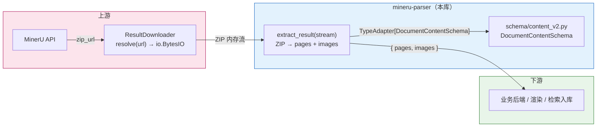
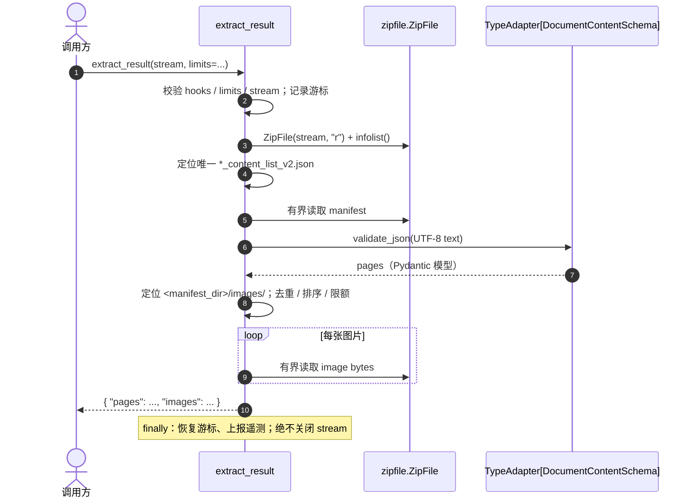

# [SPEC-003] Result Extractor

| 属性 | 内容 |
| :--- | :--- |
| **状态** | Draft |
| **负责人** | @jackafx |
| **创建时间** | 2026-10-21 |
| **更新时间** | 2026-10-21 |
| **关联 Issue/PR** | —（待关联） |

---

## 1. 背景与目标 (Context & Objectives)

### 1.1 背景 (Context)

`ResultDownloader` 的职责边界止于把结果包 URL 读入 `io.BytesIO`（见 `SPEC-002`）。下游业务真正需要的是“页面 + 图片”：`content_list_v2.json` 中的版面块结构，以及 ZIP 内 `images/` 目录下的图片二进制。当前这一步通常由调用方直接拼 `zipfile.ZipFile`、`json.loads`、`model_validate` 与目录遍历完成，痛点集中在五个方面：

1. **Manifest 定位不一致**：结果包内文件名依赖源文档名，可能位于 ZIP 根目录或子目录；同名/多份 manifest、macOS 资源分叉、错误页 ZIP 都会让“取第一个匹配文件”的脚本悄悄读到错误内容。
2. **Schema 校验缺失**：直接用 `dict["content"]` 取值时，字段缺失、块类型漂移与 `bbox` 非法要等到业务深处才暴露；错误信息也缺少字段路径。
3. **图片处理分散**：图片路径大小写、重复成员、`..` 路径、符号链接、缺失 `images/` 目录各自处理；排序不确定，调用方难以做稳定快照。
4. **资源边界缺失**：下载器的 `max_bytes` 只约束 ZIP 的压缩字节数，不约束解压后的 manifest 与图片；压缩炸弹或超大图片仍可在解压阶段把进程内存打满。
5. **错误不可分类**：`BadZipFile`、`UnicodeDecodeError`、Pydantic `ValidationError`、`KeyError` 混杂在一起，调用方无法区分“包坏了”“格式变了”“图片超限”，也无法决定是否值得重新下载。

Result Extractor 因此被设计为一个**无状态、纯内存**的解析组件：上游是 `ResultDownloader` 交付的 ZIP 内存流，下游统一交付 `{"pages": [...], "images": [...]}`。它不下载、不重试、不落盘、不解码图片，只负责把“一个结果包”确定性地解析为结构化对象与图片资源。

链路概览：



> **信任边界**：ZIP 内容视为不可信输入。即使 URL 来自 MinerU，响应体仍可能损坏、被替换或包含恶意成员；Extractor 只做结构与资源边界校验，不验证来源、签名或哈希。图片字节不会被解码，因此恶意图片载荷的防护属于下游渲染器职责。

### 1.2 现状与差距分析 (Gap Analysis)

| 能力维度 | 裸 `zipfile` + `json.loads` | 一次性解析脚本 | Result Extractor |
| :--- | :---: | :---: | :---: |
| 统一入口 `extract_result(stream)` | ❌ | ⚠️ 形态不一 | ✅ |
| Manifest 唯一性检查 | ❌ | ⚠️ 常取第一个 | ✅ `not_found` / `ambiguous` |
| `content_v2` Schema 校验 | ⚠️ 手写取值 | ⚠️ 各自实现 | ✅ `TypeAdapter[DocumentContentSchema]` |
| 图片路径规范化 | ❌ | ⚠️ 依赖 ZIP 原样 | ✅ 规范化 + 安全校验 |
| 确定性排序 | ❌ | ❌ | ✅ 按 canonical path |
| 重复 / 不安全成员检测 | ❌ | ❌ | ✅ |
| 解压后大小 / 数量上限 | ❌ | ❌ | ✅ `ExtractionLimits` |
| 损坏 / 加密 / 不支持压缩分类 | ❌ | ⚠️ 各自捕获 | ✅ 统一异常体系 |
| 不关闭调用方流 / 恢复游标 | ⚠️ 易遗漏 | ⚠️ 易遗漏 | ✅ 显式契约 |
| 无磁盘解压 | ⚠️ 易使用 `extractall` | ❌ 常落盘 | ✅ 仅内存读取 |
| 错误上下文脱敏 | ❌ | ❌ | ✅ 不泄漏文档内容 |
| 可观测性 | ❌ | ❌ | ✅ 日志 / 指标统一出口 |
| 无网络、内存 ZIP 测试 | ⚠️ | ⚠️ | ✅ 纯函数 |

> **样本基线（2026-10-21）**：用一个最小真实结果包核对，ZIP 共 7 个成员：`<uuid>_content_list.json`、`<uuid>_content_list_v2.json`、`<uuid>_model.json`、`<uuid>_origin.pdf`、`full.md`、`layout.json`、`images/<sha256>.jpg`。manifest 4,803 B，已用 `TypeAdapter(DocumentContentSchema)` 校验通过（1 页、6 个块：TitleBlock ×1、ParagraphBlock ×4、ImageBlock ×1）；ImageBlock 的 `image_source.path` 为 `images/<sha256>.jpg`，与图片成员路径一致；图片 1 张、13,936 B。该样本确认「根目录 manifest + 根 `images/`」布局与默认限额的宽松度，但样本量不足以校准 P95/P99，真实样本统计仍见 R-1。
>
> **为什么不直接内联十几行代码？** 单个正常包确实只需要 `ZipFile` 加两次读取；本组件的价值在于把“定位唯一 manifest、Schema 校验、路径安全、解压后限额、错误分类、流生命周期”收敛成可测试的公共契约。实现预计约 300–500 行，主要成本在边界与测试，而不是解析本身。

### 1.3 目标 (Goals)

- [ ] **Goal 1**：提供统一入口 `extract_result(stream) -> ExtractedResult`，接收可 seek 的二进制流，交付 `{"pages", "images"}`。
- [ ] **Goal 2**：在 ZIP 内任意深度定位**唯一**的 `*_content_list_v2.json`；缺失或多份均失败关闭。
- [ ] **Goal 3**：使用 `schema/content_v2.py` 的 `DocumentContentSchema` 完成 JSON 与 Schema 校验，错误携带字段路径且不泄漏正文。
- [ ] **Goal 4**：提取 manifest 同级 `images/` 目录下的全部常规文件，交付 canonical path 与精确二进制内容，输出顺序确定。
- [ ] **Goal 5**：对 manifest 与图片实施解压后字节数、图片数量上限，失败时不返回任何部分结果。
- [ ] **Goal 6**：建立稳定的错误分类：配置、压缩包、manifest、Schema、限额。
- [ ] **Goal 7**：明确流生命周期：不关闭调用方流，成功/失败后恢复游标。
- [ ] **Goal 8**：全程不落盘、不调用 `extract()` / `extractall()`、不写临时文件。
- [ ] **Goal 9**：日志 / 指标统一出口，指标回调异常不影响解析；支持 `correlation_id`。
- [ ] **Goal 10**：纯函数、无网络依赖，所有边界可用内存 ZIP 测试覆盖。

### 1.4 非目标 (Non-Goals / Out of Scope)

> 明确本次迭代**不包含**的内容，防止需求范围膨胀（Scope Creep）。

- [ ] 下载、重试、URL 校验、SSRF 防护；这些属于 `ResultDownloader`。
- [ ] 解压到磁盘、临时文件、`extract()` / `extractall()`、ZIP 成员权限恢复。
- [ ] 解析 `content_list.json`（v1）、`middle.json`、`model.json`、Markdown 或其他结果文件。
- [ ] 图片解码、格式嗅探、缩略图、OCR、内容哈希或损坏图片检测。
- [ ] manifest 中 `image_source.path` 与 `images` 列表的交叉校验；缺失引用与未引用图片均不报错。
- [ ] 按内容去重相同图片；每个路径一条记录。
- [ ] 流式 / 懒加载解析；整份 manifest 与全部图片一次性载入内存。
- [ ] 批量结果包、多个 ZIP 合并、跨包去重。
- [ ] 阅读顺序重建、跨页合并、版面块重排。
- [ ] ZIP 来源、签名、哈希校验；只校验结构与资源边界。
- [ ] 非 seekable 流的缓冲；调用方需自行转为 `io.BytesIO`。
- [ ] `ResultExtractor` 类门面或 `downloader.extract(result)` 便捷入口；调用方显式组合两个组件。
- [ ] 修改 `schema/content_v2.py` 或在 Extractor 层开启 `strict=True` / `extra="forbid"`。
- [ ] JSON 重复键检测；解析器按“后值覆盖前值”处理。
- [ ] 对损坏 ZIP 自动重试；本地解析错误是终态，调用方可重新下载后再次调用。
- [ ] 任意 ZIP 成员访问 API；只读取 manifest 与同级 `images/` 下的文件。

### 1.5 威胁模型 (Threat Model)

| 维度 | 内容 |
| :--- | :--- |
| **输入来源** | 可能是 `ResultDownloader` 刚下载的结果包，也可能是调用方从其他途径获得的 ZIP；一律按不可信数据处理。 |
| **受保护资产** | 进程内存、下游磁盘（若调用方使用返回的 path 落盘）、下游图片渲染器与解析器。 |
| **攻击者能力** | 控制成员名、成员数量、声明大小、压缩方法、加密标志、JSON 结构与图片字节；可构造重复成员、`..` 路径、超大解压结果、深层嵌套 JSON。 |
| **主要控制** | 唯一 manifest、canonical path、拒绝不安全成员、仅内存读取、有界读取、解压后大小/数量上限、Pydantic Schema 校验、失败不返回部分结果。 |
| **残余风险** | `zipfile` / `zlib` 的 CPU 放大与实现漏洞、Pydantic 模型内存放大、下游图片解码漏洞、manifest 与图片引用不一致、无法识别的符号链接。 |

> 本 Spec 的安全承诺以“不落盘、只读取 manifest 与同级 `images/`、使用有界读取”为前提。调用方若把返回的 path 直接拼接到磁盘路径，仍需自行做目标目录约束；Extractor 的 canonical path 只是第一道防线。

---

## 2. 用户故事与验收标准 (User Stories & Acceptance Criteria)

### US-1: 基本提取与结果契约

**As a** 业务调用方
**I want to** 把 `ResultDownloader` 返回的 ZIP 内存流直接交给一个函数
**So that** 我能拿到结构化页面与图片字节，而不关心 ZIP 与 JSON 细节

#### 验收标准 (Acceptance Criteria)

* **AC-1.1**: `extract_result(stream, *, limits=None, on_metric=None, correlation_id=None)` 必须接受 `io.BytesIO` 或任意可读、可 seek 的二进制流；不得依赖网络、磁盘或环境变量，不得写临时文件，不得调用 `stream.close()`。
* **AC-1.2**: 成功时必须返回新的普通 `dict`，且恰好包含 `"pages"` 与 `"images"` 两个键。`pages` 必须是 `schema.content_v2.DocumentContentSchema` 校验后的对象（外层列表为页，内层列表为版面块，保持 manifest 中的顺序）；`images` 必须是 `{"path": str, "bytes": bytes}` 列表，并按 `path` 升序排序。
* **AC-1.3**: `images[].bytes` 必须是不可变 `bytes` 对象，内容为 ZIP 成员解压后的精确字节；不得解码、转码或重新编码。`images[].path` 必须是使用 `/` 分隔的 canonical 归档相对路径。
* **AC-1.4**: 每次调用必须返回全新对象，不得缓存或复用上一次结果；相同输入字节与相同 `limits` 必须产生等价结果。
* **AC-1.5**: 不得修改输入流内容；成功与所有已处理失败路径都必须把游标恢复到调用前位置。恢复失败时必须记录 `mineru.extract.restore_failed` 警告日志，但不得覆盖主要成功/失败结果。
* **AC-1.6**: 输入必须是可读、可 seek 的二进制流。`io.TextIOBase`、缺少 `read`/`seek`/`tell`、`seekable()` / `readable()` 为假，或解析前 `tell()` 失败，必须在读取 ZIP 前抛出 `ResultExtractionConfigurationError(field="stream")`。
* **AC-1.7**: `limits` 必须是 `ExtractionLimits | None`；`on_metric` 必须是 callable 或 `None`；`correlation_id` 必须是 `str | None`。非法值必须在读取 ZIP 前抛出 `ResultExtractionConfigurationError`。
* **AC-1.8**: `extract_result`、`ExtractionLimits`、`DEFAULT_EXTRACTION_LIMITS`、`ExtractedResult`、`ExtractedImage`、`ExtractionIssue` 与全部 `ResultExtraction*Error` 必须可从 `mineru_parser.extractor` 与顶层 `mineru_parser` 导入。
* **AC-1.9**: 函数不得持有可变模块级调用状态；不同流上的并发调用必须安全。同一个流上的并发调用不受支持，实现无需加锁。
* **AC-1.10**: 不得调用 `stream.close()`、`ZipFile.extract()` 或 `ZipFile.extractall()`。

---

### US-2: Manifest 定位

**As a** 业务调用方
**I want to** 让 Extractor 自己找到结果包中唯一的结构化清单
**So that** 我不会因为文件名、目录层级或重复成员而读到错误内容

#### 验收标准 (Acceptance Criteria)

* **AC-2.1**: manifest 候选必须是常规文件成员，其**原始 basename** 以 `_content_list_v2.json` 结尾（大小写敏感），随后必须通过 canonical path 安全校验；可位于任意深度，`*` 允许为空前缀。
* **AC-2.2**: 必须恰好有一个候选。零个 → `ResultExtractionManifestError(reason="not_found")`；多于一个 → `ResultExtractionManifestError(reason="ambiguous")`，其中 `candidates` 为排序后的 canonical path（最多 20 条），`candidate_count` 为完整数量。
* **AC-2.3**: 目录项（名称以 `/` 结尾）不匹配后缀，不会被选为候选。basename 匹配后缀但不是常规文件（符号链接、带目录属性等），或名称无法 canonical 化（绝对路径、`..`、反斜杠、NUL/C0/C1 控制字符）时，必须抛出 `ResultExtractionArchiveError(reason="unsafe_member")`，不得静默忽略。
* **AC-2.4**: 多个 ZIP 成员 canonical 化到同一 manifest 路径时，必须按多个候选处理并报 `ambiguous`；实现不得依赖 `ZipFile.read(name)` 或 `NameToInfo` 的“后值覆盖”语义。
* **AC-2.5**: 选中的 manifest 必须通过其 `ZipInfo` 对象打开，不得按名称二次查找，避免重复名称把读取重定向到另一个成员。
* **AC-2.6**: 发现过程必须确定性：候选比较使用 canonical path 的字典序；归档成员顺序不得影响单候选的选择，也不得改变 `ambiguous` 的排序结果。
* **AC-2.7**: 后缀匹配不得接受 `_content_list.json`、`.JSON`、`_content_list_v2.json.bak`，也不得把目录名中的后缀误判为文件名后缀。
* **AC-2.8**: 根目录 manifest 与顶层目录下的 manifest 都必须支持；不得假定 manifest 一定在 ZIP 根。

---

### US-3: Manifest 解析与 Schema 校验

**As a** 业务调用方
**I want to** 在进入业务逻辑前确认清单符合 `content_v2` 定义
**So that** 字段缺失、块类型漂移与非法 `bbox` 能在解析边界立即暴露

#### 验收标准 (Acceptance Criteria)

* **AC-3.1**: 读取前若 `ZipInfo.file_size > max_manifest_bytes`，必须抛出 `ResultExtractionLimitError(resource="manifest", limit=..., actual=file_size, member=path)`。读取时最多读取 `max_manifest_bytes + 1` 字节；实际字节超限时抛出同一异常并令 `actual=len(data)`。声明大小只是提示，实际字节是最终判据。
* **AC-3.2**: 加密 manifest（`flag_bits & 0x1`，或 `zipfile` 抛出加密相关 `RuntimeError`）→ `ResultExtractionArchiveError(reason="encrypted_member", member=path)`；不支持的压缩方法 → `reason="unsupported_compression"`；CRC / 解压 / 截断 / `LargeZipFile` → `reason="corrupt_member"`；底层流 I/O 失败 → `reason="read_failed"`。
* **AC-3.3**: 必须按 UTF-8 解码，并允许去除一个可选的 UTF-8 BOM。`UnicodeDecodeError` → `ResultExtractionManifestError(reason="invalid_encoding", manifest_path=path)`。不得猜测其他编码。
* **AC-3.4**: 必须使用模块级 `TypeAdapter(DocumentContentSchema)` 的 `validate_json(text)` 完成 JSON 与 Schema 校验。Pydantic `ValidationError` 中包含 `json_invalid` 类型 → `ResultExtractionManifestError(reason="invalid_json", manifest_path=path)`；`RecursionError` → `ResultExtractionManifestError(reason="too_deep", manifest_path=path)`。
* **AC-3.5**: JSON 合法但不符合 `DocumentContentSchema` → `ResultExtractionValidationError`，携带 `manifest_path`、清洗后的 `issues`（仅 `loc` / `type` / `msg`，最多 20 条）与完整 `issue_count`。异常消息与 traceback 不得包含 manifest 正文；必须使用 `from None` 或等价方式切断原始 `ValidationError` 的显式因果链。
* **AC-3.6**: 根必须是 `list[list[LayoutElement]]`。未知块 `type`、缺少必填字段、根结构错误、非法 `bbox` 都必须产生 Schema 校验错误。
* **AC-3.7**: `[]` 是合法文档 → `pages=[]`；`[[]]` 在 Schema 下也是合法页。空文档与空页不得被视为错误。
* **AC-3.8**: 校验必须原样使用 `content_v2` 的语义：不得设置 `strict=True`、不得设置 `extra="forbid"`、不得修改模型。已知块中的额外字段按 Pydantic 默认忽略；未知块 `type` 由判别联合拒绝。
* **AC-3.9**: 成功后 `pages` 中必须是 Pydantic 模型实例（如 `TitleBlock`、`ParagraphBlock`），不得是原始 JSON dict；不得调用 `model_dump()` 扁平化。
* **AC-3.10**: 任何失败路径都不得返回部分 `pages`。

---

### US-4: 图片提取

**As a** 业务调用方
**I want to** 拿到 manifest 同级 `images/` 目录下的全部图片字节与稳定路径
**So that** 我可以直接入库、渲染或上传，而不必再次解压 ZIP

#### 验收标准 (Acceptance Criteria)

* **AC-4.1**: 图片根目录是**选中 manifest 同级**的 `images/`：manifest 位于根时前缀为 `images/`，位于 `result/` 时为 `result/images/`，位于 `a/b/` 时为 `a/b/images/`。只扫描该根目录，其他位置的 `images/` 一律忽略。
* **AC-4.2**: 图片根目录下（含子目录）的每个常规文件都必须被包含，不按扩展名、MIME 或内容过滤；零字节文件也包含，内容为 `b""`。
* **AC-4.3**: 目录项必须排除；manifest 自身即使位于图片根目录下也必须排除；图片根目录下的符号链接 → `ResultExtractionArchiveError(reason="unsafe_member", member=path)`。
* **AC-4.4**: 路径必须 canonical 化：拒绝绝对路径、`..` 段、反斜杠、空名称与 NUL/C0/C1 控制字符；折叠空段与 `.` 段；保留其他字符、大小写与 Unicode。原始路径包含 `images` 段且无法安全 canonical 化时 → `ArchiveError(reason="unsafe_member")`；与图片无关的不安全成员可以忽略。
* **AC-4.5**: 两个图片成员 canonical 化到同一路径 → `ResultExtractionArchiveError(reason="duplicate_member", member=path)`。
* **AC-4.6**: `images` 必须按 canonical path 的 Python `str` 字典序升序排列。`path` 必须保留完整归档相对前缀（例如 manifest 在 `result/` 时返回 `result/images/a.jpg`）。
* **AC-4.7**: 图片根目录不存在或没有常规文件时，`images=[]` 且提取成功；仅有一个 `images/` 目录项不是错误。
* **AC-4.8**: 构建图片条目列表时，一旦数量超过 `max_images` 必须立即抛出 `ResultExtractionLimitError(resource="image_count", limit=..., actual=已观察数量, member=None)`（`actual` 至少为 `max_images + 1`）；读取任何图片前，若声明 `file_size` 总和 > `max_total_image_bytes` → `ResultExtractionLimitError(resource="total_image_bytes", limit=..., actual=sum, member=None)`。
* **AC-4.9**: 单张图片读取前，若 `file_size > max_image_bytes` → `ResultExtractionLimitError(resource="image", limit=..., actual=file_size, member=path)`；读取时最多读取 `max_image_bytes + 1` 字节，实际超限时抛出同一异常并令 `actual=len(data)`。
* **AC-4.10**: 必须累计实际字节数；累计值超过 `max_total_image_bytes` → `ResultExtractionLimitError(resource="total_image_bytes", limit=..., actual=total, member=path)`。实际字节优先于声明大小。
* **AC-4.11**: 任一限额或成员错误都必须使整次提取失败，不得返回部分 `images` 列表。
* **AC-4.12**: 图片成员失败必须映射为 `ResultExtractionArchiveError`：加密 → `encrypted_member`；不支持的压缩 → `unsupported_compression`；CRC / 解压 / 截断 / `LargeZipFile` → `corrupt_member`；底层流 I/O → `read_failed`。`member` 必须是 canonical 图片路径。
* **AC-4.13**: 不得对 `pages` 中的 `image_source.path` 与 `images` 做交叉校验；缺失引用与未引用图片都允许。
* **AC-4.14**: 不得解码或校验图片内容；损坏的图片字节按原样返回，由下游决定如何处理。

---

### US-5: 压缩包安全与资源边界

**As a** 服务集成方
**I want to** 让解压后的资源使用有硬上限
**So that** 压缩炸弹、超大 manifest 或大量图片不会打满进程内存

#### 验收标准 (Acceptance Criteria)

* **AC-5.1**: 打开流或解析中央目录时出现 `zipfile.BadZipFile`、`zipfile.LargeZipFile` 或 `OSError` → `ResultExtractionArchiveError(reason="invalid_zip")`。空流、HTTP 错误页、非 ZIP 内容都映射到该错误。
* **AC-5.2**: `ExtractionLimits` 默认值必须为：`max_manifest_bytes = 16 MiB`（16,777,216）、`max_image_bytes = 32 MiB`（33,554,432）、`max_total_image_bytes = 256 MiB`（268,435,456）、`max_images = 10_000`、`max_members = 100_000`。`DEFAULT_EXTRACTION_LIMITS` 必须暴露具有这些值的实例。
* **AC-5.3**: 每个限额字段必须是正整数（拒绝 `bool`）；非法构造必须抛出 `ResultExtractionConfigurationError(field=<字段名>)`。`extract_result` 的 `limits=None` 表示使用默认值，不提供“无上限”模式。
* **AC-5.4**: 不得把任何成员解压到磁盘，不得创建临时文件；必须以只读模式打开 ZIP，并通过上下文管理器关闭 `ZipFile`。
* **AC-5.5**: 只允许读取选中的 manifest 与其图片根目录下的常规文件。其他成员不得被解压；它们的损坏、加密或不支持压缩不得导致提取失败。
* **AC-5.6**: 所有成员读取必须有界（`archive.open(info)` + `read(limit + 1)`）；不得对 manifest 或图片使用无界的 `ZipFile.read(name)`。必须通过 `ZipInfo` 定位选中成员。
* **AC-5.7**: 成功与失败后调用方流都必须保持打开。`ZipFile.close()` 不得关闭传入的流；Extractor 不得调用 `stream.close()`。
* **AC-5.8**: 峰值内存必须按“ZIP 中央目录 `ZipInfo` + manifest 字节 + 解码文本 + Pydantic 模型 + 图片字节 + 结果字典”估算并文档化；`max_members` 只能阻止后续遍历，无法回退 `ZipFile` 已分配的中央目录内存。实现必须包含基于 `tracemalloc` 的合成归档内存测试，不得把压缩后大小当作内存上界。
* **AC-5.9**: 不得自动重试；损坏归档是终态错误。调用方可以重新下载后再次调用。

---

### US-6: 错误模型与可观测性

**As a** 服务集成方
**I want to** 区分配置、归档、manifest、Schema 与限额失败，并观察提取结果
**So that** 我能决定是否重新下载、调整限额或修复上游数据

#### 验收标准 (Acceptance Criteria)

* **AC-6.1**: 必须定义以下异常体系；全部继承 `ResultExtractionError`，且不得继承 `MinerUError` 或 `ResultDownloadError`：

  ```text
  ResultExtractionError
  ├── ResultExtractionConfigurationError
  ├── ResultExtractionArchiveError
  ├── ResultExtractionManifestError
  ├── ResultExtractionValidationError
  └── ResultExtractionLimitError
  ```

* **AC-6.2**: `ArchiveError` 携带 `reason`（`invalid_zip` / `unsafe_member` / `duplicate_member` / `encrypted_member` / `unsupported_compression` / `corrupt_member` / `read_failed`）与 `member: str | None`；`ManifestError` 携带 `reason`（`not_found` / `ambiguous` / `invalid_encoding` / `invalid_json` / `too_deep`）、`manifest_path: str | None`、`candidates: tuple[str, ...]`、`candidate_count: int`；`ValidationError` 携带 `manifest_path`、`issues: tuple[ExtractionIssue, ...]`、`issue_count: int`；`LimitError` 携带 `resource`（`manifest` / `image` / `image_count` / `total_image_bytes` / `member_count`）、`limit`、`actual`、`member`；`ConfigurationError` 携带 `field`。
* **AC-6.3**: 公共错误消息与属性不得包含 manifest JSON 正文、图片字节、Pydantic `input` / `ctx` 或内嵌正文的原始异常字符串。成员/路径上下文必须 canonical 化；不安全原始名称必须转义 C0/C1 并截断到 512 字符。
* **AC-6.4**: 校验失败、非法 JSON/编码必须使用 `from None` 或等价方式，使原始 Pydantic 异常不成为显式 `__cause__`；归档错误可以链 `BadZipFile` / `LargeZipFile` / `zlib.error` / `EOFError` / `OSError` 等不含正文的异常，但 `NotImplementedError` 与加密 `RuntimeError` 的原始消息可能包含成员名，必须使用 `from None`，且不得链包含文档正文的异常。
* **AC-6.5**: 遥测名称必须为：成功日志 `mineru.extract`；失败日志 `mineru.extract.error`；指标回调失败日志 `mineru.metric.failed`；游标恢复失败日志 `mineru.extract.restore_failed`。指标必须为：`mineru.extract.total`、`mineru.extract.duration_ms`、`mineru.extract.pages`、`mineru.extract.images`、`mineru.extract.image_bytes`。
* **AC-6.6**: `outcome` 必须取自 `success` / `config_error` / `archive_error` / `manifest_error` / `validation_error` / `limit_error` / `unexpected`，并由异常类型映射。指标必须在 `finally` 中恰好上报一次；失败时 `pages` / `images` / `image_bytes` 均为 0。`on_metric` / `correlation_id` 在构造 `Telemetry` 前校验失败时无法上报指标，但必须抛出 `ResultExtractionConfigurationError`。
* **AC-6.7**: `on_metric` 抛出的任何异常必须被吞掉并记录 `mineru.metric.failed`，不得影响提取。`correlation_id` 必须附加到所有日志。指标标签只能包含 `outcome`，不得包含路径、成员名、文档内容或 `correlation_id`。
* **AC-6.8**: 未知的非 `ResultExtractionError` 异常必须原样抛出，并记录 `outcome="unexpected"`；`MemoryError`、`KeyboardInterrupt`、`SystemExit` 不得被包装或吞掉。
* **AC-6.9**: 公共错误消息使用英文；调用方必须基于异常类与 `reason` / `resource` 分支，不得依赖消息文本。

---

### US-7: 可测试性

**As a** 维护者
**I want to** 用纯内存 ZIP 覆盖所有分支
**So that** CI 不需要网络、磁盘或真实 MinerU 账号

#### 验收标准 (Acceptance Criteria)

* **AC-7.1**: 所有行为必须可用 `io.BytesIO` 构造的合成 ZIP 测试；不得依赖网络、磁盘或环境变量。
* **AC-7.2**: `limits`、`on_metric`、`correlation_id` 必须可选；默认调用形态必须是 `extract_result(BytesIO(...))`。
* **AC-7.3**: 相同字节与相同 `limits` 必须产生相同的 `path` 顺序、页面对象、异常类与 `reason`。
* **AC-7.4**: 测试必须覆盖第 5 节的 AC 映射，包括损坏/加密/不支持压缩成员、限额、路径安全、流生命周期与遥测。
* **AC-7.5**: 模块级 `TypeAdapter` 必须在导入时创建一次；不得在每次调用时重建，也不得共享可变状态。

---

## 3. 技术方案设计 (Technical Design)

### 3.1 架构与数据流 (Architecture & Data Flow)

#### 组件职责与边界

| 组件 | 职责 | 明确不做 |
| :--- | :--- | :--- |
| `extract_result` | 参数校验、流生命周期、编排 manifest/图片读取、构建结果、遥测 | 不下载、不重试、不落盘、不解码图片 |
| `ExtractionLimits` | 持有解压后大小与数量上限，构造时校验 | 不执行读取、不持有调用状态 |
| `_members`（内部） | canonical path、常规文件/符号链接判定、manifest 发现、有界成员读取 | 不解析 JSON、不解释 Schema |
| `_manifest`（内部） | UTF-8/JSON 解码、`TypeAdapter` 校验、错误清洗 | 不读取图片、不发现成员 |
| `_images`（内部） | 图片根目录解析、过滤、去重、排序、限额、有界读取 | 不解码图片、不做引用交叉校验 |
| `Telemetry`（共享） | 日志 / 指标统一出口、回调异常隔离、`correlation_id` | 不影响主流程 |

#### 包结构

```text
src/mineru_parser/
├── _telemetry.py               # 既有共享实现
├── schema/
│   └── content_v2.py           # DocumentContentSchema（不修改）
└── extractor/
    ├── __init__.py             # 公共再导出
    ├── extractor.py            # extract_result 编排
    ├── errors.py               # ResultExtractionError 体系
    ├── limits.py               # ExtractionLimits / DEFAULT_EXTRACTION_LIMITS
    ├── models.py               # ExtractedResult / ExtractedImage / ExtractionIssue
    └── _members.py             # 路径规范化、成员发现、有界读取
```

> Extractor 不依赖 `client` 或 `downloader` 的 wire 模型，只依赖标准库、`pydantic` 与 `schema.content_v2`。`pydantic>=2.9` 已是项目依赖，无需新增第三方依赖。

#### 提取时序



### 3.2 数据模型 (Data Model)

#### 提取限额

`ExtractionLimits` 为不可变 dataclass（`frozen=True, slots=True`），在 `__post_init__` 中校验字段。

```python
@dataclass(frozen=True, slots=True)
class ExtractionLimits:
    max_manifest_bytes: int = 16 * 1024 * 1024
    max_image_bytes: int = 32 * 1024 * 1024
    max_total_image_bytes: int = 256 * 1024 * 1024
    max_images: int = 10_000
    max_members: int = 100_000

    def __post_init__(self) -> None:
        for name in (
            "max_manifest_bytes",
            "max_image_bytes",
            "max_total_image_bytes",
            "max_images",
            "max_members",
        ):
            value = getattr(self, name)
            if isinstance(value, bool) or not isinstance(value, int) or value <= 0:
                raise ResultExtractionConfigurationError(
                    f"{name} must be a positive integer.",
                    field=name,
                )


DEFAULT_EXTRACTION_LIMITS = ExtractionLimits()
```

| 字段 | 默认值 | 约束 | 作用 |
| :--- | :---: | :--- | :--- |
| `max_manifest_bytes` | 16 MiB | 正整数，拒绝 `bool` | manifest 解压后字节上限 |
| `max_image_bytes` | 32 MiB | 正整数，拒绝 `bool` | 单张图片解压后字节上限 |
| `max_total_image_bytes` | 256 MiB | 正整数，拒绝 `bool` | 全部图片解压后总字节上限 |
| `max_images` | 10,000 | 正整数，拒绝 `bool` | 图片文件数量上限 |
| `max_members` | 100,000 | 正整数，拒绝 `bool` | ZIP 中央目录成员总数上限 |

> `max_total_image_bytes` 与 `max_image_bytes` 独立生效；即使单图小于 `max_image_bytes`，累计超过总上限仍会失败。`None` 只表示使用默认值，不表示无限制。
>
> `max_members` 在 `ZipFile` 解析中央目录之后检查；它能阻止后续遍历与图片发现，但无法回退 `zipfile` 已分配的 `ZipInfo` 内存。中央目录本身的规模仍受下载器压缩字节上限约束，见 R-2。

#### 输出结构

```python
from typing import TypedDict

from ..schema.content_v2 import DocumentContentSchema


class ExtractedImage(TypedDict):
    path: str
    bytes: bytes


class ExtractedResult(TypedDict):
    pages: DocumentContentSchema
    images: list[ExtractedImage]


class ExtractionIssue(TypedDict):
    loc: tuple[str | int, ...]
    type: str
    msg: str
```

运行时 `ExtractedResult` 是普通 `dict`；`TypedDict` 只提供静态类型与文档约束。`DocumentContentSchema = list[Page]`，`Page = list[LayoutElement]`，因此 `pages` 是“页列表的列表”。

| 字段 | 类型 | 说明 |
| :--- | :--- | :--- |
| `pages` | `DocumentContentSchema` | 按 manifest 顺序；每页是版面块模型列表；页号等于下标 + 1 |
| `images[].path` | `str` | canonical 归档相对路径；根目录 manifest 时为 `images/...` |
| `images[].bytes` | `bytes` | ZIP 成员解压后的精确字节；不转码 |

> 结果不包含 `manifest_path`；需要追踪清单文件名时使用 `mineru.extract` 日志字段，见 Q-2。

#### 内部常量

| 常量 | 值 | 用途 |
| :--- | :--- | :--- |
| `_MANIFEST_SUFFIX` | `"_content_list_v2.json"` | manifest 后缀匹配 |
| `_IMAGES_DIRNAME` | `"images"` | 图片根目录名 |
| `_MAX_ISSUES_IN_ERROR` | `20` | `ValidationError.issues` 上限 |
| `_MAX_CANDIDATES_IN_ERROR` | `20` | `ManifestError.candidates` 上限 |
| `_MAX_CONTEXT_CHARS` | `512` | 日志 / 错误上下文字符上限 |
| `_SCHEMA` | `TypeAdapter(DocumentContentSchema)` | 模块级校验器 |

#### 异常体系

```text
ResultExtractionError
├── ResultExtractionConfigurationError   # 流 / limits / hooks 非法
├── ResultExtractionArchiveError         # ZIP 或成员结构 / 读取失败
├── ResultExtractionManifestError        # manifest 缺失 / 多份 / JSON 结构错误
├── ResultExtractionValidationError      # JSON 合法但不符合 DocumentContentSchema
└── ResultExtractionLimitError           # 解压后大小 / 数量超限
```

| 异常 | 附加字段 | 说明 |
| :--- | :--- | :--- |
| `ResultExtractionConfigurationError` | `field: str \| None` | 构造参数、流能力或注入 callable 非法 |
| `ResultExtractionArchiveError` | `reason`、`member: str \| None` | `invalid_zip`、`unsafe_member`、`duplicate_member`、`encrypted_member`、`unsupported_compression`、`corrupt_member`、`read_failed` |
| `ResultExtractionManifestError` | `reason`、`manifest_path: str \| None`、`candidates: tuple[str, ...]`、`candidate_count: int` | `not_found`、`ambiguous`、`invalid_encoding`、`invalid_json`、`too_deep` |
| `ResultExtractionValidationError` | `manifest_path: str`、`issues: tuple[ExtractionIssue, ...]`、`issue_count: int` | `issues` 只含 `loc` / `type` / `msg`；最多 20 条 |
| `ResultExtractionLimitError` | `resource`、`limit: int`、`actual: int`、`member: str \| None` | `resource` ∈ `manifest` / `image` / `image_count` / `total_image_bytes` / `member_count` |

> 未显式提供的字段默认值为 `None`、空元组或 0；例如 `ManifestError(reason="not_found")` 不要求候选字段，`LimitError(resource="image_count")` 的 `member` 为 `None`。
>
> `ResultExtractionError` 独立于 `MinerUError` 与 `ResultDownloadError`；三类失败路径可独立捕获。未来若需要统一根异常，可新增 `MinerUParserError` 并让三者继承，向后兼容。

### 3.3 接口契约 (API Contracts)

#### 公共 API

```python
def extract_result(
    stream: BinaryIO,
    *,
    limits: ExtractionLimits | None = None,
    on_metric: MetricHook | None = None,
    correlation_id: str | None = None,
) -> ExtractedResult: ...
```

> 本组件是无状态函数，不引入 `ResultExtractor` 类。若未来需要复用配置或增加实例级状态，可在不破坏该函数的前提下追加薄门面，见 Q-8。

#### 公共 API 稳定性

| 层级 | 名称 | 承诺 |
| :--- | :--- | :--- |
| **稳定** | `extract_result`、`ExtractionLimits`、`DEFAULT_EXTRACTION_LIMITS`、`ExtractedResult`、`ExtractedImage`、异常体系 | 遵循 SemVer；大版本才允许破坏性变更 |
| **高级 / 可选** | `on_metric`、`correlation_id`、`ExtractionIssue` | 行为稳定，但可能新增字段 |
| **内部** | canonical path 辅助函数、成员发现、常量 | 不承诺稳定性 |

所有公共名称必须通过 `mineru_parser.extractor.__all__` 与顶层 `mineru_parser.__all__` 导出。

#### 流生命周期契约

1. **只读**：Extractor 只调用 `read` / `seek` / `tell`，不得写入或截断流。
2. **所有权**：调用方拥有流；Extractor 返回后不持有引用，也绝不调用 `close()`。
3. **游标**：成功与已处理失败后恢复到调用前位置；恢复失败只记录警告，不改变主结果。
4. **可 seek**：非 seekable 流直接拒绝；调用方可先写入 `io.BytesIO`。
5. **并发**：不同流上的并发调用安全；同一个流的并发调用不受支持。

#### 返回契约

1. **完整性**：只有 manifest 校验与全部图片读取成功后才返回；任何失败都不返回部分结果。
2. **独立性**：每次返回新的 dict、list 与 Pydantic 对象；不缓存、不共享。
3. **页面**：`pages` 是 `DocumentContentSchema`，保持 manifest 中的页顺序；Pydantic 模型可被调用方继续使用或 `model_dump()`。
4. **图片**：`images` 按 canonical path 升序；`bytes` 精确且不可变；`path` 是归档相对路径，不是磁盘绝对路径。
5. **无交叉校验**：不保证 `image_source.path` 都能在 `images` 中找到。
6. **无重试**：解析失败是终态；调用方可重新下载后再次调用。

#### 集成示例

```python
from mineru_parser import MinerUApiClient, ResultDownloader, extract_result

with MinerUApiClient() as client, ResultDownloader() as downloader:
    result = client.submit("https://example.com/paper.pdf").wait(timeout=600)
    extracted = extract_result(downloader.resolve(result.zip_url))

    pages = extracted["pages"]          # list[list[LayoutElement]]
    images = extracted["images"]        # [{"path": "images/a.jpg", "bytes": b"..."}]
```

> 当 manifest 位于子目录（如 `result/doc_content_list_v2.json`）时，图片 path 会是 `result/images/a.jpg`。manifest 中的 `image_source.path` 通常是相对 manifest 目录的 `images/a.jpg`；如需与输出对应，可使用 `manifest_dir + "/" + reference`，Extractor 不会重写引用。

### 3.4 提取算法 (Extraction Algorithm)

以下伪代码描述控制流；异常映射与遥测字段在 3.6 / 3.7 补齐。

```python
_MANIFEST_SUFFIX = "_content_list_v2.json"
_IMAGES_DIRNAME = "images"
_MAX_ISSUES_IN_ERROR = 20
_MAX_CANDIDATES_IN_ERROR = 20
_MAX_CONTEXT_CHARS = 512
_SCHEMA = TypeAdapter(DocumentContentSchema)


def extract_result(
    stream: BinaryIO,
    *,
    limits: ExtractionLimits | None = None,
    on_metric: MetricHook | None = None,
    correlation_id: str | None = None,
) -> ExtractedResult:
    started = time.monotonic()
    outcome = "unexpected"
    telemetry = _build_telemetry(on_metric, correlation_id)

    start_pos: int | None = None
    manifest_path: str | None = None
    pages: DocumentContentSchema = []
    images: list[ExtractedImage] = []

    try:
        limits = _resolve_limits(limits)
        start_pos = _validate_stream(stream)

        try:
            archive = zipfile.ZipFile(stream, "r")
        except (zipfile.BadZipFile, zipfile.LargeZipFile, OSError) as exc:
            raise ResultExtractionArchiveError(
                "invalid ZIP archive",
                reason="invalid_zip",
            ) from exc

        with archive:
            try:
                infos = archive.infolist()
            except (zipfile.BadZipFile, zipfile.LargeZipFile, OSError) as exc:
                raise ResultExtractionArchiveError(
                    "invalid ZIP central directory",
                    reason="invalid_zip",
                ) from exc

            if len(infos) > limits.max_members:
                raise ResultExtractionLimitError(
                    "ZIP member count exceeds limit",
                    resource="member_count",
                    limit=limits.max_members,
                    actual=len(infos),
                )

            manifest_path, manifest_info = _discover_manifest(infos)
            raw = _read_member(
                archive,
                manifest_info,
                limit=limits.max_manifest_bytes,
                resource="manifest",
                path=manifest_path,
            )
            pages = _validate_manifest(raw, manifest_path)
            images = _collect_images(
                archive,
                infos,
                limits=limits,
                manifest_path=manifest_path,
            )

        outcome = "success"
        telemetry.log(
            "mineru.extract",
            manifest=safe_context_path(manifest_path),
            pages=len(pages),
            images=len(images),
            image_bytes=sum(len(image["bytes"]) for image in images),
            duration_ms=(time.monotonic() - started) * 1000.0,
            outcome=outcome,
        )
        return {"pages": pages, "images": images}

    except ResultExtractionError as exc:
        outcome = _outcome_for(exc)
        telemetry.log(
            "mineru.extract.error",
            level=logging.WARNING,
            error_type=type(exc).__name__,
            reason=getattr(exc, "reason", None),
            member=getattr(exc, "member", None),
            manifest_path=getattr(exc, "manifest_path", None),
            resource=getattr(exc, "resource", None),
            outcome=outcome,
        )
        raise
    except BaseException as exc:
        outcome = "unexpected"
        telemetry.log(
            "mineru.extract.error",
            level=logging.ERROR,
            error_type=type(exc).__name__,
            outcome=outcome,
        )
        raise
    finally:
        if start_pos is not None:
            try:
                stream.seek(start_pos)
            except Exception as exc:  # noqa: BLE001 - 恢复失败不覆盖主结果
                telemetry.log(
                    "mineru.extract.restore_failed",
                    level=logging.WARNING,
                    error_type=type(exc).__name__,
                )

        telemetry.metric("mineru.extract.total", 1, {"outcome": outcome})
        telemetry.metric(
            "mineru.extract.duration_ms",
            (time.monotonic() - started) * 1000.0,
            {"outcome": outcome},
        )
        telemetry.metric(
            "mineru.extract.pages",
            len(pages) if outcome == "success" else 0,
            {"outcome": outcome},
        )
        telemetry.metric(
            "mineru.extract.images",
            len(images) if outcome == "success" else 0,
            {"outcome": outcome},
        )
        telemetry.metric(
            "mineru.extract.image_bytes",
            sum(len(image["bytes"]) for image in images)
            if outcome == "success"
            else 0,
            {"outcome": outcome},
        )
```

辅助函数：

```python
def _build_telemetry(
    on_metric: MetricHook | None,
    correlation_id: str | None,
) -> Telemetry:
    if on_metric is not None and not callable(on_metric):
        raise ResultExtractionConfigurationError(
            "on_metric must be callable",
            field="on_metric",
        )
    if correlation_id is not None and not isinstance(correlation_id, str):
        raise ResultExtractionConfigurationError(
            "correlation_id must be a string",
            field="correlation_id",
        )
    return Telemetry(on_metric=on_metric, correlation_id=correlation_id)


def _resolve_limits(limits: ExtractionLimits | None) -> ExtractionLimits:
    if limits is None:
        return DEFAULT_EXTRACTION_LIMITS
    if not isinstance(limits, ExtractionLimits):
        raise ResultExtractionConfigurationError(
            "limits must be an ExtractionLimits instance",
            field="limits",
        )
    return limits


def _validate_stream(stream: BinaryIO) -> int:
    if isinstance(stream, io.TextIOBase):
        raise ResultExtractionConfigurationError(
            "stream must be binary",
            field="stream",
        )
    if not all(
        callable(getattr(stream, name, None))
        for name in ("read", "seek", "tell")
    ):
        raise ResultExtractionConfigurationError(
            "stream must be readable and seekable",
            field="stream",
        )
    try:
        if hasattr(stream, "readable") and not stream.readable():
            raise ValueError("not readable")
        if hasattr(stream, "seekable") and not stream.seekable():
            raise ValueError("not seekable")
        return int(stream.tell())
    except (OSError, ValueError, TypeError):
        raise ResultExtractionConfigurationError(
            "stream must be readable and seekable",
            field="stream",
        ) from None


def _outcome_for(exc: ResultExtractionError) -> str:
    if isinstance(exc, ResultExtractionConfigurationError):
        return "config_error"
    if isinstance(exc, ResultExtractionLimitError):
        return "limit_error"
    if isinstance(exc, ResultExtractionValidationError):
        return "validation_error"
    if isinstance(exc, ResultExtractionManifestError):
        return "manifest_error"
    if isinstance(exc, ResultExtractionArchiveError):
        return "archive_error"
    return "unexpected"
```

行为要点：

1. **先校验后读取**：hooks、limits、stream 能力在打开 ZIP 前校验；`Telemetry` 先于 limits/stream 构造，使配置错误也能上报指标。
2. **响应必关闭**：`ZipFile` 通过上下文管理器关闭；传入的 stream 不会被关闭。
3. **失败不交付**：任何异常都不会返回部分 `pages` 或 `images`。
4. **实际字节优先**：所有读取都是 `limit + 1` 的有界读取，声明大小只用于提前失败。
5. **遥测在 finally**：指标恰好上报一次；游标恢复失败只记录警告。

### 3.5 成员发现与路径规则 (Member Discovery & Path Rules)

#### Canonical path

```python
def canonical_member_path(raw: str) -> str | None:
    if not raw or raw.startswith("/") or "\\" in raw:
        return None
    if any(
        ord(ch) < 0x20 or 0x7F <= ord(ch) <= 0x9F
        for ch in raw
    ):
        return None
    parts: list[str] = []
    for part in raw.split("/"):
        if part in ("", "."):
            continue
        if part == "..":
            return None
        parts.append(part)
    return "/".join(parts) or None
```

规则：

- 只把 `/` 当分隔符；拒绝反斜杠，避免 Windows 路径分隔符歧义。`images\a.jpg` 不属于 `images/`，会被忽略或按不安全名称处理。
- 折叠空段与 `.`；拒绝绝对路径与任何 `..` 段。
- 拒绝 NUL 与 C0/C1 控制字符，避免日志注入与下游路径歧义。
- 不做 Unicode NFC/NFD 规范化，不做大小写转换；`Images/` 与 `images/` 不同。
- 返回的 canonical path 用于输出 `images[].path`、去重、排序与错误上下文。

#### 常规文件判定

```python
def is_regular_file(info: zipfile.ZipInfo) -> bool:
    if info.is_dir() or (info.external_attr & 0x10):
        return False
    mode = (info.external_attr >> 16) & 0xFFFF
    if mode == 0:
        return True  # DOS 归档常见：没有 Unix mode
    if stat.S_ISDIR(mode) or stat.S_ISLNK(mode):
        return False
    file_type = stat.S_IFMT(mode)
    return file_type == 0 or stat.S_ISREG(mode)
```

- 目录项（trailing `/`）、MS-DOS 目录位、Unix 目录/符号链接/设备类型都不算常规文件。
- 仅有权限位（如 `0o644`）而没有文件类型位的成员按常规文件处理。
- 无法识别的符号链接（归档未写 Unix mode）只能按普通文件读取；这是残余风险，见 R-9。

#### 错误上下文路径

```python
def _looks_like_symlink(info: zipfile.ZipInfo) -> bool:
    mode = (info.external_attr >> 16) & 0xFFFF
    return stat.S_ISLNK(mode)


def safe_context_path(path: str) -> str:
    # canonical path 已拒绝控制字符，这里只做长度约束。
    if len(path) <= _MAX_CONTEXT_CHARS:
        return path
    return path[:_MAX_CONTEXT_CHARS] + "…"


def safe_member_context(raw: str) -> str:
    # 仅用于无法 canonical 化的原始成员名：转义 C0/C1，再做长度约束。
    escaped = "".join(
        ch
        if 0x20 <= ord(ch) <= 0x7E or ord(ch) > 0x9F
        else f"\\x{ord(ch):02x}"
        for ch in raw
    )
    if len(escaped) <= _MAX_CONTEXT_CHARS:
        return escaped
    return escaped[:_MAX_CONTEXT_CHARS] + "…"
```

- 内部流程始终使用完整 canonical path；构造异常字段与日志时使用 `safe_context_path`。
- 返回给调用方的 `images[].path` 使用完整 canonical path，不截断。
- 无法 canonical 化的原始名称使用 `safe_member_context`，避免日志注入与超长异常消息。

#### Manifest 发现

```python
def _discover_manifest(
    infos: list[zipfile.ZipInfo],
) -> tuple[str, zipfile.ZipInfo]:
    candidates: list[tuple[str, zipfile.ZipInfo]] = []

    for info in infos:
        raw = info.filename
        raw_base = raw.rsplit("/", 1)[-1]
        if not raw_base.endswith(_MANIFEST_SUFFIX):
            continue

        path = canonical_member_path(raw)
        if path is None:
            raise ResultExtractionArchiveError(
                "unsafe manifest member name",
                reason="unsafe_member",
                member=safe_member_context(raw),
            )
        if not is_regular_file(info):
            raise ResultExtractionArchiveError(
                "manifest candidate is not a regular file",
                reason="unsafe_member",
                member=safe_context_path(path),
            )
        candidates.append((path, info))

    if not candidates:
        raise ResultExtractionManifestError(
            "manifest not found",
            reason="not_found",
        )

    if len(candidates) > 1:
        paths = sorted(path for path, _ in candidates)
        raise ResultExtractionManifestError(
            f"multiple manifests found: {len(paths)}",
            reason="ambiguous",
            candidates=tuple(
                safe_context_path(path)
                for path in paths[:_MAX_CANDIDATES_IN_ERROR]
            ),
            candidate_count=len(paths),
        )

    return candidates[0]
```

- 匹配发生在**原始 basename** 上，因此 `./foo_content_list_v2.json` 可以被规范化接受，而 `dir/../foo_content_list_v2.json` 会失败关闭。
- 目录项 `foo_content_list_v2.json/` 的 basename 为空，不会成为候选。
- 同名重复成员会产生两个候选，统一报 `ambiguous`。

#### 图片根目录

图片根目录由 manifest 的 canonical path 推导：

| manifest canonical path | 图片根前缀 | 输出示例 |
| :--- | :--- | :--- |
| `foo_content_list_v2.json` | `images/` | `images/a.jpg` |
| `result/foo_content_list_v2.json` | `result/images/` | `result/images/a.jpg` |
| `a/b/foo_content_list_v2.json` | `a/b/images/` | `a/b/images/c.jpg` |

- 只扫描该前缀下的常规文件；`result/images/` 不会与根 `images/` 合并。
- manifest 自身即使位于该前缀下也必须排除。
- 若 manifest 在 `result/` 而图片在根 `images/`，结果为 `images=[]`；这是确定性规则，不做回退，见 Q-16。

#### 图片收集

```python
def _collect_images(
    archive: zipfile.ZipFile,
    infos: list[zipfile.ZipInfo],
    *,
    limits: ExtractionLimits,
    manifest_path: str,
) -> list[ExtractedImage]:
    manifest_dir = manifest_path.rpartition("/")[0]
    image_root = (
        f"{manifest_dir}/{_IMAGES_DIRNAME}/"
        if manifest_dir
        else f"{_IMAGES_DIRNAME}/"
    )

    entries: list[tuple[str, zipfile.ZipInfo]] = []
    for info in infos:
        raw = info.filename
        path = canonical_member_path(raw)

        if path is None:
            if _IMAGES_DIRNAME in raw.split("/"):
                raise ResultExtractionArchiveError(
                    "unsafe image member name",
                    reason="unsafe_member",
                    member=safe_member_context(raw),
                )
            continue

        if not path.startswith(image_root):
            continue
        if path == manifest_path:
            continue
        if not is_regular_file(info):
            if _looks_like_symlink(info):
                raise ResultExtractionArchiveError(
                    "symlink inside images directory",
                    reason="unsafe_member",
                    member=safe_context_path(path),
                )
            continue

        entries.append((path, info))
        if len(entries) > limits.max_images:
            raise ResultExtractionLimitError(
                "image count exceeds limit",
                resource="image_count",
                limit=limits.max_images,
                actual=len(entries),
            )

    seen: set[str] = set()
    for path, _ in entries:
        if path in seen:
            raise ResultExtractionArchiveError(
                "duplicate image member",
                reason="duplicate_member",
                member=safe_context_path(path),
            )
        seen.add(path)

    declared_total = sum(info.file_size for _, info in entries)
    if declared_total > limits.max_total_image_bytes:
        raise ResultExtractionLimitError(
            "declared image bytes exceed limit",
            resource="total_image_bytes",
            limit=limits.max_total_image_bytes,
            actual=declared_total,
        )

    entries.sort(key=lambda pair: pair[0])

    images: list[ExtractedImage] = []
    actual_total = 0
    for path, info in entries:
        data = _read_member(
            archive,
            info,
            limit=limits.max_image_bytes,
            resource="image",
            path=safe_context_path(path),
        )
        actual_total += len(data)
        if actual_total > limits.max_total_image_bytes:
            raise ResultExtractionLimitError(
                "actual image bytes exceed limit",
                resource="total_image_bytes",
                limit=limits.max_total_image_bytes,
                actual=actual_total,
                member=safe_context_path(path),
            )
        images.append({"path": path, "bytes": data})

    return images
```

#### 有界成员读取

```python
def _read_member(
    archive: zipfile.ZipFile,
    info: zipfile.ZipInfo,
    *,
    limit: int,
    resource: str,
    path: str,
) -> bytes:
    if info.flag_bits & 0x1:
        raise ResultExtractionArchiveError(
            "encrypted member",
            reason="encrypted_member",
            member=path,
        )

    if info.file_size > limit:
        raise ResultExtractionLimitError(
            f"{resource} exceeds limit {limit}",
            resource=resource,
            limit=limit,
            actual=info.file_size,
            member=path,
        )

    try:
        with archive.open(info) as member:
            data = member.read(limit + 1)
    except NotImplementedError:
        # 原始消息可能包含成员名，切断异常链。
        raise ResultExtractionArchiveError(
            "unsupported compression method",
            reason="unsupported_compression",
            member=path,
        ) from None
    except RuntimeError as exc:
        if "encrypted" in str(exc).lower():
            # 原始消息包含文件名，切断异常链。
            raise ResultExtractionArchiveError(
                "encrypted member",
                reason="encrypted_member",
                member=path,
            ) from None
        raise
    except (
        zipfile.BadZipFile,
        zipfile.LargeZipFile,
        zlib.error,
        EOFError,
    ) as exc:
        raise ResultExtractionArchiveError(
            "corrupt member",
            reason="corrupt_member",
            member=path,
        ) from exc
    except OSError as exc:
        raise ResultExtractionArchiveError(
            "member read failed",
            reason="read_failed",
            member=path,
        ) from exc

    if len(data) > limit:
        raise ResultExtractionLimitError(
            f"{resource} exceeds limit {limit}",
            resource=resource,
            limit=limit,
            actual=len(data),
            member=path,
        )

    return data
```

> 必须使用 `archive.open(info)` 而不是 `archive.read(name)`：前者可以绑定具体 `ZipInfo` 且有界读取，后者按名称查找且会一次性读完整个成员。

### 3.6 校验、限额与错误分类 (Validation, Limits & Error Classification)

#### 校验流水线

```text
1. 校验 on_metric / correlation_id，构造 Telemetry
2. 校验 limits / stream，记录游标
3. zipfile.ZipFile(stream, "r")；解析中央目录
4. 发现唯一 manifest（仅扫描成员名，不读数据）
5. 有界读取 manifest
6. UTF-8（去可选 BOM）解码
7. json_invalid / RecursionError 分类；否则 TypeAdapter[DocumentContentSchema]
8. 计算图片根目录；过滤、去重、排序
9. 数量与声明总字节预检
10. 逐张有界读取，累计实际总字节
11. 构造 {"pages", "images"}，恢复游标，上报遥测
```

#### Manifest 校验

```python
from pydantic import ValidationError

def _validate_manifest(raw: bytes, path: str) -> DocumentContentSchema:
    try:
        text = raw.decode("utf-8-sig")
    except UnicodeDecodeError:
        raise ResultExtractionManifestError(
            "manifest is not valid UTF-8",
            reason="invalid_encoding",
            manifest_path=safe_context_path(path),
        ) from None

    try:
        return _SCHEMA.validate_json(text)
    except ValidationError as exc:
        details = exc.errors(
            include_url=False,
            include_context=False,
            include_input=False,
        )

        if any(detail.get("type") == "json_invalid" for detail in details):
            raise ResultExtractionManifestError(
                "manifest is not valid JSON",
                reason="invalid_json",
                manifest_path=safe_context_path(path),
            ) from None

        issues = tuple(
            {
                "loc": tuple(detail.get("loc", ())),
                "type": str(detail.get("type", "")),
                "msg": str(detail.get("msg", "")),
            }
            for detail in details[:_MAX_ISSUES_IN_ERROR]
        )
        raise ResultExtractionValidationError(
            "manifest does not match content_v2 schema",
            manifest_path=safe_context_path(path),
            issues=issues,
            issue_count=len(details),
        ) from None
    except RecursionError:
        raise ResultExtractionManifestError(
            "manifest nesting is too deep",
            reason="too_deep",
            manifest_path=safe_context_path(path),
        ) from None
```

- `exc.errors(include_url=False, include_context=False, include_input=False)` 在生成阶段就不包含错误文档 URL、`input` 与 `ctx`。
- `json_invalid` 覆盖 JSON 语法错误与尾随数据；UTF-8 编码错误已在前面单独处理。
- `RecursionError` 可能由 JSON 解析或模型校验触发，统一归类为 `too_deep`。
- `from None` 保证原始 `ValidationError` 不作为显式 `__cause__` 暴露正文。

#### 限额检查点

| 检查 | 时机 | 使用值 | 异常 |
| :--- | :--- | :--- | :--- |
| ZIP 成员数量 | 打开中央目录后 | `len(infolist())` | `LimitError(resource="member_count")` |
| manifest 声明大小 | 解压前 | `ZipInfo.file_size` | `LimitError(resource="manifest")` |
| manifest 实际大小 | 有界读取后 | `len(data)` | `LimitError(resource="manifest")` |
| 图片数量 | 构建图片条目列表时 | 已观察文件数（至少 `max_images + 1`） | `LimitError(resource="image_count")` |
| 图片声明总大小 | 读取任何图片前 | `sum(file_size)` | `LimitError(resource="total_image_bytes")` |
| 单图声明大小 | 每张解压前 | `file_size` | `LimitError(resource="image")` |
| 单图实际大小 | 每张有界读取后 | `len(data)` | `LimitError(resource="image")` |
| 图片实际总大小 | 每张读取后 | 累计 `len(data)` | `LimitError(resource="total_image_bytes")` |

> 所有限额都失败关闭：不会“跳过超限图片继续返回其余结果”。声明大小可以提前失败，但 `file_size` 可能不准确；实际字节始终是最终判据。

#### 错误分类

| 阶段 | 情况 | 异常 |
| :--- | :--- | :--- |
| 配置 | 非法 stream / limits / hooks | `ResultExtractionConfigurationError` |
| 打开 ZIP | `BadZipFile` / `LargeZipFile` / `OSError` | `ResultExtractionArchiveError(reason="invalid_zip")` |
| 打开 ZIP | 成员数量 > `max_members` | `ResultExtractionLimitError(resource="member_count")` |
| Manifest 发现 | 零个候选 | `ResultExtractionManifestError(reason="not_found")` |
| Manifest 发现 | 多个候选 | `ResultExtractionManifestError(reason="ambiguous")` |
| Manifest 发现 | 不安全候选 / 候选是符号链接 | `ResultExtractionArchiveError(reason="unsafe_member")` |
| Manifest 读取 | 加密 | `ResultExtractionArchiveError(reason="encrypted_member")` |
| Manifest 读取 | 不支持压缩 | `ResultExtractionArchiveError(reason="unsupported_compression")` |
| Manifest 读取 | CRC / 解压 / 截断 | `ResultExtractionArchiveError(reason="corrupt_member")` |
| Manifest 读取 | 底层流 I/O | `ResultExtractionArchiveError(reason="read_failed")` |
| Manifest 读取 | 超过 `max_manifest_bytes` | `ResultExtractionLimitError(resource="manifest")` |
| Manifest 解码 | 非法 UTF-8 | `ResultExtractionManifestError(reason="invalid_encoding")` |
| Manifest 解析 | 非法 JSON | `ResultExtractionManifestError(reason="invalid_json")` |
| Manifest 解析 | 嵌套过深 | `ResultExtractionManifestError(reason="too_deep")` |
| Schema | 不符合 `DocumentContentSchema` | `ResultExtractionValidationError` |
| 图片发现 | canonical path 重复 | `ResultExtractionArchiveError(reason="duplicate_member")` |
| 图片发现 | 不安全路径 / 符号链接 | `ResultExtractionArchiveError(reason="unsafe_member")` |
| 图片读取 | 加密 / 不支持压缩 / 损坏 / I/O | `ResultExtractionArchiveError(reason=...)` |
| 图片读取 | 数量 / 单图 / 总量超限 | `ResultExtractionLimitError(resource=...)` |
| 未知 | 其他异常 | 原样抛出；`outcome="unexpected"` |

#### 错误清洗

- `ValidationError.issues` 只保留 Pydantic 的 `loc`、`type`、`msg`，丢弃 `input`、`ctx`、`url`；最多 20 条，`issue_count` 保留完整数量。
- `ManifestError.candidates` 最多 20 条 canonical path（必要时用 `safe_context_path` 截断），`candidate_count` 保留完整数量。
- 日志与异常上下文中的 canonical path 使用 `safe_context_path` 截断到 512 字符；无法 canonical 化的原始名称使用 `safe_member_context`，先转义 C0/C1 再截断。返回给调用方的 `images[].path` 不截断。
- 校验错误与非法 JSON/编码错误使用 `from None`；归档错误只链 `BadZipFile` / `zlib.error` 等不含正文的异常。
- 不得在错误消息中拼接 manifest 片段、图片字节或 `str(pydantic_validation_error)`。

### 3.7 遥测 (Telemetry)

复用共享 `mineru_parser._telemetry.Telemetry` 与 `MetricHook`；指标回调异常必须被吞掉并记录 `mineru.metric.failed`。

| 类型 | 名称 | 标签 / 字段 |
| :--- | :--- | :--- |
| 日志 | `mineru.extract` | `manifest`（canonical path）、`pages`、`images`、`image_bytes`、`duration_ms`、`outcome` |
| 日志 | `mineru.extract.error` | `error_type`、`reason`、`member`、`manifest_path`、`resource`、`outcome` |
| 日志 | `mineru.extract.restore_failed` | `error_type` |
| 日志 | `mineru.metric.failed` | `metric_name`、`error_type` |
| 指标 | `mineru.extract.total` | `outcome` |
| 指标 | `mineru.extract.duration_ms` | `outcome` |
| 指标 | `mineru.extract.pages` | `outcome` |
| 指标 | `mineru.extract.images` | `outcome` |
| 指标 | `mineru.extract.image_bytes` | `outcome` |

`outcome` 枚举（低基数，禁止自由文本）：

| outcome | 触发 |
| :--- | :--- |
| `success` | 成功返回结果 |
| `config_error` | stream / limits / hooks 非法（`Telemetry` 构造后） |
| `archive_error` | ZIP 结构、路径安全、重复成员、成员读取失败 |
| `manifest_error` | manifest 缺失 / 多份 / 编码 / JSON / 嵌套深度 |
| `validation_error` | JSON 合法但不符合 `DocumentContentSchema` |
| `limit_error` | manifest / 图片大小或数量超限 |
| `unexpected` | 未知非 `ResultExtractionError` 异常 |

- `total` 使用 counter 语义（每次调用值 1）；`duration_ms` / `pages` / `images` / `image_bytes` 使用分布量，单位分别为毫秒、页数、张数、字节。
- 指标必须在 `finally` 中恰好上报一次；失败时 `pages` / `images` / `image_bytes` 为 0，避免把部分中间结果当成成功产物。
- `on_metric` / `correlation_id` 在 `Telemetry` 构造前校验；这两个参数本身非法时无法上报指标，但必须抛出 `ResultExtractionConfigurationError`。
- 指标标签不得包含 manifest path、图片 path、成员名、文档内容或 `correlation_id`；这些信息只允许出现在日志字段中。
- 日志与异常上下文中的路径必须 canonical 化并截断到 512 字符；不得记录 manifest 正文、图片字节、图片 base64 或 Pydantic `input`。

---

## 4. 边界条件与异常处理 (Edge Cases & Error Handling)

| 场景描述 | 触发条件 | 涉及接口 | 预期处理逻辑 | 返回异常 / 结果 |
| :--- | :--- | :--- | :--- | :--- |
| 流不是二进制 | `io.TextIOBase` / 文本流 | `extract_result` | 读取 ZIP 前拒绝 | `ResultExtractionConfigurationError(field="stream")` |
| 流不可 seek | 管道 / socket / 非 seekable 包装 | `extract_result` | 读取 ZIP 前拒绝 | `ResultExtractionConfigurationError(field="stream")` |
| `tell()` 失败 / 不可 seek | 已关闭流 / 自定义流异常 / `seekable()` 为假 | `extract_result` | 读取 ZIP 前拒绝 | `ResultExtractionConfigurationError(field="stream")` |
| 空流 | downloader 返回空 `BytesIO`（如 204） | `extract_result` | `ZipFile` 解析失败 | `ArchiveError(reason="invalid_zip")` |
| 非 ZIP 内容 | HTML 错误页 / 纯文本 | `extract_result` | `ZipFile` 解析失败 | `ArchiveError(reason="invalid_zip")` |
| ZIP 损坏 / 截断 | 中央目录或成员数据损坏 | `extract_result` | 失败关闭 | `ArchiveError(reason="invalid_zip")` / `corrupt_member` |
| ZIP64 / 超大归档 | 超过普通 ZIP 限制 | `extract_result` | `LargeZipFile` 或限额 | `ArchiveError(reason="invalid_zip")` / `LimitError` |
| ZIP 成员过多 | 成员数 > `max_members` | 打开中央目录后 | 不进入 manifest 发现 | `LimitError(resource="member_count")` |
| 无 manifest | ZIP 内没有匹配后缀的文件 | 发现阶段 | 失败关闭 | `ManifestError(reason="not_found")` |
| 多份 manifest | 两份或以上匹配文件 | 发现阶段 | 不猜测，失败关闭 | `ManifestError(reason="ambiguous")` |
| 重复 manifest 成员 | 同名成员出现两次 | 发现阶段 | 按多个候选处理 | `ManifestError(reason="ambiguous")` |
| manifest 位于子目录 | `result/doc_content_list_v2.json` | 发现阶段 | 正常支持；图片根为 `result/images/` | 成功 |
| manifest 路径不安全 | 绝对路径 / `..` / 反斜杠 / 控制字符 | 发现阶段 | 失败关闭 | `ArchiveError(reason="unsafe_member")` |
| manifest 是符号链接 | Unix mode 指示 symlink | 发现阶段 | 失败关闭 | `ArchiveError(reason="unsafe_member")` |
| manifest 加密 | `flag_bits & 0x1` | 读取阶段 | 失败关闭 | `ArchiveError(reason="encrypted_member")` |
| manifest 压缩不支持 | `NotImplementedError` | 读取阶段 | 失败关闭 | `ArchiveError(reason="unsupported_compression")` |
| manifest 损坏 | CRC / zlib / EOF | 读取阶段 | 失败关闭 | `ArchiveError(reason="corrupt_member")` |
| manifest 声明超限 | `file_size > max_manifest_bytes` | 读取前 | 不进行解压 | `LimitError(resource="manifest")` |
| manifest 实际超限 | 声明撒谎，实际读取超过上限 | 读取中 | 有界读取后失败 | `LimitError(resource="manifest")` |
| manifest 非 UTF-8 | 二进制 / UTF-16 / 非法字节 | 解码阶段 | 不猜测编码 | `ManifestError(reason="invalid_encoding")` |
| manifest 非法 JSON | 语法错误 / 尾随数据 | 解析阶段 | 失败关闭 | `ManifestError(reason="invalid_json")` |
| manifest 嵌套过深 | `RecursionError` | 解析阶段 | 失败关闭 | `ManifestError(reason="too_deep")` |
| Schema 不匹配 | 未知 block type / 缺字段 / 根结构错误 | 校验阶段 | 清洗错误并失败 | `ValidationError` |
| 空文档 | JSON 为 `[]` | 校验阶段 | 合法 | `pages=[]` |
| 空页 | JSON 含 `[[]]` | 校验阶段 | 合法 | 对应页为空列表 |
| 已知块有额外字段 | Pydantic 默认 `extra="ignore"` | 校验阶段 | 忽略额外字段 | 成功 |
| 缺少 images 目录 | ZIP 内无 `images/` | 图片发现 | 不算错误 | `images=[]` |
| 空 images 目录 | 只有目录项，没有文件 | 图片发现 | 不算错误 | `images=[]` |
| nested manifest + 根 images | manifest 在 `result/`，图片在根 `images/` | 图片发现 | 只扫描同级 `result/images/` | `images=[]` |
| 多个 images 目录 | 根与 `result/` 下都有 `images/` | 图片发现 | 只扫描 manifest 同级 | 只返回同级图片 |
| 零字节图片 | 成员大小为 0 | 图片读取 | 包含 | `bytes=b""` |
| 图片路径重复 | 两个成员 canonical 到同一 path | 图片发现 | 失败关闭 | `ArchiveError(reason="duplicate_member")` |
| 图片路径不安全 | `images/../x` / 绝对路径 / 控制字符 | 图片发现 | 失败关闭 | `ArchiveError(reason="unsafe_member")` |
| 图片是符号链接 | Unix mode 指示 symlink | 图片发现 | 失败关闭 | `ArchiveError(reason="unsafe_member")` |
| 图片加密 | `flag_bits & 0x1` | 图片读取 | 失败关闭 | `ArchiveError(reason="encrypted_member")` |
| 图片压缩不支持 | `NotImplementedError` | 图片读取 | 失败关闭 | `ArchiveError(reason="unsupported_compression")` |
| 图片损坏 | CRC / zlib / EOF | 图片读取 | 失败关闭 | `ArchiveError(reason="corrupt_member")` |
| 图片数量超限 | 文件数 > `max_images` | 构建条目列表时 | 立即失败关闭 | `LimitError(resource="image_count")` |
| 图片声明总量超限 | `sum(file_size) > max_total_image_bytes` | 读取任何图片前 | 失败关闭 | `LimitError(resource="total_image_bytes")` |
| 单图声明超限 | `file_size > max_image_bytes` | 单图读取前 | 不进行解压 | `LimitError(resource="image")` |
| 单图实际超限 | 声明撒谎，实际超过上限 | 单图读取中 | 有界读取后失败 | `LimitError(resource="image")` |
| 图片实际总量超限 | 累计实际字节超过上限 | 每张读取后 | 失败关闭 | `LimitError(resource="total_image_bytes")` |
| 无关成员损坏 | 非 manifest / 非图片成员加密或损坏 | 全流程 | 不读取，不影响结果 | 成功 |
| manifest 在图片根下 | 选中 manifest 位于 `images/` | 图片发现 | 从图片列表中排除 | 成功 |
| 非 UTF-8 成员名 | 归档未设置 UTF-8 标志 | 发现阶段 | Python 按 cp437 解码；不重新猜测 | 使用解码后的名称 |
| 反斜杠路径 | `images\a.jpg` | 发现阶段 | canonical 拒绝反斜杠；该名称不属于 `images/` | 被忽略 |
| 大写目录 | `Images/a.jpg` | 发现阶段 | 大小写敏感，不匹配 | 被忽略 |
| macOS 资源分叉 | `__MACOSX/._foo_content_list_v2.json` | 发现阶段 | 可能与真实 manifest 组成多候选 | `ManifestError(reason="ambiguous")` |
| 图片引用缺失 | `image_source.path` 不在 `images` 中 | 全流程 | 不做交叉校验 | 成功 |
| 图片字节损坏 | 图片内容不是合法图片格式 | 全流程 | 不做解码/嗅探 | 原样返回 |
| 游标恢复失败 | 流被并发关闭或底层异常 | `finally` | 记录警告，不覆盖主结果 | 主结果保持不变 |
| `on_metric` 抛异常 | 指标回调内部错误 | 所有路径 | 吞掉并记录 `mineru.metric.failed` | 不影响提取 |
| 未知异常 | 非 `ResultExtractionError` | 所有路径 | 原样抛出，记录 `unexpected` | 原异常 |
| `MemoryError` | 解压/校验内存不足 | 所有路径 | 不包装、不吞掉 | `MemoryError` |
| 重复 JSON 键 | 同一对象重复 key | 解析阶段 | 解析器后值覆盖前值 | 不检测 |
| 超长路径名 | 成员名接近 ZIP 上限 | 日志/错误 | 上下文截断到 512 字符；输出 path 不截断 | 成功/异常 |

---

## 5. 任务拆解与实施步骤 (Task Breakdown)

* [ ] **Phase 1: 公共契约与数据模型**
* [ ] 新增 `extractor/errors.py`，实现 `ResultExtractionError` 体系与字段
* [ ] 新增 `extractor/limits.py`，实现 `ExtractionLimits` 校验与 `DEFAULT_EXTRACTION_LIMITS`
* [ ] 新增 `extractor/models.py`，定义 `ExtractedResult` / `ExtractedImage` / `ExtractionIssue`
* [ ] 新增 `extractor/__init__.py`，在 `mineru_parser/__init__.py` 导出公共 API
* [ ] 实现 stream / limits / hooks 校验与游标记录

* [ ] **Phase 2: ZIP 与 Manifest 发现**
* [ ] 以只读模式打开 `ZipFile`，映射 `BadZipFile` / `LargeZipFile` / `OSError`
* [ ] 实现 `max_members` 总量检查，避免对超大中央目录继续做发现与图片遍历
* [ ] 实现 `canonical_member_path`、控制字符/反斜杠拒绝、常规文件/符号链接判定
* [ ] 实现 manifest 唯一发现、`not_found` / `ambiguous` / `unsafe_member`
* [ ] 实现 `archive.open(info)` 有界读取与加密 / 压缩 / 损坏 / I/O 错误映射

* [ ] **Phase 3: JSON 与 Schema 校验**
* [ ] 实现 UTF-8 + 可选 BOM 解码
* [ ] 接入模块级 `TypeAdapter(DocumentContentSchema)`，分类 `json_invalid` 与 `RecursionError`
* [ ] 清洗 Pydantic 错误（`loc` / `type` / `msg`，最多 20 条，`from None`）
* [ ] 确认返回的是 Pydantic 模型实例，且不调用 `model_dump()`

* [ ] **Phase 4: 图片提取**
* [ ] 解析 manifest 同级 `images/` 根目录；排除 manifest、目录项与符号链接
* [ ] 实现 canonical path 去重、字典序排序
* [ ] 实现数量、声明总字节、单图、实际总字节四类限额
* [ ] 实现图片有界读取与错误映射

* [ ] **Phase 5: 生命周期、遥测与测试**
* [ ] 实现“不关闭流 + 恢复游标 + `restore_failed` 日志”
* [ ] 接入 `Telemetry`：成功/失败日志、五个指标、`outcome` 映射、`correlation_id`
* [ ] 基于 AC 映射编写内存 ZIP 测试；覆盖损坏/加密/不支持压缩/限额/路径安全
* [ ] 增加 `tracemalloc` 峰值内存测试
* [ ] 用真实样本做布局与 Schema 契约测试（必要时脱敏/最小化），核对 manifest 根结构、`images/` 布局与限额基线
* [ ] 更新 README：新增 `extract_result` 用法与数据管道图
* [ ] 回写 SPEC-002 的 Non-Goals / Q-0，引用 SPEC-003 作为解压与内容解析的下游
* [ ] 全量测试通过并更新 Spec 状态

#### AC 与测试映射

> 当前 Spec 为 Draft，以下为计划测试名；实现完成后在 PR 中补齐实际映射。

| 验收标准 | 计划测试 |
| :--- | :--- |
| AC-1.1 ~ AC-1.10 | `test_extract_basic_contract`、`test_stream_position_restored`、`test_stream_not_closed`、`test_non_seekable_stream_rejected`、`test_invalid_limits_rejected`、`test_public_exports` |
| AC-2.1 ~ AC-2.8 | `test_manifest_discovery_root`、`test_manifest_discovery_nested`、`test_manifest_not_found`、`test_manifest_ambiguous`、`test_manifest_suffix_case_sensitive`、`test_duplicate_manifest_member`、`test_unsafe_manifest_member` |
| AC-3.1 ~ AC-3.10 | `test_manifest_too_large_declared`、`test_manifest_too_large_actual`、`test_manifest_invalid_utf8`、`test_manifest_invalid_json`、`test_manifest_too_deep`、`test_validation_issues_sanitized`、`test_empty_document`、`test_extra_fields_ignored` |
| AC-4.1 ~ AC-4.14 | `test_images_adjacent_to_manifest`、`test_root_images_ignored_for_nested_manifest`、`test_images_sorted`、`test_image_bytes_exact`、`test_zero_byte_image`、`test_duplicate_image_path`、`test_unsafe_image_path`、`test_symlink_image_rejected`、`test_encrypted_image`、`test_unsupported_compression_image`、`test_corrupt_image`、`test_image_limits`、`test_missing_image_root`、`test_no_cross_validation` |
| AC-5.1 ~ AC-5.9 | `test_invalid_zip`、`test_empty_stream`、`test_member_count_limit`、`test_unrelated_member_ignored`、`test_no_disk_extraction`、`test_limits_defaults_and_validation`、`test_memory_bound_with_tracemalloc`、`test_no_retry` |
| AC-6.1 ~ AC-6.9 | `test_error_hierarchy`、`test_validation_error_has_no_content`、`test_outcome_mapping`、`test_metrics_emitted_once`、`test_metric_hook_failure_swallowed`、`test_correlation_id_in_logs`、`test_unexpected_exception_propagates` |
| AC-7.1 ~ AC-7.5 | `test_in_memory_only`、`test_deterministic_output`、`test_schema_adapter_reused` |

---

## 6. 风险与待决事项 (Risks & Open Questions)

### 6.1 风险评估表 (Risk Register)

| 编号 | 风险 / 问题描述 | 潜在影响 | 缓解 / 规避方案 | 状态 / 负责人 |
| :--- | :--- | :--- | :--- | :--- |
| `[R-1]` | 默认限额未用真实结果包校准 | 大文档被误拒，或默认上限仍过高 | 已核对 1 个最小样本（manifest 4.8 KB、单图 13.9 KB，远低于默认值）；仍需用更多样本统计 manifest / 单图 / 总图片字节的 P50/P95/P99，并通过 `ExtractionLimits` 按场景覆盖 | 待评估 / @jackafx |
| `[R-2]` | 压缩炸弹、解压 CPU 放大与超大中央目录 | 虽然有解压后限额，但 zlib 仍可能消耗大量 CPU；`ZipFile` 在 `max_members` 检查前已分配 `ZipInfo` | 有界读取 + 解压后字节/数量上限 + `max_members`；中央目录规模受下载器压缩字节上限约束；保持 Python/zlib 更新；必要时在调用方做超时/隔离 | 待评估 / @jackafx |
| `[R-3]` | Pydantic 模型内存远大于 JSON 字节 | 峰值内存超过凭 manifest 大小估算的值 | 使用 `tracemalloc` 测试真实样例；文档说明模型放大；必要时调低 `max_manifest_bytes` | 待评估 / @jackafx |
| `[R-4]` | `content_v2` Schema 漂移 | 上游新增 block type / 字段导致校验失败或额外字段被忽略 | 用真实结果包做契约测试；未知 `type` 失败关闭；版本升级时同步 Schema | 待评估 / @jackafx |
| `[R-5]` | 结果包目录布局漂移 | manifest 或 `images/` 移到其他层级，导致 `images=[]` | 用真实样例覆盖根目录与子目录布局；监控 `outcome=success` 但 `images=0` 的比例 | 待评估 / @jackafx |
| `[R-6]` | ZIP 成员名编码差异 | 未设置 UTF-8 标志时 Python 按 cp437 解码，路径出现 mojibake | 文档说明使用服务端原始 ZIP；调用方可用 bytes 层重新编码；不在 Extractor 内猜测 | 已缓解 / @jackafx |
| `[R-7]` | 返回的 path 被下游直接拼磁盘路径 | 目录穿越或覆盖文件 | Extractor 拒绝 `..` / 绝对路径；下游仍必须做目标目录约束 | 待评估 / @jackafx |
| `[R-8]` | manifest 与图片引用不一致 | 页面引用的图片缺失，或存在未引用图片 | 本期不做交叉校验；下游按需检查；未来可增加 strict 模式（Q-3） | 待评估 / @jackafx |
| `[R-9]` | 无法识别的符号链接 | 归档未写 Unix mode，symlink 被当作普通文件返回目标字符串 | 仅能识别常见 Unix mode；文档说明；下游按图片内容校验 | 待评估 / @jackafx |
| `[R-10]` | 图片字节未解码/校验 | 下游渲染器可能遇到损坏或恶意图片 | 明确 Non-Goal；下游渲染器必须自行校验与隔离 | 已缓解 / @jackafx |
| `[R-11]` | Pydantic lax 模式接受非严格值 | 数字字符串等被自动转换，可能掩盖上游问题 | 本期沿用 Schema 默认语义；需要严格校验时评估 Q-6 | 待评估 / @jackafx |
| `[R-12]` | `ZipInfo.file_size` 撒谎 | 声明大小预检可能误拒，或需要实际读取才能发现超限 | 有界读取为最终判据；声明大小只用于提前失败；失败关闭 | 已缓解 / @jackafx |
| `[R-13]` | `zipfile` / `zlib` 实现漏洞 | 恶意归档触发解析器漏洞 | 保持 Python 运行时更新；内存/数量限额；必要时在子进程/容器中解析 | 待评估 / @jackafx |
| `[R-14]` | 超长成员名、控制字符或反斜杠 | 日志注入、异常消息过大、Windows 路径歧义 | canonical path 拒绝 `..` / 绝对路径 / 反斜杠 / 控制字符；不安全原始名转义并截断到 512 字符 | 已缓解 / @jackafx |
| `[R-15]` | 重复 JSON 键 | 后值覆盖前值，可能隐藏数据 | 本期不检测；若需要防篡改，增加自定义 JSON 解析器（Q-13） | 待评估 / @jackafx |
| `[R-16]` | `MemoryError` 不可恢复 | 极端情况下进程仍可能 OOM | 限额是主要防线；调用方应控制并发与进程内存；不吞掉 `MemoryError` | 已缓解 / @jackafx |

### 6.2 待决事项 (Open Questions)

> **已闭环（划线/归档）：**
> * [x] ~~`[Q-0]`：Extractor 是否负责下载/重试？~~
>   * **决策结论**：不负责。下载与重试属于 `ResultDownloader`；Extractor 只解析内存 ZIP。

#### 1. 核心架构与契约 (Architecture & Contract)

* [x] **`[Q-1]`**：输出用普通 dict 还是 dataclass / 自定义对象？
  * **决策结论**：v1 使用普通 `dict` + `TypedDict` 静态类型，保持与调用方约定一致；若未来需要属性访问，可新增 `dict` 子类或门面，不破坏现有键访问。
* [x] **`[Q-2]`**：是否在结果中返回 `manifest_path`？
  * **决策结论**：v1 不返回；结果恰好包含 `pages` 与 `images`。manifest 路径记录在 `mineru.extract` 日志中；若下游需要，可在未来新增可选键或独立函数。
* [x] **`[Q-3]`**：是否交叉校验 `image_source.path` 与 `images`？
  * **决策结论**：v1 不做。缺失引用与未引用图片都可能合法；严格模式需要单独定义“引用解析基准”，留待后续评估。
* [x] **`[Q-4]`**：图片根目录按根 `images/` 还是 manifest 同级 `images/`？
  * **决策结论**：按 manifest 同级。manifest 在根时等价于根 `images/`；子目录 manifest 也能正确找到同级图片。若真实包把图片放根目录而 manifest 在子目录，结果为 `images=[]`，见 Q-16。
* [x] **`[Q-5]`**：是否只提取常见图片扩展名？
  * **决策结论**：不按扩展名过滤；`images/` 下所有常规文件都返回。扩展名不可信，且 MinerU 可能新增格式。
* [x] **`[Q-6]`**：是否启用 Pydantic `strict=True`？
  * **决策结论**：v1 不启用，严格沿用 `content_v2` 当前语义；若上游出现类型漂移，再评估严格模式或 Schema 层约束。
* [x] **`[Q-7]`**：是否支持 v1 `content_list.json` / `middle.json`？
  * **决策结论**：不支持；本期只面向 `content_list_v2`。
* [x] **`[Q-8]`**：是否提供 `ResultExtractor` 类门面？
  * **决策结论**：v1 提供无状态函数；类门面可在未来以不破坏函数的方式追加。
* [x] **`[Q-9]`**：是否支持非 seekable 流？
  * **决策结论**：不支持；调用方先写入 `io.BytesIO` 或临时内存缓冲。
* [x] **`[Q-10]`**：多份 manifest 时是否选“最浅”或“最新”的一份？
  * **决策结论**：不猜测，统一失败关闭 `ambiguous`；调用方应使用服务端原始结果包。
* [x] **`[Q-11]`**：`images` 是否改为 `{path: bytes}` 映射？
  * **决策结论**：保持列表并按 path 排序；调用方可自行构建映射，列表更适合重复路径检测与稳定遍历。
* [x] **`[Q-12]`**：限额是否允许 `None` 表示无上限？
  * **决策结论**：不允许；`None` 只表示默认值。无上限会让压缩炸弹防护失效。
* [x] **`[Q-13]`**：是否检测 JSON 重复键？
  * **决策结论**：v1 不检测；标准解析器后值覆盖前值。若未来需要防篡改，再引入自定义解析器。
* [x] **`[Q-14]`**：遥测是否属于 v1？
  * **决策结论**：属于；与其他组件保持一致，但 `on_metric` / `correlation_id` 均为可选。
* [x] **`[Q-15]`**：是否接受 `bytes` 作为输入？
  * **决策结论**：不接受；只接受流，保持游标/所有权语义清晰。调用方可 `io.BytesIO(data)`。
* [ ] **`[Q-16]`**：manifest 在子目录、图片在根 `images/` 时，是否回退到根目录？
  * **现状 / 影响**：当前严格按 manifest 同级查找；若真实包存在这种布局，会返回 `images=[]`。
  * **备选方案**：
    * **方案 A**：保持同级规则，布局不一致视为上游问题。
    * **方案 B**：同级为空时回退根 `images/`，增加兼容性但引入启发式。
  * **跟进人 / 期限**：@jackafx | 用真实样本校准后决定。
* [ ] **`[Q-17]`**：是否需要按内容哈希去重图片？
  * **结论**：暂不纳入；每个路径一条记录。若下游存储成本成为问题，再增加可选去重层。
* [ ] **`[Q-18]`**：是否在结果中增加页面元数据（页号、原始画像尺寸等）？
  * **结论**：暂不增加；页号可由 `pages` 下标推导，其他元数据不在 `content_v2` Schema 中。
