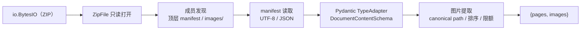
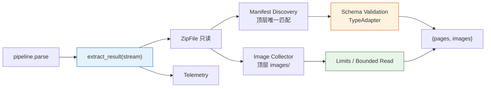
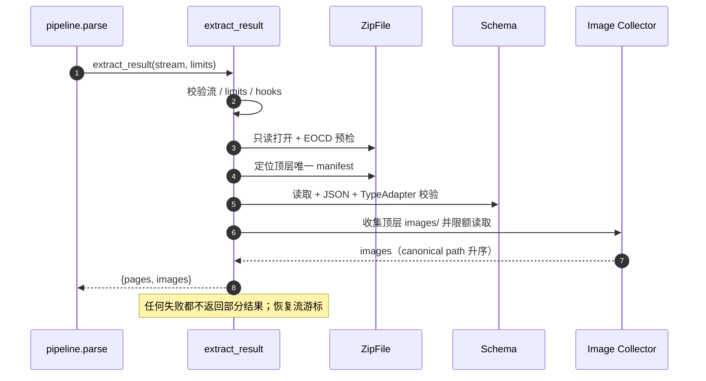

# 结果包提取器 结果包解析与图片提取 技术方案

| 字段 | 内容 |
| --- | --- |
| 标题 | 结果包提取器 结果包解析与图片提取 技术方案 |
| 主笔 | @jackafx |
| 评审人 | @jackafx（仓库维护者，兼下游依赖方负责人）；评审记录见 `changelog.md` |
| 创建日期 | 2026-10-21 |
| 目标版本 | 0.1.0 |
| 关联资源 | [全局架构](../../architecture/mineru-parser-architecture.md)、SPEC-001、SPEC-002、SPEC-004 |

## 1. 背景与上下文

### 1.1 系统现状

`mineru-parser` 的四阶段链路中，提取器是第四阶段：下载器交付 `io.BytesIO` 后，提取器把 ZIP 结果包解析为 `{"pages": [...], "images": [...]}`。上游是结果包内存流，下游是需要“页面 + 图片”的业务后端、渲染与检索入库。

当前技术栈为 Python 3.12、`zipfile`、`json`、Pydantic v2。组件是**无状态、纯内存**的解析函数：不下载、不重试、不落盘、不解码图片。组件已随 SPEC-004 私有化为 `mineru_parser._extractor`；外部用户通过 `parse()` 间接使用，行为契约仍由本文约束。

核心流程：



全局组件边界见 [全局架构](../../architecture/mineru-parser-architecture.md)；本文只描述提取器范围内的拓扑与契约。

### 1.2 核心技术痛点

结果包不是“一个正常 ZIP”那么简单；失败链如下：

1. **manifest 定位不一致**：文件名依赖源文档名，约定位于 ZIP 顶层目录；子目录残留、同名 / 多份 manifest、macOS 资源分叉、错误页 ZIP 都会让“取第一个匹配文件”的脚本悄悄读到错误内容。
2. **Schema 校验缺失**：直接用 `dict["content"]` 取值时，字段缺失、块类型漂移与 `bbox` 非法要等到业务深处才暴露；错误信息也缺少字段路径。
3. **图片处理分散**：路径大小写、重复成员、`..` 路径、符号链接、缺失 `images/` 目录各自处理；排序不确定，调用方难以做稳定快照。
4. **资源边界缺失**：下载器的 `max_bytes` 只约束压缩字节，不约束解压后的 manifest 与图片；压缩炸弹或超大图片仍可在解压阶段把进程内存打满。
5. **错误不可分类**：`BadZipFile`、`UnicodeDecodeError`、Pydantic `ValidationError`、`KeyError` 混杂在一起，调用方无法区分“包坏了”“格式变了”“图片超限”，也无法决定是否值得重新下载。

**证据（度量）**：2026-10-21 用最小真实结果包核对，ZIP 共 7 个成员（`<uuid>_content_list.json`、`<uuid>_content_list_v2.json`、`<uuid>_model.json`、`<uuid>_origin.pdf`、`full.md`、`layout.json`、`images/<sha256>.jpg`）。manifest 4,803 B，1 页、6 个块（TitleBlock ×1、ParagraphBlock ×4、ImageBlock ×1）；图片 1 张、13,936 B。该样本确认了“根目录 manifest + 根 `images/`”布局，也暴露了原默认 `max_total_image_bytes=256 MiB` 与 1 GiB 容器、$W=4$ 的部署形态不自洽：同一形态下峰值约 1,272 MiB，超过容器上限；据此下调为 160 MiB（见 §4.3 与 Q-23）。

### 1.3 重构/设计动机

1. **提取器成为每条 `parse()` 调用的最后一段**：SPEC-004 落地后，提取失败会直接表现为管道第 4 阶段失败；契约需要在 0.1.0 发布前固化。
2. **资源预算需要与部署形态对齐**：单次调用峰值约 240 MiB、$W=4$ 时约 960 MiB；默认限额必须能据此自洽推导，而不是拍脑袋。
3. **三条失败路径需要共享根异常**：客户端、下载器、提取器的异常互不继承，但调用方需要统一捕获入口；`MinerUParserError` 是本期触发点之一。
4. **下游需要与提取器一致的路径规则**：manifest 中的图片引用是上游原始字符串，必须用同一套 canonical 规则归一；否则下游无法稳定匹配图片。

### 1.4 非目标

- **下载、重试、URL 校验、SSRF 防护**：本次不做；属于上游下载组件。
- **解压到磁盘、临时文件、`extract()` / `extractall()`、ZIP 成员权限恢复**：本次不做。
- **解析 `content_list.json`（v1）、`middle.json`、`model.json`、Markdown 或其他结果文件**：本次不做。
- **图片解码、格式嗅探、缩略图、OCR、内容哈希或损坏图片检测**：本次不做。
- **manifest 中 `image_source.path` 与 `images` 列表的交叉校验**：本次不做；缺失引用与未引用图片均不报错。
- **按内容去重相同图片**：本次不做；每个路径一条记录。
- **流式 / 懒加载解析**：本次不做；整份 manifest 与全部图片一次性载入内存。
- **批量结果包、多个 ZIP 合并、跨包去重**：本次不做。
- **阅读顺序重建、跨页合并、版面块重排**：本次不做。
- **ZIP 来源、签名、哈希校验**：本次不做；只校验结构与资源边界。
- **非 seekable 流的缓冲**：本次不做；调用方需自行转为 `io.BytesIO`。
- **`ResultExtractor` 类门面**：本次不做；当前提供无状态函数。
- **修改 `schema/content_v2.py` 或开启 `strict=True` / `extra="forbid"`**：本次不做。
- **JSON 重复键检测**：本次不做；解析器按“后值覆盖前值”处理。
- **绕开 `zipfile` 自行实现成员解压**：本次不做；完整性校验交由下游。

**不做的后果**：不做图片解码与哈希校验意味着恶意图片载荷的防护属于下游渲染器；不做交叉校验意味着调用方必须自行判断引用缺失；不落盘意味着解码后的 manifest 与图片全部驻留内存，峰值受 §4.3 的限额约束。以上代价已写入第 5 章与第 7 章。

## 2. 目标与非目标

### 2.1 目标

- **G1 - 统一入口与结果契约（架构级）**：`extract_result(stream) -> ExtractedResult` 是唯一入口；每次返回新的 `{pages, images}`，失败不返回部分结果。验收：AC-1.1 ~ AC-1.11。
- **G2 - manifest 唯一发现与 Schema 校验（可靠性级）**：只在 ZIP 顶层定位唯一 `*_content_list_v2.json`；缺失或多份均失败关闭；Pydantic 校验携带字段路径且不泄漏正文。验收：AC-2.1 ~ AC-3.10。
- **G3 - 图片提取与路径规则（架构级）**：提取顶层 `images/` 全部常规文件；canonical path、去重、字典序排序；公开 `canonicalize_member_path`。验收：AC-4.1 ~ AC-4.14。
- **G4 - 资源限额与错误分类（性能 / 可靠性级）**：默认 manifest 16 MiB、单图 32 MiB、总图片 160 MiB、图片 10,000 张、成员 100,000；超限不返回部分结果。验收：AC-5.1 ~ AC-6.9。
- **G5 - 流生命周期、遥测与可测试性（运维级）**：不关闭调用方流、成功 / 失败后恢复游标；日志 / 指标统一出口；纯函数、无网络、可用内存 ZIP 测试。验收：AC-7.1 ~ AC-7.7。
- **G6 - 共享根异常与公开路径规则（架构级）**：`ResultExtractionError` 继承 `MinerUParserError` 且与其他失败家族互不继承；`canonicalize_member_path` 对外可用。验收：AC-6.1、AC-1.11、AC-4.13。

### 2.2 非目标

- **NG1 - 下载、重试、URL 校验、SSRF 防护**：属于下载器（本次不做）。
- **NG2 - 解压到磁盘 / 临时文件 / 权限恢复**：只在内存读取（本次不做）。
- **NG3 - 解析其他结果文件**：只面向 `content_list_v2`（本次不做）。
- **NG4 - 图片解码 / 哈希 / 损坏检测**：下游负责（本次不做）。
- **NG5 - manifest 与图片交叉校验**：当前不做（本次不做）。
- **NG6 - 图片内容去重**：每个路径一条记录（本次不做）。
- **NG7 - 流式 / 懒加载解析**：整份一次性载入（本次不做）。
- **NG8 - 批量 / 多 ZIP / 跨包去重**：当前不做（本次不做）。
- **NG9 - 阅读顺序重建 / 跨页合并**：当前不做（本次不做）。
- **NG10 - ZIP 来源 / 签名 / 哈希校验**：只校验结构与资源边界（本次不做）。
- **NG11 - 非 seekable 流缓冲**：调用方先转 `io.BytesIO`（本次不做）。
- **NG12 - 类门面 / 严格 Schema 模式 / 重复键检测 / 自建 ZIP 解析**：留待后续评估（Deferred to Phase 2）。
- **NG13 - 自定义 `max_total_image_bytes` 之外的部署级内存隔离**：由部署方控制并发度（Deferred to Phase 2）。

## 3. 架构设计与核心方案

### 3.1 总体架构

全局结构见 [全局架构](../../architecture/mineru-parser-architecture.md)（Approved）。提取器位于管道第 4 阶段，上游是下载器交付的内存 ZIP 流，下游是 `ParseResult.data`。

本次变更范围内的拓扑：



**新增 / 改造 / 保持不变**：

- 新增：`MinerUParserError` 根异常在提取器侧的继承关系与断言；公开 `canonicalize_member_path`。
- 改造：实现伪码收敛为契约条款；明确 EOCD 前置预检、manifest 唯一发现与资源限额的判定顺序。
- 不变：`extract_result` 签名、输出结构、异常体系、限额默认值（`max_total_image_bytes=160 MiB`）。

### 3.2 核心模块职责

| 模块 | 职责 | 明确不做 |
| :--- | :--- | :--- |
| `extract_result` | 参数 / 流校验、编排、流游标恢复、遥测收尾 | 不下载、不重试、不落盘 |
| `Manifest Discovery` | 顶层唯一 manifest 定位、候选与顶层成员清单、编码 / JSON 错误分类 | 不解析业务字段 |
| `Schema Validation` | `TypeAdapter(DocumentContentSchema)` 校验、错误清洗与 `msg` 脱敏 | 不改 Schema、不开启 strict |
| `Image Collector` | 顶层 `images/` 成员发现、canonical path、去重、排序、有界读取 | 不解码图片、不交叉校验引用 |
| `Limits` | manifest / 单图 / 总图片 / 数量 / 成员数限额 | 不替代部署层并发控制 |
| `Telemetry` | 日志 / 指标出口、`outcome` 映射、`correlation_id` | 不影响主流程 |

### 3.3 核心数据流转

1. `extract_result(stream)` 校验流可读 / 可 seek 与 `limits` / hooks 参数；记录初始游标。
2. 以只读模式打开 `ZipFile`；EOCD 前置预检按中央目录大小推导成员数上界，超限在构造 `ZipFile` 前拒绝。
3. 在 ZIP 顶层定位唯一 `*_content_list_v2.json`；缺失、多份或非法成员名分别失败关闭。
4. 有界读取 manifest，UTF-8（可选 BOM）解码，JSON 解析，`TypeAdapter(DocumentContentSchema)` 校验；错误清洗后抛出公共异常。
5. 收集顶层 `images/` 下的常规文件；canonical path 去重、字典序排序；按声明大小与累计字节双重限额有界读取。
6. 返回 `{pages, images}`；成功与已处理失败后恢复流游标；任何失败都不返回部分结果。

### 3.4 关键选型与约束

- **`zipfile` 只读 + 有界读取**：不自行实现解压，不落盘，不调用 `extract()` / `extractall()`。
- **Pydantic v2 `TypeAdapter`**：复用现有 `content_v2` Schema，提供字段路径与错误分类；不开启 strict。
- **顶层唯一 manifest**：不猜测、不回退、不合并；多份即 `ambiguous`。
- **输出普通 dict + `TypedDict`**：与调用方约定一致；Pydantic 模型只用于页面内容。
- **资源限额显式化**：限额不是孤立数字，必须与部署形态（$W$、容器内存）共同推导；详细对比见第 7 章。

## 4. 详细设计

### 4.1 设计范围与术语

- **canonical path**：ZIP 成员名的规范化形式；拒绝绝对路径、`..`、反斜杠与控制字符，保留 `images/...` 相对路径。
- **顶层成员**：ZIP 中路径不含 `/` 的成员；manifest 与 `images/` 目录均只在顶层扫描。
- **声明大小**：`ZipInfo.file_size`；它是 ZIP 自述数据，不是安全边界，但作为限额的有效闸门。
- **部分结果**：任何失败都不得返回已读取的 manifest 或图片；失败即整体失败。

### 4.2 输入契约与信任边界

| 项 | 约定 |
| :--- | :--- |
| 介质 | 任意可读、可 seek 的二进制流；典型实现为 `io.BytesIO` |
| 内容 | 标准 ZIP 归档；字节完整性与格式合法性由调用方保证，不合规时以 `invalid_zip` 失败关闭 |
| 来源 | 上游交付、缓存命中、本地文件、测试夹具均可 |
| 所有权 | 调用方持有并负责关闭流；Extractor 只读、不关闭、不持有 |
| 前置条件 | 不依赖网络、磁盘、环境变量或全局状态；非 seekable 流须先缓冲 |

**信任边界**：ZIP 内容视为不可信输入。即使 URL 来自 MinerU，响应体仍可能损坏、被替换或包含恶意成员；Extractor 只做结构与资源边界校验，不验证来源、签名或哈希。图片字节不会被解码，恶意图片载荷的防护属于下游渲染器职责。

### 4.3 数据模型与契约

**`ExtractionLimits`**

| 字段 | 默认值 | 类型 | 必填 | 约束 / 作用 |
| :--- | :--- | :--- | :---: | :--- |
| `max_manifest_bytes` | 16 MiB | `int` | 否 | 正整数，拒绝 `bool`；manifest 解压后字节上限 |
| `max_image_bytes` | 32 MiB | `int` | 否 | 正整数；单张图片解压后字节上限 |
| `max_total_image_bytes` | 160 MiB | `int` | 否 | 正整数；全部图片解压后总字节上限 |
| `max_images` | 10,000 | `int` | 否 | 正整数；图片文件数量上限 |
| `max_members` | 100,000 | `int` | 否 | 正整数；ZIP 中央目录成员总数上限 |

任一字段非法时抛 `ResultExtractionConfigurationError(field=<字段名>)`，且报错指明第一个不合法字段；`None` 只表示使用默认值，不表示无限制。

**输出结构**

| 字段 | 类型 | 说明 |
| :--- | :--- | :--- |
| `pages` | `DocumentContentSchema`（`list[list[LayoutElement]]`） | 按 manifest 顺序；页号等于下标 + 1 |
| `images[].path` | `str` | canonical 归档相对路径；恒为 `images/...` |
| `images[].bytes` | `bytes` | ZIP 成员解压后的精确字节；不转码 |

运行时 `ExtractedResult` 是普通 `dict`；`TypedDict` 只提供静态类型与文档约束。结果不包含 `manifest_path`。

**端到端资源预算**

$$
M_{\text{peak}} \approx \texttt{max\_total\_image\_bytes} + \texttt{max\_manifest\_bytes} \times (1 + k_{\text{model}}) + M_{\text{zipinfo}} + M_{\text{result}}
$$

部署侧必须满足 $W \times M_{\text{peak}} \le M_{\text{container}}$。当前默认形态：$W=4$、$M_{\text{container}}=1$ GiB、$k_{\text{model}}=1$（待标定）、$M_{\text{zipinfo}}=40$ MiB、$M_{\text{result}}=8$ MiB，代入得 $M_{\text{peak}} \approx 240$ MiB，$4 \times 240 = 960$ MiB ≤ 1 GiB。若 $k_{\text{model}} > 1$，须按 $X \le 192 - 16k$ MiB 下调 `max_total_image_bytes`。

> 压缩侧与解压侧不是同一量纲：上游 50 MiB 约束压缩后字节，Extractor 约束解压后字节；“字节拿到了但提取被限额拒绝”是正常可达状态，调用方应把 `ResultExtractionLimitError` 理解为“该结果包超出本环境预算”，而不是“包坏了”。

**异常体系**

```text
MinerUParserError
├── MinerUError                 # 客户端异常体系
├── ResultDownloadError         # 下载器异常体系
└── ResultExtractionError
    ├── ResultExtractionConfigurationError   # 流 / limits / hooks 非法
    ├── ResultExtractionArchiveError         # ZIP 或成员结构 / 读取失败
    ├── ResultExtractionManifestError        # manifest 缺失 / 多份 / JSON 结构错误
    ├── ResultExtractionValidationError      # JSON 合法但不符合 Schema
    └── ResultExtractionLimitError           # 解压后大小 / 数量超限
```

| 异常 | 附加字段 | 说明 |
| :--- | :--- | :--- |
| `ResultExtractionConfigurationError` | `field` | 构造参数、流能力或注入 callable 非法 |
| `ResultExtractionArchiveError` | `reason`、`member` | `invalid_zip`、`unsafe_member`、`duplicate_member`、`encrypted_member`、`unsupported_compression`、`corrupt_member`、`read_failed` |
| `ResultExtractionManifestError` | `reason`、`manifest_path`、`candidates`、`candidate_count`、`top_level_members`、`top_level_member_count` | `not_found`、`ambiguous`、`invalid_encoding`、`invalid_json` |
| `ResultExtractionValidationError` | `manifest_path`、`category`、`issues`、`issue_count` | `category` ∈ `unknown_block_type` / `missing_field` / `invalid_bbox` / `root_shape` / `other`；`issues` 最多 20 条 |
| `ResultExtractionLimitError` | `resource`、`limit`、`actual`、`member` | `resource` ∈ `manifest` / `image` / `image_count` / `total_image_bytes` / `member_count` |

`ResultExtractionError` 与 `MinerUError`、`ResultDownloadError`、`PipelineError` **互不继承**；四者共享 `MinerUParserError`。

### 4.4 接口与协议

**公共 API（内部组件，行为契约仍成立）**

| 成员 | 签名 / 取值 | 语义 |
| :--- | :--- | :--- |
| `extract_result` | `extract_result(stream: BinaryIO, *, limits: ExtractionLimits \| None = None, on_metric: MetricHook \| None = None, correlation_id: str \| None = None) -> ExtractedResult` | 同步纯函数；成功返回新 dict；失败不返回部分结果 |
| `canonicalize_member_path` | `canonicalize_member_path(raw: str) -> str \| None` | 与内部实现共用同一份规则；非法路径返回 `None` |

组件通过 `mineru_parser._extractor.__all__` 导出；已随 SPEC-004 私有化，不再由顶层导出。顶层只保留 `parse` 签名 / 返回值所需的 `ExtractedResult` / `ExtractedImage` / `ExtractionLimits`。

**流生命周期契约**

1. **只读**：只调用 `read` / `seek` / `tell`，不得写入或截断流。
2. **所有权**：调用方拥有流；返回后不持有引用，绝不调用 `close()`。
3. **游标**：成功与已处理失败后恢复到调用前位置；恢复失败只记录警告，不改变主结果。
4. **可 seek**：非 seekable 流直接拒绝；调用方可先写入 `io.BytesIO`。
5. **并发**：不同流上的并发调用安全；同一个流的并发调用不受支持。

**返回契约**

1. **完整性**：只有 manifest 校验与全部图片读取成功后才返回；任何失败都不返回部分结果。
2. **独立性**：每次返回新的 dict、list 与 Pydantic 对象；不缓存、不共享。
3. **页面**：`pages` 保持 manifest 中的页顺序；Pydantic 模型可继续使用或 `model_dump()`。
4. **图片**：`images` 按 canonical path 升序；`bytes` 精确且不可变；`path` 是归档相对路径。
5. **字节完整性以中央目录声明为准**：`len(images[].bytes)` 等于 `ZipInfo.file_size`；敌意归档可能谎报大小导致静默截断，下游使用图片前必须自行校验内容。
6. **引用解析**：manifest 中的 `image_source.path` 是上游原始字符串，不保证与 `images[].path` 逐字相等；下游必须先用 `canonicalize_member_path()` 归一后再匹配。
7. **无交叉校验**：不保证引用都能在 `images` 中找到；缺失引用与未引用图片都合法。
8. **无重试**：解析失败是终态；调用方可重新下载后再次调用。

### 4.5 核心流程与时序



#### 4.5.1 提取编排

本节描述**控制流契约**：每个阶段做什么、用什么判据、失败时抛出什么。实现方式（函数划分、循环写法、内部数据结构）由实现者决定，本 Spec 不约束；判定细则见 §4.5.2（成员发现与路径规则）与 §4.6（校验、限额与错误分类），遥测字段见 §5.3。

#### 编排阶段


| #   | 阶段          | 动作                                               | 失败结果                                                                                                                   | 依据                |
| :---: | :----------- | :------------------------------------------------ | :---------------------------------------------------------------------------------------------------------------------- | :----------------- |
| 1   | 遥测构造        | 校验 `on_metric` / `correlation_id`，构造 `Telemetry` | `ConfigurationError(field="on_metric" / "correlation_id")`                                                             | AC-6.6 / AC-6.7   |
| 2   | 限额解析        | `limits=None` 取默认值；否则校验类型                        | `ConfigurationError(field="limits")`                                                                                   | AC-1.7            |
| 3   | 流校验         | 校验二进制、可读、可 seek；记录起始游标                           | `ConfigurationError(field="stream")`                                                                                   | AC-1.6            |
| 4   | 成员数预检       | 读 EOCD，按条目数上界公式判定，超限立即拒绝（尚未打开归档）                 | `LimitError(resource="member_count")`                                                                                  | AC-5.9            |
| 5   | 打开归档        | 只读模式打开 ZIP，解析中央目录                                | `ArchiveError(reason="invalid_zip")`                                                                                   | AC-5.1            |
| 6   | 成员数复核       | 中央目录条目数超限则拒绝                                     | `LimitError(resource="member_count")`                                                                                  | AC-5.9            |
| 7   | manifest 发现 | 定位唯一顶层候选（不读数据）                                   | `ManifestError(reason="not_found" / "ambiguous")`、`ArchiveError(reason="unsafe_member")`                               | AC-2.1 \~ AC-2.8  |
| 8   | manifest 读取 | 有界读取并校验读取长度与声明一致                                 | `LimitError(resource="manifest")`、`ArchiveError(reason=...)`                                                           | AC-3.1 / AC-3.2   |
| 9   | manifest 解析 | UTF-8 解码 → JSON 解析 → Schema 校验                   | `ManifestError(reason="invalid_encoding" / "invalid_json")`、`ValidationError`                                          | AC-3.3 \~ AC-3.5  |
| 10  | 图片发现        | 过滤、去重、数量与声明总量预检                                  | `ArchiveError(reason="duplicate_member" / "unsafe_member")`、`LimitError(resource="image_count" / "total_image_bytes")` | AC-4.1 \~ AC-4.13 |
| 11  | 图片读取        | 逐张有界读取并校验读取长度与声明一致                               | `LimitError(resource="image")`、`ArchiveError(reason=...)`                                                              | AC-4.9 / AC-4.12  |
| 12  | 交付          | 组装 `{"pages", "images"}`                         | —                                                                                                                      | AC-1.2 / AC-1.3   |
| 13  | 收尾          | 恢复游标；上报一次指标                                      | 恢复失败仅告警，不改变主结果                                                                                                         | AC-1.5 / AC-6.6   |


> 阶段 1 早于阶段 2 / 3：`Telemetry` 必须先于 `limits` 与 `stream` 构造，使**配置错误也能上报指标**（AC-6.6）。阶段 4 早于阶段 5：成员数量必须在构造 `ZipFile` **之前**判定，避免中央目录内存先分配（AC-5.9）；阶段 4 的判定量是**条目数上界**（§4.5.2 公式），不是 EOCD 的 16 位计数字段。
>
> 阶段 1 存在一个例外：`on_metric` / `correlation_id` 本身非法时 `Telemetry` 尚未构造，**无法上报指标**，此时只抛 `ConfigurationError`（AC-6.6）。因此"指标恰好上报一次"仅对**已成功构造 `Telemetry`** 的调用成立。

#### 参数校验契约


| 校验对象             | 通过条件                                                         | 失败                                           |
| :---------------- | :------------------------------------------------------------ | :-------------------------------------------- |
| `on_metric`      | `None` 或可调用对象                                                | `ConfigurationError(field="on_metric")`      |
| `correlation_id` | `None` 或 `str`                                               | `ConfigurationError(field="correlation_id")` |
| `limits`         | `None`（取 `DEFAULT_EXTRACTION_LIMITS`）或 `ExtractionLimits` 实例 | `ConfigurationError(field="limits")`         |


`ExtractionLimits` 的**字段级**合法性由其构造期校验负责（§4.3），不在此重复。

#### 流校验契约


| 检查   | 通过条件                            | 失败                                   |
| :---- | :------------------------------- | :------------------------------------ |
| 二进制性 | 不是 `io.TextIOBase` 实例           | `ConfigurationError(field="stream")` |
| 能力存在 | 具备可调用的 `read` / `seek` / `tell` | 同上                                   |
| 可读性  | `readable()` 存在且为真（不存在时视为通过）    | 同上                                   |
| 可定位性 | `seekable()` 存在且为真（不存在时视为通过）    | 同上                                   |
| 游标可读 | `tell()` 成功并返回整数                | 同上                                   |


通过后必须记录起始游标，供收尾阶段恢复（AC-1.5）。

#### 编排与收尾契约

1. **先校验后读取**：hooks、limits、stream 能力在打开 ZIP 前校验完毕。
2. **响应必关闭**：`ZipFile` 通过上下文管理器关闭；传入的 `stream` 不会被关闭（AC-5.7）。
3. **失败不交付**：任何异常都不会返回部分 `pages` 或 `images`（AC-3.10 / AC-4.11）。
4. **声明大小是判据**：所有读取都是 `limit + 1` 的有界读取；`zipfile` 把读取钳制在中央目录声明的 `file_size` 内，因此**声明大小既是预检也是实际上界**，读取后再校验 `len(data) == info.file_size`。
5. **遥测在收尾**：指标恰好上报一次；游标恢复失败只记录警告，不覆盖主结果。
6. **异常不吞掉**：非 `ResultExtractionError` 的异常原样抛出（AC-6.8）。

#### 异常 → `outcome` 映射


| 异常类型                                 | `outcome`          |
| :------------------------------------ | :------------------ |
| `ResultExtractionConfigurationError` | `config_error`     |
| `ResultExtractionLimitError`         | `limit_error`      |
| `ResultExtractionValidationError`    | `validation_error` |
| `ResultExtractionManifestError`      | `manifest_error`   |
| `ResultExtractionArchiveError`       | `archive_error`    |
| 其他未知异常                               | `unexpected`       |


#### 指标标签装配


| 条件                     | 标签集合                                                                    |
| :---------------------- | :----------------------------------------------------------------------- |
| `outcome == "success"` | 仅 `outcome`                                                             |
| 失败                     | `outcome` + `reason`（归档 / manifest 类）+ `resource`（限额类）+ `category`（校验类） |


标签只允许封闭枚举，不得包含路径、成员名、文档内容、异常消息或 `correlation_id`（AC-6.7）。

#### 4.5.2 成员发现与路径规则

本节给出**判定规则**：给定归档内容，如何唯一确定 manifest、图片根目录、canonical path 与常规文件。规则本身是契约；实现方式由实现者决定。

##### 成员数量前置预检 (EOCD)

`zipfile` 在构造时会完整解析中央目录并为每个成员分配 `ZipInfo`；若等到解析完成再检查 `max_members`，超大归档的中央目录内存**已经分配出去了**。因此成员数量必须在构造 `ZipFile` **之前**判定：EOCD (End-Of-Central-Directory) 记录固定位于归档尾部，从流尾部读一个 64 KiB 窗口即可拿到条目数与中央目录大小。

**为什么不能只数 EOCD 的条目数字段**：该字段只有 16 位，上限 65534；条目数 ≥ 65535 时写入 `0xFFFF`（ZIP64 标记），真实值位于 EOCD64 记录（位于中央目录之后、归档尾部之前，**不在**尾部窗口内）。因此在默认 `max_members = 100_000` 下，只依赖该字段的预检**永远不可能触发拒绝**——而超大成员数归档恰恰必然走 ZIP64 路径。本 Spec 因此改用**中央目录大小**推导条目数上界。


| 预检环节     | 契约                                                                            |
| :-------- | :----------------------------------------------------------------------------- |
| 读取窗口     | 从流尾部读取末尾最多 64 KiB；读取不得改变调用方游标语义（末尾统一恢复）                                       |
| EOCD 定位  | 在窗口内从后向前查找 EOCD 签名（`PK\x05\x06`）；EOCD 定长部分为 22 字节                             |
| 取值字段     | 从 EOCD 读取「本磁盘条目数」（+8）、「中央目录总条目数」（+10）、「中央目录大小」（+12）、「归档注释长度」（+20）             |
| 自洽性校验    | EOCD 的定长部分必须**结束于窗口尾部**（EOCD 偏移 + 22 + 注释长度 == 窗口长度）；「本磁盘条目数」必须等于「总条目数」（单盘归档） |
| 条目数溢出标记  | 「总条目数」为 `0xFFFF` 时真实条目数位于 EOCD64 记录，本预检不读该记录，改由中央目录大小推导（`count_exact` 取 0）    |
| 中央目录大小溢出 | 「中央目录大小」为 `0xFFFFFFFF` 时真实值位于 EOCD64 记录，本预检**不可判定**，跳过预检                      |
| 流尾部读取失败  | 预检不可判定                                                                        |


**条目数上界公式**

中央目录每条记录固定 46 字节（再加成员名、extra field、comment），因此：

$$
\text{entries\_bound} = \max\!\Big(\texttt{count\_exact},\ \Big\lceil \frac{\texttt{cd\_size}}{46} \Big\rceil\Big)
$$

其中 `count_exact` = EOCD 的 16 位「总条目数」（为 `0xFFFF` 时取 0，因该值不可信），`cd_size` = EOCD 的 32 位「中央目录大小」。该上界**恒不小于真实条目数**（中央目录大小 ≥ 46 × 真实条目数），且在 16 位计数字段被谎报时仍能反映真实规模。


| 判定结果                          | 行为                                                                                |
| :----------------------------- | :--------------------------------------------------------------------------------- |
| `entries_bound > max_members` | 抛出 `LimitError(resource="member_count", limit=max_members, actual=entries_bound)` |
| `entries_bound ≤ max_members` | 放行                                                                                |
| 预检不可判定                        | **跳过预检**，不报错，交由中央目录解析后的后置检查兜底                                                     |


> `actual` 取 `entries_bound` 本身：当 16 位计数字段有效且不小于中央目录大小推导出的上界时，它恰为**精确条目数**；否则为**保守上界**。
>
> **上界的保守性与误拒**：`entries_bound` 是上界，因此**成员数远少于 `max_members`、但成员名很长**的归档也可能触顶（实测：50,000 个成员、平均成员名约 100 字节时 `cd_size ≈ 7.3 MB`，上界 ≈ 160,870，会被拒绝）。这是**已知取舍**：调用方需按实际成员名长度上调 `max_members`。若不接受该取舍，只能放弃前置预检（回到"解析后检查"，代价是中央目录内存先分配）。
>
> **前置预检不是安全边界**：EOCD 的全部字段由归档作者控制，谎报 `cd_size` 即可绕过前置检查。权威判定始终是构造 `ZipFile` 后的 `len(infolist()) > max_members`；前置预检的价值是对**诚实归档**快速拒绝，避免中央目录内存先分配。

- 预检是**快速拒绝**，后置检查（中央目录条目数 &gt; `max_members`）是**兜底**，两者都必须实现。
- **自洽性检查不得引入假阳性**：EOCD 定位失败、自洽性校验不通过（多盘归档、注释长度与尾部不一致）或中央目录大小溢出时一律**跳过预检**，交由 `ZipFile` 判定。
- **中央目录大小推导的上界可能误拒**（成员数少于 `max_members` 但成员名很长），这是上界固有的保守性，与自洽性检查无关；取舍与规避见上方说明。
- 预检只读尾部窗口，不解压任何成员。
- **已验证的行为**（对照中央目录实际条目数）：普通归档、带普通归档注释的归档、成员内容含伪 EOCD 签名的归档均能取到有效上界（例：2 个成员 → 上界 3）；**ZIP64 条目数归档**（70,000 个成员）由中央目录大小推得上界 85,218（真实 70,000），不再像"只数 16 位字段"那样退化为不可判定；200,000 个成员的归档上界 247,827 &gt; `max_members`，**在构造 `ZipFile` 之前即被拒绝**；非 ZIP 内容、空流、短于 22 字节的流均跳过预检；超过 64 KiB 尾部窗口的大归档仍能正确定位。
- **已知边界（伪 EOCD 藏在归档注释中）**：归档注释由作者控制，把 `PK\x05\x06` 放进注释会让"从后向前查找 EOCD"命中**伪签名**（伪记录位于真实 EOCD 之后）。此时：(a) 伪记录位于窗口尾部且注释长度为 0，**自洽性校验通过**，前置预检会读到 `cd_size = 0`、`entries_bound = 0` 并**放行**；(b) `zipfile` 自身同样命中伪记录，会把归档**静默解析成 0 个成员**（不会抛 `BadZipFile`）。Extractor 因此以 `ManifestError(reason="not_found")` 失败关闭（不返回错误内容），但诊断信息会低估归档规模。本 Spec **不**为此自建 ZIP 解析（Non-Goal）。

##### Canonical path

`canonicalize_member_path(raw: str) -> str | None` 是路径归一的**唯一实现**（AC-1.11），Extractor 内部与下游必须共用，不得出现第二套规则。


| 顺序  | 判定条件                                                          | 结果                                                |
| :---: | :------------------------------------------------------------- | :------------------------------------------------- |
| 1   | `raw` 为空                                                      | `None`                                            |
| 2   | `raw` 以 `/` 开头（绝对路径）                                          | `None`                                            |
| 3   | `raw` 含 `\`（反斜杠）                                              | `None`                                            |
| 4   | `raw` 含 NUL 或 C0/C1 控制字符（`U+0000`–`U+001F`、`U+007F`–`U+009F`） | `None`                                            |
| 5   | `raw` 按 `/` 切分后存在 `..` 段                                      | `None`                                            |
| 6   | 其余                                                            | 按 `/` 切段，丢弃空段与 `.` 段，其余段以 `/` 连接；若结果为空串则返回 `None` |


不变式：

- 只把 `/` 当分隔符；拒绝反斜杠，避免 Windows 路径分隔符歧义。`images\a.jpg` 不属于 `images/`，会被忽略或按不安全名称处理。
- 折叠空段与 `.`；拒绝绝对路径与任何 `..` 段。
- 拒绝 NUL 与 C0/C1 控制字符，避免日志注入与下游路径歧义。
- 不做 Unicode NFC/NFD 规范化，不做大小写转换；`Images/` 与 `images/` 不同。
- 纯函数：同一原始名的两次归一结果恒等；不访问 ZIP、不读取任何成员。
- 返回的 canonical path 用于输出 `images[].path`、去重、排序与错误上下文。

##### 常规文件判定


| 判定条件                                                                 | 结果                               |
| :-------------------------------------------------------------------- | :-------------------------------- |
| 目录项（名称以 `/` 结尾）                                                      | 非常规文件                            |
| `create_system == 0`（MS-DOS）且 MS-DOS 目录属性位（`external_attr & 0x10`）置位 | 非常规文件                            |
| `create_system == 3`（Unix）且 Unix mode 的文件类型位为目录 / 符号链接 / 设备等非普通文件    | 非常规文件                            |
| `create_system == 3` 且 Unix mode 为 0（归档未写 Unix mode）                 | 常规文件                             |
| `create_system == 3` 且 Unix mode 只有权限位、没有文件类型位（如 `0o644`）            | 常规文件                             |
| `create_system` 为其他取值                                                | 只按名称判定，不以 `external_attr` 推断文件类型 |


> **`external_attr` 的解释依赖 `create_system`**：CPython `zipfile` 的 `ZipInfo.create_system` 为 0 表示 MS-DOS、3 表示 Unix，两种布局下 `external_attr` 高位 / 低位的含义不同。因此上述 Unix mode 规则**仅在 `create_system == 3` 时生效**，MS-DOS 属性位规则**仅在 `create_system == 0` 时生效**；其他取值下不得据 `external_attr` 推断文件类型（否则一个 MS-DOS 归档高位残留的位会被误读为符号链接）。
>
> 注意：`zipfile` 写入目录项时，即使 `create_system == 3` 也会把 MS-DOS 目录标志 `0x10` 写进 `external_attr` 的低位（实测目录项 `external_attr = 0x41fd0010`）。因此"目录项"的判定以**名称以 `/` 结尾**为准（第一条），不依赖属性位。
>
> 无法识别的符号链接（归档未写 Unix mode）只能按普通文件读取；这是残余风险，见 R-9。

##### 错误上下文路径


| 用途                   | 契约                                                  |
| :-------------------- | :--------------------------------------------------- |
| 日志渲染                 | canonical path 已被规则拒绝控制字符，只需长度约束：超过 512 字符则截断并追加省略号 |
| 无法 canonical 化的原始成员名 | 先把可打印 ASCII 之外的字符转义为 `\xNN` 形式，再按 512 字符截断          |


- 内部流程始终使用完整 canonical path。
- **结构化字段保真**：`member`、`manifest_path`、`candidates`、`top_level_members` 中的 canonical path **完整未截断**，供调用方程序化定位与匹配。
- **日志渲染才截断**：512 字符上限只发生在写日志时。
- 无法 canonical 化的原始名称使用转义 + 截断后的形式，避免日志注入与超长异常消息；这类名称本就无法安全 canonical 化，不进入结构化字段的 canonical 语义。
- **条目可辨性**：结构化字段（`candidates` / `top_level_members`）中，无法 canonical 化的原始名以 `!` 前缀标记（`!<转义 + 截断后的原始名>`），canonical path 不加前缀。调用方据此区分两类条目（AC-2.2）。
- 返回给调用方的 `images[].path` 使用完整 canonical path，不截断。

##### Manifest 发现


| 步骤  | 动作                                            | 失败结果                                                                                                    |
| :---: | :--------------------------------------------- | :------------------------------------------------------------------------------------------------------- |
| 1   | 遍历中央目录成员                                      | —                                                                                                       |
| 2   | 原始成员名含 `/` → 跳过：不计入顶层成员，也不计入候选                | —                                                                                                       |
| 3   | 顶层成员名加入顶层清单                                   | —                                                                                                       |
| 4   | 顶层成员名不以 `_content_list_v2.json` 结尾（大小写敏感）→ 跳过 | —                                                                                                       |
| 5   | 名称无法 canonical 化 → 失败关闭                       | `ArchiveError(reason="unsafe_member")`                                                                  |
| 6   | 候选不是常规文件 → 失败关闭                               | `ArchiveError(reason="unsafe_member")`                                                                  |
| 7   | 候选数为 0 → 失败关闭                                 | `ManifestError(reason="not_found")`，携带 `top_level_members`（≤ 20 条，按字典序）与 `top_level_member_count`（完整总数） |
| 8   | 候选数 &gt; 1 → 失败关闭                             | `ManifestError(reason="ambiguous")`，`candidates` 为 canonical path 升序（≤ 20 条），`candidate_count` 为完整数量    |
| 9   | 候选数 == 1 → 返回该候选的 canonical path 与其 `ZipInfo` | —                                                                                                       |


- 搜索范围由**原始成员名**判定：不含 `/` 的成员才算顶层成员，因此 `result/foo_content_list_v2.json`、`./foo_content_list_v2.json`、`__MACOSX/._foo_content_list_v2.json`、`/foo_content_list_v2.json` 一律不参与定位，也不计入候选数。
- 顶层成员的 basename 即原始名本身，后缀匹配（大小写敏感）发生在该名称上。
- 目录项 `foo_content_list_v2.json/` 名称以 `/` 结尾，不在顶层范围，不会成为候选。
- 顶层候选名称若无法 canonical 化（反斜杠、NUL/C0/C1 控制字符），失败关闭 `unsafe_member`。
- 同名重复的顶层成员会产生两个候选，统一报 `ambiguous`。
- `not_found` 携带顶层成员清单与总数，用于分诊布局漂移。
- 选中成员必须通过其 `ZipInfo` 打开，不得按名称二次查找（AC-2.5），避免重复名称把读取重定向到另一个成员。
- 发现过程必须确定性：候选比较使用 canonical path 的字典序，归档成员顺序不得影响单候选的选择，也不得改变 `ambiguous` 的排序结果（AC-2.6）。

##### 图片根目录

图片根目录恒为 ZIP 顶层目录的 `images/`：


| 范围  | 图片根前缀     | 输出示例           |
| :--- | :--------- | :-------------- |
| 顶层  | `images/` | `images/a.jpg` |


- manifest 恒在顶层，故「与 manifest 同级」等价于「顶层」。
- 只扫描 `images/` 前缀下的常规文件（含其子目录）；`result/images/` 之类不会与顶层 `images/` 合并，也不回退。
- 顶层 manifest 恒不在 `images/` 前缀内，天然不会被收集。

##### 图片收集


| 步骤  | 动作                                                                        | 失败结果                                       |
| :---: | :------------------------------------------------------------------------- | :------------------------------------------ |
| 1   | 遍历中央目录成员                                                                  | —                                          |
| 2   | 原始名无法 canonical 化：若原始名的 `/` 分段中**存在等于 `images` 的段**（段相等，非子串匹配）→ 失败关闭；否则忽略 | `ArchiveError(reason="unsafe_member")`     |
| 3   | canonical path 不以 `images/` 前缀开头 → 忽略                                     | —                                          |
| 4   | 候选不是常规文件：是符号链接 → 失败关闭；其他非常规文件（目录项等）→ 忽略                                   | `ArchiveError(reason="unsafe_member")`     |
| 5   | 计入候选集合                                                                    | —                                          |
| 6   | 候选数量超过 `max_images` → 立即失败关闭（`actual` 至少为 `max_images + 1`）               | `LimitError(resource="image_count")`       |
| 7   | canonical path 重复 → 失败关闭                                                  | `ArchiveError(reason="duplicate_member")`  |
| 8   | 声明总字节 `sum(file_size)` 超过 `max_total_image_bytes` → 失败关闭（**读取任何图片之前**）    | `LimitError(resource="total_image_bytes")` |
| 9   | 按 canonical path 升序排序                                                     | —                                          |
| 10  | 逐张有界读取；累计实际字节超过上限 → 失败关闭                                                  | `LimitError(resource="total_image_bytes")` |


##### 有界成员读取


| 步骤  | 判定                                              | 结果                                                                           |
| :---: | :----------------------------------------------- | :---------------------------------------------------------------------------- |
| 1   | 成员被加密（`flag_bits & 0x1`）                        | `ArchiveError(reason="encrypted_member")`                                    |
| 2   | 声明大小 `file_size` &gt; 限额                        | `LimitError(resource=..., limit=..., actual=file_size, member=path)`         |
| 3   | 通过 `archive.open(info)` 打开，并读取至多 `limit + 1` 字节 | —                                                                            |
| 4   | 不支持的压缩方法                                        | `ArchiveError(reason="unsupported_compression")`，**切断异常链**                   |
| 5   | 加密相关的运行时错误                                      | `ArchiveError(reason="encrypted_member")`，**切断异常链**                          |
| 6   | CRC / 解压 / 截断                                   | `ArchiveError(reason="corrupt_member")`，可链原异常（`LargeZipFile` 为写路径专属，读取路径不可达） |
| 7   | 底层流 I/O 失败                                      | `ArchiveError(reason="read_failed")`，可链原异常                                   |
| 8   | 读取长度 &gt; 限额                                    | `LimitError(...)`，冗余断言（不可达）                                                  |
| 9   | 读取长度 ≠ 声明大小                                     | `ArchiveError(reason="corrupt_member")`                                      |


> 必须使用 `archive.open(info)` 而不是 `archive.read(name)`：前者可以绑定具体 `ZipInfo` 且有界读取，后者按名称查找且会一次性读完整个成员。
>
> 步骤 4 / 5 必须切断异常链：原始消息可能包含成员名（AC-6.4）。

### 4.6 异常处理与错误码

#### 校验流水线

```text
1. 校验 on_metric / correlation_id，构造 Telemetry
2. 校验 limits / stream，记录游标
3. EOCD 预扫描：条目数上界超限则在构造 ZipFile 之前拒绝
4. zipfile.ZipFile(stream, "r")；解析中央目录
5. 后置复核成员数量（len(infolist())）
6. 发现唯一顶层 manifest（仅扫描顶层成员名，不读数据）
7. 有界读取 manifest；校验读取长度 == 声明大小
8. UTF-8（去可选 BOM）解码
9. json_invalid 分类（含解析器递归上限）；否则 TypeAdapter[DocumentContentSchema]
10. 计算图片根目录；过滤、去重、排序
11. 数量与声明总字节预检
12. 逐张有界读取；校验读取长度 == 声明大小；累计实际总字节
13. 构造 {"pages", "images"}，恢复游标，上报遥测
```

#### Manifest 校验


| 步骤  | 动作                                                                              | 失败结果                                                                             |
| :---: | :------------------------------------------------------------------------------- | :-------------------------------------------------------------------------------- |
| 1   | 以 UTF-8 解码，允许去除一个可选 UTF-8 BOM；不猜测其他编码                                           | `ManifestError(reason="invalid_encoding", manifest_path=path)`                   |
| 2   | 用模块级 `TypeAdapter[DocumentContentSchema]` 的 `validate_json` 完成 JSON 与 Schema 校验 | —                                                                                |
| 3   | 错误明细含 `json_invalid` 类型（JSON 语法错误 / 尾随数据 / 解析器递归上限）                             | `ManifestError(reason="invalid_json", manifest_path=path)`                       |
| 4   | 错误明细不含 `json_invalid`：按下方清洗规则生成 `issues` 与 `category`                           | `ValidationError(manifest_path=path, category=..., issues=..., issue_count=...)` |
| 5   | 校验阶段递归耗尽（理论兜底）                                                                  | `ManifestError(reason="invalid_json", manifest_path=path)`                       |


##### 错误明细清洗


| 保留     | 丢弃      | 说明                         |
| :------ | :------- | :-------------------------- |
| `loc`  | —       | Pydantic 的定位路径，逐条保留        |
| `type` | —       | Pydantic 错误类型标识            |
| `msg`  | —       | 错误文本；内嵌输入值的类型必须替换为固定文案（见下） |
| —      | `input` | 可能内嵌 manifest 正文           |
| —      | `ctx`   | 可能内嵌输入值                    |
| —      | `url`   | 错误文档 URL，对调用方无价值           |


- 清洗在**生成错误明细的阶段**完成（不含 URL / `input` / `ctx`），而不是事后过滤。
- `issues` 最多 20 条（`_MAX_ISSUES_IN_ERROR`）；`issue_count` 保留**完整**错误条数。

##### `msg` 二次脱敏


| Pydantic 错误类型                                           | 处理                   |
| :------------------------------------------------------- | :-------------------- |
| `_UNSAFE_MSG_ERROR_TYPES` 中的类型（当前仅 `union_tag_invalid`） | 替换为**不含任何输入值**的固定文案  |
| 其余类型                                                    | 保留 Pydantic 原始 `msg` |


> `union_tag_invalid` 的原始 `msg` 形如 `Input tag '<原始值>' found using 'type' does not match any of the expected tags: ...`，直接保留会把 manifest 正文原样带进公共异常属性。

##### `category` 归一

按下列顺序判定，命中即止：


| 顺序  | 判定条件                                                | `category`           | 含义                                      |
| :---: | :--------------------------------------------------- | :-------------------- | :--------------------------------------- |
| 1   | 错误类型集合含 `union_tag_invalid` 或 `union_tag_not_found` | `unknown_block_type` | 未知 / 缺失的块类型 → 升级 Schema                 |
| 2   | 任一错误的 `loc` 中出现 `bbox` 段                            | `invalid_bbox`       | 非法 `bbox`                               |
| 3   | 任一错误的 `loc` 为空（根级错误），**或**错误类型集合含 `list_type`       | `root_shape`         | 根 / 页层级结构不是 `list[list[LayoutElement]]` |
| 4   | 错误类型集合含 `missing`                                   | `missing_field`      | 缺少必填字段                                  |
| 5   | 其余                                                  | `other`              | 其他 Schema 偏差                            |


> **规则 1 覆盖两种 Pydantic 错误类型**：判别联合的 tag 无效时报 `union_tag_invalid`（tag 取值不在词表内），tag 字段**缺失**时报 `union_tag_not_found`（`Unable to extract tag using discriminator 'type'`）。两者对调用方是同一个决策——"块类型不可用，升级 Schema"——必须同归 `unknown_block_type`。（`union_tag_not_found` 的 `msg` 不内嵌输入值，不在 `_UNSAFE_MSG_ERROR_TYPES` 内。）
>
> **规则 3 不能只看 `loc` 是否为空**：根结构写成 `[block]`（少一层）时，Pydantic 报 `list_type` 且 `loc = (0,)`——`loc` 非空，只有"根根本不是数组"（`loc = ()`）才满足"空 loc"。而 `list_type` 只可能出现在根与页两个层级（版面块必须是对象，否则报 `dict_type`），因此"错误类型集合含 `list_type`"是根 / 页层级结构错误的可靠判据。
>
> **规则 2 早于规则 4 的后果**：缺失 `bbox` 时 Pydantic 报 `missing` 但 `loc` 为 `(页, 块, 'paragraph', 'bbox')`——含 `bbox` 段，故被规则 2 判为 `invalid_bbox` 而非 `missing_field`。这是**有意为之**（缺失 bbox 与非法 bbox 对调用方是同一类"坐标不可用"），`missing_field` 因此只覆盖 `content` 及其嵌套字段。

- `category` 回答的是"调用方该做什么"——升级 Schema（`unknown_block_type`）还是拒收该文档（其余）；调用方**不得**去匹配 Pydantic 原始 type 字符串（AC-6.9）。
- `json_invalid` 覆盖 JSON 语法错误、尾随数据**与解析器递归上限**（深层嵌套 JSON 在此归类；本 Spec 不设独立的 `too_deep` 原因，见 AC-3.4）。UTF-8 编码错误已在前面单独处理。
- 校验失败与非法 JSON / 编码错误必须使原始 `ValidationError` 既不成为显式 `__cause__`，也不出现在 `__context__` 中（AC-6.4）。
- `manifest_path` 为**完整未截断**的 canonical path（AC-6.3）。

#### 限额检查点


| 检查            | 时机                     | 使用值                         | 异常                                         | 有效性                     |
| :------------- | :---------------------- | :--------------------------- | :------------------------------------------ | :----------------------- |
| ZIP 成员数量（前置）  | 构造 `ZipFile` 之前，读 EOCD | 条目数上界（§4.5 公式）              | `LimitError(resource="member_count")`      | ⚠️ 快速拒绝（读归档自述数据，可被谎报绕过） |
| ZIP 成员数量（后置）  | 中央目录解析后                | `len(infolist())`           | `LimitError(resource="member_count")`      | ✅ 权威兜底                  |
| manifest 声明大小 | 解压前                    | `ZipInfo.file_size`         | `LimitError(resource="manifest")`          | ✅ 实际上界                  |
| manifest 读取长度 | 有界读取后                  | `len(data) == file_size`    | `ArchiveError(reason="corrupt_member")`    | ✅ 完整性                   |
| 图片数量          | 构建图片条目列表时              | 已观察文件数（至少 `max_images + 1`） | `LimitError(resource="image_count")`       | ✅                       |
| 图片声明总大小       | 读取任何图片前                | `sum(file_size)`            | `LimitError(resource="total_image_bytes")` | ✅ 实际上界                  |
| 单图声明大小        | 每张解压前                  | `file_size`                 | `LimitError(resource="image")`             | ✅ 实际上界                  |
| 单图读取长度        | 每张有界读取后                | `len(data) == file_size`    | `ArchiveError(reason="corrupt_member")`    | ✅ 完整性                   |
| manifest 实际大小 | 有界读取后                  | `len(data)`                 | `LimitError(resource="manifest")`          | ⚠️ 冗余断言（不可达）            |
| 单图实际大小        | 每张有界读取后                | `len(data)`                 | `LimitError(resource="image")`             | ⚠️ 冗余断言（不可达）            |
| 图片实际总大小       | 每张读取后                  | 累计 `len(data)`              | `LimitError(resource="total_image_bytes")` | ⚠️ 冗余断言（不可达）            |


> **为什么后三项是冗余断言**：`zipfile` 的 `ZipExtFile` 把每次读取钳制在中央目录声明的 `file_size` 之内，故 `len(data) ≤ file_size` 恒成立；预检已保证 `file_size ≤ limit`，因此"实际字节超限"分支不可达。**声明大小既是预检也是实际上界**，有效闸门是"声明大小"三项；后三项保留只为防御 `zipfile` 行为变化，并提醒实现者不得依赖它们。
>
> 所有限额都失败关闭：不会"跳过超限图片继续返回其余结果"。声明大小可以提前失败，但 `file_size` 可能不准确——正因如此，读取长度必须与声明一致（不一致 → `corrupt_member`），而敌意归档谎报 `file_size` 造成的**静默截断**是 Extractor 无法自行识别的残余风险（R-12）。

#### 错误分类


| 阶段          | 情况                                | 异常                                                               |
| :----------- | :--------------------------------- | :---------------------------------------------------------------- |
| 配置          | 非法 stream / limits / hooks        | `ResultExtractionConfigurationError`                             |
| EOCD 预扫描    | 条目数上界 &gt; `max_members`          | `ResultExtractionLimitError(resource="member_count")`            |
| 打开 ZIP      | `BadZipFile` / `OSError`          | `ResultExtractionArchiveError(reason="invalid_zip")`             |
| 打开 ZIP      | 后置复核成员数量 &gt; `max_members`       | `ResultExtractionLimitError(resource="member_count")`            |
| Manifest 发现 | 零个候选                              | `ResultExtractionManifestError(reason="not_found")`              |
| Manifest 发现 | 多个候选                              | `ResultExtractionManifestError(reason="ambiguous")`              |
| Manifest 发现 | 不安全候选 / 候选是符号链接                   | `ResultExtractionArchiveError(reason="unsafe_member")`           |
| Manifest 读取 | 加密                                | `ResultExtractionArchiveError(reason="encrypted_member")`        |
| Manifest 读取 | 不支持压缩                             | `ResultExtractionArchiveError(reason="unsupported_compression")` |
| Manifest 读取 | CRC / 解压 / 截断 / 读取长度与声明不符         | `ResultExtractionArchiveError(reason="corrupt_member")`          |
| Manifest 读取 | 底层流 I/O                           | `ResultExtractionArchiveError(reason="read_failed")`             |
| Manifest 读取 | 超过 `max_manifest_bytes`           | `ResultExtractionLimitError(resource="manifest")`                |
| Manifest 解码 | 非法 UTF-8                          | `ResultExtractionManifestError(reason="invalid_encoding")`       |
| Manifest 解析 | 非法 JSON / 尾随数据 / 嵌套过深             | `ResultExtractionManifestError(reason="invalid_json")`           |
| Schema      | 不符合 `DocumentContentSchema`       | `ResultExtractionValidationError`（带 `category`）                  |
| 图片发现        | canonical path 重复                 | `ResultExtractionArchiveError(reason="duplicate_member")`        |
| 图片发现        | 不安全路径 / 符号链接                      | `ResultExtractionArchiveError(reason="unsafe_member")`           |
| 图片读取        | 加密 / 不支持压缩 / 损坏 / 读取长度与声明不符 / I/O | `ResultExtractionArchiveError(reason=...)`                       |
| 图片读取        | 数量 / 单图 / 总量超限                    | `ResultExtractionLimitError(resource=...)`                       |
| 未知          | 其他异常                              | 原样抛出；`outcome="unexpected"`                                      |


#### 错误清洗

- `ValidationError.issues` 只保留 Pydantic 的 `loc`、`type`、`msg`，丢弃 `input`、`ctx`、`url`；最多 20 条，`issue_count` 保留完整数量。
- `msg` 必须二次脱敏：`union_tag_invalid` 等会内嵌输入值的类型一律替换为固定文案（AC-4.5、AC-7.7）。
- `ManifestError.candidates` 最多 20 条 canonical path，`candidate_count` 保留完整数量；`not_found` 另带 `top_level_members`（最多 20 条）与 `top_level_member_count`。
- **结构化字段保真**：`member`、`manifest_path`、`candidates`、`top_level_members` 中的 canonical path **完整未截断**，供调用方程序化定位与匹配；512 字符截断只发生在**日志渲染**。无法 canonical 化的原始名称先转义 C0/C1 再截断，并以 `!` 前缀标记（AC-2.2）。
- 返回给调用方的 `images[].path` 使用完整 canonical path，不截断。
- 校验错误与非法 JSON/编码错误必须让原始 Pydantic 异常**同时不出现在 `__cause__` 与 `__context__` 中**：`from None` 只清 `__cause__`；`__context__` 必须靠"在 `except` 块内只做信息提取、待 handler 退出后再抛出公共异常对象"消除（AC-6.4）。给异常显式赋 `__context__ = None` 无效——`raise` 语句会用当前正在处理的异常覆写它。
- 归档错误只链 `BadZipFile` / `zlib.error` / `EOFError` / `OSError` 等不含正文的异常；加密 `RuntimeError` 与不支持压缩的 `NotImplementedError` 使用 `from None`。
- 不得在错误消息中拼接 manifest 片段、图片字节或 `str(pydantic_validation_error)`。

### 4.7 验收标准

#### US-1: 基本提取与结果契约

**As a** 业务调用方
**I want to** 把任意来源的 ZIP 内存流直接交给一个函数
**So that** 我能拿到结构化页面与图片字节，而不关心 ZIP 与 JSON 细节


- **AC-1.1**: `extract_result(stream, *, limits=None, on_metric=None, correlation_id=None)` 必须接受 `io.BytesIO` 或任意可读、可 seek 的二进制流，内容为标准 ZIP 归档；输入字节的来源不受限（上游交付、缓存命中、本地文件、测试夹具均可），Extractor 不感知来源，也不参与下载或重试；不得依赖网络、磁盘或环境变量，不得写临时文件，不得调用 `stream.close()`。
- **AC-1.2**: 成功时必须返回新的普通 `dict`，且恰好包含 `"pages"` 与 `"images"` 两个键。`pages` 必须是 `schema.content_v2.DocumentContentSchema` 校验后的对象（外层列表为页，内层列表为版面块，保持 manifest 中的顺序）；`images` 必须是 `{"path": str, "bytes": bytes}` 列表，并按 `path` 升序排序。
- **AC-1.3**: `images[].bytes` 必须是不可变 `bytes` 对象，内容为 ZIP 成员解压后的精确字节；不得解码、转码或重新编码。`images[].path` 必须是使用 `/` 分隔的 canonical 归档相对路径。
- **AC-1.4**: 每次调用必须返回全新对象，不得缓存或复用上一次结果；相同输入字节与相同 `limits` 必须产生等价结果。
- **AC-1.5**: 不得修改输入流内容；成功与所有已处理失败路径都必须把游标恢复到调用前位置。恢复失败时必须记录 `mineru.extract.restore_failed` 警告日志，但不得覆盖主要成功/失败结果。
- **AC-1.6**: 输入必须是可读、可 seek 的二进制流。`io.TextIOBase`、缺少 `read`/`seek`/`tell`、`seekable()` / `readable()` 为假，或解析前 `tell()` 失败，必须在读取 ZIP 前抛出 `ResultExtractionConfigurationError(field="stream")`。
- **AC-1.7**: `limits` 必须是 `ExtractionLimits | None`；`on_metric` 必须是 callable 或 `None`；`correlation_id` 必须是 `str | None`。非法值必须在读取 ZIP 前抛出 `ResultExtractionConfigurationError`。
- **AC-1.8**: `extract_result`、`ExtractionLimits`、`DEFAULT_EXTRACTION_LIMITS`、`ExtractedResult`、`ExtractedImage`、`ExtractionIssue`、`canonicalize_member_path` 与全部 `ResultExtraction*Error` 必须可从私有实现包 `mineru_parser._extractor` 导入。顶层 `mineru_parser` 只保留 `ExtractedResult` / `ExtractedImage` / `ExtractionLimits`（`parse` 的签名 / 返回值所需类型）；其余名称不再由顶层导出（SPEC-004 AC-2.2 / AC-2.3）。
- **AC-1.9**: 函数不得持有可变模块级调用状态；不同流上的并发调用必须安全。同一个流上的并发调用不受支持，实现无需加锁。
- **AC-1.10**: 不得调用 `stream.close()`、`ZipFile.extract()` 或 `ZipFile.extractall()`。
- **AC-1.11**: `canonicalize_member_path(raw: str) -> str | None` 必须对任意字符串返回与 Extractor 内部**完全一致**的 canonical path，无法安全 canonical 化时返回 `None`。实现必须与 `_members` 共用同一份函数，不得复制第二套规则；该函数不得访问 ZIP、不得读取任何成员。

---

#### US-2: Manifest 定位

**As a** 业务调用方
**I want to** 让 Extractor 自己找到结果包中唯一的结构化清单
**So that** 我不会因为文件名、目录层级或重复成员而读到错误内容


- **AC-2.1**: manifest 候选必须同时满足：(a) 成员位于 ZIP **顶层目录**——原始成员名不含 `/`；(b) 其**原始 basename** 以 `_content_list_v2.json` 结尾（大小写敏感），`*` 允许为空前缀。顶层候选随后必须通过 canonical path 安全校验与常规文件判定。位于子目录的同名成员一律不参与定位，也不计入候选数。
- **AC-2.2**: 必须恰好有一个候选。零个 → `ResultExtractionManifestError(reason="not_found")`，且必须携带 `top_level_members`（ZIP 顶层成员名清单，最多 20 条）与 `top_level_member_count`（顶层成员总数）；多于一个 → `ResultExtractionManifestError(reason="ambiguous")`，其中 `candidates` 为排序后的 canonical path（最多 20 条），`candidate_count` 为完整数量。
  > `not_found` 是布局漂移（R-5）的主要观测点。没有顶层成员清单时，运维无法区分"上游把 manifest 挪到了子目录""包结构整体变了"与"拿到的根本不是结果包"。顶层成员名属于归档元数据而非文档正文，可经转义 + 截断后的诊断上下文携带。
  > **清单的排序与条目格式**：`top_level_members` 与 `candidates` 均按 **canonical path 的字典序升序**排列，各取**排序后的前 20 条**（`_MAX_CANDIDATES_IN_ERROR` / `_MAX_TOP_LEVEL_MEMBERS_IN_ERROR`），并另附**完整数量**（`candidate_count` / `top_level_member_count`）。条目内容分两类：能 canonical 化的成员给出**完整未截断**的 canonical path；无法 canonical 化的成员给出转义 + 截断后的原始名，并以 `!` 前缀标记。`!` 前缀是"该项不是 canonical path"的机器可辨标志（AC-6.3）。
- **AC-2.3**: 目录项（名称以 `/` 结尾）不在顶层范围，不会被选为候选。顶层候选的 basename 匹配后缀但不是常规文件（符号链接、带目录属性等），或名称无法 canonical 化（反斜杠、NUL/C0/C1 控制字符）时，必须抛出 `ResultExtractionArchiveError(reason="unsafe_member")`，不得静默忽略。
- **AC-2.4**: 多个 ZIP 成员 canonical 化到同一 manifest 路径时，必须按多个候选处理并报 `ambiguous`；实现不得依赖 `ZipFile.read(name)` 或 `NameToInfo` 的“后值覆盖”语义。
- **AC-2.5**: 选中的 manifest 必须通过其 `ZipInfo` 对象打开，不得按名称二次查找，避免重复名称把读取重定向到另一个成员。
- **AC-2.6**: 发现过程必须确定性：候选比较使用 canonical path 的字典序；归档成员顺序不得影响单候选的选择，也不得改变 `ambiguous` 的排序结果。
- **AC-2.7**: 后缀匹配不得接受 `_content_list.json`、`.JSON`、`_content_list_v2.json.bak`，也不得把目录名中的后缀误判为文件名后缀。
- **AC-2.8**: 只支持 ZIP 顶层目录的 manifest。顶层不存在而子目录存在同名 manifest 时，必须报 `not_found` 失败关闭，不得回退到子目录，也不得把子目录成员计入 `ambiguous` 候选。

---

#### US-3: Manifest 解析与 Schema 校验

**As a** 业务调用方
**I want to** 在进入业务逻辑前确认清单符合 `content_v2` 定义
**So that** 字段缺失、块类型漂移与非法 `bbox` 能在解析边界立即暴露


- **AC-3.1**: 读取前若 `ZipInfo.file_size > max_manifest_bytes`，必须抛出 `ResultExtractionLimitError(resource="manifest", limit=..., actual=file_size, member=path)`。读取时最多读取 `max_manifest_bytes + 1` 字节。
  > **大小判据的唯一事实来源是中央目录声明的 `file_size`**：`zipfile` 的 `ZipExtFile` 把每次读取钳制在 `file_size` 之内，因此 `len(data) ≤ file_size` 恒成立；预检通过后"实际字节超限"分支不可达，只作为冗余断言保留。声明大小因此**既是预检也是实际上界**，本 Spec 不得声称"实际字节是最终判据"（该说法与 `zipfile` 实现不符，见 R-12）。
  > 读取完成后必须校验 `len(data) == info.file_size`；不等说明成员被提前截断，必须抛出 `ResultExtractionArchiveError(reason="corrupt_member", member=path)`。
- **AC-3.2**: 加密 manifest（`flag_bits & 0x1`，或 `zipfile` 抛出加密相关 `RuntimeError`）→ `ResultExtractionArchiveError(reason="encrypted_member", member=path)`；不支持的压缩方法 → `reason="unsupported_compression"`；CRC / 解压 / 截断 → `reason="corrupt_member"`；底层流 I/O 失败 → `reason="read_failed"`。
  > `zipfile.LargeZipFile` 是**写路径**专属异常（CPython `zipfile/__init__.py` 中 `class LargeZipFile(Exception)`，文档串为 "Raised when writing a zipfile"），三个抛出点全在写路径；**读取路径不会抛出它**。映射表可保留该分支作为防御，但实现者应知其不可达。
- **AC-3.3**: 必须按 UTF-8 解码，并允许去除一个可选的 UTF-8 BOM。`UnicodeDecodeError` → `ResultExtractionManifestError(reason="invalid_encoding", manifest_path=path)`。不得猜测其他编码。
- **AC-3.4**: 必须使用模块级 `TypeAdapter(DocumentContentSchema)` 的 `validate_json(text)` 完成 JSON 与 Schema 校验。Pydantic `ValidationError` 中包含 `json_invalid` 类型 → `ResultExtractionManifestError(reason="invalid_json", manifest_path=path)`。
  > 深层嵌套 JSON 由 JSON 解析器的递归上限拦截，并以 `json_invalid` 类型出现（Pydantic v2 的 jiter 解析器在递归上限处报 "recursion limit exceeded"），**不产生 `RecursionError`**。因此本 Spec **不设 `too_deep` 原因**：深度耗尽与语法错误同归 `invalid_json`。若 `RecursionError` 仍意外发生（模型校验阶段），按 `invalid_json` 处理，不得引入未在 AC-6.2 登记的 `reason`。
- **AC-3.5**: JSON 合法但不符合 `DocumentContentSchema` → `ResultExtractionValidationError`，携带 `manifest_path`、粗粒度 `category`、清洗后的 `issues`（仅 `loc` / `type` / `msg`，最多 20 条）与完整 `issue_count`。异常消息与 traceback 不得包含 manifest 正文；原始 `ValidationError` 必须同时不出现在 `__cause__` **与 `__context__`** 中——`from None` 只清 `__cause__`，`__context__` 必须靠"在 `except` 块之外抛出"消除（AC-6.4）。
  > **`msg` 必须二次脱敏**：Pydantic 的 `msg` 可能内嵌用户控制的输入值。典型如 `union_tag_invalid` 的 `msg` 形如 `Input tag '<原始值>' found using 'type' does not match any of the expected tags: ...`，直接保留会把 manifest 正文原样带进公共异常属性。凡 `msg` 会内嵌输入值的错误类型，必须替换为不含输入的固定文案，清单见 §4.6。
  > `category` 取封闭枚举：`unknown_block_type` / `missing_field` / `invalid_bbox` / `root_shape` / `other`，由 Extractor 依据 `issues[].type` 与 `issues[].loc` 归一后产出。它回答的是"调用方该做什么"——升级 Schema（`unknown_block_type`）还是拒收该文档（其余）——因此**不得让调用方去匹配 Pydantic 原始 type 字符串**（AC-6.9）。
- **AC-3.6**: 根必须是 `list[list[LayoutElement]]`。未知块 `type`、缺少必填字段、根结构错误、非法 `bbox` 都必须产生 Schema 校验错误。
- **AC-3.7**: `[]` 是合法文档 → `pages=[]`；`[[]]` 在 Schema 下也是合法页。空文档与空页不得被视为错误。
- **AC-3.8**: 校验必须原样使用 `content_v2` 的语义：不得设置 `strict=True`、不得设置 `extra="forbid"`、不得修改模型。已知块中的额外字段按 Pydantic 默认忽略；未知块 `type` 由判别联合拒绝。
- **AC-3.9**: 成功后 `pages` 中必须是 Pydantic 模型实例（如 `TitleBlock`、`ParagraphBlock`），不得是原始 JSON dict；不得调用 `model_dump()` 扁平化。
- **AC-3.10**: 任何失败路径都不得返回部分 `pages`。

---

#### US-4: 图片提取

**As a** 业务调用方
**I want to** 拿到顶层 `images/` 目录下的全部图片字节与稳定路径
**So that** 我可以直接入库、渲染或上传，而不必再次解压 ZIP


- **AC-4.1**: 图片根目录恒为 ZIP **顶层目录**的 `images/`（manifest 恒在顶层，故「与 manifest 同级」等价于「顶层」）。只扫描顶层 `images/`；子目录中的 `images/`（如 `result/images/`）一律忽略，不合并、不回退。
- **AC-4.2**: 图片根目录下（含子目录）的每个常规文件都必须被包含，不按扩展名、MIME 或内容过滤；零字节文件也包含，内容为 `b""`。
- **AC-4.3**: 目录项必须排除；图片根目录下的符号链接 → `ResultExtractionArchiveError(reason="unsafe_member", member=path)`。manifest 恒在顶层、不落在 `images/` 前缀内，天然不会被收集。
- **AC-4.4**: 路径必须 canonical 化：拒绝绝对路径、`..` 段、反斜杠、空名称与 NUL/C0/C1 控制字符；折叠空段与 `.` 段；保留其他字符、大小写与 Unicode。原始路径**存在等于 `images` 的段**且无法安全 canonical 化时 → `ArchiveError(reason="unsafe_member")`；与图片无关的不安全成员可以忽略。
  > "存在等于 `images` 的段"指**段相等**，不是子串匹配：`my_images/a.jpg` 的段是 `my_images`，不等于 `images`，因此不属于图片根、其不安全形态被忽略而非硬失败。`docs/images/../notes.txt` 含 `..` 段且含等于 `images` 的段 → 失败关闭。
- **AC-4.5**: 两个图片成员 canonical 化到同一路径 → `ResultExtractionArchiveError(reason="duplicate_member", member=path)`。
- **AC-4.6**: `images` 必须按 canonical path 的 Python `str` 字典序升序排列。`path` 必须是完整归档相对路径，恒为 `images/...` 形式（例如 `images/a.jpg`）。
- **AC-4.7**: 图片根目录不存在或没有常规文件时，`images=[]` 且提取成功；仅有一个 `images/` 目录项不是错误。
- **AC-4.8**: 构建图片条目列表时，一旦数量超过 `max_images` 必须立即抛出 `ResultExtractionLimitError(resource="image_count", limit=..., actual=已观察数量, member=None)`（`actual` 至少为 `max_images + 1`）；读取任何图片前，若声明 `file_size` 总和 &gt; `max_total_image_bytes` → `ResultExtractionLimitError(resource="total_image_bytes", limit=..., actual=sum, member=None)`。
- **AC-4.9**: 单张图片读取前，若 `file_size > max_image_bytes` → `ResultExtractionLimitError(resource="image", limit=..., actual=file_size, member=path)`；读取时最多读取 `max_image_bytes + 1` 字节。读取完成后必须校验 `len(data) == info.file_size`；不等 → `ResultExtractionArchiveError(reason="corrupt_member", member=path)`。大小判据与 AC-3.1 完全一致：中央目录声明的 `file_size` 是唯一事实来源，"实际字节超限"分支仅为冗余断言。
- **AC-4.10**: 必须累计实际字节数；累计值超过 `max_total_image_bytes` → `ResultExtractionLimitError(resource="total_image_bytes", limit=..., actual=total, member=path)`。由于 `len(data) ≤ file_size`，该检查在声明总量预检通过后不可达，仅作为冗余断言保留；**声明总量预检才是有效闸门**。
- **AC-4.11**: 任一限额或成员错误都必须使整次提取失败，不得返回部分 `images` 列表。
- **AC-4.12**: 图片成员失败必须映射为 `ResultExtractionArchiveError`：加密 → `encrypted_member`；不支持的压缩 → `unsupported_compression`；CRC / 解压 / 截断 / 读取长度与声明不符 → `corrupt_member`；底层流 I/O → `read_failed`。`member` 必须是**完整未截断的** canonical 图片路径。（`LargeZipFile` 为写路径专属，读取路径不可达，见 AC-3.2 注。）
- **AC-4.13**: 不得对 `pages` 中的 `image_source.path` 与 `images` 做交叉校验；缺失引用与未引用图片都允许。
  > **引用解析约定（对下游可执行）**：`image_source.path` 是上游原始字符串，Extractor 既不规范化它、也不改写它，因此**不保证与 `images[].path` 逐字相等**（上游给出 `images/./a.jpg` 时，Extractor 输出的是 `images/a.jpg`）。下游必须先用公共 API `canonicalize_member_path(image_source.path)` 归一，再与 `images[].path` 匹配；归一失败（返回 `None`）即视为不可解析的引用。Extractor 自身不做该匹配，也不得据此增删 `images` 条目。
- **AC-4.14**: 不得解码或校验图片内容；损坏的图片字节按原样返回，由下游决定如何处理。**注意**：成员长度以中央目录声明的 `file_size` 为准，敌意归档可谎报该值使内容被静默截断（见 AC-3.1 与 R-12），因此"按原样返回"包含"可能已被截断"的情形，**下游在使用图片前必须自行校验内容**。

---

#### US-5: 压缩包安全与资源边界

**As a** 服务集成方
**I want to** 让解压后的资源使用有硬上限
**So that** 压缩炸弹、超大 manifest 或大量图片不会打满进程内存


- **AC-5.1**: 打开流或解析中央目录时出现 `zipfile.BadZipFile` 或 `OSError` → `ResultExtractionArchiveError(reason="invalid_zip")`。空流、HTTP 错误页、非 ZIP 内容都映射到该错误。（`zipfile.LargeZipFile` 是写路径专属异常，读取路径不会出现，见 AC-3.2 注。）
- **AC-5.2**: `ExtractionLimits` 默认值必须为：`max_manifest_bytes = 16 MiB`（16,777,216）、`max_image_bytes = 32 MiB`（33,554,432）、`max_total_image_bytes = 160 MiB`（167,772,160）、`max_images = 10_000`、`max_members = 100_000`。`DEFAULT_EXTRACTION_LIMITS` 必须暴露具有这些值的实例。
  > 默认值必须与 §4.3 的**端到端资源预算**自洽：给定并发度 $W$ 与每进程内存上限 $M$，需满足 $W \times \big(\texttt{max\_total\_image\_bytes} + \texttt{max\_manifest\_bytes} \times (1 + k_{\text{model}}) + M_{\text{zipinfo}} + M_{\text{result}}\big) \le M$。当前默认值按 $W = 4$、$M = 1\,\text{GiB}$、$k_{\text{model}} = 1$、$M_{\text{zipinfo}} = 40\,\text{MiB}$（10 万成员）、$M_{\text{result}} = 8\,\text{MiB}$ 推导，单次调用峰值约 **240 MiB**，$W = 4$ 时约 960 MiB。**因此单次调用的峰值内存上限必须写入 README**；$k_{\text{model}}$ 由 R-3 标定后若大于 1，须按 $X \le 192 - 16\,k_{\text{model}}$ MiB 下调 `max_total_image_bytes`（$k_{\text{model}} = 1$ 时上界为 176 MiB，当前取值 160 MiB 留有余量）；超出该形态的部署用 `ExtractionLimits` 覆盖 `max_total_image_bytes`。
- **AC-5.3**: 每个限额字段必须是正整数（拒绝 `bool`）；非法构造必须抛出 `ResultExtractionConfigurationError(field=<字段名>)`。`extract_result` 的 `limits=None` 表示使用默认值，不提供“无上限”模式。
- **AC-5.4**: 不得把任何成员解压到磁盘，不得创建临时文件；必须以只读模式打开 ZIP，并通过上下文管理器关闭 `ZipFile`。
- **AC-5.5**: 只允许读取选中的顶层 manifest 与顶层 `images/` 下的常规文件。其他成员不得被解压；它们的损坏、加密或不支持压缩不得导致提取失败。
- **AC-5.6**: 所有成员读取必须有界（`archive.open(info)` + `read(limit + 1)`）；不得对 manifest 或图片使用无界的 `ZipFile.read(name)`。必须通过 `ZipInfo` 定位选中成员。
- **AC-5.7**: 成功与失败后调用方流都必须保持打开。`ZipFile.close()` 不得关闭传入的流；Extractor 不得调用 `stream.close()`。
- **AC-5.8**: 峰值内存必须按“ZIP 中央目录 `ZipInfo` + manifest 字节 + 解码文本 + Pydantic 模型 + 图片字节 + 结果字典”估算并文档化。实现必须包含基于 `tracemalloc` 的合成归档内存测试，不得把压缩后大小当作内存上界。
- **AC-5.9**: **成员数量必须在构造 `ZipFile` 之前预检**：从流尾部读取 End-Of-Central-Directory (EOCD) 记录并计算**条目数上界**，超过 `max_members` 时立即抛出 `ResultExtractionLimitError(resource="member_count", limit=..., actual=上界)`，不得先构造 `ZipFile` 再拒绝。预检必须满足：(a) 只读流尾部（末尾 64 KiB 窗口），不改变调用方游标语义；(b) 解析结果必须自洽校验（EOCD 签名、EOCD 定长部分必须结束于窗口尾部、归档注释长度与窗口尾部一致、单盘归档），否则视为不可信并**跳过预检**；(c) 条目数上界必须按 §4.5.2 的**公式**计算，**不得**只依赖 EOCD 的 16 位计数字段——该字段上限为 65534，条目数 ≥ 65535 时写 `0xFFFF`（ZIP64 标记），在默认 `max_members = 100_000` 下只数该字段的预检**永远不可能触发拒绝**，而超大成员数归档必然走 ZIP64 路径；(d) 后置检查（`len(infolist()) > max_members`）必须始终保留，两者是"前置快速拒绝 + 后置兜底"的关系。
  > **前置预检不是安全边界**：EOCD 的全部字段由归档作者控制，谎报中央目录大小即可绕过前置检查。权威判定始终是构造 `ZipFile` 后的 `len(infolist()) > max_members`；前置预检的价值是对**诚实归档**快速拒绝，避免中央目录内存先分配（详见 §4.5.2）。
- **AC-5.10**: 不得自动重试；损坏归档是终态错误。调用方可以重新下载后再次调用。

---

#### US-6: 错误模型与可观测性

**As a** 服务集成方
**I want to** 区分配置、归档、manifest、Schema 与限额失败，并观察提取结果
**So that** 我能决定是否重新下载、调整限额或修复上游数据


- **AC-6.1**: 必须定义以下异常体系；提取侧全部继承 `ResultExtractionError`，且不得继承 `MinerUError` 或 `ResultDownloadError`：
  ```text
  MinerUParserError
  ├── MinerUError            # 既有客户端异常体系
  ├── ResultDownloadError    # 既有下载器异常体系
  └── ResultExtractionError
      ├── ResultExtractionConfigurationError
      ├── ResultExtractionArchiveError
      ├── ResultExtractionManifestError
      ├── ResultExtractionValidationError
      └── ResultExtractionLimitError
  ```

  `MinerUParserError` 是**新增的库级公共根异常**，直接继承 `Exception`。`MinerUError` 与 `ResultDownloadError` 必须在保持各自现有继承关系与捕获语义不变的前提下，改为**同时**继承 `MinerUParserError`——这是纯加性变更，既有 `except MinerUError` / `except ResultDownloadError` 的行为不受影响。三条失败路径因此**互不继承**（`ResultExtractionError` 不是 `MinerUError` 的子类，反之亦然），但共享公共根，调用方可用 `except MinerUParserError` 一次性捕获全库失败。
  > 该根异常定义在 `mineru_parser/errors.py`，由 `mineru_parser` 顶层导出。SPEC-001 / SPEC-002 的异常体系、AC 与 changelog **已同步回写**（见 SPEC-001 AC-6.7、SPEC-002 AC-8.10）。
- **AC-6.2**: `ArchiveError` 携带 `reason`（`invalid_zip` / `unsafe_member` / `duplicate_member` / `encrypted_member` / `unsupported_compression` / `corrupt_member` / `read_failed`）与 `member: str | None`；`ManifestError` 携带 `reason`（`not_found` / `ambiguous` / `invalid_encoding` / `invalid_json`）、`manifest_path: str | None`、`candidates: tuple[str, ...]`、`candidate_count: int`、`top_level_members: tuple[str, ...]`、`top_level_member_count: int`；`ValidationError` 携带 `manifest_path`、`category`（`unknown_block_type` / `missing_field` / `invalid_bbox` / `root_shape` / `other`）、`issues: tuple[ExtractionIssue, ...]`、`issue_count: int`；`LimitError` 携带 `resource`（`manifest` / `image` / `image_count` / `total_image_bytes` / `member_count`）、`limit`、`actual`、`member`；`ConfigurationError` 携带 `field`。
  > `reason`、`resource`、`category` 都是**封闭枚举**，基数有界，可安全用作指标标签（AC-6.7）。未显式提供的字段默认值为 `None`、空元组或 0。
- **AC-6.3**: 公共错误消息与属性不得包含 manifest JSON 正文、图片字节、Pydantic `input` / `ctx` / `msg` 中内嵌的输入值，或内嵌正文的原始异常字符串。成员/路径上下文必须 canonical 化；不安全原始名称必须转义 C0/C1 并截断到 512 字符。
  > **结构化字段保真规则**：`member`、`manifest_path`、`candidates`、`top_level_members` 中的 canonical path 必须**完整未截断**——调用方需要它们做程序化定位与匹配。512 字符截断只适用于**日志渲染**，不得写入结构化字段。只有无法 canonical 化的原始名称才使用转义 + 截断后的诊断上下文。
- **AC-6.4**: 校验失败、非法 JSON/编码必须使原始 Pydantic 异常**既不成为显式 `__cause__`，也不出现在 `__context__` 中**。
  > **实现约束（不可省略）**：Python 的隐式异常链取的是"当前正在处理的异常"，`from None` 只清 `__cause__`，**不会**清 `__context__`。在 `except ValidationError as exc:` 块内直接 `raise ... from None`，会让 `__context__` 保留原始 `ValidationError`——而它的 `str()` 恰好含 manifest 正文（`Input tag '<正文>' found using 'type' ...`）。给异常显式赋 `__context__ = None` **同样无效**：`raise` 语句会用当前正在处理的异常覆写它。
  > **唯一可靠形态**：在 `except` 块内**只做信息提取**（清洗 `issues`、计算 `category`、构造好公共异常对象），待 handler **退出之后**再抛出该公共异常对象。此时 `__context__ is None`。AC-7.7 的哨兵测试依赖这一形态。
  > 归档错误可以链 `BadZipFile` / `zlib.error` / `EOFError` / `OSError` 等不含正文的异常；但加密 `RuntimeError` 的原始消息**包含成员名**（`zipfile` 的消息形如 `File <ZipInfo filename='...' ...> is encrypted`），必须使用 `from None`；不支持的压缩方法抛出的 `NotImplementedError`（消息为 `That compression method is not supported`，不含成员名）同样使用 `from None` 以保持一致。**不得**链任何包含文档正文的异常。
- **AC-6.5**: 遥测名称必须为：成功日志 `mineru.extract`；失败日志 `mineru.extract.error`；指标回调失败日志 `mineru.metric.failed`；游标恢复失败日志 `mineru.extract.restore_failed`。指标必须为：`mineru.extract.total`、`mineru.extract.duration_ms`、`mineru.extract.pages`、`mineru.extract.images`、`mineru.extract.image_bytes`。
  > 失败类指标的标签必须包含 `outcome` **与** 分类维度：归档 / manifest 类用 `reason`，限额类用 `resource`，校验类用 `category`。三者都是封闭枚举（AC-6.2），基数有界，且能让"上游返回错误页"（`reason="invalid_zip"`）与"归档构造异常"（`reason="unsafe_member"`）在同一张监控图上分开。
- **AC-6.6**: `outcome` 必须取自 `success` / `config_error` / `archive_error` / `manifest_error` / `validation_error` / `limit_error` / `unexpected`，并由异常类型映射。指标必须在 `finally` 中恰好上报一次；失败时 `pages` / `images` / `image_bytes` 均为 0。`on_metric` / `correlation_id` 在构造 `Telemetry` 前校验失败时无法上报指标，但必须抛出 `ResultExtractionConfigurationError`。
- **AC-6.7**: `on_metric` 抛出的任何异常必须被吞掉并记录 `mineru.metric.failed`，不得影响提取。`correlation_id` 必须附加到所有日志。指标标签只能包含**封闭枚举**（`outcome`、`reason`、`resource`、`category`），不得包含路径、成员名、文档内容、异常消息或 `correlation_id`。
- **AC-6.8**: 未知的非 `ResultExtractionError` 异常必须原样抛出，并记录 `outcome="unexpected"`；`MemoryError`、`KeyboardInterrupt`、`SystemExit` 不得被包装或吞掉。
- **AC-6.9**: 公共错误消息使用英文；调用方必须基于异常类与 `reason` / `resource` 分支，不得依赖消息文本。

---

#### US-7: 可测试性

**As a** 维护者
**I want to** 用纯内存 ZIP 覆盖所有分支
**So that** CI 不需要网络、磁盘或任何外部服务凭据


- **AC-7.1**: 所有行为必须可用 `io.BytesIO` 构造的合成 ZIP 测试；不得依赖网络、磁盘或环境变量。
- **AC-7.2**: `limits`、`on_metric`、`correlation_id` 必须可选；默认调用形态必须是 `extract_result(BytesIO(...))`。
- **AC-7.3**: 相同字节与相同 `limits` 必须产生相同的 `path` 顺序、页面对象、异常类与 `reason`。
- **AC-7.4**: 测试必须覆盖第 5 节的 AC 映射，包括损坏/加密/不支持压缩成员、限额、路径安全、流生命周期与遥测。
- **AC-7.5**: 模块级 `TypeAdapter` 必须在导入时创建一次；不得在每次调用时重建，也不得共享可变状态。
- **AC-7.6**: 必须包含基于 Hypothesis 的**性质测试**：对任意字节串与任意合法 `ExtractionLimits`，`extract_result` 要么抛出 `ResultExtractionError`，要么返回满足全部不变式的结果——`images[].path` 均已 canonical 化、互不重复、按字典序升序，`len(images[].bytes)` 等于对应成员的中央目录声明大小，`pages` 为 Pydantic 模型实例的嵌套列表，且任何路径都**不得产生部分结果、不得写入磁盘**。
- **AC-7.7**: 必须包含**正文泄漏哨兵测试**：向 manifest 的各个字符串字段（块 `type`、文本内容、图片引用等）注入唯一哨兵串，断言抛出的异常的 `message`、`issues`、`__cause__`、`__context__` 与 `str(exc)` 中**都不包含该哨兵串**；其中 `__context__` 必须**显式断言为 `None`**（仅"不含哨兵"不足以排除原始 `ValidationError` 被整体挂到上下文的情形，见 AC-6.4）。该断言必须显式覆盖 `union_tag_invalid` 与 `union_tag_not_found` 两个分支（AC-3.5）。

---

### 4.8 边界条件

| 场景描述                            | 触发条件                                                           | 涉及接口                  | 预期处理逻辑                                                            | 返回异常 / 结果                                               |
| :------------------------------- | :-------------------------------------------------------------- | :--------------------- | :----------------------------------------------------------------- | :------------------------------------------------------- |
| 流不是二进制                          | `io.TextIOBase` / 文本流                                          | `extract_result`      | 读取 ZIP 前拒绝                                                        | `ResultExtractionConfigurationError(field="stream")`    |
| 流不可 seek                        | 管道 / socket / 非 seekable 包装                                    | `extract_result`      | 读取 ZIP 前拒绝                                                        | `ResultExtractionConfigurationError(field="stream")`    |
| `tell()` 失败 / 不可 seek           | 已关闭流 / 自定义流异常 / `seekable()` 为假                                | `extract_result`      | 读取 ZIP 前拒绝                                                        | `ResultExtractionConfigurationError(field="stream")`    |
| 空流                              | 调用方传入空 `BytesIO`（如上游返回 204）                                    | `extract_result`      | `ZipFile` 解析失败                                                    | `ArchiveError(reason="invalid_zip")`                    |
| 非 ZIP 内容                        | HTML 错误页 / 纯文本                                                 | `extract_result`      | `ZipFile` 解析失败                                                    | `ArchiveError(reason="invalid_zip")`                    |
| ZIP 损坏 / 截断                     | 中央目录或成员数据损坏                                                    | `extract_result`      | 失败关闭                                                              | `ArchiveError(reason="invalid_zip")` / `corrupt_member` |
| ZIP64 / 超大归档                    | 超过普通 ZIP 限制                                                    | `extract_result`      | 读取路径由限额拦截（`LargeZipFile` 为写路径专属，不会出现）                             | `LimitError`                                            |
| ZIP 成员过多                        | 条目数上界 &gt; `max_members`                                       | EOCD 前置预检（兜底：中央目录解析后） | 构造 `ZipFile` 之前即拒绝，不分配中央目录内存                                      | `LimitError(resource="member_count")`                   |
| 成员名很长导致上界偏大                     | 成员数远少于 `max_members`，但 $\lceil\texttt{cd\_size}/46\rceil$ 上界超限 | EOCD 前置预检             | 按上界拒绝（保守误拒）；调用方按实际成员名长度上调 `max_members`                           | `LimitError(resource="member_count")`                   |
| EOCD 字段被谎报                      | `cd_size` 被谎报为小值                                               | EOCD 前置预检             | 前置预检放行；由后置 `len(infolist())` 兜底（前置不是安全边界）                         | 后置 `LimitError` 或放行                                     |
| 伪 EOCD 藏在归档注释                   | 归档注释内含 `PK\x05\x06`                                            | 预检与 `zipfile` 解析      | 两者均命中伪记录；`zipfile` 静默解析出 0 个成员，Extractor 失败关闭但不返回错误内容             | `ManifestError(reason="not_found")`                     |
| 无 manifest                      | ZIP 顶层没有匹配后缀的文件                                                | 发现阶段                  | 失败关闭；携带顶层成员清单与总数供分诊                                               | `ManifestError(reason="not_found")`                     |
| 多份 manifest                     | 顶层两份或以上匹配文件                                                    | 发现阶段                  | 不猜测，失败关闭                                                          | `ManifestError(reason="ambiguous")`                     |
| 重复 manifest 成员                  | 同名顶层成员出现两次                                                     | 发现阶段                  | 按多个候选处理                                                           | `ManifestError(reason="ambiguous")`                     |
| manifest 位于子目录                  | `result/doc_content_list_v2.json`                              | 发现阶段                  | 不在顶层范围，忽略且不回退                                                     | `ManifestError(reason="not_found")`                     |
| manifest 名称含目录前缀                | `./foo_content_list_v2.json`                                   | 发现阶段                  | 不在顶层范围，忽略                                                         | `ManifestError(reason="not_found")`                     |
| manifest 路径不安全                  | 顶层成员名含反斜杠 / 控制字符                                               | 发现阶段                  | 失败关闭                                                              | `ArchiveError(reason="unsafe_member")`                  |
| manifest 是符号链接                  | Unix mode 指示 symlink                                           | 发现阶段                  | 失败关闭                                                              | `ArchiveError(reason="unsafe_member")`                  |
| MS-DOS 归档（`create_system == 0`） | 高位残留 Unix mode 位                                               | 发现阶段                  | 只按名称与 MS-DOS 属性位判定，不据 `external_attr` 高位推断类型                      | 常规文件 → 正常提取                                             |
| manifest 加密                     | `flag_bits & 0x1`                                              | 读取阶段                  | 失败关闭                                                              | `ArchiveError(reason="encrypted_member")`               |
| manifest 压缩不支持                  | `NotImplementedError`                                          | 读取阶段                  | 失败关闭                                                              | `ArchiveError(reason="unsupported_compression")`        |
| manifest 损坏                     | CRC / zlib / EOF                                               | 读取阶段                  | 失败关闭                                                              | `ArchiveError(reason="corrupt_member")`                 |
| manifest 声明超限                   | `file_size > max_manifest_bytes`                               | 读取前                   | 不进行解压                                                             | `LimitError(resource="manifest")`                       |
| manifest 实际超限                   | 声明撒谎，实际读取超过上限                                                  | 读取中                   | **不可达**（`zipfile` 把读取钳制在中央目录声明的 `file_size` 内，见 §4.6）；保留为冗余断言     | `LimitError(resource="manifest")`（不可达）                  |
| manifest 非 UTF-8                | 二进制 / UTF-16 / 非法字节                                            | 解码阶段                  | 不猜测编码                                                             | `ManifestError(reason="invalid_encoding")`              |
| manifest 非法 JSON                | 语法错误 / 尾随数据                                                    | 解析阶段                  | 失败关闭                                                              | `ManifestError(reason="invalid_json")`                  |
| manifest 嵌套过深                   | JSON 解析器递归上限                                                   | 解析阶段                  | 与语法错误同归 `invalid_json`（不设 `too_deep`）                             | `ManifestError(reason="invalid_json")`                  |
| Schema 不匹配                      | 未知 block type / 缺字段 / 根结构错误 / bbox 非法                          | 校验阶段                  | 清洗错误并失败；给出 `category` 供调用方分支                                      | `ValidationError`                                       |
| Schema 漂移                       | 上游新增 block type                                                | 校验阶段                  | `category="unknown_block_type"`，提示升级 Schema                       | `ValidationError`                                       |
| 块 type 字段缺失                     | 块对象没有 `type` 键                                                 | 校验阶段                  | Pydantic 报 `union_tag_not_found`；与未知 type 同归 `unknown_block_type` | `ValidationError`（`category="unknown_block_type"`）      |
| 根层级少一层                          | JSON 为 `[block]` 而非 `[[block]]`                                | 校验阶段                  | Pydantic 报 `list_type`（`loc` 非空）；按错误类型集合判为 `root_shape`           | `ValidationError`（`category="root_shape"`）              |
| 块 type 内嵌正文                     | `type` 字段含敏感文本                                                 | 校验阶段                  | `msg` 二次脱敏，正文不得进入异常属性                                             | `ValidationError`（无正文）                                  |
| 空文档                             | JSON 为 `[]`                                                    | 校验阶段                  | 合法                                                                | `pages=[]`                                              |
| 空页                              | JSON 含 `[[]]`                                                  | 校验阶段                  | 合法                                                                | 对应页为空列表                                                 |
| 已知块有额外字段                        | Pydantic 默认 `extra="ignore"`                                   | 校验阶段                  | 忽略额外字段                                                            | 成功                                                      |
| 缺少 images 目录                    | ZIP 内无顶层 `images/`                                             | 图片发现                  | 不算错误                                                              | `images=[]`                                             |
| 空 images 目录                     | 只有目录项，没有文件                                                     | 图片发现                  | 不算错误                                                              | `images=[]`                                             |
| 子目录 images 目录                   | 只有 `result/images/`，无顶层 `images/`                              | 图片发现                  | 只扫描顶层 `images/`，不回退                                               | `images=[]`                                             |
| 多个 images 目录                    | 顶层与 `result/` 下都有 `images/`                                    | 图片发现                  | 只扫描顶层 `images/`                                                   | 只返回顶层图片                                                 |
| 零字节图片                           | 成员大小为 0                                                        | 图片读取                  | 包含                                                                | `bytes=b""`                                             |
| 图片路径重复                          | 两个成员 canonical 到同一 path                                        | 图片发现                  | 失败关闭                                                              | `ArchiveError(reason="duplicate_member")`               |
| 图片路径不安全                         | `images/../x` / 绝对路径 / 控制字符                                    | 图片发现                  | 失败关闭                                                              | `ArchiveError(reason="unsafe_member")`                  |
| 图片是符号链接                         | Unix mode 指示 symlink                                           | 图片发现                  | 失败关闭                                                              | `ArchiveError(reason="unsafe_member")`                  |
| 图片加密                            | `flag_bits & 0x1`                                              | 图片读取                  | 失败关闭                                                              | `ArchiveError(reason="encrypted_member")`               |
| 图片压缩不支持                         | `NotImplementedError`                                          | 图片读取                  | 失败关闭                                                              | `ArchiveError(reason="unsupported_compression")`        |
| 图片损坏                            | CRC / zlib / EOF                                               | 图片读取                  | 失败关闭                                                              | `ArchiveError(reason="corrupt_member")`                 |
| 图片数量超限                          | 文件数 &gt; `max_images`                                          | 构建条目列表时               | 立即失败关闭                                                            | `LimitError(resource="image_count")`                    |
| 图片声明总量超限                        | `sum(file_size) > max_total_image_bytes`                       | 读取任何图片前               | 失败关闭                                                              | `LimitError(resource="total_image_bytes")`              |
| 单图声明超限                          | `file_size > max_image_bytes`                                  | 单图读取前                 | 不进行解压                                                             | `LimitError(resource="image")`                          |
| 单图实际超限                          | 声明撒谎，实际超过上限                                                    | 单图读取中                 | **不可达**（同上）；保留为冗余断言                                               | `LimitError(resource="image")`（不可达）                     |
| 图片实际总量超限                        | 累计实际字节超过上限                                                     | 每张读取后                 | **不可达**（同上）；声明总量预检才是有效闸门                                          | `LimitError(resource="total_image_bytes")`（不可达）         |
| 成员谎报 file\_size                 | 中央目录声明大小与真实内容不符                                                | 图片读取                  | 读取长度以声明为准；长度不符 → `corrupt_member`                                 | `ArchiveError(reason="corrupt_member")`                 |
| 成员谎报 file\_size 且自洽             | 声明大小与 CRC 均被构造为与截断内容一致                                         | 图片读取                  | 无法自行识别，内容被静默截断；下游必须校验                                             | 成功（字节已截断）                                               |
| 引用路径需归一                         | manifest 给出 `images/./a.jpg`                                   | 图片发现                  | 输出 canonical `images/a.jpg`；下游须用 `canonicalize_member_path` 匹配    | 成功                                                      |
| 无关成员损坏                          | 非 manifest / 非图片成员加密或损坏                                        | 全流程                   | 不读取，不影响结果                                                         | 成功                                                      |
| 非 UTF-8 成员名                     | 归档未设置 UTF-8 标志                                                 | 发现阶段                  | Python 按 cp437 解码；不重新猜测                                           | 使用解码后的名称                                                |
| 反斜杠路径                           | `images\a.jpg`                                                 | 发现阶段                  | canonical 拒绝反斜杠；该名称不属于 `images/`                                  | 被忽略                                                     |
| 大写目录                            | `Images/a.jpg`                                                 | 发现阶段                  | 大小写敏感，不匹配                                                         | 被忽略                                                     |
| macOS 资源分叉                      | `__MACOSX/._foo_content_list_v2.json`                          | 发现阶段                  | 不在顶层范围，忽略，不构成多候选                                                  | 正常提取顶层 manifest                                         |
| 图片引用缺失                          | `image_source.path` 不在 `images` 中                              | 全流程                   | 不做交叉校验                                                            | 成功                                                      |
| 图片字节损坏                          | 图片内容不是合法图片格式                                                   | 全流程                   | 不做解码/嗅探                                                           | 原样返回                                                    |
| 游标恢复失败                          | 流被并发关闭或底层异常                                                    | `finally`             | 记录警告，不覆盖主结果                                                       | 主结果保持不变                                                 |
| `on_metric` 抛异常                 | 指标回调内部错误                                                       | 所有路径                  | 吞掉并记录 `mineru.metric.failed`                                      | 不影响提取                                                   |
| 未知异常                            | 非 `ResultExtractionError`                                      | 所有路径                  | 原样抛出，记录 `unexpected`                                              | 原异常                                                     |
| `MemoryError`                   | 解压/校验内存不足                                                      | 所有路径                  | 不包装、不吞掉                                                           | `MemoryError`                                           |
| 重复 JSON 键                       | 同一对象重复 key                                                     | 解析阶段                  | 解析器后值覆盖前值                                                         | 不检测                                                     |
| 超长路径名                           | 成员名接近 ZIP 上限                                                   | 日志/错误                 | 日志上下文截断到 512 字符；**结构化字段与输出 path 不截断**                             | 成功/异常                                                   |


---

## 5. 非功能性需求

### 5.1 性能与资源

- **限额**：manifest 16 MiB、单图 32 MiB、总图片 160 MiB、图片 10,000 张、成员 100,000；任一超限失败关闭。验收：AC-5.1 ~ AC-5.10。
- **单次调用峰值内存**：约 240 MiB；$W=4$ 时约 960 MiB，不超过 1 GiB 容器。该数字为公式推导值，标 **[estimated]**（$k_{\text{model}}$ 待 `tracemalloc` 标定后回写）。验收：`test_memory_bound_with_tracemalloc`。
- **确定性**：相同字节 + 相同 `limits` 产生等价结果；图片按 canonical path 升序。验收：AC-7.3。
- **无磁盘 IO**：不调用 `extract()` / `extractall()`，不写临时文件。验收：AC-5.9。

### 5.2 可靠性与容灾

- **失败关闭**：manifest 缺失 / 多份 / Schema 不符 / 成员不安全 / 超限均整体失败，不返回部分结果。验收：AC-1.4、AC-2.1 ~ AC-2.8、AC-5.x。
- **流生命周期**：不关闭调用方流；成功与已处理失败后恢复游标；恢复失败只记日志。验收：AC-1.5 ~ AC-1.7。
- **无重试**：解析失败是终态；调用方可重新下载后再次调用。验收：接口契约第 8 条。
- **限额独立性**：`max_image_bytes` 与 `max_total_image_bytes` 独立生效；单图合格但累计超限仍失败。验收：AC-5.2。

### 5.3 可观测性

- **日志**：`mineru.extract`（成功）、`mineru.extract.error`（终态失败）、`mineru.metric.failed`；`correlation_id` 附加到所有日志。验收：AC-6.7、AC-6.8。
- **指标**：成功 / 失败 / 耗时 / 字节 / 图片数等低基数指标；标签取自封闭枚举（`outcome`、`resource`、`category`）。验收：AC-6.7、AC-6.8。
- **脱敏**：错误消息不泄漏文档正文；Pydantic `msg` 中的内嵌输入值替换为固定文案。验收：AC-3.9、AC-6.4、AC-7.7。
- **回调隔离**：`on_metric` 异常被吞掉并记录 `mineru.metric.failed`。验收：AC-6.7。

### 5.4 安全与合规

- **不可信 ZIP**：成员名、数量、声明大小、压缩方法、加密标志均按不可信处理；拒绝不安全成员与重复成员。验收：AC-2.6、AC-4.4 ~ AC-4.7、AC-5.5。
- **路径安全**：canonical path 拒绝 `..`、绝对路径、反斜杠、控制字符；下游仍需做目标目录约束。验收：AC-4.4、AC-4.6。
- **资源边界**：有界读取 + 解压后限额 + 成员数预检，避免压缩炸弹与中央目录内存放大。验收：AC-5.1 ~ AC-5.10。
- **信息泄漏**：Pydantic 错误清洗、`msg` 二次脱敏、异常不携带正文。验收：AC-3.9、AC-6.4、AC-7.7。
- **残余风险**：`zipfile` / `zlib` 实现漏洞、敌意归档谎报 `file_size` 造成静默截断；已在 §4.3 与附录登记。

## 6. 上线与迁移计划

### 6.1 发布与灰度

提取器随 `mineru-parser` 包发布，采用“候选版 → 正式版”两阶段：

1. **Phase 1（候选）**：发布 `0.1.0rcN`；在真实 `tests/data/result_001.zip` 与 80 个提取器测试函数（76 个主测试 + 4 个性质测试）上验证；观察 7 天。
2. **Phase 2（正式）**：无 P0/P1 问题后发布 `0.1.0`。
3. **观察期**：发布后 14 天；资源超限或安全回归按 6.4 回滚。

库形态无法按流量比例灰度；以候选版与真实样本验证替代。[estimated] 观察窗口按当前维护者规模设定。

### 6.2 数据迁移与兼容性

- **无数据迁移**：提取器不落盘、不缓存；输出为本次调用的新对象。
- **兼容性**：组件已私有化；外部用户通过 `parse()` 使用；输出键名与类型不变。
- **内部迁移**：导入路径统一为 `mineru_parser._extractor`；顶层只保留 `ExtractedResult` / `ExtractedImage` / `ExtractionLimits`。
- **Schema 兼容**：不修改 `content_v2` Schema；上游新增块类型时按 `unknown_block_type` 失败关闭并回写 Schema。

### 6.3 上线验证与冒烟

| 冒烟项 | 步骤 | 观察指标 |
| :--- | :--- | :--- |
| 单元回归 | `python -m pytest tests/test_extractor.py -q` | 76 个测试函数全通过 |
| 性质测试 | `python -m pytest tests/test_extractor_property.py -q` | 4 个 Hypothesis 测试函数全通过 |
| 真实样本 | 用 `tests/data/result_001.zip` 调用 `extract_result` | 13 页 / 156 块 / 20 图（以 README 实测为准）；无磁盘写入 |
| 限额路径 | 构造超大 manifest / 图片 / 成员数 | 分别抛对应 `ResultExtractionLimitError`，无部分结果 |
| 可观测性 | 检查日志与指标 | `outcome`、`resource`、`category`、`correlation_id` 齐全；无正文泄漏 |

### 6.4 回滚与熔断

**触发条件（可观测数字）**：

- 提取器单测或性质测试失败数 $\ge 1$。
- 真实样本解析失败率连续 10 分钟 > 1%。
- 单次调用峰值内存超过 240 MiB 的 150%（即 > 360 MiB），出现 $\ge 1$ 次。
- 信息泄漏哨兵测试失败 $\ge 1$ 次。

**回滚步骤**：

1. yank 当前版本；通知使用者固定到上一稳定版本。
2. 回退发布提交；重新打上一版本标签。
3. 恢复 `max_total_image_bytes` / `max_manifest_bytes` / Schema 版本；重跑 `tests/test_extractor.py` 与 `tests/test_extractor_property.py`。
4. 用真实样本复跑，确认页数 / 块数 / 图片数与 README 基线一致后解除熔断。

## 7. 替代方案与权衡

### 7.1 Status Quo：`zipfile` + `json.loads` + `extractall`

- **思路**：调用方直接打开 ZIP，取第一个匹配的 manifest，解压到临时目录，再读图片。
- **成本**：manifest 定位不一致；Schema 错误延迟到业务深处；图片路径与排序不确定；解压后资源不可控。
- **风险**：压缩炸弹、路径穿越、错误页 ZIP 被当成正常结果、磁盘残留；每个调用方重复实现。
- **触发阈值**：当第二个调用方开始复制同一段 ZIP 解析与限额代码时，Status Quo 的成本已超过收敛成本。

### 7.2 被否决方案：调用系统 `unzip` / `extractall`

- **思路**：把解压交给外部命令或 `extractall`。
- **优点**：实现简单。
- **淘汰原因**：会落盘、无法在解压前做成员数与路径校验、无法保证“失败不返回部分结果”；与“纯内存、无磁盘 IO”的约束直接冲突。

### 7.3 被否决方案：懒加载 / 生成器输出

- **思路**：按需读取 manifest 与图片，降低峰值内存。
- **优点**：内存更低，适合超大结果包。
- **淘汰原因**：会改变返回契约——“失败不返回部分结果”与“整份一次性载入”两条前提都要重写；当前默认限额已能把峰值控制在 240 MiB，收益不足以抵消契约复杂度。留作 Q-20。

### 7.4 被否决方案：自建 ZIP 解析以消除 `file_size` 撒谎

- **思路**：绕开 `zipfile`，自行解析本地头、CRC 与加密，获得真实解压长度。
- **优点**：彻底消除 `file_size` 静默截断风险。
- **淘汰原因**：约 100–150 行实现 + 对应测试，收益仅覆盖敌意归档这一残余风险；当前已通过输出契约把使用前校验责任转移给下游。待安全评审提出明确需求后再评估（Q-19）。

### 7.5 最终选型与权衡矩阵

**选定方案**：`zipfile` 只读 + 顶层唯一 manifest + Pydantic `TypeAdapter` + 有界读取与显式限额 + 普通 dict 输出。

| 维度 | Status Quo | `extractall` | 懒加载 | 自建 ZIP 解析 | 选定方案 |
| :--- | :--- | :--- | :--- | :--- | :--- |
| 内存可控 | 差 | 差 | 强 | 中 | 强 |
| 路径与成员安全 | 差 | 差 | 中 | 强 | 强 |
| 失败不返回部分结果 | 差 | 差 | 弱 | 中 | 强 |
| 实现与维护成本 | 低（重复） | 低 | 高 | 高 | 中 |
| 与现有 Schema / 管道兼容 | 中 | 中 | 弱 | 中 | 强 |
| 契合当前阶段 | 否 | 否 | 否 | 否 | **是** |

结论：选定方案与 G1 ~ G6 一致；最关键约束是“纯内存、失败关闭、限额可推导”，这三项决定了不能使用 `extractall`，也不值得在本期自建 ZIP 解析。

## 附录 A：未决问题

- **Q-17**：是否需要按内容哈希去重图片？当前每个路径一条记录；若存储成本成为问题再增加可选去重层。
- **Q-18**：是否在结果中增加页面元数据（页号、原始画像尺寸）？页号可由下标推导，其他元数据不在 `content_v2` Schema 中。
- **Q-19**：是否提供 strict 尺寸模式，绕开 `zipfile` 自行解压以消除静默截断？代价约 100–150 行 + 测试；待安全评审提出明确需求。
- **Q-20**：图片是否改为懒加载生成器以降低峰值内存？会改变返回契约；当前默认限额已满足 1 GiB 容器，暂不纳入。
