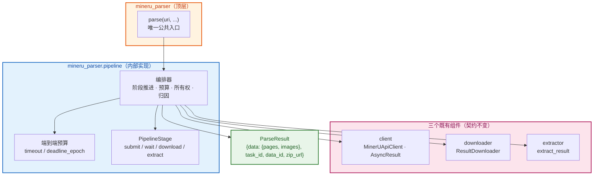
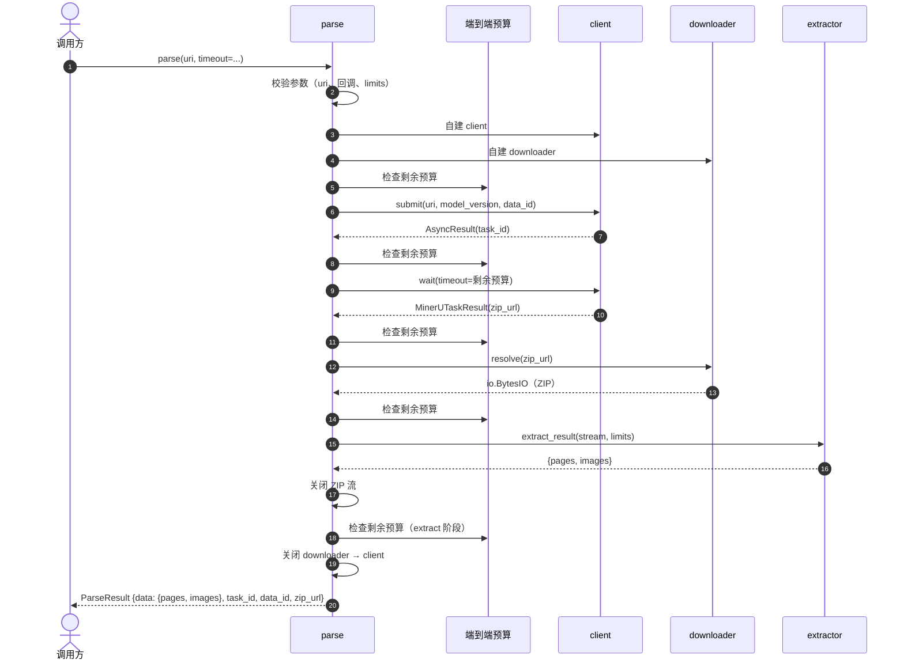

# \[SPEC-004\] Pipeline


| 属性              | 内容         |
| :--------------- | :---------- |
| **状态**          | In Review  |
| **负责人**         | @jackafx   |
| **创建时间**        | 2026-10-21 |
| **更新时间**        | 2026-10-21 |
| **关联 Issue/PR** | —（待关联）     |


> **评审指引**：本 Spec 的**唯一契约源是 §2 的验收标准（AC）**。评审以 AC 清单为准，逐条确认"可断言 / 可测试"；§3 给出的是**契约**（公共 API、参数语义、阶段判定规则、错误映射、遥测口径），**不包含具体代码实现**——实现方式由实现者决定，§3 只约束"必须做什么"与"必须如何判定"。实现与 §3 契约不一致时以 AC 为准，并回写本 Spec。
>
> **本 Spec 的定位**：它是**库的门面（facade）**，不新增任何解析能力。SPEC-001（client）、SPEC-002（downloader）、SPEC-003（extractor）的契约**一字不改**；本 Spec 只负责把三者串成一条流水线，并把"整个项目对外只暴露一个 `parse` 函数"这件事固化为可断言的契约。

---

## 1. 背景与目标 (Context &amp; Objectives)

### 1.1 背景 (Context)

仓库目前有三个各自独立、契约清晰的组件：SPEC-001 的 `MinerUApiClient` 负责"提交 → 等待"并交付 `zip_url`；SPEC-002 的 `ResultDownloader` 负责把结果包流式读进 `io.BytesIO`；SPEC-003 的 `extract_result` 负责把 ZIP 内存流解析为 `{"pages", "images"}`。三个组件都刻意**不耦合**彼此——这带来了清晰的可测试边界，但也把编排成本全部推给了调用方。

调用方今天必须自己写这段样板：

```python
with MinerUApiClient() as client, ResultDownloader() as downloader:
    task = client.submit(uri, data_id=data_id)
    result = task.wait(timeout=600, on_update=on_update)
    stream = downloader.resolve(result.zip_url)
    extracted = extract_result(stream)
```

痛点集中在五个方面，且**没有一个能靠"再调一次某个组件的参数"解决**：

1. **编排样板与顺序知识外泄**：三个组件的调用顺序、参数透传、生命周期关闭分散在每个调用点；调用方需要知道"谁产生什么、谁消费什么"，这是编排契约而非组件契约。
2. **顶层 API 面过宽**：库的顶层 `mineru_parser` 当前导出约 40 个名字（3 个组件类 + 1 个函数 + 全部异常类 + 全部类型）。使用者要判断"我到底该用哪个入口"，实际答案永远是"三个都用"。
3. **生命周期与所有权无人负责**：中间产物（ZIP `BytesIO`）的所有权在样板代码里是模糊的——谁负责 `close()`？异常路径上谁负责？实践中"忘记关流"与"重复关闭"都会出现。
4. **失败不可归因**：三个组件抛三族互不继承的异常（`MinerUError` / `ResultDownloadError` / `ResultExtractionError`）。调用方能区分异常**类型**，但拿不到"是哪一个阶段失败"的结构化信息——只能靠猜或翻日志。
5. **预算不闭合**：三个组件各有自己的超时与字节上限（等待轮询超时、下载总预算、下载 `max_bytes`、提取解压限额），但**没有任何一层负责把它们合成一个端到端预算**。结果最坏情况下是三段超时之和，远超调用方的心智预期。

> **刻意不解决的痛点——崩溃即孤儿任务**：任务一旦提交成功就存在于服务端；若进程在等待途中崩溃，该任务无人认领，而 `data_id` 按 SPEC-001 的语义**不是幂等键**。本期**不**提供任务恢复入口：管道刻意保持**无状态**（Q-13、Goal 7），不持有跨调用的任务状态，也不接受外部传入的 `task_id` 来续跑。崩溃后的任务由调用方按 `data_id` 对账处理——这是无状态设计付出的已知代价，登记为 R-7。

此外还有一处**跨组件才看得见的资源问题**：SPEC-003 的峰值内存推导（单次 ≈ 240 MiB）只覆盖了解压侧，**没有计入压缩侧仍然驻留的 ZIP 缓冲**（默认 ≤ 50 MiB）。真实峰值是两者之和（≈ 290 MiB），在 SPEC-003 的默认形态（$W = 4$、1 GiB 容器）下会超限。这个问题只有编排层能看见。

链路概览（本期要串起来的正是这条链）：

```mermaid
flowchart LR
    classDef io fill:#fff3e0,stroke:#e65100,stroke-width:2px,color:#bf360c;
    classDef mod fill:#e3f2fd,stroke:#1565c0,stroke-width:2px,color:#0d47a1;
    classDef out fill:#e8f5e9,stroke:#2e7d32,stroke-width:2px,color:#1b5e20;
    classDef srv fill:#fce4ec,stroke:#ad1457,stroke-width:2px,color:#880e4f;

    URI["PDF URI"]:::io
    CLIENT["client<br/>MinerUApiClient · AsyncResult"]:::mod
    API["MinerU API Server"]:::srv
    ZIPURL["zip_url"]:::io
    DL["downloader<br/>ResultDownloader"]:::mod
    MEM["io.BytesIO<br/>ZIP 内存流"]:::io
    EX["extractor<br/>extract_result"]:::mod
    RESULT["ParseResult<br/>{data: {pages, images}, task_id, data_id, zip_url}"]:::out

    URI -->|"① 提交"| CLIENT
    CLIENT -->|"POST /extract/task"| API
    API -->|"task_id"| CLIENT
    CLIENT -->|"GET /extract/task/{id}"| API
    API -->|"full_zip_url"| ZIPURL
    ZIPURL -->|"② 下载"| DL
    DL --> MEM
    MEM -->|"③ 解析"| EX
    EX --> RESULT
```



### 1.2 现状与差距分析 (Gap Analysis)

#### 能力维度对比


| 能力维度            | 手写三段编排（今天）            | 分阶段库调用 | 本期目标（`parse` 门面）                     |
| :--------------- | :---------------------: | :------: | :------------------------------------: |
| 一次调用完成端到端       | ❌                     | ❌      | ✅                                    |
| 顶层只需一个入口        | ❌（顶层导出约 40 个名字）       | ❌      | ✅（仅 `parse` 一个函数）                    |
| 阶段顺序由库保证        | ❌                     | ❌      | ✅                                    |
| 中间产物所有权明确       | ⚠️ 模糊                 | ⚠️ 模糊  | ✅（管道负责关闭）                            |
| 失败阶段可结构化归因      | ❌                     | ❌      | ✅（`PipelineStage`）                   |
| 端到端统一预算         | ❌                     | ❌      | ✅（单一 `timeout` / `deadline_epoch`）   |
| 超时语义单一          | ❌（三族超时异常）             | ❌      | ✅（统一 `PipelineTimeoutError`）         |
| 崩溃后任务可恢复        | ⚠️ 需调用方自己接住 `task_id` | ⚠️ 同左  | ❌（明确非目标：管道无状态，见 Q-13） |
| 压缩侧 + 解压侧联合内存预算 | ❌                     | ❌      | ✅（§3.5 公式 + README 数字）               |
| 组件可独立替换 / 独立测试  | ✅                     | ✅      | ⚠️ 组件转为私有实现（AC-2.3 / AC-2.10），测试缝只在内部保留 |
| 组件契约可独立演进       | ✅                     | ✅      | ✅（SPEC-001/002/003 一字不改）             |


#### 顶层 API 面的变化（本 Spec 的破坏性影响）


| 名称                                                                                       | 现状   | 本期后                                 | 迁移方式                                                    |
| :---------------------------------------------------------------------------------------- | :---- | :----------------------------------- | :------------------------------------------------------- |
| —                                                                                        | —    | ✅ `mineru_parser.parse`（**唯一稳定函数**） | 直接使用                                                    |
| `MinerUApiClient` / `AsyncResult`                                                        | 顶层导出 | **私有化**：移出顶层，公开路径不再提供                  | 无法再导入；如需编排请使用 `parse`                        |
| `ResultDownloader`                                                                       | 顶层导出 | **私有化**：移出顶层，公开路径不再提供                  | 无法再导入                                                |
| `extract_result` / `canonicalize_member_path`                                            | 顶层导出 | **私有化**：移出顶层，公开路径不再提供                  | 无法再导入                                                |
| 三族具体异常类                                                                                  | 顶层导出 | **私有化**：移出顶层，公开路径不再提供                  | 无法再导入；改用 `MinerUParserError` + 类名分支，或按信封的 `error_type` 分支                     |
| `MinerUParserError`                                                                      | 顶层导出 | **保留**（捕获全库失败所需）                    | 无需改动                                                    |
| `ExtractedResult` / `ExtractedImage` / `ExtractionLimits` / `MetricHook` / `__version__` | 顶层导出 | **保留**（`parse` 签名/返回值所需类型）          | 无需改动                                                    |
| `MinerUTaskStatus`                                                                       | 顶层导出 | **保留**（`on_update` 回调参数类型）           | 无需改动                                                    |
| `PipelineStage`（新增）                                                                      | —    | **保留**（`on_error` 回调参数类型）           | —                                                       |
| `ParseResult` / `ErrorMessage`（新增）                                                        | —    | **保留**（`parse` 的返回类型）               | —                                                       |
| `PipelineError` / `PipelineTimeoutError` / `PipelineConfigurationError`（新增）                  | —    | **保留**（管道自身的失败类型）               | —                                                       |


> **破坏性变更登记**：顶层 `__all__` 收缩是**有意的破坏性变更**，项目版本为 `0.1.0`（未到 1.0），本期一次性完成比"分阶段弃用"更干净。README 必须同步改写（§5 Phase 4），changelog 必须记录迁移路径。
>
> **不暴露的理由**：三个组件转为**私有实现**——实现包改名为 `mineru_parser._client` / `_downloader` / `_extractor`，公开路径 `mineru_parser.client` / `.downloader` / `.extractor` **不再提供**。调用方能接触到的只有 `parse` 与其结果类型；组件 API 不再是任何形式下的公共契约。
>
> 组件的**行为契约**（SPEC-001 / 002 / 003）仍然成立——它们作为内部实现继续被实现与测试，只是不再对调用方可见。`parse()` 的语义因此是这些契约在管道层的**投影**。

> **样本基线（2026-10-21）**：编排层没有独立样本，沿用 SPEC-003 已核对过的真实结果包 `tests/data/result_001.zip`（7 成员、manifest 4,803 B、1 页 6 块、1 张图 13,936 B）与 SPEC-002 的下载器契约测试作为组件级基线；编排层的**预算数字**（§3.5）是由两个组件的既有默认值推导而来，**不是实测值**——真实并发峰值仍需在部署环境标定，见 R-6。

### 1.3 目标 (Goals)

- [ ] **Goal 1**：提供**唯一**的顶层公共函数 `mineru_parser.parse(uri, ...) -> ParseResult`，一次调用完成"提交 → 等待 → 下载 → 解析"，并把任务元数据（`task_id` / `data_id` / `zip_url`）随解析产物一并交付。
- [ ] **Goal 2**：顶层 `mineru_parser.__all__` 中**只有一个函数**（`parse`）；其余导出只能是类型、异常类与常量（AC-2.1 可断言）。
- [ ] **Goal 3**：把三组件的编排契约固化为库责任：阶段顺序、参数透传、生命周期关闭、中间产物所有权。
- [ ] **Goal 4**：提供**单一端到端预算**（`timeout` / `deadline_epoch`），覆盖四个阶段；预算耗尽在默认信封模式下表现为 `status="failed"` + `error.stage`，在异常模式（`raise_on_error=True`）下表现为 `PipelineTimeoutError(stage=...)`。
- [ ] **Goal 5**：失败**阶段可归因**：以封闭枚举 `PipelineStage` 标识，通过 `on_error` 回调、日志与指标标签暴露。
- [ ] **Goal 6**：除超时外，阶段异常**原样透传**（不包装、不翻译、不吞掉），保持三个组件既有的异常语义与捕获方式。
- [ ] **Goal 7**：管道保持**无状态**：不持有跨调用的任务状态，不提供凭外部 `task_id` 恢复的入口；任务元数据只作为**本次调用**的返回值交付。
- [ ] **Goal 8**：生命周期与所有权明确：管道自建 client / downloader 并在返回前关闭；中间 ZIP 流由管道关闭；结果对象独立于流。
- [ ] **Goal 9**：压缩侧与解压侧的**联合内存预算**显式化（§3.5 公式 + README 峰值数字），并给出并发度与限额的关系。
- [ ] **Goal 10**：可观测性统一：`correlation_id` 透传三组件；管道自身的指标与阶段耗时日志口径唯一。
- [ ] **Goal 11**：全流程可在**无网络**环境下测试（内部编排器的私有测试缝 + 可注入时钟），CI 不依赖真实 MinerU 服务；测试缝**不进入**公共签名。
- [ ] **Goal 12**：**不改动** SPEC-001 / SPEC-002 / SPEC-003 的任何契约；本 Spec 只增不改。
- [ ] **Goal 13**：失败以**状态信封**交付：已知异常（`MinerUParserError` 家族）封装为 `ErrorMessage`（含失败阶段、异常类别与脱敏摘要），兜不住的异常原样抛出；调用方默认无需 `try` / `except` 即可拿到成败与失败原因。

### 1.4 非目标 (Non-Goals / Out of Scope)

> 明确本次迭代**不包含**的内容，防止需求范围膨胀（Scope Creep）。

- [ ] 改动 SPEC-001 / SPEC-002 / SPEC-003 的任何公共契约、参数默认值、异常层次或限额默认值。
- [ ] 批处理、并发调度、线程池 / 异步 / `asyncio` 版本；本期只有一个同步函数。
- [ ] "只提交不解析"的入口（如 `parse(submit_only=True)`）：批量先提交、稍后再解析的作业模式由调用方在**管道之外**自行编排实现（组件已转为私有实现，不提供公开导入路径），管道不提供该分支。
- [ ] **任务恢复 / 崩溃续跑**（凭外部 `task_id` 恢复等待、提前交出 `task_id` 供落库的回调）：管道保持**无状态**，不持有跨调用的任务状态，也不接受外部传入的任务标识来续跑；崩溃后未完成的任务由调用方按 `data_id` 对账处理（见 §1.1 的说明、Q-13 与 R-7）。
- [ ] 结果包的断点续传 / 本地缓存（缓存已下载的 ZIP）：结果包体积有限，重新下载的成本可接受，缓存带来的状态与失效复杂度不划算。
- [ ] 把 `mineru_parser.pipeline` 作为**公开**子包（允许第三方插入或扩展阶段）：公开会引入插件契约与版本耦合成本，管道实现保持内部。
- [ ] 阶段级重试（重试是各组件内部的责任）；管道不做整链重放。
- [ ] 结果缓存（内存 LRU、Redis、本地磁盘）与条件请求。
- [ ] 自动持久化 `task_id`、任务注册表、任务对账 API、孤儿任务自动清理或取消。
- [ ] 断路器、限流、熔断、排队与背压。
- [ ] 结果上传 / 入库 / 对象存储落盘。
- [ ] 分布式追踪（OpenTelemetry / trace context 传播）；`correlation_id` 只是字符串透传。
- [ ] 图片解码、格式嗅探、缩略图、`image_source.path` 与 `images` 的交叉校验（属 SPEC-003 的明确非目标）。
- [ ] 阅读顺序重建、跨页合并、版面块重排。
- [ ] 幂等提交 / 去重：相同 `uri` + `data_id` 的两次 `parse()` 会产生两个任务（继承 SPEC-001 语义）。
- [ ] 把 `parse` 拆成多个可组合的顶层函数（`submit_and_wait` / `download_and_extract` 等）；顶层保持**只有一个函数**。
- [ ] 顶层再导出组件类或组件异常类（见 §1.2 迁移表）。
- [ ] **组件注入**：`parse()` 不接受 `client` / `downloader` 或任何组件实例作为参数（AC-2.10）；组件由管道自建，调用方无法替换。
- [ ] **组件 API 对外暴露**：三个组件包私有化（`_client` / `_downloader` / `_extractor`），公开导入路径不再提供（AC-2.3）。
- [ ] 流式 / 懒加载输出；`parse()` 一次性交付完整 `ParseResult`。
- [ ] 端到端 exactly-once 语义；重复调用可能重复计费（见 R-3）。
- [ ] 为 `parse()` 提供"无限等待"的默认值之外的隐式兜底（如服务端侧兜底取消）。

### 1.5 威胁模型 (Threat Model)


| 维度        | 内容                                                                                                                                                                            |
| :--------- | :----------------------------------------------------------------------------------------------------------------------------------------------------------------------------- |
| **输入来源**  | `uri`（PDF 地址）由调用方提供，可能来自外部用户；`zip_url` 来自服务端，按不可信网络输入处理。                                                                                                          |
| **受保护资产** | API 凭据（`MINERU_API_KEY`）、进程内存、下游磁盘（若调用方把 `images[].path` 落盘）、下游图片渲染器、服务端配额与费用。                                                                                                |
| **攻击者能力** | 控制 `uri` 的取值；控制结果包内容（经由上游或伪造的 `zip_url`）；诱导重定向到内网 / 元数据端点；构造超大或恶意的 ZIP。                                                                                           |
| **主要控制**  | client 侧 URL 语法校验与 Bearer 鉴权；downloader 侧 SSRF 防护（仅 HTTP(S)、IDNA、DNS 公网性、逐跳重定向复验、HTTPS 降级拒绝、`max_bytes`）；extractor 侧 manifest 唯一性、Schema 校验、canonical path、解压后限额；管道层统一预算与所有权。 |
| **残余风险**  | `zip_url` 若被劫持，下载器仍会执行 SSRF 校验（纵深防御）；`correlation_id` 若由用户可控，不得进入指标标签（AC-5.9）；`on_update` / `on_error` 回调由调用方提供，其异常已被隔离但不构成安全边界。                                        |


> 本 Spec **不新增**安全控制，只把三个组件既有的控制**串起来**并保证"任一阶段的控制都不可被管道绕过"——例如管道不得为了"少一次往返"而跳过下载器的 URL 校验，也不得为了"省内存"而把 ZIP 交给 extractor 之外的解析路径。

---

## 2. 用户故事与验收标准 (User Stories &amp; Acceptance Criteria)

### US-1: 单函数端到端解析

**As a** 业务调用方
**I want to** 只调用一个函数就拿到解析结果
**So that** 我不必了解三个组件的调用顺序、参数透传与生命周期

#### 验收标准 (Acceptance Criteria)

- **AC-1.1**: `parse(uri, *, ...)` 必须接受一个绝对 http(s) 的 PDF URI，并返回 `ParseResult`——一个**恰好**包含 `"status"`、`"data"`、`"task_id"`、`"data_id"`、`"zip_url"`、`"error"` 六个键的普通 `dict`。`status` 必须取 `"success"` 或 `"failed"`。成功时：`data` 必须是 `ExtractedResult`（一个**恰好**包含 `"pages"` 与 `"images"` 两个键的 `dict`，其**形状与取值**必须与 `extract_result` 的返回值逐字相同：`pages` 必须是 Pydantic 模型实例，`images[].bytes` 必须是不可变 `bytes`，`images` 按 canonical path 字典序升序，继承 SPEC-003 AC-1.2 / AC-1.3 / AC-4.6），且 `error` 必须为 `None`。失败时：`data` 必须为 `None`，`error` 必须是非 `None` 的 `ErrorMessage`（AC-1.12）。`ParseResult` **不得**改变 `ExtractedResult` 的既有契约——`extract_result` 仍只返回两个键（SPEC-003 AC-1.2 不变）。
- **AC-1.2**: `parse()` 必须依次完成四个阶段：**submit → wait → download → extract**。任一阶段失败必须**中止**后续阶段：失败于 submit / wait 时不得发起下载请求，失败于 download 时不得调用提取器。
- **AC-1.3**: `parse()` 不得要求调用方构造 `MinerUApiClient` / `ResultDownloader` / `extractor`；必须**自建**（AC-3.1）。公共签名**不得**出现任何组件参数，调用方无法替换组件（AC-2.10）。
- **AC-1.4**: 每次调用必须返回**全新**对象；不得缓存、复用或跨调用共享上一次的结果、页模型实例或图片字节。
- **AC-1.5**: **成功与失败都必须**上报 `mineru.pipeline.total` 与 `mineru.pipeline.duration_ms`（成功时 `outcome="success"`），并记录各阶段的耗时（AC-5.7）。失败时不得因"异常被信封化"而漏报。
- **AC-1.6**: `parse()` 必须是**无状态**函数：不得持有跨调用的可变状态；并发调用不同实例之间不得共享可变状态（同一进程内两次并发 `parse()` 各自自建 client / downloader，互不干扰）。
- **AC-1.7**: `parse()` 不得改变三个组件的语义：`submit` 的请求体、`wait` 的轮询语义、`resolve` 的重试与 SSRF 规则、`extract_result` 的定位与限额规则全部按各自 SPEC 执行（AC-4.9）。
- **AC-1.8**: `parse()` 返回后不得再持有对 ZIP 流、HTTP 响应体、Session 或结果的引用（AC-3.5）。
- **AC-1.9**: `ParseResult` 的元数据字段必须取自本次调用的终态结果：`task_id` 必须等于 `MinerUTaskResult.provider_task_id`（沿用 SPEC-001 AC-9.2 的取值优先级——服务端返回优先、句柄 id 兜底），`data_id` 必须等于 `MinerUTaskResult.data_id`（服务端与提交参数都缺失时为 `None`），`zip_url` 必须等于 `MinerUTaskResult.zip_url`（不得为空串）。
- **AC-1.10**: `ParseResult.zip_url` 属于**敏感值**（可能携带签名凭据）：管道不得把它写入任何日志或指标标签（AC-5.9）；调用方把它落盘或打日志前必须自行评估。管道不得对其做任何脱敏改写——成功时 `ParseResult.zip_url` 必须与 `MinerUTaskResult.zip_url` 逐字相同（AC-1.9）。
- **AC-1.11**: 失败处理必须遵循"**已知异常封装、兜不住的抛出**"：默认（`raise_on_error=False`）下，`MinerUParserError` 家族的**全部**已知异常必须被封装为 `ErrorMessage` 并以 `status="failed"` 返回，**不得抛出**；未知异常类型、`MemoryError`、`KeyboardInterrupt`、`SystemExit` 必须原样抛出，**不得**被封装、吞掉或包装。`raise_on_error=True` 时，已知异常改为原样抛出（AC-5.3）；兜不住的异常在两种模式下都原样抛出。
- **AC-1.12**: 失败信封必须满足：`status == "failed"`、`data is None`、`error` 非 `None`；`error.stage` 必须是 `config` / `submit` / `wait` / `download` / `extract` 之一；`error.error_type` 必须是该异常的**类名**；`error.cause_type` 必须是异常链首因的类名或 `None`；`task_id` / `data_id` / `zip_url` 按"**当时已知**"填充——提交成功即知 `task_id`，等待完成后才知 `zip_url`，未知的取 `None`。失败信封**不得**携带部分产物，也不得携带原始异常对象。

---

### US-2: 唯一公共 API 与契约面

**As a** 库使用者
**I want to** 面对一个明确的入口面
**So that** 我不必在几十个导出名里猜"该用哪个"

#### 验收标准 (Acceptance Criteria)

- **AC-2.1**: `mineru_parser.__all__` 中**有且只有一个函数**——`parse`。其余条目必须是**类型 / 异常类 / 类常量 / `__version__`**，不得出现第二个函数（包括别名、私有重导出，`parse` 的变体）。该约束必须由测试断言（AC-7.4）。**判定口径是"函数"而非"可调用对象"**：异常类与普通类同样是可调用对象（`callable(MinerUParserError)` 为真），因此断言必须按 `inspect.isfunction(x)` 或 `callable(x) and not isinstance(x, type)` 判定，否则 AC-2.2 要求保留的 `MinerUParserError` 会让断言自相矛盾。
- **AC-2.2**: 顶层**必须**继续导出：`MinerUParserError`（捕获全库失败）、`PipelineError` / `PipelineTimeoutError` / `PipelineConfigurationError`（管道自身的失败类型）、`ParseResult`、`ErrorMessage`、`ExtractedResult`、`ExtractedImage`、`ExtractionLimits`、`MetricHook`、`PipelineStage`、`MinerUTaskStatus`、`__version__`。其中 `ParseResult` / `ErrorMessage` / `ExtractedResult` / `ExtractedImage` / `ExtractionLimits` / `MetricHook` / `PipelineStage` / `MinerUTaskStatus` 是 `parse` 的签名或返回值所引用的类型。**管道异常家族必须在顶层导出**：组件三族的具体异常类已随组件私有化而不可导入（AC-2.3），若管道异常也不导出，调用方将只剩 `MinerUParserError` 一个可捕获类型——"超时统一为 `PipelineTimeoutError`"（AC-4.4 / AC-4.5）这一语义收益将被抹平。
- **AC-2.3**: `MinerUApiClient`、`AsyncResult`、`ResultDownloader`、`extract_result`、`canonicalize_member_path`、三族具体异常类与其他组件级名称**必须**从顶层 `__all__` 移除，**且公开导入路径必须一并关闭**：实现包改名为私有 `mineru_parser._client` / `_downloader` / `_extractor`，`mineru_parser.client` / `.downloader` / `.extractor` 不再提供，调用方**无法导入**任何组件 API。组件的行为契约（SPEC-001 / 002 / 003）作为内部实现继续成立，但不再是公共契约。
- **AC-2.4**: 本变更属于**破坏性变更**，必须在 README 的迁移说明与本 Spec 的 changelog 中显式登记，并在 changelog 中给出"旧顶层导入 → 新公共面"的对照——组件三族的旧导入路径**全部关闭**（不存在"新子模块导入路径"），对照表须写明"无法再导入"及替代写法。
- **AC-2.5**: `parse` 的**签名与返回类型**遵循 SemVer；大版本才允许破坏性变更。组件 API 转为**私有实现**，**不**遵循 SemVer（未来可调整签名而不升大版本），但行为契约由各自 SPEC 约束。
- **AC-2.6**: 顶层**不得**出现第二个函数（包括别名、私有重导出、`parse` 的变体）；不得提供 `parse_async` / `parse_sync` 之类的并列入口（异步不在本期范围，见 Non-Goals）。**导出异常类不算"第二个函数"**——异常类是可调用对象，但 AC-2.1 的约束只针对**函数**。
- **AC-2.7**: `parse` 必须从 `mineru_parser.pipeline`（内部实现模块）实现并在顶层再导出；顶层**不得**包含编排逻辑实现（编排代码必须位于 `mineru_parser.pipeline` 包内）。
- **AC-2.8**: `mineru_parser.pipeline` 包**必须**是内部实现层：不通过顶层 `__all__` 暴露其内部名称（`PipelineOrchestrator` 等实现细节不得出现在顶层）。
- **AC-2.9**: `parse` 的签名**不得**包含任何用于恢复历史任务的参数（如 `task_id`），顶层**不得**提供第二个用于续跑既有任务的入口（Goal 7 / Q-13）。管道**不得**声称提交是幂等的：相同 `uri` + `data_id` 的两次 `parse()` 会创建两个任务（`data_id` 按 SPEC-001 语义仅用于对账，不是幂等键），该行为必须在 README 中提示。
- **AC-2.10**: `parse` 的签名**不得**包含任何组件级参数（`client` / `downloader` / 组件实例 / 组件工厂），**不得**出现 `MinerUApiClient`、`ResultDownloader` 等组件类型；调用方**无法**替换管道内部的组件。公共面**不得**出现任何其他构造或配置入口（不得提供 `parse_with(...)` 之类的变体，AC-2.6）。

---

### US-3: 生命周期与资源所有权

**As a** 服务集成方
**I want to** 每一次调用都干净地收尾
**So that** 我不会泄漏连接、流或内存

#### 验收标准 (Acceptance Criteria)

- **AC-3.1**: `parse()` 必须自建 `MinerUApiClient` 与 `ResultDownloader`，并在**返回前**关闭它们——包括成功路径与所有失败路径（`finally` 语义）。关闭必须幂等。
- **AC-3.2**: 管道自建的 client / downloader 在 `parse()` 返回（或抛错）后**不得**再被使用；其 Session 必须已关闭。管道**不得**保留对它们的引用（AC-3.5）。
- **AC-3.3**: 下载得到的 ZIP `io.BytesIO` 由 `parse()` 拥有：必须在提取结束后关闭（成功与失败路径都关闭），且**不得**出现在返回值中。调用方无法取得该流。
- **AC-3.4**: 返回的 `ParseResult` 必须**独立于**已关闭的流：关闭流之后 `pages` 与 `images[].bytes` 仍可正常使用（提取器已复制字节，见 SPEC-003 AC-1.3）。
- **AC-3.5**: `parse()` 返回后不得持有对 ZIP 流、HTTP 响应体、Session、页模型或图片字节的引用；除返回值外不得保留任何对象。
- **AC-3.6**: 每次 `parse()` 调用必须创建**新的** client / downloader 实例；不得跨调用复用实例、Session 或缓冲区（AC-1.6）。
- **AC-3.7**: `parse()` 不得关闭调用方持有的任何对象；除自建的两个组件与中间 ZIP 流外，管道不拥有、不创建、不销毁任何资源。调用方**无法**向管道提供任何需要被管理的对象（AC-2.10）。
- **AC-3.8**: 关闭顺序必须是"先关流、后关组件"：中间 ZIP 流在提取结束后立即关闭；client 与 downloader 在函数返回前的 `finally` 中关闭，顺序为 downloader → client（依赖方向：先停止下载，再停止 API 会话）。

---

### US-4: 端到端预算与超时

**As a** 服务集成方
**I want to** 用一个预算约束整条流水线
**So that** 我能预测最坏耗时，而不是三段超时之和

#### 验收标准 (Acceptance Criteria)

- **AC-4.1**: `timeout`（相对秒数）与 `deadline_epoch`（绝对 Unix 时间戳）**互斥**；同时提供必须抛出 `PipelineConfigurationError`，且**不得**发起任何网络请求、不得创建任何组件实例。两者都不提供表示不设端到端上限（等待阶段沿用客户端的无限等待语义，见 AC-4.8）。
- **AC-4.2**: 端到端预算必须覆盖**全部四个阶段**（submit / wait / download / extract），必须在每个阶段**开始前**与**结束后**检查。剩余预算必须按单调时钟计算（`deadline_epoch` 仅在入口处换算一次为单调预算）。
- **AC-4.3**: 预算耗尽时必须失败：默认（信封）模式下返回 `status="failed"` 的信封，`error.stage` 标识耗尽时所处阶段、`error.error_type == "PipelineTimeoutError"`；`raise_on_error=True` 时抛出 `PipelineTimeoutError`，其 `stage` 字段标识耗尽时所处阶段。两种模式都**不得**返回部分结果，不得返回空结果冒充成功。
- **AC-4.4**: 等待阶段必须把**剩余预算**传给 `AsyncResult.wait(timeout=remaining)`（继承 SPEC-001 AC-4.1 \~ AC-4.3 的预算语义）。等待阶段自身抛出的 `MinerUTimeoutError`：异常模式（`raise_on_error=True`）下必须被翻译为 `PipelineTimeoutError(stage="wait")`，原始异常作为 `__cause__` 保留，`last_status` / `task_id` 复制到 `PipelineTimeoutError` 上；默认信封模式下必须封装为 `error.error_type == "PipelineTimeoutError"`、`error.stage == "wait"`、`error.cause_type == "MinerUTimeoutError"`。
- **AC-4.5**: 下载阶段抛出的 `ResultDownloadTimeoutError`：异常模式（`raise_on_error=True`）下必须被翻译为 `PipelineTimeoutError(stage="download")`，原始异常作为 `__cause__` 保留；默认信封模式下必须封装为 `error.error_type == "PipelineTimeoutError"`、`error.stage == "download"`、`error.cause_type == "ResultDownloadTimeoutError"`。
- **AC-4.6**: 提取阶段是纯 CPU / 内存操作，**不接受**时间预算参数；预算在提取**结束后**检查，若已超预算必须抛 `PipelineTimeoutError(stage="extract")` 并丢弃结果（提取不可中断）。
- **AC-4.7**: 除等待阶段外，管道**无法中断**正在进行的下载（`resolve()` 不接受每调用预算，见 SPEC-002 AC-2.1）。若下载阶段越过端到端预算，管道只能在阶段结束后检出并抛 `PipelineTimeoutError(stage="download")`；该限制必须在 README 与本 Spec 中显式说明。
- **AC-4.8**: 不提供 `timeout` / `deadline_epoch` 时，等待阶段**无上界**（继承 SPEC-001 的 `wait()` 语义）。该默认值必须在 README 中以风险提示的形式给出（长文档解析可能耗时数分钟），但不得由管道自行代入隐式默认值。
- **AC-4.9**: 预算检查必须使用可注入的单调时钟；测试必须能在不 sleep 的情况下确定性地触发预算耗尽（AC-7.2）。

---

### US-5: 阶段归因与可观测性

**As a** 运维 / 服务集成方
**I want to** 知道失败发生在哪个阶段
**So that** 我能快速判断是上游慢、下载被拦还是包坏了

#### 验收标准 (Acceptance Criteria)

- **AC-5.1**: 必须定义封闭枚举 `PipelineStage`，取值恰好为 `config` / `submit` / `wait` / `download` / `extract`（`StrEnum`）；不得新增其他取值，也不得用自由文本表示阶段。
- **AC-5.2**: 任一阶段失败时，管道必须在抛出前调用 `on_error(stage, exception)`，其中 `exception` 是**该阶段原始抛出的异常对象**（超时翻译前）。
- **AC-5.3**: 在**异常模式**（`raise_on_error=True`）下，**除超时外**，阶段异常必须**原样抛出**：管道不得包装、翻译、替换或吞掉；抛出的对象必须与阶段抛出的对象**同一**（`is`），其类型、属性与异常链保持不变。因此**已经持有这些异常类引用**的代码（存量直接依赖组件的调用方）其既有捕获方式在 `raise_on_error=True` 下**继续有效**。但组件三族的具体异常类已随组件私有化而**不可导入**（AC-2.3），**新代码**只能以库级根异常 `MinerUParserError` 捕获后按 `type(exc).__name__` 分支，或直接捕获 `PipelineTimeoutError`（超时，AC-2.2）。在默认信封模式下，同一异常被封装为 `ErrorMessage`，其 `error.error_type` 必须等于该异常的类名（AC-1.11）——**两种模式的信息量必须一致**。
- **AC-5.4**: 管道自身产生的失败必须使用 `PipelineError` 家族：`PipelineConfigurationError`（配置或参数非法）与 `PipelineTimeoutError`（端到端预算耗尽）。二者均继承 `PipelineError`，而 `PipelineError` 继承库级根 `MinerUParserError`。
- **AC-5.5**: `on_error` 抛出的任何异常必须被吞掉并记录 `mineru.pipeline.on_error.failed` 警告日志，不得影响主流程。
- **AC-5.6**: `on_metric` 抛出的任何异常必须被吞掉并记录 `mineru.metric.failed` 警告日志（与 SPEC-001/002/003 的既有约定一致）。
- **AC-5.7**: 管道自身的指标必须在 `finally` 中**恰好上报一次**；失败时 `mineru.pipeline.pages` / `mineru.pipeline.images` / `mineru.pipeline.image_bytes` 必须为 0。
- **AC-5.8**: 提供的 `correlation_id` 必须透传到 client / downloader / extractor 的**全部**日志与指标（各自组件按其 SPEC 附加该字段），并附加到管道自身的日志。
- **AC-5.9**: 指标标签只允许封闭枚举（`outcome`、`stage`）；**不得**包含 URI、`task_id`、`data_id`、`zip_url`、路径、成员名、异常消息或 `correlation_id`。
- **AC-5.10**: 未知的非 `MinerUParserError` 异常必须**原样抛出**（不得被封装成信封、不得被吞掉），并记录 `outcome="unexpected"`；`MemoryError`、`KeyboardInterrupt`、`SystemExit` 同样原样抛出（对齐 SPEC-003 AC-6.8）。
- **AC-5.11**: 管道自身的日志名必须为：`mineru.pipeline`（成功）、`mineru.pipeline.error`（失败，含 `stage` 与 `error_type`）、`mineru.pipeline.stage`（阶段切换，含阶段耗时）。三组件的既有日志名保持不变。
- **AC-5.12**: 阶段耗时必须以毫秒为单位记录，且各阶段的耗时都必须出现在成功与失败两种情形的日志中。
- **AC-5.13**: `ErrorMessage` 必须由管道**自行构造**，且只包含 `stage` / `error_type` / `message` / `cause_type` 四个键；**不得**包含原始异常对象、异常链原文、文档正文、凭据或签名 URL。`error.message` 必须是脱敏后的可读摘要。
- **AC-5.14**: 兜不住的异常（未知类型 / `MemoryError` / `KeyboardInterrupt` / `SystemExit`）必须原样抛出，且必须被记录到带 traceback 的错误日志（`mineru.pipeline.error`，含 `stage` 与 `error_type`），不得静默丢失。

---

### US-6: 资源预算自洽

**As a** 服务集成方
**I want to** 知道一次 `parse()` 真实占多少内存
**So that** 我能据此决定并发度，而不是等 OOM

#### 验收标准 (Acceptance Criteria)

- **AC-6.1**: 管道必须把**压缩侧上限**（下载的 `max_bytes`，默认 50 MiB）与**解压侧上限**（提取限额，SPEC-003 默认值）作为两个**独立量纲**管理，两者都必须有默认值；两者不得互相替代或合并为单一上限。
- **AC-6.2**: 单次 `parse()` 的峰值内存必须按 §3.5 的公式估算，并在 **README 中写明默认档位的峰值上界**（≈ 290 MiB）。该数字必须与 SPEC-003 §3.2 的推导口径保持自洽。
- **AC-6.3**: 管道不得因"下载成功但解压超限"而重试、改换路径或降级；`ResultExtractionLimitError` 必须原样抛出（终态），并由调用方按"该结果包超出本环境预算"理解（继承 SPEC-003 §3.2 的量纲说明）。
- **AC-6.4**: `limits` 参数必须是 `ExtractionLimits | None`；非法值必须在**进入任何阶段之前**抛出 `PipelineConfigurationError`，不得静默回退到默认值。
- **AC-6.5**: 管道不得缓存、落盘、复制或二次压缩结果包字节；ZIP 字节在生命周期内只存在一份（下载器返回的那份）。
- **AC-6.6**: 管道不得因内存压力主动中止或跳过提取；内存不足由 Python 抛出 `MemoryError`，按 AC-5.10 原样透出。

---

### US-7: 可测试性

**As a** 维护者
**I want to** 在无网络环境下覆盖整条流水线
**So that** CI 不需要 MinerU 凭据、真实结果包或外网

#### 验收标准 (Acceptance Criteria)

- **AC-7.1**: 全部行为必须可在**无网络**环境下测试：client 与 downloader 的替身必须能经**内部**测试缝接入（AC-7.8），时钟必须可注入（AC-4.9）。
- **AC-7.2**: 测试必须覆盖：四阶段成功路径（submit / wait / download / extract 各一次）、四个阶段的失败路径、预算耗尽（分别在四个阶段边界触发）、信封与异常**双模式**的等价性、异常原样抛出、组件与流的关闭、回调隔离。
- **AC-7.3**: 必须包含"**异常同一性**"测试：在异常模式（`raise_on_error=True`）下，对每个阶段的失败，断言 `parse()` 抛出的对象与替身阶段抛出的对象 `is` 相同（超时除外，超时必须断言 `__cause__` 指向原始超时异常）；在默认信封模式下，断言 `error.error_type` 等于该异常的类名。
- **AC-7.4**: 必须包含"**顶层 API 面**"测试：断言 `mineru_parser.__all__` 中的**函数**恰好只有 `parse`（按"函数"判定而非"可调用对象"，见 AC-2.1），且 AC-2.2 要求保留的名称均存在、AC-2.3 要求移除的名称均不存在、`mineru_parser.client` / `.downloader` / `.extractor` **不再可导入**（AC-2.3）。
- **AC-7.5**: **公共面**的默认构造路径必须被覆盖：使用**本地回环地址**的 mock HTTP 服务提供 `/extract/task` 与 `/extract/task/{id}`（客户端无 SSRF 限制，允许回环），并经内部测试缝替换 downloader 覆盖下载阶段（下载器的 SSRF 防护会拒绝回环地址，这是刻意行为，不得为测试放宽）。
- **AC-7.6**: 测试不得依赖真实 MinerU 服务、真实 CDN、真实外网地址或真实 API 凭据；`MINERU_API_KEY` 必须由测试**自行设置**（monkeypatch 为占位值），不得读取开发机上的真实环境变量。
- **AC-7.7**: 管道实现必须是无状态的纯编排：不得引入模块级可变状态、不得使用全局单例、不得在导入时发起网络请求。
- **AC-7.8**: 内部编排器（`mineru_parser.pipeline` 内）必须保留一个**私有**测试缝，使测试能替换 client / downloader / 时钟；该缝**不得**出现在 `parse()` 的公共签名中（AC-2.10），**不得**通过任何公开路径暴露，也**不得**以第二个公共函数的形式提供。

---

## 3. 技术方案设计 (Technical Design)

### 3.1 架构与数据流 (Architecture &amp; Data Flow)

#### 端到端链路

见 §1.1 的链路图。管道在其中承担的是"把 ① ② ③ 串起来并对整条链负责"的角色：

- **① submit**：客户端提交任务并产出 `task_id`；管道随即进入等待阶段（管道无状态，不保留任何跨调用信息）。
- **② wait**：客户端轮询到终态，产出 `zip_url`；管道在此消耗端到端预算的绝大部分。
- **③ download**：下载器把结果包读入 `io.BytesIO`；管道拥有并在提取后关闭该流。
- **④ extract**：提取器把 ZIP 内存流解析为 `{"pages", "images"}`；管道关闭流并交付结果。

#### 组件职责与边界


| 组件                           | 职责                                | 明确不做                          |
| :---------------------------- | :--------------------------------- | :----------------------------- |
| `mineru_parser.parse`（门面）    | 参数校验、阶段编排、预算检查、生命周期与所有权、阶段归因、遥测汇总 | 不实现协议、不解析 ZIP、不改变组件语义         |
| `mineru_parser.pipeline`（内部） | 上述逻辑的实现包；持有阶段状态机与预算计算             | 不被顶层 `__all__` 暴露内部名称（AC-2.8） |
| `client`（SPEC-001）           | 提交、轮询、终态解释、结果交付                   | 不下载、不解析                       |
| `downloader`（SPEC-002）       | 流式下载、重试、SSRF 防护、内存上限              | 不解压、不解析                       |
| `extractor`（SPEC-003）        | manifest 定位、Schema 校验、图片收集、解压后限额  | 不下载、不重试、不落盘                   |


#### 门面视角的组件编排



#### 编排时序



#### 包结构

```text
src/mineru_parser/
├── __init__.py          # 唯一公共函数 parse + 类型再导出（AC-2.1 / AC-2.2）
├── errors.py            # MinerUParserError（既有，不变）
├── pipeline/            # 内部实现层（AC-2.7 / AC-2.8）
│   ├── __init__.py      # 内部再导出（parse 实现入口）
│   ├── orchestrator.py  # 阶段推进、生命周期、所有权、异常翻译
│   ├── budget.py        # 端到端预算与阶段计时
│   ├── stages.py        # PipelineStage
│   └── errors.py        # PipelineError / PipelineConfigurationError / PipelineTimeoutError
├── _client/             # 私有化（SPEC-001）：公开路径不再提供
├── _downloader/         # 私有化（SPEC-002）：公开路径不再提供
└── _extractor/          # 私有化（SPEC-003）：公开路径不再提供
```

> 管道层**不新增第三方运行时依赖**；`pipeline` 包只依赖标准库、三个既有组件与 `pydantic`（间接）。

### 3.2 数据模型 (Data Model)

#### 阶段枚举

`PipelineStage` 为 `StrEnum`，取值恰好五个（四个**执行**阶段 + 参数校验阶段 `config`）：


| 取值         | 含义                           |
| :---------- | :---------------------------- |
| `config`   | 任何阶段开始前的参数校验（管道自身）           |
| `submit`   | 提交解析任务（`POST /extract/task`） |
| `wait`     | 轮询等待任务终态                     |
| `download` | 下载结果包                        |
| `extract`  | 解析结果包                        |


> 取值必须是**封闭枚举**：它是指标标签与 `on_error` 参数的取值来源，必须低基数、可安全用于监控维度。
>
> 四个**执行**阶段（`submit` / `wait` / `download` / `extract`）在**每一次** `parse()` 调用中都会出现：管道无状态，不存在跳过 `submit` 的路径（Goal 7 / Q-13）。`config` 只在参数校验失败时出现——它表示"尚未进入任何执行阶段"。

#### 异常体系

```text
MinerUParserError                  # 库级公共根异常（既有）
├── MinerUError                    # SPEC-001（既有）
├── ResultDownloadError            # SPEC-002（既有）
├── ResultExtractionError          # SPEC-003（既有）
└── PipelineError                  # 本 Spec 新增
    ├── PipelineConfigurationError  # 参数 / 配置非法
    └── PipelineTimeoutError        # 端到端预算耗尽
```


| 异常                           | 附加字段                                                                                | 说明                                                                                                                                                                                        |
| :---------------------------- | :----------------------------------------------------------------------------------- | :----------------------------------------------------------------------------------------------------------------------------------------------------------------------------------------- |
| `PipelineConfigurationError` | `field: str | None`                                                                 | 参数名（如 `uri` / `limits` / `timeout` / `deadline_epoch` / `on_error` / `on_update` / `on_metric` / `correlation_id`）；未指明时为 `None` |
| `PipelineTimeoutError`       | `stage: PipelineStage`、`task_id: str | None`、`last_status: MinerUTaskStatus | None` | `last_status` 仅在等待阶段超时时可得（继承 SPEC-001 AC-4.3）；`__cause__` 为被翻译的原始超时异常                                                                                                                     |


> **与既有异常家族的关系**：`PipelineError` 与 `MinerUError` / `ResultDownloadError` / `ResultExtractionError` **互不继承**，四者共享公共根 `MinerUParserError`。因此 `except MinerUParserError` 可一次性捕获全库失败，而 `except ResultExtractionError` **不会**捕获管道自身的配置错误。
>
> **超时是唯一的翻译点**：`parse()` 的超时**统一**表现为 `PipelineTimeoutError`（AC-4.4 / AC-4.5），因此 `except MinerUTimeoutError` **不会**捕获 `parse()` 抛出的等待超时——这是有意的语义收敛：调用 `parse()` 的代码只需要认识一个超时类型。组件被直接调用时，各自的超时异常类型不变。

#### `parse` 参数


| 参数                | 类型                                                      | 默认值     | 语义                                         |
| :----------------- | :------------------------------------------------------- | :------- | :------------------------------------------ |
| `uri`             | `str`                                                  | —（必填） | PDF 的绝对 http(s) URI                              |
| `model_version`   | `str`                                                   | `"vlm"` | 透传给 `client.submit`（继承 SPEC-001）           |
| `data_id`         | `str | None`                                            | `None`  | 对账标识；**不是幂等键**（继承 SPEC-001）                |
| `timeout`         | `float | None`                                          | `None`  | 端到端相对预算（秒）；与 `deadline_epoch` 互斥           |
| `deadline_epoch`  | `float | None`                                          | `None`  | 端到端绝对截止（Unix 时间戳）；与 `timeout` 互斥           |
| `limits`          | `ExtractionLimits | None`                               | `None`  | 提取限额；`None` 使用 `DEFAULT_EXTRACTION_LIMITS` |
| `raise_on_error`  | `bool`                                                | `False` | `False`（默认）：失败时**不抛异常**，返回 `status="failed"` 的信封；`True`：失败时改为抛异常（已知异常原样透传，超时翻译为 `PipelineTimeoutError`） |
| `on_update`       | `Callable[[MinerUTaskStatus], None] | None`             | `None`  | 透传给 `AsyncResult.wait`（继承 SPEC-001 AC-6.1） |
| `on_error`        | `Callable[[PipelineStage, BaseException], None] | None` | `None`  | 阶段失败时收到 `(stage, 原始异常)`                    |
| `on_metric`       | `MetricHook | None`                                     | `None`  | 管道与三个组件共用的指标回调                             |
| `correlation_id`  | `str | None`                                            | `None`  | 透传到三个组件的全部日志与指标                            |


> **没有组件参数**：`parse` 的签名里**不存在**任何组件级参数（AC-2.10）。三个组件由管道自建、自管、自关闭；调用方既不能替换它们，也拿不到它们。测试所需的替身注入只存在于**内部**编排器（AC-7.8）。
>
> **参数校验时机**：所有参数校验必须在**创建任何组件实例之前**完成（AC-4.1 / AC-4.4 / AC-6.4），确保"配置错误"不会产生任何网络副作用。

#### 输出

`parse()` 返回 `ParseResult`——一个**状态信封**：既承载解析产物与任务元数据，也承载失败信息。

```python
from typing import Literal, TypedDict

from .._extractor import ExtractedResult
from .stages import PipelineStage


class ErrorMessage(TypedDict):
    stage: PipelineStage
    error_type: str
    message: str
    cause_type: str | None


class ParseResult(TypedDict):
    status: Literal["success", "failed"]
    data: ExtractedResult | None
    task_id: str | None
    data_id: str | None
    zip_url: str | None
    error: ErrorMessage | None
```

运行时 `ParseResult` 是普通 `dict`；`TypedDict` 只提供静态类型与文档约束。`ParseResult` **不继承** `ExtractedResult`：解析产物整体收在 `data` 属性里，与任务元数据**平级**且**互不污染**——`data` 的类型仍是 `ExtractedResult`，其"恰好两个键"的约束（SPEC-003 AC-1.2）原样生效。

#### `ParseResult` 字段

| 字段      | 类型                           | 说明                                                                                                                                                                 |
| --------- | ------------------------------ | -------------------------------------------------------------------------------------------------------------------------------------------------------------------- |
| `status`  | `Literal["success", "failed"]` | 本次调用的结果状态；取值封闭，可直接用作指标标签                                                                                                                     |
| `data`    | `ExtractedResult \| None`      | 解析产物：**成功时非 `None`**、`failed` 时必须为 `None`（不返回部分产物）。`data["pages"]` 为按 manifest 顺序的页列表，`data["images"]` 为 `{"path", "bytes"}` 列表（按 canonical path 字典序升序，继承 SPEC-003） |
| `task_id` | `str \| None`                  | 本次任务的服务端 id；成功时等于 `MinerUTaskResult.provider_task_id`（AC-1.9）；失败时按"当时已知"填充（提交成功后即已知，AC-1.12）                                        |
| `data_id` | `str \| None`                  | 对账标识；成功时等于 `MinerUTaskResult.data_id`（AC-1.9）；失败时回填调用方传入的 `data_id`（若提供）                                                                |
| `zip_url` | `str \| None`                  | 结果包地址；**敏感值**，不得进入日志或指标标签（AC-1.10）；失败时仅在等待阶段已完成后才有值                                                                |
| `error`   | `ErrorMessage \| None`         | 失败时的错误信息；成功时必须为 `None`（AC-1.12）                                                                                                                      |

#### `ErrorMessage` 字段

| 字段 | 类型 | 说明 |
| :--- | :--- | :--- |
| `stage` | `PipelineStage` | 失败发生的阶段（`config` / `submit` / `wait` / `download` / `extract`） |
| `error_type` | `str` | 异常**类名**（如 `MinerUQuotaError`）；调用方据此分支，不依赖消息文本 |
| `message` | `str` | 脱敏后的可读摘要；**不得**包含文档正文、凭据、签名 URL 或异常链原文 |
| `cause_type` | `str \| None` | 异常链首因的类名（如 `MinerUTimeoutError`）；无异常链时为 `None`；同样不携带原始消息 |

> `error_type` / `cause_type` 只给**类名**，不带异常消息：消息文本可能含签名 URL（SPEC-002 R-11）或文档正文（SPEC-003 AC-6.3），一律不进信封。
>
> `error` 的内容必须由管道**自行构造**，不得把原始异常对象塞进信封——信封是可序列化、可落盘、可上报的结构。


> **不污染既有契约**：`ExtractedResult` 的"恰好两个键"约束（SPEC-003 AC-1.2）针对的是 `extract_result` 的返回值，**不受影响**。`ParseResult` 是管道层**新增**的独立类型，通过 `data` 属性**引用** `ExtractedResult` 而非继承它——`ExtractedResult` 的一切契约原样保留。
>
> **元数据是本次调用的快照**：`ParseResult` 的 `task_id` / `data_id` / `zip_url` 只描述**本次**调用创建的任务。管道不持有跨调用状态，也不接受外部任务标识来续跑（Goal 7 / Q-13）——因此这些字段是**观测数据**，不是**恢复凭据**。

### 3.3 接口契约 (API Contracts)

#### 公共 API

```python
def parse(
    uri: str,
    *,
    model_version: str = "vlm",
    data_id: str | None = None,
    timeout: float | None = None,
    deadline_epoch: float | None = None,
    limits: ExtractionLimits | None = None,
    raise_on_error: bool = False,
    on_update: Callable[[MinerUTaskStatus], None] | None = None,
    on_error: Callable[[PipelineStage, BaseException], None] | None = None,
    on_metric: MetricHook | None = None,
    correlation_id: str | None = None,
) -> ParseResult: ...
```

> 这是本库**唯一**的顶层函数（AC-2.1 / AC-2.6）。它是同步阻塞调用；异步版本不在本期范围（Non-Goals）。

#### 公共 API 稳定性


| 层级                  | 名称                                                                                                                                                 | 承诺                      |
| :------------------- | :-------------------------------------------------------------------------------------------------------------------------------------------------- | :----------------------- |
| **稳定（唯一函数）**        | `parse`                                                                                                                                            | 遵循 SemVer；大版本才允许破坏性变更   |
| **稳定（类型）**          | `ParseResult`、`ErrorMessage`、`ExtractedResult`、`ExtractedImage`、`ExtractionLimits`、`PipelineStage`、`MinerUTaskStatus`、`MetricHook`、`MinerUParserError`、`PipelineError`、`PipelineTimeoutError`、`PipelineConfigurationError` | 跟随 `parse` 的稳定性         |
| **内部 / 不遵循 SemVer** | `mineru_parser.pipeline` 包内名称、三个私有组件包（`_client` / `_downloader` / `_extractor`）内的全部 API | 可调整；行为契约由各自 SPEC 约束     |


#### 输入契约 (Input Contract)


| 项    | 约定                                                                                       |
| :---- | :---------------------------------------------------------------------------------------- |
| 目标   | `uri` **必填**，必须是非空白的绝对 http(s) URL（由 client 校验，继承 SPEC-001 AC-2.4） |
| 凭证   | 由 client 从 `MINERU_API_KEY` 读取（继承 SPEC-001 AC-1.2）；管道不接触凭据，也不记录它                         |
| 结果包  | 由服务端返回的 `zip_url` 指向；管道不校验其来源，只依赖 downloader 的 SSRF 防护                                   |
| 前置条件 | 不依赖磁盘、临时文件或除 `MINERU_API_KEY` 外的环境变量                                                     |
| 并发   | `parse()` 可被并发调用；每次调用自建组件（AC-1.6 / AC-3.6）                                               |


#### 返回契约

1. **完整性**：只有四个阶段全部成功才返回 `status="success"`；失败一律返回 `status="failed"`，**不返回部分产物**（`data` 必须为 `None`，对齐 SPEC-003 AC-3.10 / SPEC-003 AC-4.11）。
2. **形状**：`ParseResult`，恰好 `status`、`data`、`task_id`、`data_id`、`zip_url`、`error` 六个键（AC-1.1）；`data` 是 `ExtractedResult`，与 `extract_result` 的返回值逐字相同。
3. **独立性**：全新对象，不与内部流共享生命周期（AC-1.4 / AC-3.4）。
4. **无重试**：管道不重放整链；阶段内部的重试由各组件负责（Non-Goals）。
5. **失败语义（默认）**：**已知异常**（`MinerUParserError` 家族）被封装为 `ErrorMessage` 并随 `status="failed"` 返回，**不抛异常**；**兜不住的异常**（未知类型、`MemoryError`、`KeyboardInterrupt`、`SystemExit`）原样抛出（AC-1.11 / AC-5.14）。
6. **失败语义（`raise_on_error=True`）**：已知异常改为**原样抛出**（超时翻译为 `PipelineTimeoutError`，AC-5.3）；兜不住的异常在两种模式下都原样抛出。

#### 所有权契约


| 对象                      | 所有者 | 关闭时机                       |
| :----------------------- | :--- | :-------------------------- |
| 自建的 `MinerUApiClient`   | 管道  | 返回前，`finally` 中            |
| 自建的 `ResultDownloader`  | 管道  | 返回前，`finally` 中（先于 client） |
| 中间 ZIP `io.BytesIO`     | 管道  | 提取结束后立即（成功与失败都关）           |
| 返回的 `ParseResult`       | 调用方 | 由调用方处置                     |


#### 集成示例

```python
from mineru_parser import parse

# 最简形态：一个 URI 进，一个 ParseResult 出；默认不抛异常
result = parse("https://example.com/paper.pdf")

if result["status"] == "success":
    for page in result["data"]["pages"]:
        for block in page:
            print(block.type, block.bbox)
    for image in result["data"]["images"]:
        print(image["path"], len(image["bytes"]))
    print(result["task_id"], result["data_id"])
else:
    # 已知失败已被封装成错误信息
    print(result["error"]["stage"], result["error"]["error_type"], result["error"]["message"])
```

```python
from mineru_parser import PipelineStage, parse

# 端到端预算 + 阶段归因：失败时能立刻知道卡在哪一段
def on_failure(stage: PipelineStage, exc: BaseException) -> None:
    logger.error("parse failed at %s: %s", stage, type(exc).__name__)

result = parse(
    "https://example.com/paper.pdf",
    data_id="doc-42",
    timeout=600,                              # 覆盖提交 / 等待 / 下载 / 解析四段
    on_update=lambda status: print(status.state),
    on_error=on_failure,
)
```

```python
from mineru_parser import MinerUParserError, PipelineTimeoutError, parse

# 需要"按异常类型分支"时，显式开启异常模式
try:
    result = parse("https://example.com/paper.pdf", timeout=600, raise_on_error=True)
except PipelineTimeoutError as exc:
    ...                              # 端到端预算耗尽：exc.stage 标识耗尽阶段
except MinerUParserError as exc:
    # 组件三族的具体异常类已私有化，不可按类型导入（AC-2.3 / AC-2.8）；
    # 统一用库级根异常捕获后按类名分支——与信封模式的 error["error_type"] 等价
    if type(exc).__name__ == "MinerUQuotaError":
        ...                          # 额度耗尽：可退避后重试
    elif type(exc).__name__ == "ResultExtractionLimitError":
        ...                          # 该结果包超出本环境预算：终态，调整 limits
    else:
        raise
```

> 上例中**只有** `MinerUParserError` 与 `PipelineTimeoutError` 可从顶层 `mineru_parser` 导入（AC-2.2）；组件三族的具体异常类随组件私有化而**不再提供任何导入路径**（AC-2.3），因此新代码按类名分支。存量直接依赖组件的代码不受影响——阶段异常在异常模式下**原样抛出**（AC-5.3），其既有的 `except MinerUQuotaError` 之类的捕获方式继续有效。
>
> **默认是信封，异常是选项**：不写 `raise_on_error=True` 时，**已知**失败不会抛出，而是变成 `status="failed"` + `error`；只有**兜不住**的异常（未知类型、`MemoryError`、`KeyboardInterrupt`、`SystemExit`）才一定会抛出来。

### 3.4 编排算法 (Orchestration)

本节描述**控制流契约**：每个阶段做什么、用什么判据、失败时抛出什么。实现方式（函数划分、异常捕获顺序、内部数据结构）由实现者决定。

#### 编排阶段


| #   | 阶段     | 动作                                                                                                 | 失败结果                                                                         | 依据                                         |
| :---: | :------ | :-------------------------------------------------------------------------------------------------- | :---------------------------------------------------------------------------- | :------------------------------------------ |
| 1   | 参数校验   | 校验 `uri` 非空、`timeout` / `deadline_epoch` 互斥、回调可调用性、`limits` 类型、`correlation_id` 类型  | `PipelineConfigurationError(field=...)`                                      | AC-4.1 / AC-5.4 / SPEC-003 AC-6.7                   |
| 2   | 预算建立   | 由 `timeout` 或 `deadline_epoch` 换算剩余预算；换算后剩余 $\le 0$ 立即失败                                           | `PipelineTimeoutError(stage="submit")`                                       | AC-4.2 / AC-4.3                            |
| 3   | 组件准备   | 自建 client 与 downloader（无注入路径）                                                                        | —（构造失败按未知异常处理，AC-5.10）                        | AC-1.3 / AC-2.10 / AC-3.1                  |
| 4   | 提交     | `client.submit(uri, model_version=..., data_id=...)`                                              | `MinerUError` 子类原样抛出                                                         | AC-1.2 / AC-5.3                            |
| 5   | 等待     | 复用提交得到的句柄 → `wait(timeout=剩余预算, on_update=...)`                                                   | `MinerUTimeoutError` → `PipelineTimeoutError(stage="wait")`；其余原样             | AC-4.4                                   |
| 6   | 下载     | `downloader.resolve(result.zip_url)`                                                               | `ResultDownloadTimeoutError` → `PipelineTimeoutError(stage="download")`；其余原样 | AC-4.5 / AC-5.3                            |
| 7   | 解析     | `extract_result(stream, limits=...)`                                                               | `ResultExtractionError` 子类原样抛出                                               | AC-5.3 / AC-6.3                            |
| 8   | 交付     | 组装 `ParseResult`（`data` + `task_id` / `data_id` / `zip_url`）；关闭 ZIP 流；检查预算；关闭自建组件；上报遥测 | `PipelineTimeoutError(stage="extract")`（预算耗尽）                                | AC-1.1 / AC-1.9 / AC-3.3 / AC-4.6 / AC-3.8 |


> **阶段 1 早于阶段 3**：配置错误必须在创建任何组件（尤其是 Session）之前暴露，避免"配置错了却建立了连接池"的副作用。
>
> **阶段 2 早于阶段 4**：预算已耗尽时不得提交任务——否则会产生一个无人等待的孤儿任务。
>
> **阶段 7 之后的关闭在阶段 8**：ZIP 流必须在提取后立即关闭（不再需要），而 client / downloader 的关闭在 `finally` 中执行（覆盖所有失败路径）。

#### 预算检查点


| 检查点 | 位置             | 耗尽时的 `stage` |
| :--- | :-------------- | :------------ |
| 提交前 | 进入 submit 之前   | `submit`     |
| 等待前 | 进入 wait 之前     | `wait`       |
| 下载前 | 进入 download 之前 | `download`   |
| 解析前 | 进入 extract 之前  | `extract`    |
| 解析后 | 提取完成、关闭流之后     | `extract`    |


> 等待阶段**不另设**检查点：剩余预算已作为 `wait(timeout=remaining)` 传入，客户端会在每次查询前与每次 sleep 后自行检查（继承 SPEC-001 AC-4.4）。管道在该阶段只负责把 `MinerUTimeoutError` 翻译为 `PipelineTimeoutError(stage="wait")`。
>
> **检查点语义**：预算耗尽一律**终止**本次调用并抛出 `PipelineTimeoutError`，不得"跳过下载"或"返回部分结果"。

#### 异常处理规则


| 情形 | 默认（信封模式，`raise_on_error=False`） | 异常模式（`raise_on_error=True`） |
| :--- | :--- | :--- |
| 阶段抛出 `MinerUTimeoutError` | 封装为 `error.error_type="PipelineTimeoutError"`、`error.stage="wait"`、`error.cause_type="MinerUTimeoutError"` | 翻译为 `PipelineTimeoutError(stage="wait")`，原异常作为 `__cause__`，复制 `task_id` / `last_status` |
| 阶段抛出 `ResultDownloadTimeoutError` | 封装为 `error.error_type="PipelineTimeoutError"`、`error.stage="download"`、`error.cause_type="ResultDownloadTimeoutError"` | 翻译为 `PipelineTimeoutError(stage="download")`，原异常作为 `__cause__` |
| 阶段抛出其他 `MinerUParserError` 子类 | 封装为 `error.error_type=<异常类名>`、`error.stage=<失败阶段>`、`error.cause_type=<异常链首因类名或 None>` | **原样抛出**（同一对象，AC-5.3） |
| 管道参数校验失败（`PipelineConfigurationError`） | 封装为 `error.stage="config"`、`error.error_type="PipelineConfigurationError"` | **原样抛出** |
| 阶段抛出未知异常 | **原样抛出**，记录 `outcome="unexpected"`（AC-5.10 / AC-5.14） | **原样抛出**，记录 `outcome="unexpected"` |
| `on_error` / `on_update` 抛异常 | 吞掉并记录对应 `mineru.pipeline.*.failed` 日志（AC-5.5） | 同左 |
| `on_metric` 抛异常 | 吞掉并记录 `mineru.metric.failed`（AC-5.6） | 同左 |
| `MemoryError` / `KeyboardInterrupt` / `SystemExit` | **原样抛出**，不包装、不吞掉、**不封装**（AC-5.10 / AC-5.14） | 同左 |


> **"已知 / 兜不住"的判定标准**：**已知** = `MinerUParserError` 家族（`MinerUError` / `ResultDownloadError` / `ResultExtractionError` / `PipelineError`）的**任意**子类；**兜不住** = 其余一切（未知类型 + `MemoryError` / `KeyboardInterrupt` / `SystemExit`）。判定只看**类型**，不看消息、不看内容。
>
> **翻译的实现约束**（仅异常模式）：翻译必须用 `raise PipelineTimeoutError(...) from original`，保证 `__cause__` 指向原始超时异常（AC-7.3）；不得用 `from None`（会丢失原始异常，违背 AC-4.4 / AC-4.5 的"保留 `__cause__`"要求）。
>
> **非超时的原样透出约束**（仅异常模式）：管道捕获阶段异常后，只做"记录归因 + 回调 + 重新抛出"，**不得**重新构造异常对象、不得修改其属性、不得改变其 `__cause__` / `__context__`（AC-5.3）。实现上必须使用裸 `raise`（而非 `raise exc`）以保留 traceback。
>
> **信封模式的构造约束**：信封必须由管道**自行构造**，**不得**把原始异常对象塞进信封（信封必须可序列化）；原始异常仍必须被记录到错误日志（含 traceback）以便排障——信封只承载脱敏后的类名与摘要（AC-5.13 / AC-5.14）。

#### 遥测与日志


| 类型  | 名称                                       | 标签 / 字段                                                          |
| :--- | :---------------------------------------- | :---------------------------------------------------------------- |
| 日志  | `mineru.pipeline`                        | `duration_ms`、`outcome`、`task_id`、`data_id`、`stage_durations_ms` |
| 日志  | `mineru.pipeline.stage`                  | `stage`、`duration_ms`、`outcome`                                  |
| 日志  | `mineru.pipeline.error`                  | `stage`、`error_type`、`duration_ms`、`outcome`                     |
| 日志  | `mineru.pipeline.on_error.failed`        | `stage`、`error_type`                                             |
| 指标  | `mineru.pipeline.total`                  | `outcome`、`stage`                                                |
| 指标  | `mineru.pipeline.duration_ms`            | `outcome`                                                        |
| 指标  | `mineru.pipeline.stage.duration_ms`      | `stage`、`outcome`                                                |
| 指标  | `mineru.pipeline.pages`                  | `outcome`                                                        |
| 指标  | `mineru.pipeline.images`                 | `outcome`                                                        |
| 指标  | `mineru.pipeline.image_bytes`            | `outcome`                                                        |


`outcome` 枚举（低基数，禁止自由文本）：


| outcome        | 触发                                   |
| :-------------- | :------------------------------------ |
| `success`      | 四阶段全部成功                              |
| `config_error` | 参数校验失败（`PipelineConfigurationError`） |
| `timeout`      | 端到端预算耗尽（`PipelineTimeoutError`）      |
| `stage_error`  | 阶段失败（非超时）                            |
| `unexpected`   | 未知非 `MinerUParserError` 异常           |


> `mineru.pipeline.total` 的 `stage` 标签在成功时为**最后一个阶段**（`extract`），失败时为**失败发生的阶段**。`stage` 取值封闭于 `PipelineStage`（AC-5.1 / AC-5.9）。
>
> `mineru.pipeline.pages` / `images` / `image_bytes` 在成功时取自提取结果，在失败时为 0（AC-5.7）。
>
> 日志字段中的 `task_id` / `data_id` 属于**日志**（不是指标标签），可用于人工排障；指标标签严禁包含它们（AC-5.9）。

### 3.5 端到端资源预算 (End-to-End Resource Budget)

三个组件的限额各自成立，但**只有编排层能看见它们的和**。一次 `parse()` 的峰值内存近似为：

$$
M_{\text{peak}} \approx \underbrace{\texttt{max\_bytes}}_{\text{压缩侧：ZIP 缓冲}} + \underbrace{\texttt{max\_total\_image\_bytes} + \texttt{max\_manifest\_bytes}\times(1+k_{\text{model}}) + M_{\text{zipinfo}} + M_{\text{result}}}_{\text{解压侧：SPEC-003 §3.2}}
$$

其中 $k_{\text{model}}$ 是 Pydantic 模型相对 JSON 文本的内存放大系数（由 SPEC-003 R-3 标定，当前取 1），$M_{\text{zipinfo}}$ 是中央目录 `ZipInfo` 的常驻开销，$M_{\text{result}}$ 是结果字典自身开销。

> **与 SPEC-003 的差异**：SPEC-003 的推导只覆盖解压侧，得 $M_{\text{peak}} \approx 240\,\text{MiB}$；管道**额外承担压缩侧的 ZIP 缓冲**（默认上限 50 MiB），因为该缓冲在整个提取过程中都驻留（提取器从中读取图片字节）。

代入默认值（压缩侧 50 MiB、解压侧 160 + 32 + 40 + 8 MiB）：

$$
M_{\text{peak}} \approx 50 + 160 + 32 \times 2 + 40 + 8 = 290\,\text{MiB}
$$

部署侧必须满足：

$$
W \times M_{\text{peak}} \le M_{\text{container}}
$$


| 形态                                             | 校验                                                                 |
| :---------------------------------------------- | :------------------------------------------------------------------ |
| $W = 3$、$M_{\text{container}} = 1\,\text{GiB}$ | $3 \times 290 = 870\,\text{MiB} \le 1024\,\text{MiB}$ ✓（默认档位可用）    |
| $W = 4$、$M_{\text{container}} = 1\,\text{GiB}$ | $4 \times 290 = 1160\,\text{MiB} > 1024\,\text{MiB}$ ✗（默认档位**超限**） |


并发 4 时需要的解压侧限额（记 $X = \texttt{max\_total\_image\_bytes}$）：

$$
4 \times (50 + X + 32 + 40 + 8) \le 1024 \quad\Longrightarrow\quad X \le 126\,\text{MiB}
$$

> **结论（必须写入 README）**：默认档位下 `parse()` 单次调用峰值约 **290 MiB**；在 1 GiB 容器中默认并发度**不超过 3**。需要并发 4 时，必须用 `ExtractionLimits(max_total_image_bytes=126 * 1024 * 1024)` 覆盖解压侧上限，或降低并发度。
>
> 本推导随 $k_{\text{model}}$ 变化，标定后必须同步回写本节与 README（承接 SPEC-003 R-3）。

**压缩侧与解压侧不是同一量纲**：下载器的 `max_bytes` 约束**压缩后**字节，提取限额约束**解压后**字节。因此"下载成功但提取被限额拒绝"是**正常可达状态**，不是错误（继承 SPEC-003 §3.2 的说明）。管道不得把这种情况当作失败重试（AC-6.3）。

### 3.6 与既有组件的契约衔接


| 衔接点              | 规则                                                                                       |
| :---------------- | :---------------------------------------------------------------------------------------- |
| `submit` 参数      | `model_version` / `data_id` 原样透传；`uri` 原样透传（校验由 client 负责，继承 SPEC-001 AC-2.4）            |
| `wait` 参数        | `timeout` 传**剩余预算**（不是调用方的原始 `timeout`）；`on_update` 原样透传；`policy` 不暴露（沿用客户端默认）           |
| `resolve`        | `zip_url` 原样传入；管道不预检、不改写、不缓存该 URL                                                        |
| `extract_result` | 流原样传入；`limits` 透传（`None` → 默认）；管道不改变流语义（不关闭、不 seek），关闭由管道在提取后执行                          |
| 异常               | 除超时翻译外，管道**只观察不介入**（AC-5.3）                                                              |
| 遥测               | 管道与三个组件共用同一个 `on_metric` 与 `correlation_id`；各组件按自身 SPEC 上报自身指标，管道只上报自身指标（指标名不冲突）         |


---

## 4. 边界条件与异常处理 (Edge Cases &amp; Error Handling)


> 下表中"信封"指默认模式（`raise_on_error=False`）的返回表现，`status="failed"` 且 `error` 携带 `ErrorMessage`；"异常"指 `raise_on_error=True` 时的抛出表现。两列**同时**成立——同一失败在两种模式下的信息量必须一致。

| 场景描述 | 触发条件 | 预期处理逻辑 | 信封（默认） | 异常（`raise_on_error=True`） |
| :--- | :--- | :--- | :--- | :--- |
| `uri` 缺失或为空白 | 调用方遗漏 | 参数校验阶段拒绝，不创建组件、不发请求 | `status="failed"`，`error.stage="config"` | `PipelineConfigurationError(field="uri")` |
| `timeout` 与 `deadline_epoch` 都给 | 调用方误用 | 同上 | `status="failed"`，`error.stage="config"` | `PipelineConfigurationError(field="timeout")` |
| 预算在提交前已耗尽 | `timeout=0` 或过期的 `deadline_epoch` | 不提交任务，直接失败（避免孤儿任务） | `status="failed"`，`error.stage="submit"`，`error.error_type="PipelineTimeoutError"` | `PipelineTimeoutError(stage="submit")` |
| 等待阶段超时 | 服务端长时间不就绪 | 客户端抛 `MinerUTimeoutError`；翻译并保留 `__cause__` 与 `last_status` | `status="failed"`，`error.stage="wait"`，`error.cause_type="MinerUTimeoutError"` | `PipelineTimeoutError(stage="wait")` |
| 下载阶段超时 | 下载器总预算耗尽 | 翻译并保留 `__cause__` | `status="failed"`，`error.stage="download"` | `PipelineTimeoutError(stage="download")` |
| 提取阶段超时（预算已耗尽但提取不可中断） | 提取耗时超过剩余预算 | 提取完成后检出，丢弃结果 | `status="failed"`，`error.stage="extract"` | `PipelineTimeoutError(stage="extract")` |
| 下载阶段越过端到端预算 | 预算不足但 `resolve()` 不接受每调用预算 | 只能在阶段结束后检出（AC-4.7 已知限制） | `status="failed"`，`error.stage="download"` | `PipelineTimeoutError(stage="download")` |
| 提交失败（认证 / 额度 / 服务端错误） | client 抛错 | 不重试（client 内部已按 SPEC-001 处理） | `status="failed"`，`error.stage="submit"`，`error.error_type="MinerUQuotaError"` 等 | 原样抛出 `MinerUAuthenticationError` / `MinerUQuotaError` / `MinerUExecutionError` |
| 任务终态为失败 / 取消 | 服务端返回 `failed` / `canceled` | 原样分类 | `status="failed"`，`error.stage="wait"`，`error.error_type="MinerUExecutionError"` | `MinerUExecutionError` |
| 下载被 SSRF 防护拒绝 | `zip_url` 指向内网 / 非 HTTP(S) | 不降级、不重试到不安全路径 | `status="failed"`，`error.stage="download"`，`error.error_type="ResultDownloadSecurityError"` | `ResultDownloadSecurityError` |
| 结果包超过下载上限 | 压缩后字节超 `max_bytes` | 终态，不重试 | `status="failed"`，`error.stage="download"`，`error.error_type="ResultDownloadTooLargeError"` | `ResultDownloadTooLargeError` |
| 结果包解压后超限 | 图片总量 / manifest 超提取限额 | 终态，不重试、不降级 | `status="failed"`，`error.stage="extract"`，`error.error_type="ResultExtractionLimitError"` | `ResultExtractionLimitError` |
| 结果包结构异常 | 无唯一顶层 manifest / Schema 不符 | 原样分类 | `status="failed"`，`error.stage="extract"` | `ResultExtractionManifestError` / `ResultExtractionValidationError` |
| `on_error` 抛异常 | 调用方回调有 bug | 吞掉并告警，失败处理不受影响 | 同左 | 同左 |
| `on_metric` 抛异常 | 指标后端不可用 | 吞掉并告警 | 记录 `mineru.metric.failed` | 同左 |
| 提取过程中 `MemoryError` | 内存不足 | **兜不住**：原样抛出，不封装 | `MemoryError` | `MemoryError` |
| `KeyboardInterrupt` / `SystemExit` | 用户中断 | **兜不住**：原样抛出；`finally` 仍须关闭已创建的组件与流 | 原异常 | 原异常 |
| 阶段抛出未知异常 | 管道未预期的异常类型 | **兜不住**：原样抛出 + 记录 `outcome="unexpected"` | 原异常 | 原异常 |
| 进程在等待途中崩溃 | 崩溃 | 管道无状态、**不提供恢复入口**：该任务成为孤儿，由调用方按 `data_id` 对账处理（R-7） | — | — |
| 同一 URI 重复调用 `parse()` | 调用方重复请求 | 创建两个任务（`data_id` 非幂等键） | 两个独立信封 | 两个独立异常 |


---

## 5. 任务拆解与实施步骤 (Task Breakdown)

### Phase 1: 契约与骨架

- [x] 定义 `PipelineStage` 枚举、`PipelineError` / `PipelineConfigurationError` / `PipelineTimeoutError` 异常体系（`mineru_parser/pipeline/errors.py`、`stages.py`）
- [x] 定义 `ParseResult`（六键信封：`status` / `data` / `task_id` / `data_id` / `zip_url` / `error`，`data` 为独立的 `ExtractedResult`，**不继承**）与 `ErrorMessage`（四字段）类型，并从顶层导出
- [x] 建立 `mineru_parser/pipeline` 包与 `orchestrator.py` 骨架（阶段状态机 + 生命周期骨架）
- [x] 实现端到端预算模块（`budget.py`）：`timeout` / `deadline_epoch` 换算、剩余预算计算、检查点
- [x] 顶层 `__init__.py` 收缩为"一个函数 + 必要类型"（AC-2.1 / AC-2.2 / AC-2.3），同步删除被移除的顶层导出

### Phase 2: 编排实现

- [x] 实现四阶段编排与阶段归因（`on_error`、阶段日志、阶段耗时）
- [x] 实现**信封模式**（默认）：已知异常 → `ErrorMessage` + `status="failed"`；兜不住的异常原样抛出
- [x] 实现**异常模式**（`raise_on_error=True`）：已知异常原样抛出（超时翻译为 `PipelineTimeoutError`，保留 `__cause__`）
- [x] 实现 `ErrorMessage` 的构造与脱敏（只含 `stage` / `error_type` / `message` / `cause_type`）
- [x] 实现失败信封的"当时已知"元数据回填（`task_id` / `data_id` / `zip_url`）
- [x] 实现所有权与关闭顺序（ZIP 流 → downloader → client），管道自建实例一律由管道关闭
- [x] 实现管道遥测（§3.4 遥测表）与 `correlation_id` 透传

### Phase 3: 测试与验收

- [x] 覆盖 AC-7.2 的全部路径：四阶段成功、四阶段失败、预算耗尽、回调隔离、生命周期关闭
- [x] **双模式**测试：同一失败在信封模式与异常模式下的信息量必须一致（AC-1.11 / AC-1.12）
- [x] 异常同一性测试（AC-7.3，异常模式）：断言抛出对象 `is` 阶段抛出对象
- [x] 兜不住异常的传播测试（AC-5.14）：未知异常 / `MemoryError` 在两种模式下都必须原样抛出
- [x] 顶层 API 面测试（AC-7.4）：唯一**函数**断言（按"函数"而非"可调用对象"判定，AC-2.1）+ 保留 / 移除名单断言
- [x] 默认构造路径测试（AC-7.5）：本地 mock HTTP 服务 + 内部测试缝替换 downloader
- [x] 全量回归：`tests/test_client.py` / `test_downloader.py` / `test_extractor.py` / `test_extractor_property.py` 必须全部通过

### Phase 4: 文档与迁移

- [x] README 重写：快速开始改为 `parse()` 单函数形态；删除三组件的手写编排样板（随 `df05cff` 落盘）
- [x] README 补写：顶层 API 面（唯一函数）、迁移表（§1.2）、峰值内存 290 MiB 与并发度指引（§3.5）、超时语义（统一 `PipelineTimeoutError`，含捕获写法与 `__cause__` 细分）（随 `df05cff` 落盘）
- [x] README 补写：`ParseResult` 的六个键与元数据来源；`ErrorMessage` 的四个字段；`zip_url` 作为敏感值的处理提示（随 `df05cff` 落盘）
- [x] README 补写失败语义：**默认信封、不抛异常**，`raise_on_error=True` 才抛；已知异常封装、兜不住的抛出（随 `df05cff` 落盘）
- [x] README 补写风险提示：`data_id` 非幂等键、默认无端到端超时、崩溃后任务不可恢复（无状态设计的已知代价）（随 `df05cff` 落盘）
- [x] README 顶部补"目标公共面尚未实现"的状态说明——**已随 `df05cff` 落盘**，实现落地后须删除该说明
- [x] 本 Spec 的 changelog 记录破坏性变更（已随初稿创建）；`docs/specs/CLAUDE.md` 若后续新增"组件清单"章节，须把 SPEC-004 补入
- [x] 各组件 SPEC（001 / 002 / 003）的"由顶层导出"表述同步回写为"内部实现"

### AC ↔ 测试映射（计划）


| AC                       | 计划测试名（`tests/test_pipeline.py`）                                     |
| :------------------------ | :------------------------------------------------------------------- |
| AC-1.1                   | `test_parse_returns_parse_result_with_nested_data`                 |
| AC-1.2                   | `test_stage_order_and_early_abort`                                  |
| AC-1.3 / AC-1.6          | `test_components_built_internally_and_isolated_per_call`            |
| AC-1.4                   | `test_results_are_fresh_objects`                                    |
| AC-1.5                   | `test_metrics_reported_on_success_and_failure`                      |
| AC-1.7                   | `test_component_contracts_unchanged`（委托给三组件既有测试）                    |
| AC-1.8                   | `test_no_retained_references`                                       |
| AC-1.9                   | `test_parse_result_metadata_provenance`                             |
| AC-1.10                  | `test_zip_url_never_logged_or_labelled`                             |
| AC-1.11                  | `test_known_errors_wrapped_and_unknown_propagated`                 |
| AC-1.12                  | `test_failed_envelope_shape_and_partial_metadata`                  |
| AC-2.1 / AC-2.2 / AC-2.3 | `test_top_level_exports_exactly_one_function`                        |
| AC-2.4                   | （文档项，由 README / changelog 评审核对）                                     |
| AC-2.5                   | `test_parse_signature_is_stable`（签名快照）                              |
| AC-2.6                   | `test_top_level_has_no_second_function`                             |
| AC-2.7 / AC-2.8          | `test_orchestration_lives_in_pipeline_package`                      |
| AC-2.9                   | `test_no_task_resume_parameter` + `test_duplicate_calls_create_two_tasks` |
| AC-3.1 / AC-3.8          | `test_owned_components_closed_in_order`                             |
| AC-3.2                   | `test_injected_components_not_closed`                               |
| AC-3.3 / AC-3.4          | `test_zip_stream_closed_and_result_independent`                     |
| AC-3.5                   | `test_no_retained_references`                                       |
| AC-3.6                   | `test_components_built_internally_and_isolated_per_call`            |
| AC-3.7                   | `test_caller_owned_objects_untouched`                               |
| AC-4.1                   | `test_mutually_exclusive_parameters_rejected_before_network`        |
| AC-4.2 / AC-4.3          | `test_budget_exhausted_at_each_boundary`                            |
| AC-4.4                   | `test_wait_timeout_translated_with_cause` + `test_wait_timeout_enveloped` |
| AC-4.5                   | `test_download_timeout_translated_with_cause` + `test_download_timeout_enveloped` |
| AC-4.6                   | `test_extract_overrun_detected_after_extract`                       |
| AC-4.7                   | `test_download_overrun_documented_behaviour`                        |
| AC-4.8                   | `test_no_default_timeout_means_unbounded_wait`                      |
| AC-4.9                   | `test_budget_uses_injected_monotonic_clock`                         |
| AC-5.1                   | `test_pipeline_stage_enum_is_closed`                                |
| AC-5.2 / AC-5.3 / AC-7.3 | `test_stage_error_propagates_unchanged`（异常模式）                   |
| AC-5.4                   | `test_pipeline_error_hierarchy`                                     |
| AC-5.5                   | `test_on_error_isolated`                                            |
| AC-5.6                   | `test_on_metric_isolated`                                           |
| AC-5.7                   | `test_metrics_reported_exactly_once`                                |
| AC-5.8                   | `test_correlation_id_propagated_to_components`                      |
| AC-5.9                   | `test_metric_labels_are_closed_enums`                               |
| AC-5.10                  | `test_unknown_exception_propagates`（两种模式）                       |
| AC-5.11 / AC-5.12        | `test_pipeline_logs_and_stage_durations`                            |
| AC-5.13                  | `test_error_message_is_serializable_and_sanitised`                 |
| AC-5.14                  | `test_uncaught_errors_logged_with_traceback`                       |
| AC-6.1 / AC-6.2          | `test_budget_formula_documented`（文档项）+ `test_peak_budget_constants` |
| AC-6.3                   | `test_extraction_limit_is_terminal`                                 |
| AC-6.4                   | `test_invalid_limits_rejected_before_stages`                        |
| AC-6.5                   | `test_no_caching_or_disk_writes`                                    |
| AC-6.6                   | `test_memory_error_propagates`                                      |
| AC-7.1 / AC-7.5          | `test_default_path_with_local_mock_server`                          |
| AC-7.6                   | `test_no_network_access`（断网断言）                                      |
| AC-7.7                   | `test_no_module_level_mutable_state`                                |


---

## 6. 风险与待决事项 (Risks &amp; Open Questions)

### 6.1 风险评估表 (Risk Register)


| 编号       | 风险 / 问题描述                              | 潜在影响                                                              | 缓解 / 规避方案                                                                                            | 状态 / 负责人       |
| :-------- | :-------------------------------------- | :----------------------------------------------------------------- | :---------------------------------------------------------------------------------------------------- | :-------------- |
| `[R-1]`  | **顶层 API 收缩是破坏性变更**                    | 既有用户 `from mineru_parser import ResultDownloader` 直接报 ImportError | 顶层 `__all__` 只保留 `parse` + 必要类型；组件 API 转为**私有实现**（`_client` / `_downloader` / `_extractor`），公开导入路径关闭但**行为契约不变**；README 迁移表 + changelog 登记；项目未到 1.0，一次性收敛优于分阶段弃用 | 待评审 / @jackafx |
| `[R-2]`  | **组件私有化是破坏性变更**                       | 依赖 `from mineru_parser import ResultDownloader` 等旧导入的用户必须改写为 `parse`                    | 顶层 `__all__` 收缩 + 公开导入路径关闭（AC-2.3 / AC-2.10）；README 迁移表 + changelog 登记（项目 0.1.0，一次性收敛）        | 待评审 / @jackafx |
| `[R-3]`  | **重复调用即重复计费**                          | 同一 URI 重复 `parse()` 产生多个任务与费用                                     | `data_id` 非幂等键的事实必须在 README 显式提示；本期不做幂等（Non-Goals）；**重复调用抑制登记为后续优化项 B-1**（§6.3）        | 已接受 / 转 B-1 |
| `[R-4]`  | **超时语义翻译造成捕获方式变化**                     | `except MinerUTimeoutError` 不再捕获 `parse()` 的等待超时                  | 统一为 `PipelineTimeoutError`（**顶层导出**，AC-2.2）并在 README 明示；`__cause__` 保留原始异常，需要时可从 `__cause__` 细分                      | 待评审 / @jackafx |
| `[R-5]`  | **端到端预算无法中断下载**                        | 下载阶段可能越过预算，浪费一次下载                                                 | 文档化已知限制（AC-4.7）；下载器自带 `total_timeout` 作为内层上界；后续可评估给 `resolve` 增加每调用预算                                | 待评估 / @jackafx |
| `[R-6]`  | **峰值内存数字是推导值而非实测值**                    | 部署时按 290 MiB 配置仍可能 OOM                                            | §3.5 公式与假设全部公开；README 给出并发度指引；真实并发峰值需在目标环境用 `tracemalloc` 标定（承接 SPEC-003 R-3）                        | 待标定 / @jackafx |
| `[R-7]`  | **管道无状态，崩溃后任务不可恢复**          | 等待途中崩溃会留下一个无人认领的服务端任务（可能计费）                        | 明确列为非目标（§1.4 / Q-13 / Goal 7）；调用方按 `data_id` 对账；README 显式提示该代价   | 已接受 / @jackafx |
| `[R-8]`  | **阶段归因依赖调用方提供 `on_error`**             | 不提供回调时，失败阶段只能从日志 / 指标中读                                           | 阶段信息同时进入 `mineru.pipeline.error` 日志与 `mineru.pipeline.total{stage}` 指标，标签低基数可直接聚合                    | 已缓解 / @jackafx |
| `[R-9]`  | **管道层引入新的失败模式**（预算、翻译、回调）              | 故障面变多，排查成本上升                                                      | 管道自身失败只有两类（配置 / 超时），且均在**任何网络副作用之前**或**超时翻译**中产生；组件异常零改写（AC-5.3）                                     | 已缓解 / @jackafx |
| `[R-10]` | **组件 API 失去顶层导出后，组件的可发现性下降**           | 用户难以发现"还能直接用组件"                                                   | README 保留三组件说明并标注"内部实现（不对外）"，**不给出导入路径**（公开路径已关闭，AC-2.3）；组件行为契约由各自 SPEC 约束，文档链接指回 SPEC-001 / 002 / 003 | 已处理 / @jackafx |
| `[R-11]` | **`parse()` 每次调用自建 Session，跨调用无连接池复用** | 高频小任务场景下 TLS 握手开销显著                                               | 记录为已知代价；组件不可注入（AC-2.10），本期不引入全局会话缓存（Non-Goals）                               | 待评估 / @jackafx |
| `[R-12]` | **管道不改变组件契约，但组合效应未被契约测试覆盖**            | 三者组合后的边界（如"下载成功但提取超限"）可能在生产首次暴露                                   | 契约测试覆盖组合路径（§5 AC 映射）；边界表逐条列出组合场景（§4）                                                                 | 待处理 / @jackafx |
| `[R-13]` | **信封模式把"业务失败"与"内部错误"放进同一条返回路径** | 只看 `status` 的调用方可能忽略 `error.error_type` 里的类名，排查变慢 | 兜不住的异常**不封装**、直接抛出（AC-1.11 / AC-5.10）；已知异常一律带 `error_type` 类名；`outcome="unexpected"` 指标与带 traceback 的错误日志保证可观测（AC-5.14） | 已缓解 / @jackafx |
| `[R-14]` | **组件不可注入，公共面无测试缝** | 下载阶段无法在无网络下端到端测试（下载器拒绝回环地址）；只能依赖内部实现层的接缝 | 公共签名不含任何组件参数（AC-2.10）；内部编排器保留**私有**测试缝，仅 `mineru_parser.pipeline` 内部可见（AC-7.8）；测试经内部缝注入替身，公共面另做"不暴露"断言 | 已缓解 / @jackafx |
| `[R-15]` | **组件异常类私有化后，调用方无法按具体类型捕获** | 组件三族的具体异常类不再有任何导入路径（AC-2.3），新代码只剩 `MinerUParserError` 一个可捕获的根异常，细粒度分支退化为"按类名判断" | 管道异常家族（`PipelineError` / `PipelineTimeoutError` / `PipelineConfigurationError`）**在顶层导出**（AC-2.2），保住"统一捕获超时"这一唯一高频分支；组件失败的细粒度分支统一走 `type(exc).__name__`（异常模式）或 `error["error_type"]`（信封模式），两者信息量一致（AC-5.3）；README 显式给出两种模式的分支写法 | 已缓解 / @jackafx |


### 6.2 待决事项 (Open Questions)

> **已闭环（划线/归档）：**
>
> - [x] ~~`Q-0`：顶层 API 面如何收敛？~~ → **决策**：顶层只保留 `parse` 一个函数 + 签名/返回值所需的类型；组件 API 转为**私有实现**，不提供公开导入路径，不遵循 SemVer（见 §1.2 与 AC-2.1 \~ AC-2.8）。
> - [x] ~~`Q-1`：端到端预算由谁负责？~~ → **决策**：由管道提供单一 `timeout` / `deadline_epoch`，覆盖四个阶段；等待阶段把剩余预算下传给 client（AC-4.2 / AC-4.4）。
> - [x] ~~`Q-2`：超时异常是否统一？~~ → **决策**：统一为 `PipelineTimeoutError(stage=...)`，其余阶段异常原样透传（AC-4.4 / AC-4.5 / AC-5.3）。
> - [x] ~~`Q-3`：`PipelineTimeoutError` 是否**同时**继承 `MinerUTimeoutError`？~~ → **决策**：**保持独立**——只继承 `PipelineError`，四个异常家族继续互不继承（AC-5.4）。代价是"统一捕获超时"需显式列出三个超时类型，README 必须给出该写法。
> - [x] ~~`Q-4`：是否提供 `on_stage`（阶段进入 / 退出）回调？~~ → **决策**：**不提供**。阶段信息只经 `on_error` 回调、日志与指标暴露（AC-5.1 / AC-5.2 / AC-5.11），保持回调面最小。
> - [x] ~~`Q-5`：结果元数据（`task_id` / `data_id` / `zip_url`）如何交付？~~ → **决策**：新增管道层类型 **`ParseResult`**（`pages` / `images` + `task_id` / `data_id` / `zip_url`），由 `parse()` 返回；`ExtractedResult` 的既有契约**不变**（AC-1.1 / AC-1.9 / AC-1.10）。
> - [x] ~~`Q-6`：是否提供"只提交不解析"的入口（`parse(submit_only=True)`）？~~ → **决策**：**不提供**，保持入口简洁；批量作业由调用方在**管道之外**自行编排（组件已私有化，不提供公开导入路径）（Non-Goals）。
> - [x] ~~`Q-7`：是否提供结果包的断点续传 / 本地缓存？~~ → **决策**：**不提供**——结果包体积有限，重新下载的成本可接受（Non-Goals）。
> - [x] ~~`Q-10`：`mineru_parser.pipeline` 是否作为**公开**子包（允许第三方扩展阶段）？~~ → **决策**：**不公开**，管道实现保持内部；第三方插入阶段不在本期范围（AC-2.8 / Non-Goals）。
> - [x] ~~`Q-14`：失败时 `parse()` 应该抛异常，还是返回带状态的信封？~~ → **决策**：**默认返回信封**（`status="failed"` + `ErrorMessage`），调用方默认无需 `try` / `except` 即可拿到成败与失败原因；需要按异常类型分支时显式传 `raise_on_error=True`，此时已知异常**原样抛出**（超时翻译为 `PipelineTimeoutError`）。核心规则是"**已知异常封装成错误，兜不住的往外抛**"——已知 = `MinerUParserError` 家族，兜不住 = 未知类型 + `MemoryError` / `KeyboardInterrupt` / `SystemExit`，两种模式下都原样抛出（AC-1.11 / AC-1.12 / AC-5.10 / AC-5.14）。
> - [x] ~~`Q-15`：组件（client / downloader）是否可注入、是否对外暴露？~~ → **决策**：**都不可**。`parse()` 的公共签名不含任何组件参数（AC-2.10）；三个组件包改为**私有**（`_client` / `_downloader` / `_extractor`），公开路径 `mineru_parser.client` 等不再提供，调用方无法导入组件 API（AC-2.3）。测试缝只保留在**内部**编排器上（AC-7.8）。
> - [x] ~~`Q-13`：是否提供任务恢复 / 崩溃续跑（凭 `task_id` 恢复等待、提前交出 `task_id` 的回调）？~~ → **决策**：**不提供**，管道保持**无状态**——不持有跨调用的任务状态，也不接受外部任务标识来续跑；任务元数据只作为**本次调用**的返回值交付（Goal 7 / AC-2.9 / §1.4）。崩溃后未完成的任务由调用方按 `data_id` 对账处理（R-7）。

#### 1. 核心架构与契约 (Architecture &amp; Contract)

#### 1. 核心架构与契约 (Architecture &amp; Contract)

- [ ] **`Q-12`**：`ParseResult` 是否应再携带运行期字段（如 `duration_ms` / `state` / `page_count`）？
  - **现状 / 影响**：当前 `ParseResult` 只含解析产物与三项任务元数据。耗时已进日志与指标；`state` 恒为 `succeeded`（失败时抛异常），`page_count` 可由 `len(result["pages"])` 导出。
  - **备选方案**：**方案 A**：维持现状（元数据够用，其余可导出）；**方案 B**：加 `duration_ms`，代价是结果类型开始承载运行期观测数据，与"结果 = 数据"的定位有张力。
  - **跟进人 / 期限**：@jackafx / 评审时

#### 2. 业务边界与扩展性 (Scope &amp; Extensibility)

- [ ] **`Q-8`**：`data_id` 的幂等语义是否需要在管道层补齐（例如同 `data_id` 复用已有任务）？
  - **结论**：暂不纳入；服务端未提供该能力，管道不得伪造幂等（R-3）。

#### 3. 性能与解耦 (Performance &amp; Modularization)

- [ ] **`Q-9`**：是否引入跨调用的 Session 复用缓存（`parse()` 默认复用进程内 Session）？
  - **现状 / 影响**：当前每次调用自建两个 Session，跨调用无连接池复用（R-11）；复用会引入全局可变状态，与 AC-7.7 的"无模块级可变状态"冲突。
  - **备选方案**：**方案 A**：维持现状；**方案 B**：在**管道内部**维护进程级 Session 池（不暴露给调用方），由 `parse()` 的普通配置项间接控制复用与否。
  - **跟进人 / 期限**：@jackafx / 评审时

- [ ] **`Q-11`**：峰值内存 290 MiB 是否需要在实现阶段用 `tracemalloc` 实测校正？
  - **结论**：需要——实现阶段补一条内存测量测试，把实测值回写 §3.5 与 README（与 SPEC-003 R-3 的标定合并进行）。

### 6.3 后续优化项 (Backlog)

> 本节记录**本期明确不做、但已被识别**的改进方向。每项都不是当前 Spec 的契约，不得据此实现或依赖；进入实现前需单独立项与评审。

| 编号 | 优化项 | 问题 | 候选方向 | 状态 |
| :--- | :--- | :--- | :--- | :--- |
| `[B-1]` | **同一任务的重复调用抑制** | 管道无状态且不提供恢复入口（Q-13），因此同一份文档被 `parse()` 两次就会**创建两个任务、计费两次**；`data_id` 按 SPEC-001 语义仅用于对账，**不是幂等键**，服务端也不提供"按 `data_id` 复用任务"的能力（Q-8）。调用方目前只能自行在业务层去重。 | 候选方向（均需另行评审）：① 调用方维护 `data_id` → `task_id` 的对账表，重复 `parse()` 前先查表；② 管道提供"只提交不解析"出口（本期已明确不做，Q-6），让调用方先批量提交再择机解析；③ 服务端支持真正的幂等键后，管道透传该键。 | 待立项 / @jackafx |
