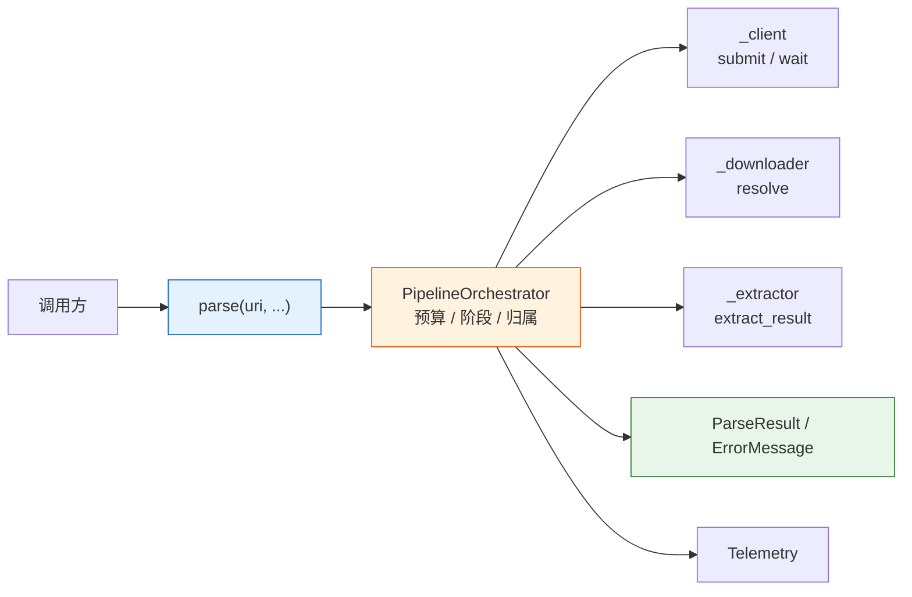
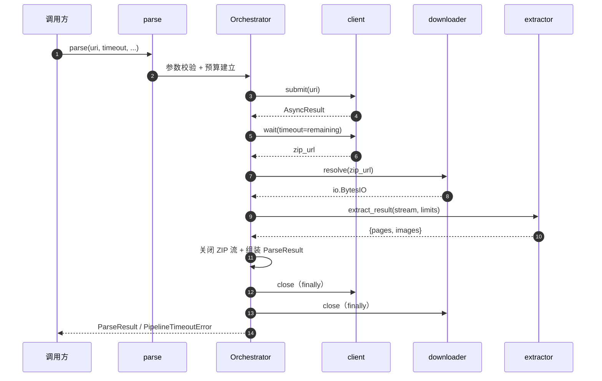

# 解析管道 单函数端到端编排 技术方案

| 字段 | 内容 |
| --- | --- |
| 标题 | 解析管道 单函数端到端编排 技术方案 |
| 主笔 | @jackafx |
| 评审人 | @jackafx（仓库维护者，兼下游依赖方负责人）；评审记录见 `changelog.md` |
| 创建日期 | 2026-10-21 |
| 目标版本 | 0.1.0 |
| 关联资源 | [全局架构](../../architecture/mineru-parser-architecture.md)、SPEC-001、SPEC-002、SPEC-003 |

## 1. 背景与上下文

### 1.1 系统现状

仓库已有三个各自独立、契约清晰的组件：客户端负责“提交 → 等待”并交付 `zip_url`；下载器负责把结果包流式读进 `io.BytesIO`；提取器负责把 ZIP 解析为 `{"pages", "images"}`。三个组件刻意不耦合彼此，带来了清晰的可测试边界，但把编排成本全部推给了调用方。

当前调用方必须自己写这段样板：构造 client 与 downloader、按顺序 submit → wait → resolve → extract、管理中间 ZIP 流与 Session 的生命周期、把三族异常翻译成自己的失败模型。顶层 `mineru_parser.__all__` 当前导出约 40 个名字（3 个组件类 + 1 个函数 + 全部异常类 + 全部类型）。

核心流程：


全局组件边界见 [全局架构](../../architecture/mineru-parser-architecture.md)；本文只描述管道层范围内的拓扑与契约。

### 1.2 核心技术痛点

三个组件各自正确，但“组合”本身没有 owner；失败链如下：

1. **编排样板与顺序知识外泄**：三个组件的调用顺序、参数透传、生命周期关闭分散在每个调用点；调用方需要知道“谁产生什么、谁消费什么”。
2. **顶层 API 面过宽**：约 40 个顶层名字，使用者要判断“到底该用哪个入口”，实际答案永远是“三个都用”。
3. **生命周期与所有权无人负责**：中间 ZIP `BytesIO` 的所有权在样板代码里是模糊的——谁负责 `close()`？异常路径上谁负责？实践中“忘记关流”与“重复关闭”都会出现。
4. **失败不可归因**：三个组件抛三族互不继承的异常；调用方能区分异常类型，但拿不到“是哪一个阶段失败”的结构化信息，只能靠猜或翻日志。
5. **预算不闭合**：三个组件各有自己的超时与字节上限，但没有任何一层把它们合成一个端到端预算；最坏情况下是三段超时之和。
6. **崩溃即孤儿任务**：任务提交成功即存在于服务端；进程在等待途中崩溃，该任务无人认领，而 `data_id` 不是幂等键。

**证据（度量）**：README 记录的 2026-10-21 真实运行中，13 页 PDF 的端到端耗时为 37.5 s，其中提交 0.22 s、等待 36.56 s、下载 0.67 s、解析 0.03 s；顶层导出约 40 个名字。等待阶段占 97.5%，说明“组合成本”主要落在等待与生命周期管理上，而不是解析本身。另有一处只有编排层能看见的资源问题：SPEC-003 的峰值推导只覆盖解压侧（约 240 MiB），未计入压缩侧仍驻留的 ZIP 缓冲（默认 ≤ 50 MiB），真实峰值约 290 MiB（[estimated] 推导值）。

### 1.3 重构/设计动机

1. **三个组件已落地，缺的是最后一个集成层**：SPEC-001 / 002 / 003 的契约稳定后，管道是 0.1.0 发布前唯一缺失的公共入口。
2. **顶层 API 面需要一次性收敛**：约 40 个名字对使用者是负担；组件私有化与单函数门面必须在 0.1.0 一次完成，避免分阶段弃用的长期双轨。
3. **端到端预算与阶段归因只能由编排层提供**：三个组件各自不知道其他阶段的超时与失败；只有管道能看见“三段超时之和”和“失败发生在哪一段”。
4. **README 已按单函数形态改写**：文档先行，管道契约必须与 README 的 `parse()` 用法保持一致。

### 1.4 非目标

- **改动 SPEC-001 / 002 / 003 的公共契约、默认值、异常层次或限额**：本次不做；管道只增不改。
- **批处理、并发调度、线程池 / 异步 / `asyncio` 版本**：本次不做；只提供一个同步函数。
- **“只提交不解析”的入口**：本次不做；批量作业由调用方在管道之外编排。
- **任务恢复 / 崩溃续跑**：本次不做；管道无状态，不持有跨调用任务状态。
- **结果包断点续传 / 本地缓存**：本次不做；结果包体积有限，重新下载可接受。
- **把 `mineru_parser.pipeline` 作为公开子包**：本次不做；管道实现保持内部。
- **阶段级重试 / 整链重放**：本次不做；重试是各组件内部责任。
- **结果缓存、断路器、限流、排队、背压**：本次不做。
- **结果上传 / 入库 / 对象存储落盘**：本次不做。
- **分布式追踪（OpenTelemetry / trace context）**：本次不做；`correlation_id` 只是字符串透传。
- **图片解码、交叉校验、阅读顺序重建**：本次不做；属于提取器或下游。
- **幂等提交 / 去重**：本次不做；相同 `uri` + `data_id` 的两次调用会产生两个任务。
- **把 `parse` 拆成多个可组合的顶层函数**：本次不做；顶层保持只有一个函数。
- **组件注入 / 组件 API 对外暴露**：本次不做；三个组件包私有化。
- **流式 / 懒加载输出**：本次不做；一次性交付完整 `ParseResult`。
- **端到端 exactly-once 语义**：本次不做；重复调用可能重复计费。

**不做的后果**：不做任务恢复意味着崩溃后由调用方按 `data_id` 对账；不做幂等意味着重复调用会重复计费；不做组件注入意味着测试只能依赖内部测试缝；不做异步意味着高并发由调用方用线程 / 进程池承接。以上代价已写入第 5 章与第 7 章。

## 2. 目标与非目标

### 2.1 目标

- **G1 - 唯一顶层入口与四阶段编排（架构级）**：提供唯一的顶层函数 `parse(uri, ...) -> ParseResult`，依次完成 submit → wait → download → extract；顶层 `__all__` 只有一个函数。验收：AC-1.1 ~ AC-1.3、AC-2.1 ~ AC-2.10。
- **G2 - 端到端预算与阶段归因（可靠性级）**：单一 `timeout` / `deadline_epoch` 覆盖四阶段；预算耗尽在信封模式返回 `error.stage`，在异常模式抛 `PipelineTimeoutError(stage=...)`。验收：AC-4.1 ~ AC-4.9。
- **G3 - 生命周期与所有权（架构级）**：管道自建 client / downloader 并在返回前关闭；中间 ZIP 流在提取后立即关闭；返回结果独立于流。验收：AC-3.1 ~ AC-3.8。
- **G4 - 失败信封 / 异常双模式（可靠性级）**：已知异常封装为 `ErrorMessage`，兜不住的异常原样抛出；`raise_on_error=True` 时已知异常原样抛出（超时翻译）。验收：AC-1.11、AC-1.12、AC-5.1 ~ AC-5.14。
- **G5 - 可观测性与无网络可测试性（运维级）**：阶段耗时、指标与日志口径唯一；`correlation_id` 透传；全部行为可在无网络环境测试。验收：AC-5.7 ~ AC-5.12、AC-7.1 ~ AC-7.8。

### 2.2 非目标

- **NG1 - 修改既有组件契约**：管道只增不改（本次不做）。
- **NG2 - 批处理 / 并发 / 异步**：由调用方用线程或进程承接（本次不做）。
- **NG3 - 只提交不解析的入口**：由调用方在管道外编排（本次不做）。
- **NG4 - 任务恢复 / 崩溃续跑**：管道无状态（本次不做）。
- **NG5 - 断点续传 / 本地缓存**：结果包体积有限（本次不做）。
- **NG6 - 公开 `pipeline` 子包**：实现保持内部（本次不做）。
- **NG7 - 阶段级重试 / 整链重放**：组件内部负责（本次不做）。
- **NG8 - 缓存 / 断路器 / 限流 / 排队 / 背压**：当前不做（本次不做）。
- **NG9 - 结果上传 / 入库 / 落盘**：由调用方负责（本次不做）。
- **NG10 - 分布式追踪**：`correlation_id` 只做字符串透传（本次不做）。
- **NG11 - 图片解码 / 交叉校验 / 阅读顺序重建**：属于提取器或下游（本次不做）。
- **NG12 - 幂等提交 / 去重**：`data_id` 不是幂等键（本次不做）。
- **NG13 - 多函数拆分的公共面**：顶层保持唯一函数（本次不做）。
- **NG14 - 组件注入 / 组件 API 暴露**：组件私有化（本次不做）。
- **NG15 - 流式 / 懒加载输出**：一次性交付（本次不做）。
- **NG16 - exactly-once**：重复调用可能重复计费（Deferred to Phase 2）。

## 3. 架构设计与核心方案

### 3.1 总体架构

全局结构见 [全局架构](../../architecture/mineru-parser-architecture.md)（Approved）。管道是唯一公开入口，位于三个私有组件之上；本次只改管道层与顶层导出面。

本次变更范围内的拓扑：



**新增 / 改造 / 保持不变**：

- 新增：`mineru_parser.pipeline` 包（阶段枚举、预算、结果类型、编排器）；顶层 `parse` 与管道异常家族。
- 改造：顶层 `__all__` 收缩为“一个函数 + 必要类型”；组件包改为私有 `_client` / `_downloader` / `_extractor`。
- 不变：三个组件的行为契约（SPEC-001 / 002 / 003）原样保留，作为内部实现继续成立。

### 3.2 核心模块职责

| 模块 | 职责 | 明确不做 |
| :--- | :--- | :--- |
| `parse` | 唯一公共入口；参数透传与结果返回 | 不实现组件逻辑、不持有状态 |
| `PipelineOrchestrator` | 四阶段编排、预算检查点、阶段归因、双模式失败处理、生命周期与所有权 | 不新增解析能力、不重试整链 |
| `budget` | `timeout` / `deadline_epoch` 换算、剩余预算、单调时钟检查 | 不中断不可中断的下载 / 提取 |
| `result` | `ParseResult` / `ErrorMessage` 构造与脱敏 | 不持有原始异常对象 |
| `stages` | 封闭 `PipelineStage` 枚举 | 不允许自由文本阶段 |
| `Telemetry` | 管道自身日志 / 指标、`correlation_id` 透传、回调隔离 | 不影响主流程 |

### 3.3 核心数据流转

1. 调用方调用 `parse(uri, ...)`；管道先做参数校验，再建立端到端预算。
2. 自建 client 与 downloader；提交任务，取得 `AsyncResult`。
3. 用剩余预算调用 `AsyncResult.wait`，取得 `MinerUTaskResult.zip_url`。
4. 下载器 `resolve(zip_url)` 得到 ZIP `io.BytesIO`。
5. 提取器 `extract_result(stream, limits)` 得到 `{pages, images}`；提取后立即关闭 ZIP 流。
6. 组装 `ParseResult`（`data` + `task_id` / `data_id` / `zip_url`），在 `finally` 中关闭 downloader → client，并上报遥测。
7. 任一阶段失败：默认模式返回 `status="failed"` + `ErrorMessage`；异常模式原样抛出（超时翻译为 `PipelineTimeoutError`）。

### 3.4 关键选型与约束

- **单函数门面而非多入口**：降低顶层 API 面与选择成本；组件仍作为私有实现保留完整契约。
- **同步阻塞而非异步编排**：与三个组件的同步模型一致；异步留给调用方的线程 / 进程池。详细对比见第 7 章。
- **无状态管道**：不持有跨调用任务状态，不接受外部 `task_id` 续跑；崩溃后的对账由调用方负责。
- **默认信封、异常可选**：调用方默认无需 `try` / `except`；需要按类型分支时显式开启异常模式。
- **组件不可注入**：公共签名不含组件参数；测试缝只在内部编排器保留。

## 4. 详细设计

### 4.1 设计范围与术语

- **阶段**：`config` / `submit` / `wait` / `download` / `extract`；`config` 只在参数校验失败时出现。
- **已知异常**：`MinerUParserError` 家族（`MinerUError` / `ResultDownloadError` / `ResultExtractionError` / `PipelineError`）的任意子类。
- **兜不住的异常**：未知类型 + `MemoryError` / `KeyboardInterrupt` / `SystemExit`；两种模式下都原样抛出。
- **预算**：由 `timeout` 或 `deadline_epoch` 换算出的单调时钟预算，覆盖四个阶段。

### 4.2 公共面与输入契约

**公共 API 面**：顶层 `mineru_parser.__all__` 只有一个函数 `parse`；其余条目只能是 `parse` 签名 / 返回值所需的类型、异常类与 `__version__`。具体保留 / 移除名单见 AC-2.2 / AC-2.3。

| 项 | 约定 |
| :--- | :--- |
| 目标 | `uri` 必填，非空白绝对 http(s) URL（由 client 校验） |
| 凭证 | 由 client 从 `MINERU_API_KEY` 读取；管道不接触凭据，也不记录 |
| 结果包 | 由服务端返回的 `zip_url` 指向；管道不校验来源，依赖下载器的 SSRF 防护 |
| 前置条件 | 不依赖磁盘、临时文件或除 `MINERU_API_KEY` 外的环境变量 |
| 并发 | `parse()` 可被并发调用；每次调用自建组件，互不共享状态 |

### 4.3 数据模型与契约

**阶段枚举**

| 取值 | 含义 |
| :--- | :--- |
| `config` | 任何执行阶段开始前的参数校验（管道自身） |
| `submit` | 提交解析任务（`POST /extract/task`） |
| `wait` | 轮询等待任务终态 |
| `download` | 下载结果包 |
| `extract` | 解析结果包 |

取值必须是封闭枚举：它是指标标签与 `on_error` 参数的取值来源，必须低基数、可安全用于监控维度。

**异常体系**

```text
MinerUParserError
├── MinerUError                    # 客户端
├── ResultDownloadError            # 下载器
├── ResultExtractionError          # 提取器
└── PipelineError                  # 管道新增
    ├── PipelineConfigurationError  # 参数 / 配置非法
    └── PipelineTimeoutError        # 端到端预算耗尽
```

| 异常 | 附加字段 | 说明 |
| :--- | :--- | :--- |
| `PipelineConfigurationError` | `field` | 参数名（`uri` / `limits` / `timeout` / `deadline_epoch` / 回调 / `correlation_id`）；未指明时为 `None` |
| `PipelineTimeoutError` | `stage`、`task_id`、`last_status` | `last_status` 仅在等待阶段超时时可得；`__cause__` 为被翻译的原始超时异常 |

四个异常家族互不继承；`except MinerUParserError` 可一次性捕获全库失败。超时是唯一的翻译点：`parse()` 的超时统一表现为 `PipelineTimeoutError`。

**`parse` 参数**

| 参数 | 类型 | 默认值 | 语义 |
| :--- | :--- | :--- | :--- |
| `uri` | `str` | 必填 | PDF 的绝对 http(s) URI |
| `model_version` | `str` | `"vlm"` | 透传给 client |
| `data_id` | `str \| None` | `None` | 对账标识；不是幂等键 |
| `timeout` | `float \| None` | `None` | 端到端相对预算（秒）；与 `deadline_epoch` 互斥 |
| `deadline_epoch` | `float \| None` | `None` | 端到端绝对截止（Unix 时间戳）；与 `timeout` 互斥 |
| `limits` | `ExtractionLimits \| None` | `None` | 提取限额；`None` 使用默认值 |
| `raise_on_error` | `bool` | `False` | `False` 返回失败信封；`True` 抛异常（超时翻译） |
| `on_update` | `Callable[[MinerUTaskStatus], None] \| None` | `None` | 透传给 `AsyncResult.wait` |
| `on_error` | `Callable[[PipelineStage, BaseException], None] \| None` | `None` | 阶段失败时收到 `(stage, 原始异常)` |
| `on_metric` | `MetricHook \| None` | `None` | 管道与三个组件共用的指标回调 |
| `correlation_id` | `str \| None` | `None` | 透传到三个组件的全部日志与指标 |

所有参数校验必须在创建任何组件实例之前完成。

**`ParseResult` 字段**

| 字段 | 类型 | 说明 |
| :--- | :--- | :--- |
| `status` | `Literal["success", "failed"]` | 本次调用状态；可直接作为指标标签 |
| `data` | `ExtractedResult \| None` | 成功时非 `None`；失败时必须为 `None`（不返回部分产物） |
| `task_id` | `str \| None` | 服务端任务 id；失败时按“当时已知”填充 |
| `data_id` | `str \| None` | 对账标识；成功时取终态结果，失败时回填调用方传入值 |
| `zip_url` | `str \| None` | 结果包地址；敏感值，不得进入日志或指标标签 |
| `error` | `ErrorMessage \| None` | 失败时的错误信息；成功时必须为 `None` |

**`ErrorMessage` 字段**

| 字段 | 类型 | 说明 |
| :--- | :--- | :--- |
| `stage` | `PipelineStage` | 失败发生的阶段 |
| `error_type` | `str` | 异常类名；调用方据此分支 |
| `message` | `str` | 脱敏后的可读摘要；不含正文、凭据、签名 URL 或异常链原文 |
| `cause_type` | `str \| None` | 异常链首因的类名；无异常链时为 `None` |

**端到端资源预算**

$$
M_{\text{peak}} \approx \texttt{max\_bytes} + \texttt{max\_total\_image\_bytes} + \texttt{max\_manifest\_bytes}\times(1+k_{\text{model}}) + M_{\text{zipinfo}} + M_{\text{result}}
$$

代入默认值（压缩侧 50 MiB、解压侧 160 + 16 × 2 + 40 + 8 MiB）得 $M_{\text{peak}} \approx 290$ MiB（[estimated] 推导值）。部署侧必须满足 $W \times M_{\text{peak}} \le M_{\text{container}}$：$W=3$、1 GiB 时 870 MiB ✓；$W=4$ 时 1,160 MiB ✗。并发 4 时需将 `max_total_image_bytes` 下调到 $\le 126$ MiB。

### 4.4 接口与协议

#### 公共 API

```python
def parse(
    uri: str,
    *,
    model_version: str = "vlm",
    data_id: str | None = None,
    timeout: float | None = None,
    deadline_epoch: float | None = None,
    limits: ExtractionLimits | None = None,
    raise_on_error: bool = False,
    on_update: Callable[[MinerUTaskStatus], None] | None = None,
    on_error: Callable[[PipelineStage, BaseException], None] | None = None,
    on_metric: MetricHook | None = None,
    correlation_id: str | None = None,
) -> ParseResult: ...
```

> 这是本库**唯一**的顶层函数（AC-2.1 / AC-2.6）。它是同步阻塞调用；异步版本不在本期范围（Non-Goals）。

#### 公共 API 稳定性


| 层级                  | 名称                                                                                                                                                 | 承诺                      |
| :------------------- | :-------------------------------------------------------------------------------------------------------------------------------------------------- | :----------------------- |
| **稳定（唯一函数）**        | `parse`                                                                                                                                            | 遵循 SemVer；大版本才允许破坏性变更   |
| **稳定（类型）**          | `ParseResult`、`ErrorMessage`、`ExtractedResult`、`ExtractedImage`、`ExtractionLimits`、`PipelineStage`、`MinerUTaskStatus`、`MetricHook`、`MinerUParserError`、`PipelineError`、`PipelineTimeoutError`、`PipelineConfigurationError` | 跟随 `parse` 的稳定性         |
| **内部 / 不遵循 SemVer** | `mineru_parser.pipeline` 包内名称、三个私有组件包（`_client` / `_downloader` / `_extractor`）内的全部 API | 可调整；行为契约由各自 SPEC 约束     |


#### 输入契约 (Input Contract)


| 项    | 约定                                                                                       |
| :---- | :---------------------------------------------------------------------------------------- |
| 目标   | `uri` **必填**，必须是非空白的绝对 http(s) URL（由 client 校验，继承 SPEC-001 AC-2.4） |
| 凭证   | 由 client 从 `MINERU_API_KEY` 读取（继承 SPEC-001 AC-1.2）；管道不接触凭据，也不记录它                         |
| 结果包  | 由服务端返回的 `zip_url` 指向；管道不校验其来源，只依赖 downloader 的 SSRF 防护                                   |
| 前置条件 | 不依赖磁盘、临时文件或除 `MINERU_API_KEY` 外的环境变量                                                     |
| 并发   | `parse()` 可被并发调用；每次调用自建组件（AC-1.6 / AC-3.6）                                               |


#### 返回契约

1. **完整性**：只有四个阶段全部成功才返回 `status="success"`；失败一律返回 `status="failed"`，**不返回部分产物**（`data` 必须为 `None`，对齐 SPEC-003 AC-3.10 / SPEC-003 AC-4.11）。
2. **形状**：`ParseResult`，恰好 `status`、`data`、`task_id`、`data_id`、`zip_url`、`error` 六个键（AC-1.1）；`data` 是 `ExtractedResult`，与 `extract_result` 的返回值逐字相同。
3. **独立性**：全新对象，不与内部流共享生命周期（AC-1.4 / AC-3.4）。
4. **无重试**：管道不重放整链；阶段内部的重试由各组件负责（Non-Goals）。
5. **失败语义（默认）**：**已知异常**（`MinerUParserError` 家族）被封装为 `ErrorMessage` 并随 `status="failed"` 返回，**不抛异常**；**兜不住的异常**（未知类型、`MemoryError`、`KeyboardInterrupt`、`SystemExit`）原样抛出（AC-1.11 / AC-5.14）。
6. **失败语义（`raise_on_error=True`）**：已知异常改为**原样抛出**（超时翻译为 `PipelineTimeoutError`，AC-5.3）；兜不住的异常在两种模式下都原样抛出。

#### 所有权契约


| 对象                      | 所有者 | 关闭时机                       |
| :----------------------- | :--- | :-------------------------- |
| 自建的 `MinerUApiClient`   | 管道  | 返回前，`finally` 中            |
| 自建的 `ResultDownloader`  | 管道  | 返回前，`finally` 中（先于 client） |
| 中间 ZIP `io.BytesIO`     | 管道  | 提取结束后立即（成功与失败都关）           |
| 返回的 `ParseResult`       | 调用方 | 由调用方处置                     |


#### 集成示例

```python
from mineru_parser import parse

# 最简形态：一个 URI 进，一个 ParseResult 出；默认不抛异常
result = parse("https://example.com/paper.pdf")

if result["status"] == "success":
    for page in result["data"]["pages"]:
        for block in page:
            print(block.type, block.bbox)
    for image in result["data"]["images"]:
        print(image["path"], len(image["bytes"]))
    print(result["task_id"], result["data_id"])
else:
    # 已知失败已被封装成错误信息
    print(result["error"]["stage"], result["error"]["error_type"], result["error"]["message"])
```

```python
from mineru_parser import PipelineStage, parse

# 端到端预算 + 阶段归因：失败时能立刻知道卡在哪一段
def on_failure(stage: PipelineStage, exc: BaseException) -> None:
    logger.error("parse failed at %s: %s", stage, type(exc).__name__)

result = parse(
    "https://example.com/paper.pdf",
    data_id="doc-42",
    timeout=600,                              # 覆盖提交 / 等待 / 下载 / 解析四段
    on_update=lambda status: print(status.state),
    on_error=on_failure,
)
```

```python
from mineru_parser import MinerUParserError, PipelineTimeoutError, parse

# 需要"按异常类型分支"时，显式开启异常模式
try:
    result = parse("https://example.com/paper.pdf", timeout=600, raise_on_error=True)
except PipelineTimeoutError as exc:
    ...                              # 端到端预算耗尽：exc.stage 标识耗尽阶段
except MinerUParserError as exc:
    # 组件三族的具体异常类已私有化，不可按类型导入（AC-2.3 / AC-2.8）；
    # 统一用库级根异常捕获后按类名分支——与信封模式的 error["error_type"] 等价
    if type(exc).__name__ == "MinerUQuotaError":
        ...                          # 额度耗尽：可退避后重试
    elif type(exc).__name__ == "ResultExtractionLimitError":
        ...                          # 该结果包超出本环境预算：终态，调整 limits
    else:
        raise
```

> 上例中**只有** `MinerUParserError` 与 `PipelineTimeoutError` 可从顶层 `mineru_parser` 导入（AC-2.2）；组件三族的具体异常类随组件私有化而**不再提供任何导入路径**（AC-2.3），因此新代码按类名分支。存量直接依赖组件的代码不受影响——阶段异常在异常模式下**原样抛出**（AC-5.3），其既有的 `except MinerUQuotaError` 之类的捕获方式继续有效。
>
> **默认是信封，异常是选项**：不写 `raise_on_error=True` 时，**已知**失败不会抛出，而是变成 `status="failed"` + `error`；只有**兜不住**的异常（未知类型、`MemoryError`、`KeyboardInterrupt`、`SystemExit`）才一定会抛出来。

### 4.5 核心流程与时序



本节描述**控制流契约**：每个阶段做什么、用什么判据、失败时抛出什么。实现方式（函数划分、异常捕获顺序、内部数据结构）由实现者决定。

#### 编排阶段


| #   | 阶段     | 动作                                                                                                 | 失败结果                                                                         | 依据                                         |
| :---: | :------ | :-------------------------------------------------------------------------------------------------- | :---------------------------------------------------------------------------- | :------------------------------------------ |
| 1   | 参数校验   | 校验 `uri` 非空、`timeout` / `deadline_epoch` 互斥、回调可调用性、`limits` 类型、`correlation_id` 类型  | `PipelineConfigurationError(field=...)`                                      | AC-4.1 / AC-5.4 / SPEC-003 AC-6.7                   |
| 2   | 预算建立   | 由 `timeout` 或 `deadline_epoch` 换算剩余预算；换算后剩余 $\le 0$ 立即失败                                           | `PipelineTimeoutError(stage="submit")`                                       | AC-4.2 / AC-4.3                            |
| 3   | 组件准备   | 自建 client 与 downloader（无注入路径）                                                                        | —（构造失败按未知异常处理，AC-5.10）                        | AC-1.3 / AC-2.10 / AC-3.1                  |
| 4   | 提交     | `client.submit(uri, model_version=..., data_id=...)`                                              | `MinerUError` 子类原样抛出                                                         | AC-1.2 / AC-5.3                            |
| 5   | 等待     | 复用提交得到的句柄 → `wait(timeout=剩余预算, on_update=...)`                                                   | `MinerUTimeoutError` → `PipelineTimeoutError(stage="wait")`；其余原样             | AC-4.4                                   |
| 6   | 下载     | `downloader.resolve(result.zip_url)`                                                               | `ResultDownloadTimeoutError` → `PipelineTimeoutError(stage="download")`；其余原样 | AC-4.5 / AC-5.3                            |
| 7   | 解析     | `extract_result(stream, limits=...)`                                                               | `ResultExtractionError` 子类原样抛出                                               | AC-5.3 / AC-6.3                            |
| 8   | 交付     | 组装 `ParseResult`（`data` + `task_id` / `data_id` / `zip_url`）；关闭 ZIP 流；检查预算；关闭自建组件；上报遥测 | `PipelineTimeoutError(stage="extract")`（预算耗尽）                                | AC-1.1 / AC-1.9 / AC-3.3 / AC-4.6 / AC-3.8 |


> **阶段 1 早于阶段 3**：配置错误必须在创建任何组件（尤其是 Session）之前暴露，避免"配置错了却建立了连接池"的副作用。
>
> **阶段 2 早于阶段 4**：预算已耗尽时不得提交任务——否则会产生一个无人等待的孤儿任务。
>
> **阶段 7 之后的关闭在阶段 8**：ZIP 流必须在提取后立即关闭（不再需要），而 client / downloader 的关闭在 `finally` 中执行（覆盖所有失败路径）。

#### 预算检查点


| 检查点 | 位置             | 耗尽时的 `stage` |
| :--- | :-------------- | :------------ |
| 提交前 | 进入 submit 之前   | `submit`     |
| 等待前 | 进入 wait 之前     | `wait`       |
| 下载前 | 进入 download 之前 | `download`   |
| 解析前 | 进入 extract 之前  | `extract`    |
| 解析后 | 提取完成、关闭流之后     | `extract`    |


> 等待阶段**不另设**检查点：剩余预算已作为 `wait(timeout=remaining)` 传入，客户端会在每次查询前与每次 sleep 后自行检查（继承 SPEC-001 AC-4.4）。管道在该阶段只负责把 `MinerUTimeoutError` 翻译为 `PipelineTimeoutError(stage="wait")`。
>
> **检查点语义**：预算耗尽一律**终止**本次调用并抛出 `PipelineTimeoutError`，不得"跳过下载"或"返回部分结果"。

### 4.6 异常处理与错误码

#### 异常处理规则


| 情形 | 默认（信封模式，`raise_on_error=False`） | 异常模式（`raise_on_error=True`） |
| :--- | :--- | :--- |
| 阶段抛出 `MinerUTimeoutError` | 封装为 `error.error_type="PipelineTimeoutError"`、`error.stage="wait"`、`error.cause_type="MinerUTimeoutError"` | 翻译为 `PipelineTimeoutError(stage="wait")`，原异常作为 `__cause__`，复制 `task_id` / `last_status` |
| 阶段抛出 `ResultDownloadTimeoutError` | 封装为 `error.error_type="PipelineTimeoutError"`、`error.stage="download"`、`error.cause_type="ResultDownloadTimeoutError"` | 翻译为 `PipelineTimeoutError(stage="download")`，原异常作为 `__cause__` |
| 阶段抛出其他 `MinerUParserError` 子类 | 封装为 `error.error_type=<异常类名>`、`error.stage=<失败阶段>`、`error.cause_type=<异常链首因类名或 None>` | **原样抛出**（同一对象，AC-5.3） |
| 管道参数校验失败（`PipelineConfigurationError`） | 封装为 `error.stage="config"`、`error.error_type="PipelineConfigurationError"` | **原样抛出** |
| 阶段抛出未知异常 | **原样抛出**，记录 `outcome="unexpected"`（AC-5.10 / AC-5.14） | **原样抛出**，记录 `outcome="unexpected"` |
| `on_error` / `on_update` 抛异常 | 吞掉并记录对应 `mineru.pipeline.*.failed` 日志（AC-5.5） | 同左 |
| `on_metric` 抛异常 | 吞掉并记录 `mineru.metric.failed`（AC-5.6） | 同左 |
| `MemoryError` / `KeyboardInterrupt` / `SystemExit` | **原样抛出**，不包装、不吞掉、**不封装**（AC-5.10 / AC-5.14） | 同左 |


> **"已知 / 兜不住"的判定标准**：**已知** = `MinerUParserError` 家族（`MinerUError` / `ResultDownloadError` / `ResultExtractionError` / `PipelineError`）的**任意**子类；**兜不住** = 其余一切（未知类型 + `MemoryError` / `KeyboardInterrupt` / `SystemExit`）。判定只看**类型**，不看消息、不看内容。
>
> **翻译的实现约束**（仅异常模式）：翻译必须用 `raise PipelineTimeoutError(...) from original`，保证 `__cause__` 指向原始超时异常（AC-7.3）；不得用 `from None`（会丢失原始异常，违背 AC-4.4 / AC-4.5 的"保留 `__cause__`"要求）。
>
> **非超时的原样透出约束**（仅异常模式）：管道捕获阶段异常后，只做"记录归因 + 回调 + 重新抛出"，**不得**重新构造异常对象、不得修改其属性、不得改变其 `__cause__` / `__context__`（AC-5.3）。实现上必须使用裸 `raise`（而非 `raise exc`）以保留 traceback。
>
> **信封模式的构造约束**：信封必须由管道**自行构造**，**不得**把原始异常对象塞进信封（信封必须可序列化）；原始异常仍必须被记录到错误日志（含 traceback）以便排障——信封只承载脱敏后的类名与摘要（AC-5.13 / AC-5.14）。

### 4.7 验收标准

#### US-1: 单函数端到端解析

**As a** 业务调用方
**I want to** 只调用一个函数就拿到解析结果
**So that** 我不必了解三个组件的调用顺序、参数透传与生命周期


- **AC-1.1**: `parse(uri, *, ...)` 必须接受一个绝对 http(s) 的 PDF URI，并返回 `ParseResult`——一个**恰好**包含 `"status"`、`"data"`、`"task_id"`、`"data_id"`、`"zip_url"`、`"error"` 六个键的普通 `dict`。`status` 必须取 `"success"` 或 `"failed"`。成功时：`data` 必须是 `ExtractedResult`（一个**恰好**包含 `"pages"` 与 `"images"` 两个键的 `dict`，其**形状与取值**必须与 `extract_result` 的返回值逐字相同：`pages` 必须是 Pydantic 模型实例，`images[].bytes` 必须是不可变 `bytes`，`images` 按 canonical path 字典序升序，继承 SPEC-003 AC-1.2 / AC-1.3 / AC-4.6），且 `error` 必须为 `None`。失败时：`data` 必须为 `None`，`error` 必须是非 `None` 的 `ErrorMessage`（AC-1.12）。`ParseResult` **不得**改变 `ExtractedResult` 的既有契约——`extract_result` 仍只返回两个键（SPEC-003 AC-1.2 不变）。
- **AC-1.2**: `parse()` 必须依次完成四个阶段：**submit → wait → download → extract**。任一阶段失败必须**中止**后续阶段：失败于 submit / wait 时不得发起下载请求，失败于 download 时不得调用提取器。
- **AC-1.3**: `parse()` 不得要求调用方构造 `MinerUApiClient` / `ResultDownloader` / `extractor`；必须**自建**（AC-3.1）。公共签名**不得**出现任何组件参数，调用方无法替换组件（AC-2.10）。
- **AC-1.4**: 每次调用必须返回**全新**对象；不得缓存、复用或跨调用共享上一次的结果、页模型实例或图片字节。
- **AC-1.5**: **成功与失败都必须**上报 `mineru.pipeline.total` 与 `mineru.pipeline.duration_ms`（成功时 `outcome="success"`），并记录各阶段的耗时（AC-5.7）。失败时不得因"异常被信封化"而漏报。
- **AC-1.6**: `parse()` 必须是**无状态**函数：不得持有跨调用的可变状态；并发调用不同实例之间不得共享可变状态（同一进程内两次并发 `parse()` 各自自建 client / downloader，互不干扰）。
- **AC-1.7**: `parse()` 不得改变三个组件的语义：`submit` 的请求体、`wait` 的轮询语义、`resolve` 的重试与 SSRF 规则、`extract_result` 的定位与限额规则全部按各自 SPEC 执行（AC-4.9）。
- **AC-1.8**: `parse()` 返回后不得再持有对 ZIP 流、HTTP 响应体、Session 或结果的引用（AC-3.5）。
- **AC-1.9**: `ParseResult` 的元数据字段必须取自本次调用的终态结果：`task_id` 必须等于 `MinerUTaskResult.provider_task_id`（沿用 SPEC-001 AC-9.2 的取值优先级——服务端返回优先、句柄 id 兜底），`data_id` 必须等于 `MinerUTaskResult.data_id`（服务端与提交参数都缺失时为 `None`），`zip_url` 必须等于 `MinerUTaskResult.zip_url`（不得为空串）。
- **AC-1.10**: `ParseResult.zip_url` 属于**敏感值**（可能携带签名凭据）：管道不得把它写入任何日志或指标标签（AC-5.9）；调用方把它落盘或打日志前必须自行评估。管道不得对其做任何脱敏改写——成功时 `ParseResult.zip_url` 必须与 `MinerUTaskResult.zip_url` 逐字相同（AC-1.9）。
- **AC-1.11**: 失败处理必须遵循"**已知异常封装、兜不住的抛出**"：默认（`raise_on_error=False`）下，`MinerUParserError` 家族的**全部**已知异常必须被封装为 `ErrorMessage` 并以 `status="failed"` 返回，**不得抛出**；未知异常类型、`MemoryError`、`KeyboardInterrupt`、`SystemExit` 必须原样抛出，**不得**被封装、吞掉或包装。`raise_on_error=True` 时，已知异常改为原样抛出（AC-5.3）；兜不住的异常在两种模式下都原样抛出。
- **AC-1.12**: 失败信封必须满足：`status == "failed"`、`data is None`、`error` 非 `None`；`error.stage` 必须是 `config` / `submit` / `wait` / `download` / `extract` 之一；`error.error_type` 必须是该异常的**类名**；`error.cause_type` 必须是异常链首因的类名或 `None`；`task_id` / `data_id` / `zip_url` 按"**当时已知**"填充——提交成功即知 `task_id`，等待完成后才知 `zip_url`，未知的取 `None`。失败信封**不得**携带部分产物，也不得携带原始异常对象。

---

#### US-2: 唯一公共 API 与契约面

**As a** 库使用者
**I want to** 面对一个明确的入口面
**So that** 我不必在几十个导出名里猜"该用哪个"


- **AC-2.1**: `mineru_parser.__all__` 中**有且只有一个函数**——`parse`。其余条目必须是**类型 / 异常类 / 类常量 / `__version__`**，不得出现第二个函数（包括别名、私有重导出，`parse` 的变体）。该约束必须由测试断言（AC-7.4）。**判定口径是"函数"而非"可调用对象"**：异常类与普通类同样是可调用对象（`callable(MinerUParserError)` 为真），因此断言必须按 `inspect.isfunction(x)` 或 `callable(x) and not isinstance(x, type)` 判定，否则 AC-2.2 要求保留的 `MinerUParserError` 会让断言自相矛盾。
- **AC-2.2**: 顶层**必须**继续导出：`MinerUParserError`（捕获全库失败）、`PipelineError` / `PipelineTimeoutError` / `PipelineConfigurationError`（管道自身的失败类型）、`ParseResult`、`ErrorMessage`、`ExtractedResult`、`ExtractedImage`、`ExtractionLimits`、`MetricHook`、`PipelineStage`、`MinerUTaskStatus`、`__version__`。其中 `ParseResult` / `ErrorMessage` / `ExtractedResult` / `ExtractedImage` / `ExtractionLimits` / `MetricHook` / `PipelineStage` / `MinerUTaskStatus` 是 `parse` 的签名或返回值所引用的类型。**管道异常家族必须在顶层导出**：组件三族的具体异常类已随组件私有化而不可导入（AC-2.3），若管道异常也不导出，调用方将只剩 `MinerUParserError` 一个可捕获类型——"超时统一为 `PipelineTimeoutError`"（AC-4.4 / AC-4.5）这一语义收益将被抹平。
- **AC-2.3**: `MinerUApiClient`、`AsyncResult`、`ResultDownloader`、`extract_result`、`canonicalize_member_path`、三族具体异常类与其他组件级名称**必须**从顶层 `__all__` 移除，**且公开导入路径必须一并关闭**：实现包改名为私有 `mineru_parser._client` / `_downloader` / `_extractor`，`mineru_parser.client` / `.downloader` / `.extractor` 不再提供，调用方**无法导入**任何组件 API。组件的行为契约（SPEC-001 / 002 / 003）作为内部实现继续成立，但不再是公共契约。
- **AC-2.4**: 本变更属于**破坏性变更**，必须在 README 的迁移说明与本 Spec 的 changelog 中显式登记，并在 changelog 中给出"旧顶层导入 → 新公共面"的对照——组件三族的旧导入路径**全部关闭**（不存在"新子模块导入路径"），对照表须写明"无法再导入"及替代写法。
- **AC-2.5**: `parse` 的**签名与返回类型**遵循 SemVer；大版本才允许破坏性变更。组件 API 转为**私有实现**，**不**遵循 SemVer（未来可调整签名而不升大版本），但行为契约由各自 SPEC 约束。
- **AC-2.6**: 顶层**不得**出现第二个函数（包括别名、私有重导出、`parse` 的变体）；不得提供 `parse_async` / `parse_sync` 之类的并列入口（异步不在本期范围，见 Non-Goals）。**导出异常类不算"第二个函数"**——异常类是可调用对象，但 AC-2.1 的约束只针对**函数**。
- **AC-2.7**: `parse` 必须从 `mineru_parser.pipeline`（内部实现模块）实现并在顶层再导出；顶层**不得**包含编排逻辑实现（编排代码必须位于 `mineru_parser.pipeline` 包内）。
- **AC-2.8**: `mineru_parser.pipeline` 包**必须**是内部实现层：不通过顶层 `__all__` 暴露其内部名称（`PipelineOrchestrator` 等实现细节不得出现在顶层）。
- **AC-2.9**: `parse` 的签名**不得**包含任何用于恢复历史任务的参数（如 `task_id`），顶层**不得**提供第二个用于续跑既有任务的入口（Goal 7 / Q-13）。管道**不得**声称提交是幂等的：相同 `uri` + `data_id` 的两次 `parse()` 会创建两个任务（`data_id` 按 SPEC-001 语义仅用于对账，不是幂等键），该行为必须在 README 中提示。
- **AC-2.10**: `parse` 的签名**不得**包含任何组件级参数（`client` / `downloader` / 组件实例 / 组件工厂），**不得**出现 `MinerUApiClient`、`ResultDownloader` 等组件类型；调用方**无法**替换管道内部的组件。公共面**不得**出现任何其他构造或配置入口（不得提供 `parse_with(...)` 之类的变体，AC-2.6）。

---

#### US-3: 生命周期与资源所有权

**As a** 服务集成方
**I want to** 每一次调用都干净地收尾
**So that** 我不会泄漏连接、流或内存


- **AC-3.1**: `parse()` 必须自建 `MinerUApiClient` 与 `ResultDownloader`，并在**返回前**关闭它们——包括成功路径与所有失败路径（`finally` 语义）。关闭必须幂等。
- **AC-3.2**: 管道自建的 client / downloader 在 `parse()` 返回（或抛错）后**不得**再被使用；其 Session 必须已关闭。管道**不得**保留对它们的引用（AC-3.5）。
- **AC-3.3**: 下载得到的 ZIP `io.BytesIO` 由 `parse()` 拥有：必须在提取结束后关闭（成功与失败路径都关闭），且**不得**出现在返回值中。调用方无法取得该流。
- **AC-3.4**: 返回的 `ParseResult` 必须**独立于**已关闭的流：关闭流之后 `pages` 与 `images[].bytes` 仍可正常使用（提取器已复制字节，见 SPEC-003 AC-1.3）。
- **AC-3.5**: `parse()` 返回后不得持有对 ZIP 流、HTTP 响应体、Session、页模型或图片字节的引用；除返回值外不得保留任何对象。
- **AC-3.6**: 每次 `parse()` 调用必须创建**新的** client / downloader 实例；不得跨调用复用实例、Session 或缓冲区（AC-1.6）。
- **AC-3.7**: `parse()` 不得关闭调用方持有的任何对象；除自建的两个组件与中间 ZIP 流外，管道不拥有、不创建、不销毁任何资源。调用方**无法**向管道提供任何需要被管理的对象（AC-2.10）。
- **AC-3.8**: 关闭顺序必须是"先关流、后关组件"：中间 ZIP 流在提取结束后立即关闭；client 与 downloader 在函数返回前的 `finally` 中关闭，顺序为 downloader → client（依赖方向：先停止下载，再停止 API 会话）。

---

#### US-4: 端到端预算与超时

**As a** 服务集成方
**I want to** 用一个预算约束整条流水线
**So that** 我能预测最坏耗时，而不是三段超时之和


- **AC-4.1**: `timeout`（相对秒数）与 `deadline_epoch`（绝对 Unix 时间戳）**互斥**；同时提供必须抛出 `PipelineConfigurationError`，且**不得**发起任何网络请求、不得创建任何组件实例。两者都不提供表示不设端到端上限（等待阶段沿用客户端的无限等待语义，见 AC-4.8）。
- **AC-4.2**: 端到端预算必须覆盖**全部四个阶段**（submit / wait / download / extract），必须在每个阶段**开始前**与**结束后**检查。剩余预算必须按单调时钟计算（`deadline_epoch` 仅在入口处换算一次为单调预算）。
- **AC-4.3**: 预算耗尽时必须失败：默认（信封）模式下返回 `status="failed"` 的信封，`error.stage` 标识耗尽时所处阶段、`error.error_type == "PipelineTimeoutError"`；`raise_on_error=True` 时抛出 `PipelineTimeoutError`，其 `stage` 字段标识耗尽时所处阶段。两种模式都**不得**返回部分结果，不得返回空结果冒充成功。
- **AC-4.4**: 等待阶段必须把**剩余预算**传给 `AsyncResult.wait(timeout=remaining)`（继承 SPEC-001 AC-4.1 \~ AC-4.3 的预算语义）。等待阶段自身抛出的 `MinerUTimeoutError`：异常模式（`raise_on_error=True`）下必须被翻译为 `PipelineTimeoutError(stage="wait")`，原始异常作为 `__cause__` 保留，`last_status` / `task_id` 复制到 `PipelineTimeoutError` 上；默认信封模式下必须封装为 `error.error_type == "PipelineTimeoutError"`、`error.stage == "wait"`、`error.cause_type == "MinerUTimeoutError"`。
- **AC-4.5**: 下载阶段抛出的 `ResultDownloadTimeoutError`：异常模式（`raise_on_error=True`）下必须被翻译为 `PipelineTimeoutError(stage="download")`，原始异常作为 `__cause__` 保留；默认信封模式下必须封装为 `error.error_type == "PipelineTimeoutError"`、`error.stage == "download"`、`error.cause_type == "ResultDownloadTimeoutError"`。
- **AC-4.6**: 提取阶段是纯 CPU / 内存操作，**不接受**时间预算参数；预算在提取**结束后**检查，若已超预算必须抛 `PipelineTimeoutError(stage="extract")` 并丢弃结果（提取不可中断）。
- **AC-4.7**: 除等待阶段外，管道**无法中断**正在进行的下载（`resolve()` 不接受每调用预算，见 SPEC-002 AC-2.1）。若下载阶段越过端到端预算，管道只能在阶段结束后检出并抛 `PipelineTimeoutError(stage="download")`；该限制必须在 README 与本 Spec 中显式说明。
- **AC-4.8**: 不提供 `timeout` / `deadline_epoch` 时，等待阶段**无上界**（继承 SPEC-001 的 `wait()` 语义）。该默认值必须在 README 中以风险提示的形式给出（长文档解析可能耗时数分钟），但不得由管道自行代入隐式默认值。
- **AC-4.9**: 预算检查必须使用可注入的单调时钟；测试必须能在不 sleep 的情况下确定性地触发预算耗尽（AC-7.2）。

---

#### US-5: 阶段归因与可观测性

**As a** 运维 / 服务集成方
**I want to** 知道失败发生在哪个阶段
**So that** 我能快速判断是上游慢、下载被拦还是包坏了


- **AC-5.1**: 必须定义封闭枚举 `PipelineStage`，取值恰好为 `config` / `submit` / `wait` / `download` / `extract`（`StrEnum`）；不得新增其他取值，也不得用自由文本表示阶段。
- **AC-5.2**: 任一阶段失败时，管道必须在抛出前调用 `on_error(stage, exception)`，其中 `exception` 是**该阶段原始抛出的异常对象**（超时翻译前）。
- **AC-5.3**: 在**异常模式**（`raise_on_error=True`）下，**除超时外**，阶段异常必须**原样抛出**：管道不得包装、翻译、替换或吞掉；抛出的对象必须与阶段抛出的对象**同一**（`is`），其类型、属性与异常链保持不变。因此**已经持有这些异常类引用**的代码（存量直接依赖组件的调用方）其既有捕获方式在 `raise_on_error=True` 下**继续有效**。但组件三族的具体异常类已随组件私有化而**不可导入**（AC-2.3），**新代码**只能以库级根异常 `MinerUParserError` 捕获后按 `type(exc).__name__` 分支，或直接捕获 `PipelineTimeoutError`（超时，AC-2.2）。在默认信封模式下，同一异常被封装为 `ErrorMessage`，其 `error.error_type` 必须等于该异常的类名（AC-1.11）——**两种模式的信息量必须一致**。
- **AC-5.4**: 管道自身产生的失败必须使用 `PipelineError` 家族：`PipelineConfigurationError`（配置或参数非法）与 `PipelineTimeoutError`（端到端预算耗尽）。二者均继承 `PipelineError`，而 `PipelineError` 继承库级根 `MinerUParserError`。
- **AC-5.5**: `on_error` 抛出的任何异常必须被吞掉并记录 `mineru.pipeline.on_error.failed` 警告日志，不得影响主流程。
- **AC-5.6**: `on_metric` 抛出的任何异常必须被吞掉并记录 `mineru.metric.failed` 警告日志（与 SPEC-001/002/003 的既有约定一致）。
- **AC-5.7**: 管道自身的指标必须在 `finally` 中**恰好上报一次**；失败时 `mineru.pipeline.pages` / `mineru.pipeline.images` / `mineru.pipeline.image_bytes` 必须为 0。
- **AC-5.8**: 提供的 `correlation_id` 必须透传到 client / downloader / extractor 的**全部**日志与指标（各自组件按其 SPEC 附加该字段），并附加到管道自身的日志。
- **AC-5.9**: 指标标签只允许封闭枚举（`outcome`、`stage`）；**不得**包含 URI、`task_id`、`data_id`、`zip_url`、路径、成员名、异常消息或 `correlation_id`。
- **AC-5.10**: 未知的非 `MinerUParserError` 异常必须**原样抛出**（不得被封装成信封、不得被吞掉），并记录 `outcome="unexpected"`；`MemoryError`、`KeyboardInterrupt`、`SystemExit` 同样原样抛出（对齐 SPEC-003 AC-6.8）。
- **AC-5.11**: 管道自身的日志名必须为：`mineru.pipeline`（成功）、`mineru.pipeline.error`（失败，含 `stage` 与 `error_type`）、`mineru.pipeline.stage`（阶段切换，含阶段耗时）。三组件的既有日志名保持不变。
- **AC-5.12**: 阶段耗时必须以毫秒为单位记录，且各阶段的耗时都必须出现在成功与失败两种情形的日志中。
- **AC-5.13**: `ErrorMessage` 必须由管道**自行构造**，且只包含 `stage` / `error_type` / `message` / `cause_type` 四个键；**不得**包含原始异常对象、异常链原文、文档正文、凭据或签名 URL。`error.message` 必须是脱敏后的可读摘要。
- **AC-5.14**: 兜不住的异常（未知类型 / `MemoryError` / `KeyboardInterrupt` / `SystemExit`）必须原样抛出，且必须被记录到带 traceback 的错误日志（`mineru.pipeline.error`，含 `stage` 与 `error_type`），不得静默丢失。

---

#### US-6: 资源预算自洽

**As a** 服务集成方
**I want to** 知道一次 `parse()` 真实占多少内存
**So that** 我能据此决定并发度，而不是等 OOM


- **AC-6.1**: 管道必须把**压缩侧上限**（下载的 `max_bytes`，默认 50 MiB）与**解压侧上限**（提取限额，SPEC-003 默认值）作为两个**独立量纲**管理，两者都必须有默认值；两者不得互相替代或合并为单一上限。
- **AC-6.2**: 单次 `parse()` 的峰值内存必须按 §4.3 的公式估算，并在 **README 中写明默认档位的峰值上界**（≈ 290 MiB，[estimated] 推导值）。该数字必须与 SPEC-003 §4.3 的推导口径保持自洽。
- **AC-6.3**: 管道不得因"下载成功但解压超限"而重试、改换路径或降级；`ResultExtractionLimitError` 必须原样抛出（终态），并由调用方按"该结果包超出本环境预算"理解（继承 SPEC-003 §4.3 的量纲说明）。
- **AC-6.4**: `limits` 参数必须是 `ExtractionLimits | None`；非法值必须在**进入任何阶段之前**抛出 `PipelineConfigurationError`，不得静默回退到默认值。
- **AC-6.5**: 管道不得缓存、落盘、复制或二次压缩结果包字节；ZIP 字节在生命周期内只存在一份（下载器返回的那份）。
- **AC-6.6**: 管道不得因内存压力主动中止或跳过提取；内存不足由 Python 抛出 `MemoryError`，按 AC-5.10 原样透出。

---

#### US-7: 可测试性

**As a** 维护者
**I want to** 在无网络环境下覆盖整条流水线
**So that** CI 不需要 MinerU 凭据、真实结果包或外网


- **AC-7.1**: 全部行为必须可在**无网络**环境下测试：client 与 downloader 的替身必须能经**内部**测试缝接入（AC-7.8），时钟必须可注入（AC-4.9）。
- **AC-7.2**: 测试必须覆盖：四阶段成功路径（submit / wait / download / extract 各一次）、四个阶段的失败路径、预算耗尽（分别在四个阶段边界触发）、信封与异常**双模式**的等价性、异常原样抛出、组件与流的关闭、回调隔离。
- **AC-7.3**: 必须包含"**异常同一性**"测试：在异常模式（`raise_on_error=True`）下，对每个阶段的失败，断言 `parse()` 抛出的对象与替身阶段抛出的对象 `is` 相同（超时除外，超时必须断言 `__cause__` 指向原始超时异常）；在默认信封模式下，断言 `error.error_type` 等于该异常的类名。
- **AC-7.4**: 必须包含"**顶层 API 面**"测试：断言 `mineru_parser.__all__` 中的**函数**恰好只有 `parse`（按"函数"判定而非"可调用对象"，见 AC-2.1），且 AC-2.2 要求保留的名称均存在、AC-2.3 要求移除的名称均不存在、`mineru_parser.client` / `.downloader` / `.extractor` **不再可导入**（AC-2.3）。
- **AC-7.5**: **公共面**的默认构造路径必须被覆盖：使用**本地回环地址**的 mock HTTP 服务提供 `/extract/task` 与 `/extract/task/{id}`（客户端无 SSRF 限制，允许回环），并经内部测试缝替换 downloader 覆盖下载阶段（下载器的 SSRF 防护会拒绝回环地址，这是刻意行为，不得为测试放宽）。
- **AC-7.6**: 测试不得依赖真实 MinerU 服务、真实 CDN、真实外网地址或真实 API 凭据；`MINERU_API_KEY` 必须由测试**自行设置**（monkeypatch 为占位值），不得读取开发机上的真实环境变量。
- **AC-7.7**: 管道实现必须是无状态的纯编排：不得引入模块级可变状态、不得使用全局单例、不得在导入时发起网络请求。
- **AC-7.8**: 内部编排器（`mineru_parser.pipeline` 内）必须保留一个**私有**测试缝，使测试能替换 client / downloader / 时钟；该缝**不得**出现在 `parse()` 的公共签名中（AC-2.10），**不得**通过任何公开路径暴露，也**不得**以第二个公共函数的形式提供。

---

### 4.8 边界条件

> 下表中"信封"指默认模式（`raise_on_error=False`）的返回表现，`status="failed"` 且 `error` 携带 `ErrorMessage`；"异常"指 `raise_on_error=True` 时的抛出表现。两列**同时**成立——同一失败在两种模式下的信息量必须一致。

| 场景描述 | 触发条件 | 预期处理逻辑 | 信封（默认） | 异常（`raise_on_error=True`） |
| :--- | :--- | :--- | :--- | :--- |
| `uri` 缺失或为空白 | 调用方遗漏 | 参数校验阶段拒绝，不创建组件、不发请求 | `status="failed"`，`error.stage="config"` | `PipelineConfigurationError(field="uri")` |
| `timeout` 与 `deadline_epoch` 都给 | 调用方误用 | 同上 | `status="failed"`，`error.stage="config"` | `PipelineConfigurationError(field="timeout")` |
| 预算在提交前已耗尽 | `timeout=0` 或过期的 `deadline_epoch` | 不提交任务，直接失败（避免孤儿任务） | `status="failed"`，`error.stage="submit"`，`error.error_type="PipelineTimeoutError"` | `PipelineTimeoutError(stage="submit")` |
| 等待阶段超时 | 服务端长时间不就绪 | 客户端抛 `MinerUTimeoutError`；翻译并保留 `__cause__` 与 `last_status` | `status="failed"`，`error.stage="wait"`，`error.cause_type="MinerUTimeoutError"` | `PipelineTimeoutError(stage="wait")` |
| 下载阶段超时 | 下载器总预算耗尽 | 翻译并保留 `__cause__` | `status="failed"`，`error.stage="download"` | `PipelineTimeoutError(stage="download")` |
| 提取阶段超时（预算已耗尽但提取不可中断） | 提取耗时超过剩余预算 | 提取完成后检出，丢弃结果 | `status="failed"`，`error.stage="extract"` | `PipelineTimeoutError(stage="extract")` |
| 下载阶段越过端到端预算 | 预算不足但 `resolve()` 不接受每调用预算 | 只能在阶段结束后检出（AC-4.7 已知限制） | `status="failed"`，`error.stage="download"` | `PipelineTimeoutError(stage="download")` |
| 提交失败（认证 / 额度 / 服务端错误） | client 抛错 | 不重试（client 内部已按 SPEC-001 处理） | `status="failed"`，`error.stage="submit"`，`error.error_type="MinerUQuotaError"` 等 | 原样抛出 `MinerUAuthenticationError` / `MinerUQuotaError` / `MinerUExecutionError` |
| 任务终态为失败 / 取消 | 服务端返回 `failed` / `canceled` | 原样分类 | `status="failed"`，`error.stage="wait"`，`error.error_type="MinerUExecutionError"` | `MinerUExecutionError` |
| 下载被 SSRF 防护拒绝 | `zip_url` 指向内网 / 非 HTTP(S) | 不降级、不重试到不安全路径 | `status="failed"`，`error.stage="download"`，`error.error_type="ResultDownloadSecurityError"` | `ResultDownloadSecurityError` |
| 结果包超过下载上限 | 压缩后字节超 `max_bytes` | 终态，不重试 | `status="failed"`，`error.stage="download"`，`error.error_type="ResultDownloadTooLargeError"` | `ResultDownloadTooLargeError` |
| 结果包解压后超限 | 图片总量 / manifest 超提取限额 | 终态，不重试、不降级 | `status="failed"`，`error.stage="extract"`，`error.error_type="ResultExtractionLimitError"` | `ResultExtractionLimitError` |
| 结果包结构异常 | 无唯一顶层 manifest / Schema 不符 | 原样分类 | `status="failed"`，`error.stage="extract"` | `ResultExtractionManifestError` / `ResultExtractionValidationError` |
| `on_error` 抛异常 | 调用方回调有 bug | 吞掉并告警，失败处理不受影响 | 同左 | 同左 |
| `on_metric` 抛异常 | 指标后端不可用 | 吞掉并告警 | 记录 `mineru.metric.failed` | 同左 |
| 提取过程中 `MemoryError` | 内存不足 | **兜不住**：原样抛出，不封装 | `MemoryError` | `MemoryError` |
| `KeyboardInterrupt` / `SystemExit` | 用户中断 | **兜不住**：原样抛出；`finally` 仍须关闭已创建的组件与流 | 原异常 | 原异常 |
| 阶段抛出未知异常 | 管道未预期的异常类型 | **兜不住**：原样抛出 + 记录 `outcome="unexpected"` | 原异常 | 原异常 |
| 进程在等待途中崩溃 | 崩溃 | 管道无状态、**不提供恢复入口**：该任务成为孤儿，由调用方按 `data_id` 对账处理（R-7） | — | — |
| 同一 URI 重复调用 `parse()` | 调用方重复请求 | 创建两个任务（`data_id` 非幂等键） | 两个独立信封 | 两个独立异常 |


---

## 5. 非功能性需求

### 5.1 性能与资源

- **端到端基线**：13 页真实样本 37.5 s；等待阶段 36.56 s（2026-10-21，README）。该数字是观测基线，不是 SLA；[estimated] P95 / P99 尚未统计。
- **单次峰值内存**：默认约 290 MiB（[estimated] 推导值，待 `tracemalloc` 实测校正）；$W=3$、1 GiB 容器可用；$W=4$ 时需下调 `max_total_image_bytes` 到 ≤ 126 MiB。验收：§4.3 公式 + README 数字。
- **预算检查**：四个阶段开始前与结束后检查；等待阶段把剩余预算传给 `wait`。验收：AC-4.2 ~ AC-4.9。
- **无额外拷贝**：ZIP 字节在生命周期内只存在一份；管道不缓存、不落盘、不二次压缩。验收：AC-6.5。

### 5.2 可靠性与容灾

- **生命周期**：自建 client / downloader 在 `finally` 中关闭，顺序 downloader → client；中间 ZIP 流在提取后立即关闭。验收：AC-3.1 ~ AC-3.8。
- **失败不返回部分结果**：失败时 `data=None`；信封与异常两种模式的信息量一致。验收：AC-1.11、AC-1.12。
- **无状态**：不持有跨调用任务状态；并发调用各自自建组件。验收：AC-1.6、AC-3.6、AC-7.7。
- **回调隔离**：`on_error` / `on_update` / `on_metric` 异常被吞掉并记录对应日志。验收：AC-5.5、AC-5.6。
- **兜不住的异常**：未知类型 / `MemoryError` / `KeyboardInterrupt` / `SystemExit` 原样抛出，并记录带 traceback 的错误日志。验收：AC-5.10、AC-5.14。

### 5.3 可观测性

#### 5.3.1 遥测与日志


| 类型  | 名称                                       | 标签 / 字段                                                          |
| :--- | :---------------------------------------- | :---------------------------------------------------------------- |
| 日志  | `mineru.pipeline`                        | `duration_ms`、`outcome`、`task_id`、`data_id`、`stage_durations_ms` |
| 日志  | `mineru.pipeline.stage`                  | `stage`、`duration_ms`、`outcome`                                  |
| 日志  | `mineru.pipeline.error`                  | `stage`、`error_type`、`duration_ms`、`outcome`                     |
| 日志  | `mineru.pipeline.on_error.failed`        | `stage`、`error_type`                                             |
| 指标  | `mineru.pipeline.total`                  | `outcome`、`stage`                                                |
| 指标  | `mineru.pipeline.duration_ms`            | `outcome`                                                        |
| 指标  | `mineru.pipeline.stage.duration_ms`      | `stage`、`outcome`                                                |
| 指标  | `mineru.pipeline.pages`                  | `outcome`                                                        |
| 指标  | `mineru.pipeline.images`                 | `outcome`                                                        |
| 指标  | `mineru.pipeline.image_bytes`            | `outcome`                                                        |


`outcome` 枚举（低基数，禁止自由文本）：


| outcome        | 触发                                   |
| :-------------- | :------------------------------------ |
| `success`      | 四阶段全部成功                              |
| `config_error` | 参数校验失败（`PipelineConfigurationError`） |
| `timeout`      | 端到端预算耗尽（`PipelineTimeoutError`）      |
| `stage_error`  | 阶段失败（非超时）                            |
| `unexpected`   | 未知非 `MinerUParserError` 异常           |


> `mineru.pipeline.total` 的 `stage` 标签在成功时为**最后一个阶段**（`extract`），失败时为**失败发生的阶段**。`stage` 取值封闭于 `PipelineStage`（AC-5.1 / AC-5.9）。
>
> `mineru.pipeline.pages` / `images` / `image_bytes` 在成功时取自提取结果，在失败时为 0（AC-5.7）。
>
> 日志字段中的 `task_id` / `data_id` 属于**日志**（不是指标标签），可用于人工排障；指标标签严禁包含它们（AC-5.9）。

- **指标标签**：只允许封闭枚举（`outcome`、`stage`）；不得包含 URI、`task_id`、`data_id`、`zip_url`、路径、成员名、异常消息或 `correlation_id`。验收：AC-5.9。
- **信封脱敏**：`ErrorMessage` 只含四个字段；不含原始异常对象、异常链原文、正文、凭据或签名 URL。验收：AC-5.13。
- **无网络测试**：全部行为可在无网络环境测试；内部测试缝只保留在编排器。验收：AC-7.1 ~ AC-7.8。

### 5.4 安全与合规

- **凭据**：管道不读取、不记录 `MINERU_API_KEY`；凭证由 client 处理。验收：AC-5.9 + 代码评审。
- **签名 URL**：`zip_url` 是敏感值，不得进入日志或指标标签；成功时原样返回给调用方，不做脱敏改写。验收：AC-1.10、AC-5.9。
- **失败信封**：只暴露类名与脱敏摘要，避免把文档正文或签名 URL 带出。验收：AC-5.13。
- **不可信结果包**：管道的安全边界完全依赖下载器与提取器；管道不得绕过其校验（例如跳过下载器的 URL 校验）。验收：AC-1.7 + 组件契约。

## 6. 上线与迁移计划

### 6.1 发布与灰度

管道随 `mineru-parser` 包发布，采用“候选版 → 正式版”两阶段：

1. **Phase 1（候选）**：发布 `0.1.0rcN`；在真实 13 页样本、66 个管道测试与全量回归上验证；观察 7 天。
2. **Phase 2（正式）**：无 P0/P1 问题后发布 `0.1.0`。
3. **观察期**：发布后 14 天；破坏性变更相关问题按 6.4 回滚。

库形态无法按流量比例灰度；以候选版与内部集成验证替代。[estimated] 观察窗口按当前维护者规模设定。

### 6.2 数据迁移与兼容性

- **无数据迁移**：管道无状态、不落盘；结果只存在于本次返回值。
- **破坏性变更**：顶层 `__all__` 收缩为 14 个条目；组件 API 与三族具体异常类不再可从顶层导入。迁移对照见下表。
- **迁移指南**：旧代码改用 `parse()`；需要按异常类型分支时使用 `MinerUParserError` + 类名，或 `raise_on_error=True` 捕获 `PipelineTimeoutError`。
- **内部迁移**：组件包统一为 `_client` / `_downloader` / `_extractor`；组件行为契约不变。

| 旧顶层导入 | 新公共面 |
| :--- | :--- |
| `from mineru_parser import MinerUApiClient, AsyncResult` | 无法再导入；改用 `from mineru_parser import parse` |
| `from mineru_parser import ResultDownloader` | 无法再导入；改用 `parse` |
| `from mineru_parser import extract_result, canonicalize_member_path` | 无法再导入；改用 `parse` 的 `data` 字段 |
| 三族具体异常类 | 无法再导入；改用 `MinerUParserError` + 类名分支，或 `PipelineTimeoutError` |

### 6.3 上线验证与冒烟

| 冒烟项 | 步骤 | 观察指标 |
| :--- | :--- | :--- |
| 单元回归 | `python -m pytest tests/test_pipeline.py -q` | 66 个测试函数全通过 |
| 全量回归 | `python -m pytest -q` | 四组件测试全部通过 |
| 真实样本 | 按 README 运行 13 页示例 PDF | `status=success`；页数 / 块数 / 图片数；端到端与阶段耗时 |
| 顶层 API 面 | 检查 `mineru_parser.__all__` | 唯一函数 `parse`；保留 / 移除名单符合 AC-2.2 / AC-2.3 |
| 失败语义 | 分别触发 config / submit / wait / download / extract 失败 | 信封 `stage` / `error_type` 正确；异常模式同一性正确 |
| 可观测性 | 检查日志与指标 | `outcome`、`stage`、阶段耗时、`correlation_id` 齐全；无签名 URL |

### 6.4 回滚与熔断

**触发条件（可观测数字）**：

- 管道单测或全量回归失败数 $\ge 1$。
- 真实样本 `parse()` 失败率连续 10 分钟 > 1%。
- 单次调用峰值内存超过 290 MiB 的 150%（即 > 435 MiB），出现 $\ge 1$ 次。
- 顶层 API 面回归：`__all__` 出现第二个函数或保留名单缺失，$\ge 1$ 次。

**回滚步骤**：

1. yank 当前版本；通知使用者固定到上一稳定版本。
2. 回退发布提交；重新打上一版本标签。
3. 恢复上一版顶层 `__all__` 与组件公开路径；重跑 `tests/test_pipeline.py` 与全量回归。
4. 用真实样本复跑，确认 `status=success` 与 README 基线一致后解除熔断。

## 7. 替代方案与权衡

### 7.1 Status Quo：调用方手写三段编排

- **思路**：调用方自己构造 client / downloader、按顺序调用、自己关闭资源、自己翻译三族异常。
- **成本**：每个调用点重复编排样板；顶层约 40 个名字；生命周期与预算无人统一负责。
- **风险**：忘记关流、重复关闭、失败阶段不可归因、三段超时之和远超预期；崩溃后孤儿任务无人对账。
- **触发阈值**：当第二个调用方开始复制同一段编排代码时，Status Quo 的成本已超过收敛成本。

### 7.2 被否决方案：保留组件公开 + 增加便捷 helper

- **思路**：保留三个组件的顶层导入，另加一个 `parse` 便捷函数。
- **优点**：不破坏既有用户；迁移平滑。
- **淘汰原因**：顶层 API 面仍然过宽，使用者仍需判断“该用哪个入口”；组件公开意味着公共契约还要继续维护，与“单函数门面”的目标冲突。项目未到 1.0，一次性收敛更干净。

### 7.3 被否决方案：异步 / 并发编排

- **思路**：用 `asyncio` 并发等待多个任务，或引入任务队列。
- **优点**：高并发、吞吐更高。
- **淘汰原因**：三个组件都是同步阻塞模型；引入事件循环会改变调用方编程模型，并把取消传播、线程安全与资源生命周期问题带入本期。异步留作后续独立评估。

### 7.4 被否决方案：外部编排框架（Prefect / Luigi / Celery）

- **思路**：用成熟编排框架表达四阶段 DAG。
- **优点**：重试、状态、可观测性开箱即用。
- **淘汰原因**：引入额外中间件与运维成本；当前是单进程同步库，四阶段顺序固定，框架能力远超实际需求。与“无状态、开箱即用、零额外依赖”的约束不对应。

### 7.5 最终选型与权衡矩阵

**选定方案**：单函数 `parse` + 内部 `PipelineOrchestrator` + 无状态 + 端到端预算 + 信封 / 异常双模式。

| 维度 | Status Quo | 组件公开 + helper | 异步编排 | 外部框架 | 选定方案 |
| :--- | :--- | :--- | :--- | :--- | :--- |
| 顶层 API 面收敛 | 差 | 中 | 中 | 中 | 强 |
| 生命周期与所有权 | 差 | 中 | 中 | 强 | 强 |
| 与同步组件的兼容 | 强 | 强 | 差 | 弱 | 强 |
| 端到端预算与阶段归因 | 差 | 中 | 中 | 强 | 强 |
| 额外依赖 / 运维成本 | 无 | 无 | 中 | 高 | 无 |
| 契合当前阶段 | 否 | 否 | 否 | 否 | **是** |

结论：选定方案与 G1 ~ G5 一致；最关键的约束是“唯一入口、无状态、同步、零额外依赖”，这四项决定了不能保留组件公开面，也不适合引入异步或外部编排框架。

## 附录 A：未决问题

- **Q-8**：`data_id` 的幂等语义是否需要在管道层补齐？服务端未提供该能力，管道不得伪造幂等；当前不做。
- **Q-9**：是否引入跨调用 Session 复用缓存？会引入全局可变状态，与“无模块级可变状态”冲突；当前不做。
- **Q-11**：峰值内存 290 MiB 是否需要 `tracemalloc` 实测校正？需要；实现阶段补一条内存测量测试，把实测值回写 §4.3 与 README。
- **Q-12**：`ParseResult` 是否应再携带运行期字段（如 `duration_ms` / `state` / `page_count`）？当前维持“结果 = 数据”，其余可导出。
