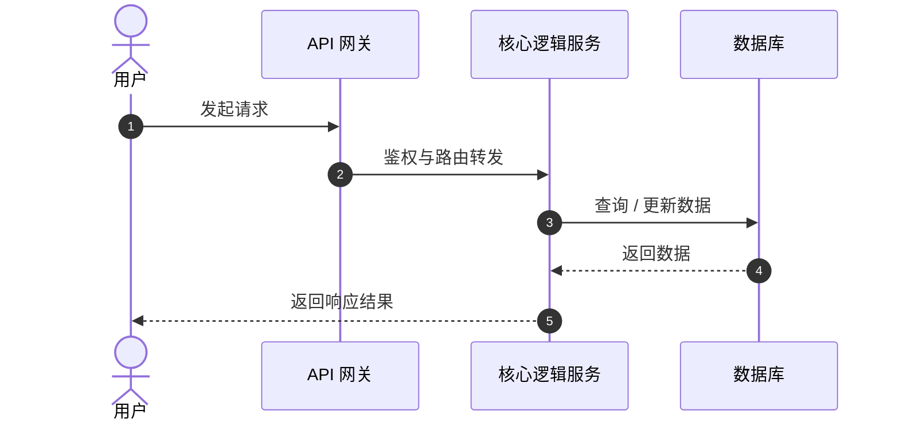

# [SPEC-000] <功能名称>

| 属性 | 内容 |
| :--- | :--- |
| **状态** | Draft / In Review / Approved / Implemented |
| **负责人** | @author |
| **创建时间** | YYYY-MM-DD |
| **更新时间** | YYYY-MM-DD |
| **关联 Issue/PR** | #000 |

---

## 1. 背景与目标 (Context & Objectives)


### 1.1 背景 (Context)
> 简要说明为什么要开发此功能，解决什么痛点或业务需求。

### 1.2 现状与差距分析 (Gap Analysis)
> 对比现有实现与当前能力缺口，说明引入该功能前后的差异（建议使用能力对比矩阵或量化数据支撑）。

| 能力维度 | 现行方案 A | 现行方案 B | 本期目标 (新方案) |
| :--- | :---: | :---: | :---: |
| **核心功能 1** | ✅ | ❌ | ✅ |
| **核心功能 2** | ❌ | ❌ | ✅ |

### 1.3 目标 (Goals)
- [ ] **Goal 1**: [核心功能点 1]
- [ ] **Goal 2**: [核心功能点 2]

### 1.4 非目标 (Non-Goals / Out of Scope)
> 明确本次迭代**明确不包含**的内容，防止需求范围膨胀（Scope Creep）。
- [ ] [本期暂不处理的功能 1]
- [ ] [未来版本再评估的需求 2]

---

## 2. 用户故事与验收标准 (User Stories & Acceptance Criteria)

### US-1: [用户故事标题]
**As a** [用户角色]  
**I want to** [完成什么操作/获得什么功能]  
**So that** [实现什么价值/解决什么问题]  

#### 验收标准 (Acceptance Criteria)
* **AC-1.1**: [当条件 A 发生时，系统必须做出响应 B]
* **AC-1.2**: [数据存储/安全性要求，例如：密码必须哈希存储]
* **AC-1.3**: [业务限制，例如：单个用户最多只能创建 5 个实例]

---

## 3. 技术方案设计 (Technical Design)

### 3.1 架构与数据流 (Architecture & Data Flow)


### 3.2 数据模型变更 (Data Model)

```sql
-- 新增/修改数据库表结构定义
CREATE TABLE example_table (
    id VARCHAR(36) PRIMARY KEY,
    user_id VARCHAR(36) NOT NULL,
    status VARCHAR(16) DEFAULT 'active',
    created_at TIMESTAMP DEFAULT CURRENT_TIMESTAMP,
    updated_at TIMESTAMP DEFAULT CURRENT_TIMESTAMP ON UPDATE CURRENT_TIMESTAMP
);

```

### 3.3 接口契约 (API Contracts)

#### `POST /api/v1/example-endpoint`

* **请求头 (Headers)**: `Authorization: Bearer <token>`
* **请求体 (Request Body)**:
```json
{
  "name": "string",
  "type": "standard"
}

```


* **成功响应 (201 Created)**:
```json
{
  "code": 0,
  "message": "success",
  "data": {
    "id": "res_123456",
    "created_at": "2026-10-07T15:00:00Z"
  }
}

```


---

## 4. 边界条件与异常处理 (Edge Cases & Error Handling)

| 场景描述 | 触发条件 | 预期处理逻辑 | 返回错误码 / HTTP 状态 |
| --- | --- | --- | --- |
| 参数合法性校验失败 | 格式错误/缺少必填字段 | 拒绝请求，记录警告日志 | 400 Bad Request |
| 未授权/Token 过期 | Header 未包含有效 Token | 拒绝请求 | 401 Unauthorized |
| 并发冲突 | 多个请求同时修改同一资源 | 乐观锁重试 / 提示冲突 | 409 Conflict |

---

## 5. 任务拆解与实施步骤 (Task Breakdown)

* [ ] **Phase 1: 数据层与契约定义**
* [ ] 编写 Migration 脚本更新数据库
* [ ] 定义 DTO / Interface 与实体模型


* [ ] **Phase 2: 核心业务逻辑实现**
* [ ] 实现 Service 层业务代码与校验机制
* [ ] 实现 API Endpoint 与中间件集成


* [ ] **Phase 3: 测试与验收**
* [ ] 针对 AC-1.1 ~ AC-1.3 编写单元测试
* [ ] 执行边界用例与集成测试

---

## 6. 风险与待决事项 (Risks & Open Questions)

> **模块说明**：本节用于系统性梳理当前方案在架构、实现、第三方依赖及业务边界上存在的潜在风险，并记录尚未完全敲定的待决事项（Open Questions），以便在评审和落地过程中逐一闭环。
> 💡 *提示：在填写时，若业务叙事或边界不清晰，务必先与相关方/用户进行确认，切忌盲目主观臆测。*

### 6.1 风险评估表 (Risk Register)

| 编号 | 风险 / 问题描述 | 潜在影响 | 缓解 / 规避方案 | 状态 / 负责人 |
| :--- | :--- | :--- | :--- | :--- |
| `[R-1]` | `[例如：外部依赖协议漂移/状态变更]` | `[未知状态触发重试/终态异常]` | `[状态归一化、瞬态重试预算、契约测试]` | `[待评估 / 已缓解]` |
| `[R-2]` | `[例如：提交阶段请求超时/孤儿任务]` | `[产生冗余数据或资源泄漏]` | `[唯一业务标识对账、明确重试边界]` | `[进行中 / 张三]` |
| `[R-N]` | `[描述具体的风险点]` | `[描述对系统、性能或业务的影响]` | `[具体的应对与降级策略]` | `[待处理 / 负责人]` |

---

### 6.2 待决事项 (Open Questions)

> **已闭环（划线/归档）：**
> * [x] ~~`[已决事项示例]`：`[原待决事项描述]`~~ 
>   * **决策结论**：`[说明最终采用的方案及依据，如：已由 Exporter 抽象解决]`

#### 1. 核心架构与契约 (Architecture & Contract)
* [ ] **`[待决事项编号]`**：`[例如：wait() 的 deadline 是否应改为必填，或提供基于 request_timeout 的默认总超时？(关联 R-3)]`
  * **现状 / 影响**：`[描述当前实现方式及可能带来的风险]`
  * **备选方案**：
    * **方案 A**：`[方案 A 描述及其优缺点]`
    * **方案 B**：`[方案 B 描述及其优缺点]`
  * **跟进人 / 期限**：`[负责人]` | `[预计完成日期]`

* [ ] **`[待决事项编号]`**：`[例如：是否提供按 data_id 对账/查询任务的封装，以缓解提交阶段结果未知造成的孤儿任务？(关联 R-2)]`

#### 2. 业务边界与扩展性 (Scope & Extensibility)
* [ ] **`[待决事项编号]`**：`[例如：是否支持批量任务/任务列表/删除接口？]`
  * **结论**：`[暂不纳入当前目标 / 待评估]`
* [ ] **`[待决事项编号]`**：`[例如：是否为结果下载增加可配置的 host 允许列表？(关联 R-14)]`

#### 3. 性能与解耦 (Performance & Modularization)
* [ ] **`[待决事项编号]`**：`[例如：是否把 MetricHook 从 client.py 抽到独立模块，避免反向导入？]`
* [ ] **`[待决事项编号]`**：`[例如：是否需要在 ExportedResult 中携带 Provider 的 task_id / data_id？]`